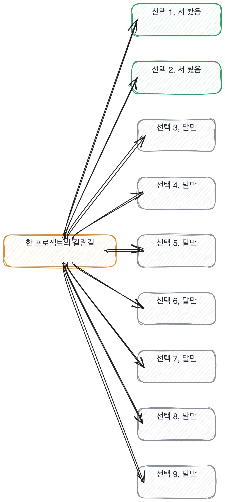
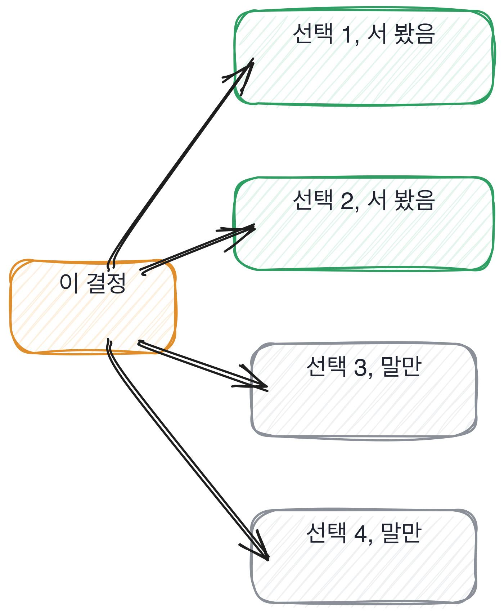
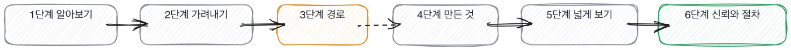
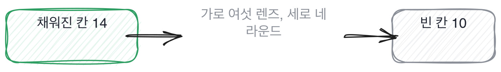
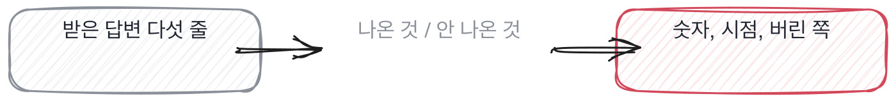

# 들어가며

## 2판에 부쳐

1판을 내고 나서 다시 읽다가 걸리는 장이 하나 있었습니다. 17장, 원격과 도구였어요.
감시 장비를 어떻게 볼지는 다뤘는데, 지금 지원자 상당수가 실제로 만들어 보는 것,
에이전트를 도구와 묶어 쓰는 경험을 가리는 질문이 없었습니다.

그래서 2판에서 17장을 통째로 바꿨습니다. 도구를 묶어 쓰다 실패한 자리, 추론을 더
시킬지 끊을지 정한 경계, 에이전트에게 어디까지 맡겼는지. 이 세 칸으로요.
전에 다루던 원격 면접 이야기 중 남길 가치가 있는 것은 다음 장의 질문 하나에 그대로
옮겨 뒀습니다.

표지의 질문 61개는 그대로 뒀습니다. 장을 늘리는 대신 가장 작고 바꿔도 흐름이 안 깨지는
장을 골라 바꿨어요. 질문집은 쌓아 두는 책이 아니라 쓰는 책이라, 낡은 질문을 들고
있는 것보다 바꾸는 쪽이 낫다고 판단했습니다.

이런 면접이 있습니다. 45분 동안 지원자가 막힘없이 답합니다.
용어가 정확하고 순서가 매끄럽고 예시까지 붙어요. 묻는 쪽은 고개를 끄덕이며 메모를 하고,
끝나고 나서 좋았다고 말합니다. 그리고 몇 달 뒤에 같은 팀에서 이런 장면이 나옵니다.
무엇을 봤느냐고 물었는데 답이 안 나오는 자리요.
로그를 어디서 보는지 몰라서가 아니라, 지금 무엇이 이상한지를 말로 못 옮기는 상태입니다.

이 책은 그 두 장면 사이를 봅니다. 면접에서 통과한 답과 현장에서 나온 답이 왜 다른가.
만드는 자리에 오래 있어 본 사람이라면 그 간격이 눈에 익을 겁니다.
읽어서 아는 것과 해서 아는 것은 결과가 나오는 자리에서 갈라지는데,
면접장에서는 그 둘이 같은 문장으로 나옵니다.

그래서 이 책은 두 자리에서 정리했습니다. 하나는 실무자의 자리예요.
무엇을 실제로 해 봐야 알 수 있고 무엇은 읽으면 알 수 있는지, 그건 해 본 사람이 압니다.
다른 하나는 면접의 두 자리고요. 묻는 쪽에서 무엇이 확인되는지, 받는 쪽에서 무엇을 보일 수 있는지.
그 셋을 겹쳐 놓고 남는 질문만 예순한 개로 추렸습니다.

면접 기록을 다시 꺼내 보면 대개 같은 것이 보입니다.
물었던 질문 중에 **실제로 해 봐야만 답할 수 있는 것**이 몇 개였느냐요.
그 수가 0이면 그날 본 것은 그 사람이 아니라 그 사람이 읽은 것입니다.

## 이 책이 하는 약속

이 책은 다섯 가지를 약속합니다. 지키지 못하면 그 자리를 비워 두겠습니다.

1. 질문마다 **판정 기준**이 붙습니다. 이러면 통과, 이러면 안 보냄
2. 질문마다 **꼬리 질문 한 줄**이 붙습니다. 그 자리에서 그대로 읽으면 됩니다
3. 답변 표본은 **실제로 받은 것**입니다. 지어낸 나쁜 답변을 싣지 않습니다
4. 잘 답한 표본도 같은 밀도로 싣습니다. 떨어뜨리는 법만 배우면 아무도 못 뽑아요
5. 물으면 안 되는 것을 먼저 못 박습니다. 파고드는 법과 선을 넘는 것은 다릅니다

## 왜 지금인가

예전에도 준비해 오는 지원자는 있었어요. 그런데 준비의 값이 달라졌습니다.
전에는 준비하는 데 시간이 들었고, 그 시간이 곧 신호였어요.
알고리즘 문제를 삼백 개 풀어 온 사람은 적어도 삼백 문제만큼 앉아 있었던 거죠.

지금은 그 시간이 거의 0이에요. 어떤 주제든 30초면 잘 정리된 답이 나옵니다.
문장이 매끄럽고 용어가 정확하고 예시까지 붙어서요.
그래서 면접장에서 벌어지는 일이 이렇게 바뀌었어요.
**모르는 사람과 아는 사람이 똑같이 말해요.**

여기서 오해 하나를 먼저 걷어낼게요. 이건 지원자를 탓하는 이야기가 아니에요.
도구가 있는데 안 쓰는 사람이 이상한 거예요. 저도 씁니다.
문제는 우리가 쓰던 질문이 **말할 수 있는가**를 재도록 만들어져 있다는 거고,
그 잣대가 이제 아무것도 안 가른다는 겁니다.

> **현장에서는**
>
> 어떤 팀은 코딩 테스트 통과율이 한 해 만에 두 배가 됐는데 최종 합격자 수는 그대로였어요.
> 거른 게 아니라 거르는 척한 라운드가 하나 늘어난 겁니다.

## 이 책의 한 문장

그래서 이 책은 처음부터 끝까지 한 가지를 합니다.

> **quotebox**
>
> **답을 듣지 마세요. 안 고른 쪽을 물으세요.**



위 그림에서 색이 든 둘만 이 사람이 실제로 서 본 자리입니다. 나머지 일곱은 말로만 압니다.
아홉이라는 수는 제가 세어 본 프로젝트들에서 나온 어림이고, 이유를 대는 건 대개 둘이나 셋이에요.
그 일곱 자리를 물어보면 그때부터 답이 달라집니다.

해 본 사람은 자기가 버린 선택지를 말할 수 있어요. 그게 아직 몸에 남아 있거든요.
청크 크기를 512로 잡았다면 그 전에 256을 써 봤고, 왜 바꿨는지 숫자로 기억합니다.
읽고 온 사람은 512만 말합니다. 512가 정답으로 적혀 있었으니까요.

이 차이가 실력의 차이는 아니에요. **지나온 경로의 차이**입니다.
그리고 경로는 말투로 안 드러나고 질문으로 드러납니다.

한 프로젝트에 갈림길이 몇 개였는지 세어 보세요. 대개 아홉이나 열입니다.
그중 지원자가 이유를 대는 건 둘이나 셋이에요. 나머지 일곱은 남이 정한 걸 받아 쓴 거고요.
그 일곱을 아는 것이 이 책이 파는 전부입니다.



위 그림에서 초록은 실제로 서 본 갈림길이고 회색은 말만 아는 갈림길이에요.
이 책의 그림에서 **회색이 주인공**입니다.
관문이 넘어갈수록 회색이 줄어드는 게 눈에 보여야 하고, 안 줄어들면 제가 잘못 쓴 거예요.

## 칸 한 장은 이렇게 생겼습니다

이 책의 단위는 장이 아니라 칸입니다. 칸 하나가 면접 동작 하나예요.
30초 안에 끝나는 동작 하나. 그게 이 책의 최소 단위입니다.

칸은 늘 같은 순서로 흘러갑니다. 먼저 낱말 두셋을 한 줄로 풀고,
받은 답변을 그대로 보여드려요. 그리고 한 줄 묻습니다. 무엇이 비어 있을까요.
바로 답을 드리지 않고 한 칸을 띄웁니다. 여러분이 짚어 보시라고요.

그다음에 같은 답변에 표시를 찍은 걸 보여드립니다.
여러분이 짚은 자리와 제가 찍은 자리를 대조하는 순간, 그게 이 책의 학습 단위예요.
문제를 풀어서 배우는 게 아니라 짚어 보고 대조해서 배웁니다.
그래서 이 책에는 연습문제가 없어요.

마지막이 판정입니다. 이러면 통과, 이러면 다음 라운드로 안 보냄.
그리고 꼬리 질문 한 줄. 그 자리에서 그대로 읽으시면 됩니다.

> **물을 문장 둘**
>
> 그 숫자를 그렇게 잡으신 이유가 있을까요. 그 전에는 뭘 써 보셨어요?

## 먼저 자기 진단부터

지금 잡혀 있는 면접이 하나 있다고 치죠. 없으면 마지막으로 본 면접이어도 됩니다.
그 면접 하나에 대고 아래 열 개에 예 아니오로 답해 보세요.
답은 팀 전체가 아니라 **그 면접 하나**를 두고 답합니다.

- **1.** 무엇을 확인하려고 그 질문을 넣었는지 문장으로 적어 두었나요
- **2.** 같은 자리에 지원한 두 사람에게 같은 질문을 하나요
- **3.** 검색해서 30초면 나오는 질문이 절반을 넘지 않나요
- **4.** 지원자가 실제로 만든 것 하나를 30분 이상 파고드나요
- **5.** 버린 선택지를 묻는 질문이 하나라도 있나요
- **6.** 되돌린 경험을 묻는 질문이 하나라도 있나요
- **7.** 좋아졌다는 주장에 무엇으로 쟀는지 되묻나요
- **8.** 통과 기준을 면접 전에 적어 두나요
- **9.** 디브리프에서 누가 먼저 말할지 정해 두었나요
- **10.** 물으면 안 되는 것 목록을 면접관 모두가 알고 있나요

예가 일곱 개 아래면 이 책의 1단계부터 순서대로 보시는 게 빠릅니다.
여덟 이상이면 3단계로 건너뛰셔도 돼요. 그 앞은 이미 하고 계신 겁니다.

저는 처음 이 열 개를 만들었을 때 제 면접에 대고 답해 봤어요. 넷이었습니다.
15년 넘게 면접을 봐 온 사람의 점수가 넷이었어요.
그래서 이 책을 쓰기 시작했습니다.

## 여섯 렌즈와 관문 지도

이 책은 지원자를 여섯 각도에서 봅니다. 기초, 만들기, 평가, 판단, 운영, 사람.
한 번에 하나씩만 씁니다. 여섯을 동시에 보면 하나도 못 보거든요.
렌즈는 점검표가 아니라 순서예요. 기초가 먼저고 사람이 마지막입니다.



여섯 단계로 갑니다. 앞의 두 단계는 귀를 만드는 구간이에요.
매끄러운 답이 어떻게 생겼는지 익히고, 질문을 고쳐 쓰는 법을 배웁니다.

3단계가 이 책의 척추입니다. 결정을 세고 버린 쪽을 묻는 자리요.
여기까지만 하셔도 다음 면접이 달라집니다.

4단계부터가 AI 엔지니어 특화 구간이에요. 데이터, 모델, 검색, 코드를 하나씩 봅니다.
네 자리에서 묻는 것이 서로 다르고, 어느 자리를 안 물었는지가 그대로 남습니다.

5단계는 평가와 설계와 운영과 안전이고, 6단계는 이 전부를 팀의 절차로 옮기는 이야기예요.
혼자 잘 묻는 것으로는 팀이 안 바뀌거든요. 옆자리 면접관이 다른 걸 물으면
그 지원자 판정은 두 사람의 취향 차이로 끝납니다.



위 격자는 여섯 렌즈와 네 라운드를 곱한 스물넷입니다.
칠해진 칸이 실제로 물은 자리예요. 대부분의 팀이 열 몇 칸에서 멈춥니다.
스물넷을 다 채우라는 얘기가 아니에요. **어디가 비었는지 알고 비워 두라는 얘기**입니다.

## 이 책이 60번 다시 보는 과제 하나

이 책에는 예제가 딱 하나 나옵니다. 사내 문서를 넣으면 답을 찾아 주는 작은 검색 서비스예요.
문서를 조각으로 자르고, 질의에 가까운 조각을 고르고, 그걸로 답을 만들고, 마지막에 좋아졌는지를 잽니다.
AI 엔지니어가 실제로 하는 일의 축소판이라 골랐습니다.

```python
def split(doc_id: str, text: str, size: int = 120, overlap: int = 20) -> list[Chunk]:
    """글자 수로 자른다. 겹치는 길이만큼 뒤로 물러나며 자른다."""
    if size <= 0:
        raise ValueError("size must be positive")
    if not 0 <= overlap < size:
        raise ValueError("overlap must be in [0, size)")

    body = text.strip()
    if not body:
        return []

    step = size - overlap
    chunks: list[Chunk] = []
    start = 0
    while start < len(body):
        piece = body[start : start + size]
        chunks.append(Chunk(doc_id=doc_id, index=len(chunks), text=piece))
        start += step
    return chunks
```

관문마다 새 예제를 만들지 않아요. 이 코드가 조금씩 자랍니다.
라이브 코딩 과제도 여기서 나오고, 디버깅 과제도 여기서 나오고,
설계 질문도 이 서비스의 규모를 열 배로 올리면서 나옵니다.
여러분이 이 코드를 60번 다시 보게 되는 것이 이 책의 구조예요.

받아서 그대로 돌려 보실 수 있습니다. 바깥 라이브러리를 하나도 안 씁니다.
그리고 그대로 여러분 회사 과제로 쓰셔도 됩니다. 그러라고 조건을 느슨하게 풀었어요.

## 물으면 안 되는 것

이 책은 파고드는 법을 가르칩니다. 그래서 선부터 긋고 시작할게요.

아래는 안 묻습니다.

- 나이, 그리고 나이를 알 수 있는 것
- 결혼과 출산 계획, 가족 관계와 재산
- 출신 지역, 종교, 정치 성향
- 병력과 장애, 성적 지향
- 병역 면제 사유

이유는 셋입니다. 직무와 상관이 없고, 물어서 얻는 것이 없고,
묻는 순간 이 책이 가르치는 절차가 통째로 무의미해져요.

국내 법도 직무와 무관한 개인 정보를 채용 과정에서 수집하는 것을 제한하고 있어요. [확립]
자세한 것은 부록 한 쪽에 정리해 뒀어요.
다만 이 책은 법률 자문이 아니고, 적용되는 법과 관행은 나라와 시점에 따라 다릅니다.

에둘러 묻는 것도 같이 막습니다.
졸업 연도를 물어 나이를 재거나, 주말에 주로 뭐 하시냐고 물어 종교를 재거나,
집이 어디냐고 물어 출신을 재는 것요.

**에둘러 물은 것도 물은 겁니다.**

이게 손해처럼 느껴지실 수도 있어요. 저도 그랬습니다.
그런데 저 목록을 다 지우고 나서 제 면접이 더 좋아졌어요.
빈 시간을 만든 것 하나 더 파고드는 데 썼거든요. 그쪽이 훨씬 많이 알려줍니다.

> **저자의 삽질**
>
> 야근 가능하냐는 질문이 아직도 나옵니다. 그런데 이 질문으로 알아낼 수 있는 건 없어요.
> 다들 가능하다고 답하거든요. 답이 하나로 정해진 질문은 묻는 사람만 물었다고 느낍니다.

## 이 책을 읽는 법

먼저 이 책이 답변을 어떻게 다루는지를 한 장으로 보여드릴게요.
왼쪽이 그대로 받은 것이고 오른쪽이 그 답변에서 안 나온 것입니다.
이 두 칸을 나란히 놓는 것이 이 책이 예순한 번 반복하는 동작이에요.



순서대로 읽으시는 게 가장 빠릅니다. 뒤의 칸이 앞의 칸으로만 만들어져 있거든요.
15장에서 갑자기 튀어나오는 기법은 없습니다. 그건 제가 스스로에게 건 규칙이고,
어기면 빌드가 멈추게 해 뒀어요.

급하시면 세 곳만 먼저 보셔도 됩니다.
7장의 결정 세기, 13장의 평가, 그리고 부록의 질문지 한 장.
그 셋만으로도 다음 면접이 달라집니다. 나머지는 그다음에 채우시면 돼요.

읽다가 안 맞는 이야기가 나오면 그 자리에 표시해 두세요.
저는 이 책에서 여러 번 틀릴 겁니다. 관문마다 제가 확신 못 하는 걸 따로 적어 두었으니
거기부터 의심하시면 됩니다.

> **현장에서는**
>
> 저는 면접 기록을 반년 뒤에 다시 꺼내 봅니다. 그때 무슨 근거로 통과시켰는지 읽히는 기록이 절반이 안 됩니다.
> 나머지 절반에는 좋은 인상이라고만 적혀 있어요.

속는 자리를 둘 미리 짚고 갑니다. 이 책 전체가 이 둘에서 시작하거든요.
하나는 낱말이 맞아서 속는 자리이고, 다른 하나는 답이 길어서 속는 자리입니다.

> **여기서 다들 속는다**
>
> 용어를 정확하게 쓰면 아는 사람처럼 들립니다. 낱말이 맞으니까요.
> 그런데 낱말은 읽으면 외워지고, 외운 낱말과 써 본 낱말은 소리가 같습니다.
> 그래서 이 책은 낱말을 안 세고 숫자와 시점을 셉니다.
> 확인은 한마디면 됩니다. 그 값을 그렇게 잡으신 이유가 뭐냐고 물어보세요.

둘째는 첫째와 반대쪽에서 옵니다. 낱말이 아니라 길이에 속는 자리요.

> **여기서 다들 속는다**
>
> 답이 길고 조리 있으면 준비를 많이 한 사람으로 보입니다. 실제로 그렇기도 하고요.
> 문제는 준비의 양과 해 본 양이 이제 따로 논다는 겁니다.
> 길이는 도구가 늘려 주고 해 본 것은 안 늘려 주거든요.
> 확인은 짧게 답하게 하면 됩니다. 한 문장으로 말해 달라고 해 보세요.

면접장에서 제일 자주 쓰실 것은 아래 다섯 줄입니다. 첫 라운드 30초에 훑는 것들이에요.
다섯을 다 채우는 사람은 드물고, 셋이면 다음 라운드로 보냅니다.

> **30초 점검**
>
> 답변 다섯 줄 안에 숫자나 시점이 하나라도 나오는가.
> 버린 선택지를 말하는가.
> 남의 일과 자기 일이 갈려 있는가.
> 지금 안 풀린 것을 말하는가.
> 모른다는 말이 한 번이라도 나오는가.

채용 현장에서 쓰는 말도 같이 익혀 두시면 좋습니다. 팀에서 이야기할 때 필요한 어휘예요.
면접 동작은 아닌데, 이 말이 없으면 같은 이야기를 매번 길게 설명해야 합니다.
관문마다 두세 개씩 흘려 두고 부록 용어집에 모았습니다.

> **채용 말 배우기**
>
> **라운드** 면접 한 번을 말합니다. 45분짜리 하나가 한 라운드예요.
>
> **디브리프** 면접이 끝나고 면접관들이 모여 판정을 맞추는 자리를 말합니다.
>
> **시그널** 면접에서 얻은 판단 근거 하나를 말해요. 인상이 아니라 근거를 셀 때 씁니다.

이 책은 옛 관행을 하나씩 다시 재 봅니다. 그대로 유효한지, 조정하면 되는지, 이제 안 맞는지요.
관문마다 하나씩 놓고, 부록에 성적표로 모았습니다. 판정 옆에는 근거를 한 줄 붙였고요.
대부분 제 경험입니다. 경험을 근거라고 적는 건 정직한 거고, 원칙인 척 적는 게 문제라서 그렇게 적었어요.

> **옛 규칙은 아직 유효한가**
>
> **면접 앞에 예상 질문을 준비해 오게 하는 관행.** 판정은 조정해서 유효입니다.
> 근거는 제 경험이에요. 준비 자체는 여전히 좋은 신호인데, 준비의 값이 싸져서 변별이 안 됩니다.
> 그래서 저는 준비해 온 것을 묻는 대신 **준비하면서 못 채운 자리**를 묻습니다.
> 못 채운 자리는 준비할수록 더 선명해져서, 성실히 준비한 사람에게 오히려 유리합니다.

관문마다 마지막에 긴 이야기를 하나씩 둡니다. 급할 때는 건너뛰셔도 되는 자리예요.
나머지가 다 짧고 빡빡해서 한 군데는 늘어질 자리가 필요하더라고요.
첫 이야기는 우리가 지금 하는 이 절차가 어디서 왔는지입니다.

> **쉬어 가기**
>
> **쉬어 가기: 면접이라는 절차는 어디서 왔나**
>
> 지금 우리가 아는 형태의 면접은 생각보다 오래되지 않았습니다.
> 사람을 뽑을 때 앉혀 놓고 물어보는 일이야 늘 있었지만,
> 같은 질문을 정해 놓고 여러 후보에게 똑같이 묻는 방식은 20세기에 자리를 잡았어요.
> 그전에는 대개 아는 사람의 소개였습니다. 누가 데려왔느냐가 판정이었죠.
>
> 소개로 뽑는 방식에는 확실한 장점이 있었습니다. 이미 같이 일해 본 사람의 관점이 들어가니까요.
> 지금 레퍼런스 확인이 남아 있는 이유가 그겁니다. 그 시절 방식의 마지막 조각이에요.
> 문제는 소개가 닿는 범위가 좁다는 것이었습니다. 아는 사람의 아는 사람까지만 갑니다.
>
> 그래서 공고를 내고 모르는 사람을 부르기 시작했는데, 그때 새 문제가 생겼습니다.
> 모르는 사람을 45분에 어떻게 아느냐는 문제요. 이 문제는 아직 안 풀렸습니다.
> 지난 백 년 동안 나온 방법들이 전부 이 문제에 대한 답이었고, 이 책도 그중 하나입니다.
>
> 그러니까 우리가 지금 겪는 어려움은 새로운 게 아니에요. 조건 하나가 바뀐 겁니다.
> 모르는 사람이 아는 사람처럼 말할 수 있게 됐다는 조건이요.
> 바뀐 조건 하나에 맞춰 방법을 고치는 것, 그게 이 책이 하는 일 전부입니다.

여기까지가 이 책을 여는 이야기입니다. 다음 쪽부터 첫 칸이에요.
한 칸이 두세 쪽이고 30초짜리 동작 하나를 담습니다. 하루에 한 칸씩 읽으셔도 됩니다.
순서대로 읽으시면 뒤 칸이 앞 칸을 딛고 서는 게 보이고, 급하시면 목차에서 골라 펴셔도 됩니다.

> **한 관문 요약**
>
> 읽은 것과 해 본 것은 말투로 안 갈립니다. 질문으로 갈립니다.
>
> 한 프로젝트의 갈림길은 열 개 안팎이고, 그중 이유를 대는 건 둘이나 셋입니다.
>
> 이 책의 단위는 칸이고, 칸 하나가 30초짜리 동작 하나입니다.
>
> 다음 관문에서 뒤집히는 것. 매끄러운 답은 나쁜 신호가 아니라 아무 신호도 아닙니다.

> **이 판정이 헐거운 지점**
>
> 매끄러운 답이 아무 신호도 아니라는 말은 조금 셉니다. 말을 정리해서 하는 능력은 실제로 쓸모가 있어요.
>
> 자기 진단 열 문항의 기준선을 일곱으로 잡은 건 제 감입니다. 근거가 있는 숫자가 아니에요.
>
> 이 책은 지원자가 도구를 쓴다는 전제로 쓰였습니다. 안 쓰는 자리도 아직 있습니다.
