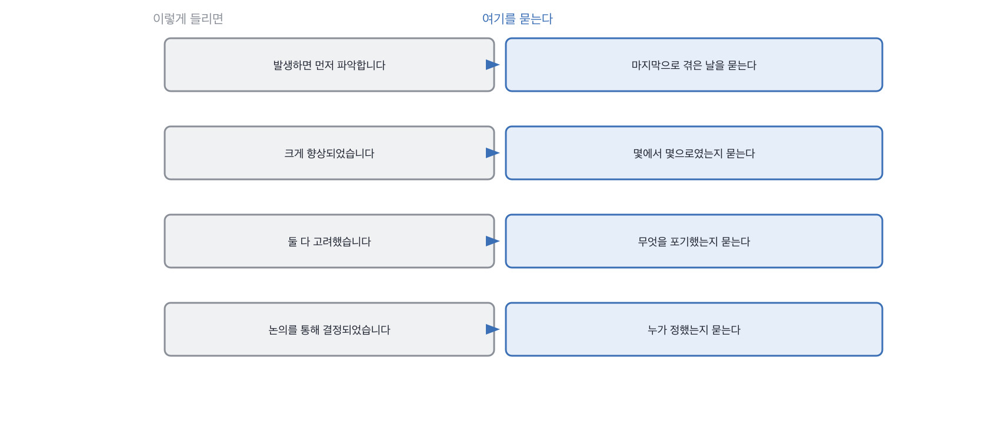

# 1.2 외운 답의 버릇 열 가지

*[1.1](q001.md) 에서 숫자를 셌죠. 이제 숫자 말고 문장의 모양을 봅니다.*

> **이 말부터**
>
> **버릇** 준비해 온 답에서 반복해서 나타나는 문장의 모양을 말합니다. 잘못이 아니라 신호예요.
> **절차 서술** 겪은 일을 말하는 대신 해야 하는 일을 순서대로 말하는 것을 가리킵니다.

숫자를 세는 것만으로도 절반은 걸립니다. 그런데 숫자를 넣어서 준비해 오는 분도 있어요.
그럴 때 남는 건 문장의 모양이에요. 준비된 답은 모양이 비슷합니다.
같은 자료를 보고 왔거나 같은 도구로 정리했으니까요.

저는 표본을 모으면서 이 모양을 열 가지로 줄였습니다.
이걸 외우실 필요는 없어요. 두어 개만 귀에 붙어도 나머지가 같이 걸립니다.

- **.** 버릇 이렇게 들립니다
- **1.** 절차 서술 발생하면 먼저 파악합니다
- **2.** 가정법 도입하면 대응할 수 있습니다
- **3.** 부사로 때우기 크게, 많이, 효과적으로
- **4.** 양쪽 다 고려 성능과 비용을 모두 고려했습니다
- **5.** 중요합니다로 닫기 지속적인 개선이 중요합니다
- **6.** 배웠습니다로 닫기 많은 것을 배울 수 있었습니다
- **7.** 남들 이야기 실무에서는 많이 사용합니다
- **8.** 태도 표명 저는 경청하려고 노력합니다
- **9.** 시점 없음 초기에는, 나중에는
- **10.** 주어 흐리기 논의를 통해 결정되었습니다

버릇이 보이면 그다음이 정해져 있습니다. 모양마다 파고들 자리가 다르거든요.

> **이렇게 답합니다**
>
> 가장 어려웠던 점은 검색 정확도를 높이는 것이었습니다.
> 초기에는 관련 없는 문서가 검색되는 경우가 많았습니다.
> 이를 해결하기 위해 청킹 전략을 개선하고 하이브리드 검색을 도입했습니다.
> 키워드 검색과 벡터 검색을 결합하여 정확도를 크게 향상시켰습니다.
> 또한 재순위 모델을 적용하여 최종 결과의 품질을 높였습니다.
> 이 과정에서 검색 시스템에 대해 많은 것을 배울 수 있었습니다.

이 답변, 무엇이 비어 있을까요. 이번엔 숫자가 아니라 모양을 보세요.

> **표시해 보면**
>
> 가장 어려웠던 점은 검색 정확도를 높이는 것이었습니다.
> 초기에는 관련 없는 문서가 검색되는 경우가 많았습니다.
>     ← 많았다가 얼마나였는지 없음
> 이를 해결하기 위해 청킹 전략을 개선하고 하이브리드 검색을 도입했습니다.
> 키워드 검색과 벡터 검색을 결합하여 정확도를 크게 향상시켰습니다.
>     ← 크게 향상이 몇에서 몇으로인지 없음
> 또한 재순위 모델을 적용하여 최종 결과의 품질을 높였습니다.
>     ← 적용했다는 말만 있고 무엇이 바뀌었는지 없음
> 이 과정에서 검색 시스템에 대해 많은 것을 배울 수 있었습니다.
>     ← 배웠다로 닫는 문장은 이 답의 마지막 세 줄을 요약만 함

여섯 줄에 버릇이 넷 들어 있어요. 많았다와 크게 향상은 3번이고,
적용하여 품질을 높였다는 4번에 가깝고, 마지막 줄은 6번입니다.
이 답변이 나쁜 건 아니에요. 실제로 저 셋을 다 했을 수도 있습니다.
다만 **했다는 것과 효과가 있었다는 것이 한 문장에 붙어 있어서** 구분이 안 됩니다.

> **이렇게 파고듭니다**
>
> 물음: 하이브리드로 바꾸기 전과 후를 무엇으로 비교하셨어요?
>
> 답: 정성적으로 확인했습니다. 팀원들이 써 보고 확실히 나아졌다고 했어요.

정성적으로 확인했다는 답이 나오면 거기서 멈추지 마세요. 그것도 방법이거든요.
다만 한 번 더 물어야 합니다. 누가, 몇 개를, 언제 봤는지요.
해 본 사람은 여기서 갑자기 구체적이 됩니다.

> **해 본 사람의 답**
>
> 제일 어려웠던 건 나아졌는지를 재는 일이었어요.
> 검색이 이상하다는 말은 매주 나오는데, 무엇이 이상한지가 사람마다 달랐거든요.
> 그래서 사내 슬랙에서 실패한 질문 120개를 모아서 정답 문서를 손으로 붙였습니다.
> 이틀 걸렸어요. 그거 만들고 나서야 하이브리드가 실제로 도움이 되는지 볼 수 있었습니다.
> 결과는 좀 애매했어요. 상위 5개 정확도는 0.66에서 0.74로 올랐는데,
> 키워드 쪽 가중치를 올리니까 오타가 있는 질문에서 오히려 나빠졌습니다.
> 지금은 질의 길이로 가중치를 나눠 쓰고 있고, 이게 맞는지는 아직 모르겠습니다.

이 답에서 제일 좋은 줄은 마지막 줄이에요. 지금도 모르겠다는 문장요.
버릇 목록의 반대편에는 늘 이런 문장이 있습니다. **아직 안 끝난 것을 말하는 문장이요.**
준비된 답은 끝난 것만 말합니다. 끝나야 요약이 되니까요.

> **한 번 더**
>
> 지연 이야기에서는 버릇 1번과 2번이 이렇게 나옵니다.
> 응답 지연이 발생하면 먼저 병목 지점을 파악합니다.
> 검색 단계인지 생성 단계인지 구분하는 것이 중요합니다.
> 검색이 느리다면 인덱스 구조나 쿼리를 최적화합니다.
> 생성이 느리다면 스트리밍을 적용하거나 더 작은 모델을 고려합니다.
> 캐싱을 도입하면 반복되는 질의에 대해 효과적으로 대응할 수 있습니다.
> 모니터링을 통해 지속적으로 개선해 나가는 것이 중요합니다.
> 발생하면으로 열고 도입하면으로 이어요. 겪은 일이 아니라 절차를 말한 겁니다.

버릇 목록을 손에 들고 나면 반대 방향이 궁금해집니다. 버릇이 안 보이면 그건 좋은 답일까요.
꼭 그렇지가 않아요. 안 보이는 이유가 하나 더 있거든요.
그 이유가 이 관문에서 제일 자주 속는 자리입니다.

> **여기서 다들 속는다**
>
> 저 표의 열 가지 중 어느 것도 그 자체로 탈락 사유가 아닙니다.
> 잘 정리해서 말하는 사람의 답에도 절반은 들어 있어요.
> 버릇은 판정이 아니라 **어디를 파고들지 알려주는 표시**입니다.
> 버릇이 보이는 문장 하나를 골라 그 자리만 파세요.

이 다섯 중 몇 개가 보이는지로 판정을 나누지 마세요. 개수는 파고들 자리를 정할 때 쓰고,
판정은 파고든 뒤에 나온 것으로 냅니다.

> **판정**
>
> 버릇이 보이는 자리를 파고들었을 때 시점이나 숫자가 딸려 나오면 통과입니다.
> 버릇이 몇 개 보였는지는 판정에 안 씁니다. 버릇은 어디를 팔지 정해 줄 뿐이에요.
>
> 파고들 때마다 다른 버릇으로 옮겨 가면 안 보냅니다.
> 세 번 옮겨 가면 그때는 확인할 것이 안 남습니다.
>
> 디브리프에는 이렇게 적습니다. 버릇이 넷 보였고, 비교 방법을 되물었더니
> 정성적으로 확인했다고 답했고, 표본 수와 시점은 끝까지 안 나왔다.

> **물을 문장 둘**
>
> 가장 어려웠던 점을 물으면 정리가 끝난 이야기가 나옵니다.
> 그래서 오래 안 풀린 것 쪽으로 돌립니다. 안 풀린 일에는 날짜가 붙어 있거든요.
>
> **그대로 읽으세요.** *그 프로젝트에서 제일 오래 안 풀린 게 뭐였어요? 며칠쯤 걸렸어요?*
>
> **답을 받으면 이어서.** *그거 바꾸기 전과 후를 무엇으로 비교하셨어요? 누가 봤어요?*

버릇이 몇 개였는지도 같이 적어 둡니다. 숫자로 적어 두면 다음 지원자와 견줄 수 있어요.
인상은 견줄 수가 없습니다. 매끄러웠다는 기록은 두 사람을 나란히 놓을 때 아무 일도 안 합니다.

> **이걸 놓치면**
>
> 버릇을 못 알아보면 [1.5](q005.md) 의 30초 판정에서 볼 자리가 안 정해집니다.

