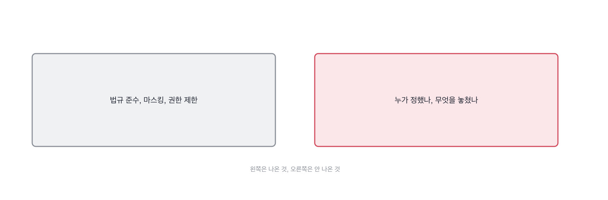

# 1.3 물은 것과 받은 것을 나란히

*[1.2](q002.md) 에서 버릇을 봤죠. 이번엔 답 하나만 보지 말고 물음과 같이 봅니다.*

> **이 말부터**
>
> **비껴가기** 답이 질문 옆에 있는 더 쉬운 물음에 답하는 것을 말합니다. 거짓말과는 다릅니다.
> **되돌아오기** 비껴간 답을 원래 물음으로 다시 데려오는 것을 말해요. 면접관이 하는 일입니다.

면접 기록을 나중에 다시 읽어 보면 이상한 게 하나 보입니다.
답변만 적어 놨을 때는 다 괜찮아 보이는데, 질문을 같이 놓고 보면
절반쯤이 **다른 물음에 답하고 있어요.** 답은 훌륭한데 물은 게 그게 아닌 겁니다.

이건 속이려는 게 아닙니다. 모르는 물음이 오면 사람은 자동으로 아는 물음으로 옮겨 가거든요.
저도 합니다. 그래서 이 동작은 지원자를 잡는 동작이 아니라
**내가 무엇을 못 물었는지 확인하는 동작**에 가깝습니다.
비껴간 답의 절반은 제가 흐리게 물어서 생긴 것이더라고요.

> **이렇게 물었습니다**
>
> 이 서비스에서 개인정보는 어떻게 다루셨어요?

이렇게 물으면 대개 이런 답이 옵니다.

> **이렇게 답합니다**
>
> 개인정보 보호는 매우 중요한 사안입니다.
> 저희는 관련 법규를 준수하며 데이터를 처리했습니다.
> 민감한 정보는 마스킹 처리하고 접근 권한을 제한했습니다.
> 로그에도 개인정보가 남지 않도록 주의했습니다.
> 정기적으로 보안 점검을 실시하여 안전성을 확보했습니다.

물음은 어떻게 다뤘느냐였는데 답은 무엇이 중요하냐로 시작합니다. 한 칸 비껴간 거예요.
그리고 한 칸 비끼면 그 뒤 문장은 전부 그 칸 위에 쌓입니다.
그래서 뒤로 갈수록 답이 정연해지는데, 정연해질수록 원래 물음에서는 멀어져요.

> **표시해 보면**
>
> 개인정보 보호는 매우 중요한 사안입니다.
>     ← 중요하다는 말로 여는 것은 물음에 대한 답이 아님
> 저희는 관련 법규를 준수하며 데이터를 처리했습니다.
> 민감한 정보는 마스킹 처리하고 접근 권한을 제한했습니다.
>     ← 무엇을 민감으로 봤는지, 누가 정했는지 안 나옴
> 로그에도 개인정보가 남지 않도록 주의했습니다.
>     ← 주의했다는 것은 절차가 아니라 마음가짐임
> 정기적으로 보안 점검을 실시하여 안전성을 확보했습니다.
>     ← 정기가 얼마나인지, 누가 하는지 안 나옴

표시가 붙은 자리를 보면 공통점이 있어요. 전부 **주어가 없습니다.**
누가 민감으로 정했는지, 누가 점검하는지가 안 나오죠.
개인정보 이야기에서 주어가 없으면 그건 대개 아무도 안 정한 겁니다.
정한 사람이 있으면 그 사람 이야기가 같이 나오거든요. 법무팀이든 팀장이든요.

> **이렇게 파고듭니다**
>
> 물음: 마스킹 규칙은 누가 정하셨어요? 놓친 게 나온 적은요?
>
> 답: 팀 내부에서 논의해서 정했습니다. 특별히 문제가 된 적은 없었던 것 같습니다.

문제가 된 적이 없었던 것 같다는 답은 두 가지 중 하나예요.
정말 없었거나, 있었는데 못 본 겁니다. 그 둘은 아주 다른데 말로는 똑같이 나오죠.
그래서 이 자리에서 한 번 더 묻습니다. 있었다면 어떻게 알 수 있었겠느냐고요.
알아차릴 장치를 대는 사람과 그냥 없었다고 하는 사람이 여기서 갈립니다.

> **해 본 사람의 답**
>
> 문서 자체에 사람 이름이 들어 있는 게 문제였어요. 인사 공지 같은 것들요.
> 법무팀에 물어서 사내 공개 범위가 이미 전사인 문서만 색인하기로 정했습니다.
> 그 기준으로 4천 건 중에 300건쯤이 빠졌어요.
> 로그는 질의 원문을 안 남기고 해시만 남겼는데, 이건 나중에 후회했습니다.
> 검색이 왜 실패했는지 볼 수가 없더라고요. 지금은 30일만 원문을 두고 지웁니다.
> 한 번 놓친 것도 있어요. 첨부 파일 안의 표에 연락처가 있었는데
> 텍스트 추출이 그걸 그대로 가져왔습니다. 두 달 뒤에 사용자가 알려줘서 알았어요.

마지막 두 줄이 이 답을 다른 답으로 만듭니다. 놓친 것을 먼저 말하고,
그걸 두 달 뒤에 사용자가 알려줘서 알았다고 하거든요.
**놓친 것을 말하는 사람은 찾아본 사람입니다.**
안 찾아본 사람은 놓친 것도 없습니다. 없는 게 아니라 모르는 거죠.

> **현장에서는**
>
> 면접 기록을 물음 없이 답만 적어 두는 팀이 많습니다.
> 그러면 디브리프에서 비껴간 답과 붙은 답이 똑같이 좋아 보입니다.

기록을 물음과 함께 남기기 시작하면 다음 라운드가 편해집니다.
앞사람이 무엇을 물었고 어디서 비꼈는지가 보이니까요.

> **판정**
>
> 비껴간 것을 알려줬을 때 스스로 원래 물음으로 돌아오면 통과입니다.
> 돌아오는 사람은 그 자리에 있었던 사람이에요.
>
> 되돌려도 계속 옆 물음에 답하면 안 보냅니다.
> 다만 그 전에 제 물음이 흐리지 않았는지 한 번 봅니다. 절반은 제 잘못이더라고요.
>
> 디브리프에는 이렇게 적습니다. 첫 문장에서 한 칸 비껴갔고,
> 되돌리자 주어가 나왔고, 놓친 사례는 끝까지 안 나왔다.

> **물을 문장 둘**
>
> 어떻게 다뤘냐고 물으면 태도가 나옵니다.
> 그래서 누가 정했느냐로 바꿔 묻습니다. 주어를 물으면 절차가 딸려 나옵니다.
>
> **그대로 읽으세요.** *그 규칙을 누가 정했고, 정할 때 뭘 보고 정하셨어요?*
>
> **답을 받으면 이어서.** *제가 여쭌 건 그 판단을 누가 했느냐였어요. 그 자리에 계셨나요?*

비껴간 자리는 지원자의 기록이면서 동시에 제 기록이기도 합니다.
제가 물음을 흐리게 물어서 비낀 경우가 절반이거든요. 그래서 그것도 같이 적어요.
그 기록이 쌓이면 다음 분기에 제 질문 목록이 바뀝니다. 그게 이 칸의 진짜 산출물입니다.

> **이걸 놓치면**
>
> 물음과 답을 나란히 안 놓으면 [1.4](q004.md) 에서 빈자리가 어느 칸인지 못 짚습니다.

