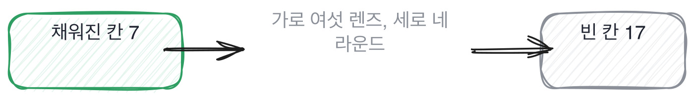

# 1.4 빈자리 일곱 군데

*[1.1](q001.md) 과 [1.3](q003.md) 을 합칩니다. 세는 것과 나란히 놓는 것을 한 장으로요.*

> **이 말부터**
>
> **빈자리** 답변에 안 나온 것 중에서, 해 봤으면 나왔을 것을 말합니다.
> **빈자리 지도** 그 자리들을 일곱 칸으로 접어 둔 종이 한 장이에요. 면접 중에 칸을 채웁니다.

여기까지 오면 한 가지가 답답해집니다. 빈자리를 알아보긴 하겠는데
45분 동안 무엇부터 봐야 할지가 안 정해져요. 답변마다 비어 있는 게 다르거든요.

그런데 표본을 쌓아 놓고 보면 빈자리가 아무 데나 생기지 않습니다.
일곱 자리에서 반복됩니다. 이걸 종이 한 장에 적어 두고 면접 중에 칸을 채우면
끝났을 때 어디를 못 물었는지가 그대로 남아요.

- **.** 자리 비어 있으면 이렇게 들립니다
- **1.** 숫자 크게 개선했습니다
- **2.** 시점 초기에는 문제가 있었습니다
- **3.** 버린 선택지 최적의 방법을 선택했습니다
- **4.** 내 일과 남의 일 전 과정을 담당했습니다
- **5.** 잰 방법 정확도가 향상되었습니다
- **6.** 실패와 되돌리기 성공적으로 마무리했습니다
- **7.** 지금 안 풀린 것 안정적으로 운영 중입니다

일곱 중에 넷이 채워지면 대개 해 본 사람입니다. 일곱을 다 채우는 사람은 드물어요.
저도 제 프로젝트를 설명할 때 일곱을 다 못 채웁니다.

> **이렇게 답합니다**
>
> 저는 전체 파이프라인 설계와 구현에 참여했습니다.
> 데이터 수집부터 임베딩, 검색, 생성까지 전 과정을 담당했습니다.
> 팀원들과 협업하며 각 단계를 개선해 나갔습니다.
> 프로젝트 리딩도 함께 맡아 일정 관리도 했습니다.
> 결과적으로 성공적으로 서비스를 출시할 수 있었습니다.

이 답변에서 비어 있는 칸은 몇 번일까요. 세어 보세요.

> **표시해 보면**
>
> 저는 전체 파이프라인 설계와 구현에 참여했습니다.
>     ← 참여와 담당과 리딩이 한 답에 다 있으면 경계가 없는 것과 같음
> 데이터 수집부터 임베딩, 검색, 생성까지 전 과정을 담당했습니다.
>     ← 전 과정을 혼자 했다는 뜻인지 팀이 했다는 뜻인지 안 갈림
> 팀원들과 협업하며 각 단계를 개선해 나갔습니다.
>     ← 팀원이 몇 명이었는지 없음
> 프로젝트 리딩도 함께 맡아 일정 관리도 했습니다.
> 결과적으로 성공적으로 서비스를 출시할 수 있었습니다.
>     ← 성공의 기준이 없음

4번 칸이 통째로 비었습니다. 참여했다와 담당했다와 리딩을 맡았다가
한 답변에 다 들어 있으면 경계가 없는 것과 같아요.
그리고 4번이 비면 나머지 여섯도 못 믿게 됩니다.
누가 한 일인지 모르는 채로 숫자를 들어 봐야 그게 누구 숫자인지 모르니까요.

> **이렇게 파고듭니다**
>
> 물음: 그 넷 중에 코드를 직접 쓰신 건 어디예요?
>
> 답: 주로 전체적인 구조를 잡는 역할이었고,
> 세부 구현은 팀원들과 나눠서 진행했습니다.

전체적인 구조를 잡는 역할이었다는 답이 나오면 한 걸음 더 갑니다.
구조를 잡았다는 말 자체는 4번 칸을 안 채워요.
그 구조에서 본인이 바꾼 결정 하나를 대 달라고 하면 그때 칸이 채워집니다.

> **해 본 사람의 답**
>
> 넷 중에 제가 코드를 쓴 건 검색 쪽입니다. 색인 만들고 질의 짜는 부분요.
> 수집기는 데이터 엔지니어 한 분이 이미 만들어 둔 걸 받아썼고,
> 생성 쪽 프롬프트는 다른 분이 잡았습니다. 저는 그 프롬프트에 뭘 넣을지만 정했어요.
> 평가는 제가 하자고 해서 제가 만들었습니다. 아무도 안 하고 있었거든요.
> 일정은 제가 관리한 게 아니라 PM 한 분이 따로 계셨습니다.
> 팀은 넷이었고 저까지 다섯이었어요.

이 답은 자기가 안 한 것을 셋이나 말합니다. 수집기, 프롬프트, 일정요.
**안 한 것을 말할수록 한 것이 또렷해집니다.**
그리고 평가는 아무도 안 해서 자기가 만들었다는 줄이 이 답의 값이에요.

> **한 번 더**
>
> 되돌리고 싶은 것을 물으면 빈자리 6번과 7번이 같이 드러납니다.
> 다시 만든다면 처음부터 더 체계적으로 설계할 것 같습니다.
> 초기에 아키텍처를 충분히 검토하지 못한 아쉬움이 있습니다.
> 테스트 코드도 더 꼼꼼하게 작성하고 싶습니다.
> 모니터링 체계도 처음부터 갖추는 것이 좋다고 생각합니다.
> 전반적으로 기본기를 더 탄탄히 하고 싶습니다.
> 체계적으로와 꼼꼼하게와 기본기는 자리를 안 가리킵니다.
> 반대쪽은 문자 수로 자른 결정 하나를 대고 그게 만든 200줄짜리 함수까지 갑니다.

일곱 칸을 다 훑고 나면 이 칸의 판정이 섭니다.
일곱을 다 채우라는 게 아니라 어디가 비었는지 알라는 겁니다.

> **판정**
>
> 일곱 칸 중 넷 이상이 두 번 안에 채워지면 통과입니다.
> 일곱을 다 채우는 사람은 드물어요. 저도 제 프로젝트로 다 못 채웁니다.
>
> 4번 칸이 끝까지 안 채워지면 안 보냅니다.
> 누가 한 일인지 모르면 나머지 여섯 칸의 숫자도 누구 것인지 모르게 되거든요.
>
> 디브리프에는 이렇게 적습니다. 일곱 칸 중 둘만 채워졌고, 4번이 비어 있고,
> 직접 쓴 코드가 어디냐고 물었지만 범위가 안 좁혀졌다.

> **물을 문장 둘**
>
> 맡은 부분을 물으면 참여와 담당과 리딩이 한 답에 다 들어옵니다.
> 그래서 코드로 물어요. 코드는 경계가 또렷하거든요.
>
> **그대로 읽으세요.** *그중에 코드를 직접 쓰신 데가 어디예요?*
>
> **답을 받으면 이어서.** *그 넷 중에 다른 분이 하신 건 어디였어요?*

칸 번호로 적어 두면 다음 라운드 면접관이 어디를 이어서 물을지 바로 압니다.
말로 넘기면 그 사람이 다시 처음부터 물어요. 지원자는 같은 이야기를 두 번 하게 되고요.

> **이걸 놓치면**
>
> 빈자리 지도가 없으면 [1.5](q005.md) 의 30초 판정이 그냥 인상 평가가 됩니다.

