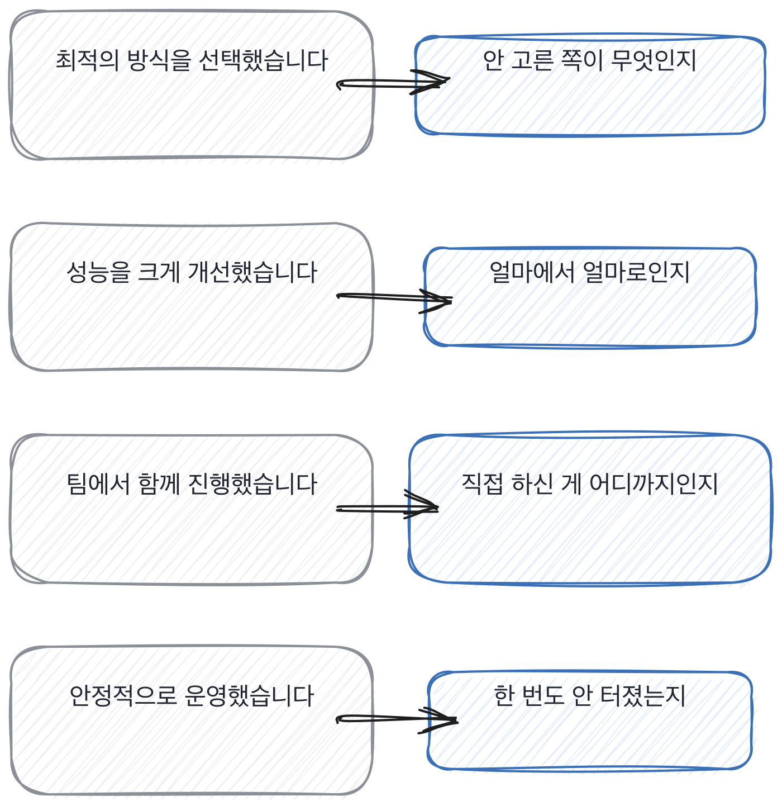

# 2장을 닫으며

## 한 관문을 닫으며

두 말투를 짝으로 세우면 이렇게 됩니다. 왼쪽은 다 통과되는 문장이고,
오른쪽을 한 번씩만 물으면 그 자리에서 갈려요.

이 장에서 한 일은 잣대를 뒤집은 겁니다. 앞 장에서는 빠진 것을 찾았고,
이 장에서는 있는 것을 찾았어요. 그런데 결과가 재미있습니다.
두 잣대가 서로 다른 사람을 걸러 내거든요.

말을 잘하는데 다섯이 안 나오는 사람이 있고, 말이 엉키는데 다섯이 다 나오는 사람이 있어요.
후자를 놓치는 게 면접관이 저지르는 제일 비싼 실수입니다.
전자는 다음 라운드에서 걸러지지만, 후자는 한 번 떨어뜨리면 영영 안 돌아오니까요.

> **저자의 삽질**
>
> 말을 여러 번 고쳐 말하면 준비가 덜 된 것으로 읽힙니다.
> 그런데 고치는 자리가 전부 숫자면 이야기가 달라져요. 잣대가 없으면 그 차이가 안 보입니다.

다음 장은 훈련입니다. 새 개념 없이 답변만 계속 나란히 놓고 봅니다.
두 잣대를 손에 붙이는 게 목적이에요.

> **현장에서는**
>
> 저는 같은 질문에 받은 답변 둘을 나란히 붙여 놓고 팀에 돌립니다. 어느 쪽이 나은지 물으면
> 대개 갈리는데, 무엇이 갈랐는지 한 줄로 쓰라고 하면 그때 잣대가 나옵니다.

이 관문에서 속기 쉬운 자리를 하나 짚습니다. 겸손한 답이라는 자리요.
못 한 것을 말하는 것과 겸손한 것이 겉으로는 비슷하게 들리는데, 안이 완전히 다릅니다.
앞쪽에는 자리가 있고 뒤쪽에는 태도만 있어요.

> **여기서 다들 속는다**
>
> 겸손한 답은 정직해 보입니다. 부족한 점이 많다거나 아직 배우는 중이라는 말이요.
> 그런데 겸손도 준비됩니다. 그리고 겸손한 문장에는 확인할 자리가 하나도 없어요.
> 못 한 것을 말하는 것과 겸손한 것은 다릅니다. 앞쪽에는 자리가 있고 뒤쪽에는 태도만 있습니다.
> 확인은 하나만 대라고 하면 됩니다. 지금 못 하는 걸 하나만 짚어 달라고 해 보세요.

면접장에서 이 관문의 것을 쓰실 때는 아래 다섯 줄이면 됩니다.
위에서 아래로 훑는 데 30초쯤 걸립니다. 셋이 나오면 다음 라운드로 보내셔도 돼요.
다섯을 다 채우는 사람은 드뭅니다. 다 채우라고 만든 목록이 아니에요.

> **30초 점검**
>
> 숫자가 하나라도 나오는가.
> 시점이 달력에 찍히는가.
> 버린 쪽이 나오는가.
> 다른 사람 이름이 한 번이라도 나오는가.
> 못 한 것을 말하는가.

나란히 놓기가 왜 그렇게 잘 듣는지, 그리고 무엇과 나란히 놓아야 하는지를 풀어 놓고 닫겠습니다.
여기서 잘못 고르면 판정이 그날 사정에 흔들려요.
흔들리는 판정은 다음 주에 팀에서 못 씁니다.

> **쉬어 가기**
>
> **쉬어 가기: 나란히 놓기는 왜 그렇게 잘 듣나**
>
> 답변 하나만 놓고 좋은지 나쁜지 정하기는 어렵습니다. 기준이 머릿속에만 있으니까요.
> 그런데 둘을 나란히 놓으면 기준이 없어도 차이가 먼저 보입니다.
> 이건 사람 눈의 성질이에요. 절대값보다 차이를 훨씬 잘 봅니다.
>
> 면접에서 이 성질을 쓰는 방법이 둘 있습니다. 하나는 이 책이 쓰는 방식이고,
> 다른 하나는 팀에서 흔히 쓰는 방식인데 저는 그쪽을 안 씁니다.
>
> 흔한 방식은 지원자끼리 견주는 겁니다. 오늘 본 셋 중 누가 제일 나았냐고 묻는 거죠.
> 빠르고 편한데 문제가 하나 있습니다. 셋 다 기준 아래여도 하나가 뽑힙니다.
> 그리고 셋 다 기준 위여도 둘이 떨어집니다. 그날 누구와 같이 왔느냐가 판정에 섞여요.
>
> 이 책이 쓰는 방식은 사람을 안 견주고 **답변을 견줍니다.**
> 같은 질문에 나올 수 있는 두 답을 미리 놓고, 오늘 받은 답이 어느 쪽에 가까운지 봅니다.
> 견주는 상대가 다른 지원자가 아니라 미리 적어 둔 문장이라 그날 사정에 안 흔들립니다.
>
> 그래서 이 책의 짝 답변이 그냥 예시가 아닙니다. 잣대예요.
> 여러분 팀에서도 잘 답한 표본을 하나씩 모아 두시면 그게 그대로 잣대가 됩니다.
> 모으는 데 반년 걸리는데, 모으고 나면 면접이 훨씬 조용해집니다.

이 관문에서 나온 낱말 몇 개를 짚고 갑니다. 잣대를 맞추는 이야기에 붙는 말들이에요.
셋 다 여럿이 같이 볼 때 필요한 말입니다. 혼자 보면 잣대가 머릿속에만 있어도 되거든요.

> **채용 말 배우기**
>
> **캘리브레이션** 면접관들끼리 점수 기준을 맞추는 자리를 말합니다.
>
> **잣대** 두 답변을 무엇으로 갈랐는지 문장으로 적어 둔 것을 말해요.
>
> **표본** 잘 답한 것과 빈 답을 모아 둔 실물을 말합니다. 잣대는 여기서 나옵니다.

옛 관행 하나를 재 봅니다. 후보끼리 견주는 관행인데, 편하지만 값을 치릅니다.
저도 오래 이렇게 했고, 그만두고 나서야 무엇을 치르고 있었는지 알았습니다.

> **옛 규칙은 아직 유효한가**
>
> **그날 본 후보끼리 견주는 관행.** 판정은 이제 안 맞음입니다.
> 근거는 제 경험이에요. 그날 누구와 같이 왔느냐가 판정에 섞입니다.
> 그래서 저는 사람 대신 **미리 적어 둔 답변**과 견줍니다.
> 견주는 상대가 고정돼 있으면 판정이 날짜에 안 흔들립니다.

이 관문에서 들고 갈 것을 다섯 줄로 접으면 이렇게 됩니다.
앞의 넷이 표시이고 마지막 하나가 그 표시를 무엇에 대고 견주느냐예요.
견줄 상대를 잘못 고르면 앞의 넷을 아무리 잘 봐도 판정이 흔들립니다.

> **한 관문 요약**
>
> 해 본 사람의 표시는 다섯입니다. 숫자, 시점, 버린 쪽, 남의 이름, 못 한 것.
>
> 다섯 중 셋이 나오면 말투가 어떻든 해 본 쪽입니다.
>
> 빈자리는 무게가 다릅니다. 안 해 본 것보다 안 재 본 것이 더 위험합니다.
>
> 다음 장에서 뒤집히는 것. 잣대 둘을 알았으니 이제 속도를 붙입니다.

> **이 판정이 헐거운 지점**
>
> 다섯 중 셋이라는 기준은 제 표본에서 나온 것이고, 자리마다 다를 수 있습니다.
>
> 남의 이름을 대는 것은 협업이 있는 조직에서만 나옵니다. 혼자 만든 사람에게는 불리합니다.
>
> 말이 엉킨 사람을 알아보라고 했지만, 45분 안에 그걸 하는 건 여전히 어렵습니다.
