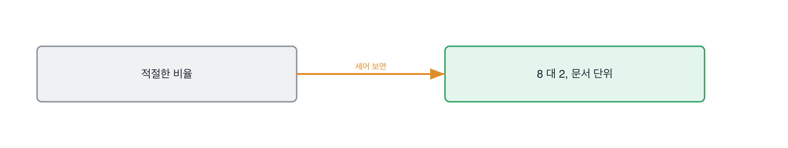

# 2.1 같은 질문, 두 답변

*[1.5](../01-g01/q005.md) 에서 첫 판정을 내렸죠. 이번엔 판정 전에 눈을 먼저 맞춥니다.*

> **이 말부터**
>
> **나란히 놓기** 같은 질문에 대한 답 둘을 붙여 놓고 보는 것을 말합니다.
> **잣대** 그 둘을 무엇으로 갈랐는지 문장으로 적어 둔 것을 말해요. 적어야 다음에 또 씁니다.

답변 하나만 놓고 보면 판단이 잘 안 섭니다. 좋은지 나쁜지 견줄 데가 없으니까요.
그런데 같은 질문에 대한 답 둘을 나란히 놓으면, 잣대를 미리 만들어 두지 않아도
차이가 먼저 눈에 들어옵니다. 그리고 그 차이를 말로 옮겨 적으면 그게 잣대가 돼요.
순서가 우리가 아는 것과 반대입니다. 잣대를 만들어 놓고 재는 게 아니라,
보고 나서 잣대를 적는 거예요.

> **이렇게 답합니다**
>
> 사내 문서를 기반으로 학습 데이터를 구축했습니다.
> 질문과 답변 쌍 형태로 데이터셋을 만들었습니다.
> 데이터 품질이 중요하기 때문에 검수 과정을 거쳤습니다.
> 학습과 검증 세트를 적절한 비율로 분리했습니다.
> 과적합을 방지하기 위해 에폭 수를 조절했습니다.

이 답변, 무엇이 비어 있을까요.

> **표시해 보면**
>
> 사내 문서를 기반으로 학습 데이터를 구축했습니다.
>     ← 몇 건인지, 어느 문서인지 없음
> 질문과 답변 쌍 형태로 데이터셋을 만들었습니다.
> 데이터 품질이 중요하기 때문에 검수 과정을 거쳤습니다.
>     ← 누가 검수했는지, 무엇을 걸렀는지 없음
> 학습과 검증 세트를 적절한 비율로 분리했습니다.
>     ← 적절한 비율이 몇 대 몇인지 없음
> 과적합을 방지하기 위해 에폭 수를 조절했습니다.
>     ← 조절했다면 몇에서 몇으로였는지 없음

다섯 줄이 다 맞는 말입니다. 검수도 했고, 나누기도 했고, 에폭도 조절했어요.
그런데 **숫자가 하나도 없습니다.** 몇 건을 만들었는지, 몇 대 몇으로 나눴는지,
에폭을 몇에서 몇으로 줄였는지가 다 빠져 있죠.

그중에서도 적절한 비율이라는 말이 이 답변의 정체입니다.
비율을 직접 정해 본 사람은 8 대 2라고 말하거든요.
안 정해 본 사람이 적절하다고 말합니다. 그 말이 편해서요.

> **이렇게 파고듭니다**
>
> 물음: 검수하다가 버린 데이터가 있었나요? 어떤 걸 버리셨어요?
>
> 답: 품질이 낮은 데이터는 제외했습니다.
> 전반적으로 노이즈를 줄이는 방향으로 정리했습니다.

품질이 낮은 데이터를 제외했다는 답은 사실 아무것도 안 알려줍니다.
품질이 낮다는 판단 자체가 기준에서 나오는 건데, 그 기준이 빠져 있으니까요.
그래서 여기서는 버린 기준을 물어야 합니다. 기준은 데이터를 직접 만들어 본 사람만
말할 수 있거든요. 남이 만든 데이터를 받아 쓴 사람은 무엇이 버려졌는지도 모릅니다.

> **해 본 사람의 답**
>
> 질문과 답변 쌍을 1,800개 만들었어요. 그중 400개를 버렸습니다.
> 버린 기준이 둘이었는데, 하나는 답이 문서 밖 지식을 쓰는 것이고
> 다른 하나는 질문이 사내 은어라서 6개월 뒤에 뜻이 바뀔 것 같은 것이었어요.
> 두 번째 기준은 제가 만든 건 아니고, 팀에서 반년 전에 겪은 일이 있어서 나왔습니다.
> 나누는 건 8 대 2로 했는데, 문서 단위로 나눴어요.
> 질문 단위로 나눴더니 같은 문서에서 나온 질문이 양쪽에 걸쳐서 점수가 0.9까지 나왔거든요.
> 그건 실력이 아니라 새어 나간 거였죠.

두 답을 나란히 놓으면 차이가 셋 보입니다. 1,800과 400이라는 숫자가 있고,
버린 기준이 둘 있고, 나누는 단위를 질문에서 문서로 바꾼 이유가 있어요.
그중 마지막이 제일 중요합니다. 점수가 0.9까지 나온 걸 보고 좋아한 게 아니라
이상하다고 생각했거든요. 새어 나간 걸 알아보려면 그 점수를 직접 받아 봐야 합니다.

> **여기서 다들 속는다**
>
> 두 번째 답이 좋은 이유는 자세해서가 아닙니다.
> 자세한 건 준비해 오면 됩니다. 좋은 이유는 **점수 0.9를 의심했기** 때문이에요.
> 높은 점수를 의심하는 사람은 그 점수를 직접 받아 본 사람입니다.

나란히 놓는 건 책에서만 되는 게 아니라 면접장에서도 됩니다.
앞사람 답을 기억해 두면 되니까요. 그래서 저는 같은 자리에 지원한 분들께
같은 질문을 씁니다. 질문이 같아야 견줄 데가 생기고, 견줄 데가 있어야
이 답이 좋았다는 말에 근거가 붙어요.

> **판정**
>
> 두 답을 가른 것을 문장 하나로 적을 수 있으면 통과입니다.
> 적히는 순간 그게 이 자리의 잣대가 됩니다.
>
> 두 답이 안 갈리면 지원자가 아니라 질문을 의심합니다.
> 안 갈리는 질문은 그날로 질문 목록에서 뺍니다.
>
> 디브리프에는 이렇게 적습니다. 숫자가 하나도 없었고, 버린 기준을 두 번 물었지만
> 안 나왔고, 데이터를 나눈 단위도 끝까지 안 나왔다.

> **물을 문장 둘**
>
> 어떤 데이터로 했냐고 물으면 절차가 나옵니다.
> 그래서 버린 것 쪽으로 돌립니다. 버린 것은 만든 사람만 알거든요.
>
> **그대로 읽으세요.** *그 데이터에서 버린 게 있어요? 뭘 기준으로 버리셨어요?*
>
> **답을 받으면 이어서.** *그거 나눌 때 단위가 뭐였어요? 왜 그 단위로 나누셨어요?*

두 답을 가른 문장은 면접이 끝나기 전에 그 자리에서 적어 둡니다.
나중에 적으면 좋았다 나빴다로만 남거든요. 그건 다음 지원자와 견줄 수가 없어요.
버린 기준을 못 댔다고 적어 두면 그게 다음 면접에서도 쓰입니다.

> **이걸 놓치면**
>
> 나란히 안 놓으면 [2.2](q007.md) 의 다섯 가지가 그냥 외울 목록이 됩니다.

