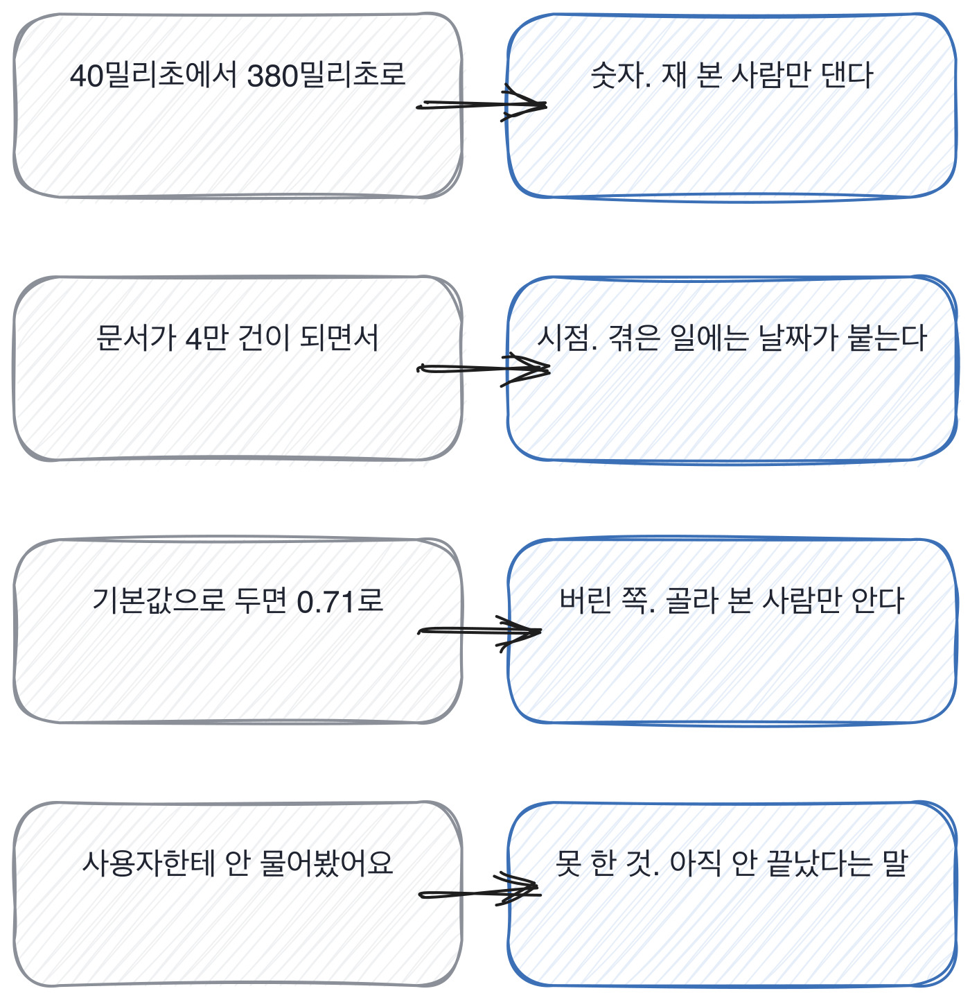

# 2.2 해 본 사람이 늘 하는 다섯 가지

*[2.1](q006.md) 에서 두 답을 나란히 놨죠. 이제 무엇이 갈랐는지를 다섯으로 적습니다.*

> **이 말부터**
>
> **표시** 해 본 사람의 답에 반복해서 나오는 것을 말합니다. 버릇의 반대편이에요.
> **못 한 것** 하려다 안 한 것, 또는 지금도 못 하고 있는 것을 말합니다.

앞 칸에서 두 답을 갈랐던 것들을 모아 보면 다섯으로 줄어듭니다.
그런데 이 다섯은 실력의 목록이 아니라 **기억의 목록**이에요.
해 본 일은 숫자와 날짜와 같이 일한 사람이 통째로 붙어서 기억되거든요.
읽은 것은 결론만 남습니다. 그래서 읽은 사람은 결론을 말하고,
해 본 사람은 결론에 딸린 것들을 같이 말합니다.

- **.** 표시 이렇게 들립니다
- **1.** 숫자 40밀리초에서 380밀리초로
- **2.** 시점 문서가 4만 건이 되면서
- **3.** 버린 쪽 기본값으로 두면 0.78이 0.71로
- **4.** 남의 이름 백엔드 하시는 분이 반대하셔서
- **5.** 못 한 것 사용자한테 물어본 적이 없거든요

> **이렇게 답합니다**
>
> 오픈소스 벡터 데이터베이스를 사용했습니다.
> 확장성과 커뮤니티 지원을 고려하여 선택했습니다.
> 인덱스 타입은 성능과 정확도의 균형을 고려해 설정했습니다.
> 운영 환경에서도 안정적으로 동작했습니다.

이 답변에서 다섯 중 몇 개가 보이나요.

> **표시해 보면**
>
> 오픈소스 벡터 데이터베이스를 사용했습니다.
> 확장성과 커뮤니티 지원을 고려하여 선택했습니다.
>     ← 확장성이 이 프로젝트에서 무엇을 뜻하는지 없음
> 인덱스 타입은 성능과 정확도의 균형을 고려해 설정했습니다.
>     ← 어떤 인덱스를 골랐는지, 무엇과 견줬는지 없음
> 운영 환경에서도 안정적으로 동작했습니다.
>     ← 안정적이었다는 판단의 근거가 없음

하나도 없습니다. 네 줄이 전부 성질 이야기거든요.
확장성, 균형, 안정성. 전부 결과를 요약하는 말이고 과정을 가리키지 않아요.
이런 말은 다 쓰고 난 뒤에 붙는 말이라, 안 써 본 사람도 똑같이 쓸 수 있습니다.

> **이렇게 파고듭니다**
>
> 물음: 인덱스 파라미터를 바꿔 보신 적 있어요?
>
> 답: 기본 설정을 주로 사용했습니다. 특별히 문제가 없어서요.

기본 설정을 썼고 문제가 없었다는 답은 정직하고, 또 흔합니다.
대부분의 서비스가 기본값으로 잘 돌거든요. 그래서 여기서 판정을 내리면 안 됩니다.
다만 **바꿔 본 적이 없다는 것**은 그대로 기록해 둡니다.
값을 한 번도 안 건드려 본 사람은 그 값이 무엇을 바꾸는지도 모르니까요.

> **해 본 사람의 답**
>
> 처음엔 그냥 리스트에 넣고 전부 훑었어요. 문서가 4천 건이라 그게 돌았거든요.
> 40밀리초 나왔습니다. 굳이 뭘 붙일 이유가 없었어요.
> 그러다 문서가 4만 건이 되면서 380밀리초가 됐고, 그때 벡터 데이터베이스를 붙였습니다.
> 붙이면서 배운 건 파라미터 하나가 정확도를 깎는다는 거였어요.
> 탐색 폭을 기본값으로 두면 상위 5개 정확도가 0.78에서 0.71로 떨어졌습니다.
> 그래서 그 값을 두 배로 올리고 지연 60밀리초를 더 냈어요.
> 지금도 그 교환이 맞는지는 모르겠습니다. 사용자한테 물어본 적이 없거든요.

다섯이 다 나왔어요. 40과 380이라는 숫자가 있고, 문서가 4만 건이 된 시점이 있고,
탐색 폭을 기본값으로 두면 정확도가 깎인다는 버린 쪽이 있습니다.
그리고 마지막 줄에 사용자한테 물어본 적이 없다는 문장이 붙어요.

그 마지막 줄이 이 답의 값입니다. **자기 결정을 아직 못 믿고 있다는 말**이거든요.
지연 60밀리초를 더 내고 정확도를 산 게 맞는 교환이었는지를 아직 확인 못 했다는 뜻이고,
그걸 확인하는 방법까지 알고 있다는 뜻이기도 합니다.

> **한 번 더**
>
> 불만을 물으면 4번과 1번이 같이 나옵니다.
> 사용자들은 답변의 정확도에 대한 피드백을 주로 주셨습니다.
> 원하는 정보를 찾지 못하는 경우에 대한 개선 요청이 있었습니다.
> 응답 속도에 대한 의견도 있었습니다.
> 이러한 피드백을 반영하여 지속적으로 개선했습니다.
> 피드백을 주셨다는 문장에는 사람이 없어요.
> 반대쪽은 두 달에 서른한 건, 그중 스물세 건이 같은 원인이라고 말합니다.

다섯을 다 요구하지는 마세요. 셋이면 충분합니다.
저는 답을 들으면서 손가락으로 셉니다. 셋이 접히면 그때부터는 판정을 미루고
그 사람 이야기를 더 듣는 쪽으로 갑니다. 셋이 접힌 사람은 대개 넷째와 다섯째도
갖고 있는데, 제가 안 물어서 안 나온 것뿐이거든요.

> **판정**
>
> 다섯 가지 표시 중 셋이 한 번 파고들어서 나오면 통과입니다.
> 세 번 캐물어서 겨우 나온 것은 안 셉니다. 그건 제가 만들어 준 답이에요.
>
> 파고든 뒤에도 하나도 안 나오면 다음 라운드로 안 보냅니다.
> 기본값을 썼다는 답 자체는 흠이 아니에요. 바꿔 본 적이 없다는 것만 적어 둡니다.
>
> 디브리프에는 이렇게 적습니다. 다섯 중 하나도 안 나왔고,
> 기본 설정만 썼고, 값을 바꿔 본 적이 없다고 본인이 말했다.

> **물을 문장 둘**
>
> 어떤 걸 쓰셨냐고 물으면 도구 이름만 돌아옵니다.
> 그래서 그 전에는 어떻게 했느냐로 돌립니다. 그 전이 있으면 바꾼 이유도 있거든요.
>
> **그대로 읽으세요.** *그거 붙이기 전에는 어떻게 하고 계셨어요?*
>
> **답을 받으면 이어서.** *그 값을 바꿔 보신 적 있어요? 바꿨을 때 어느 숫자가 움직였어요?*

다섯 중 몇이 나왔는지를 숫자로 적어 둡니다. 좋았다고 적으면
디브리프에서 아무 말도 못 하거든요. 넷이 나왔다고 적으면 다른 면접관의 셋과
견줄 수 있고, 견줄 수 있으면 그 자리가 토론이 됩니다. 인상은 토론이 안 돼요.

> **이걸 놓치면**
>
> 표시를 못 세면 [2.3](q008.md) 에서 어느 빈자리가 위험한지 못 가릅니다.

