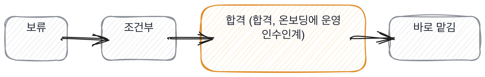

# 2.3 어느 쪽 빈자리가 더 위험한가

*[2.2](q007.md) 에서 표시 다섯을 봤죠. 이번엔 빈자리에 무게를 답니다.*

> **이 말부터**
>
> **메울 수 있는 빈자리** 들어와서 두 달이면 채워지는 빈자리를 말합니다.
> **안 메워지는 빈자리** 습관에 가까워서 시간이 지나도 잘 안 바뀌는 빈자리를 말해요.

빈자리를 다 똑같이 세면 아무도 못 뽑습니다. 일곱 칸이 다 채워진 사람은 없거든요.
저도 제 프로젝트로 답해 보면 다섯을 넘기기 어렵습니다.
그래서 개수를 세는 대신 무게를 답니다.

기준은 하나예요. **이 빈자리를 들어와서 메울 수 있는가.**
안 써 본 도구는 두 달이면 메워집니다. 그런데 안 재 보는 습관은 2년이 지나도 그대로예요.
그래서 도구가 비어 있는 건 넘어가고, 재 본 적이 없는 건 못 넘어갑니다.

- **빈자리.** 무게 왜
- **안 써 본 라이브러리.** 가벼움 두 달이면 메워집니다
- **모르는 개념.** 가벼움 모른다고 말하면 더 가벼워져요
- **숫자 없음.** 무거움 재는 습관이 없다는 뜻입니다
- **버린 쪽 없음.** 무거움 남이 정한 걸 받아 썼다는 뜻이에요
- **못 한 것 없음.** 무거움 자기 일을 안 돌아본다는 뜻입니다
- **남의 이름 없음.** 중간 혼자 만든 자리였을 수도 있어요

> **이렇게 답합니다**
>
> 확장성 측면에서 고민이 있습니다.
> 사용자가 늘어나면 인프라 비용도 함께 증가할 것으로 보입니다.
> 모델 업데이트에 따른 호환성 이슈도 고려해야 합니다.
> 전반적으로 안정성을 유지하면서 개선해 나가는 것이 과제입니다.

이 답변의 빈자리는 가벼운 쪽일까요, 무거운 쪽일까요.

> **표시해 보면**
>
> 확장성 측면에서 고민이 있습니다.
>     ← 확장성이라는 말이 무엇을 가리키는지 없음
> 사용자가 늘어나면 인프라 비용도 함께 증가할 것으로 보입니다.
>     ← 얼마나 늘면 얼마가 되는지 없음
> 모델 업데이트에 따른 호환성 이슈도 고려해야 합니다.
> 전반적으로 안정성을 유지하면서 개선해 나가는 것이 과제입니다.
>     ← 과제라는 말로 닫으면 걱정이 아니라 계획임

무거운 쪽입니다. 걱정을 물었는데 계획으로 답했거든요.

걱정과 계획은 문장의 모양이 다릅니다. 걱정은 구체적이에요. 어디가 언제 터질지가 붙습니다.
계획은 추상적이어도 됩니다. 아직 안 겪은 일이니까요.
그래서 **걱정을 계획으로 바꿔 말하는 건 아직 안 겪었다는 신호**입니다.
겪은 사람은 걱정을 말할 때 자기도 모르게 시간과 자리를 댑니다.

> **이렇게 파고듭니다**
>
> 물음: 오늘 밤에 터진다면 어디가 터질 것 같으세요?
>
> 답: 트래픽이 급증하면 응답 지연이 발생할 수 있을 것 같습니다.

오늘 밤에 터진다면 어디냐고 물으면 대개 갈립니다.
운영해 본 사람은 자리를 대고, 안 해 본 사람은 조건절로 답하거든요.
트래픽이 급증하면이라는 말은 어느 서비스에나 붙는 말이라 아무것도 안 알려줍니다.

> **해 본 사람의 답**
>
> 색인 재생성이요. 새벽 3시에 도는데 실패하면 아무도 모릅니다.
> 지난달에 한 번 실패했는데 이틀 뒤에 알았어요. 검색 결과가 이틀 전 문서였거든요.
> 알림을 붙이긴 했는데 슬랙 채널이라서 새벽에는 아무도 안 봅니다.
> 그리고 하나 더 있어요. 임베딩 API 키가 한 사람 계정으로 되어 있습니다.
> 그분이 휴가 가면 제가 못 고쳐요. 이건 제가 두 달째 미루고 있는 겁니다.

새벽 3시, 이틀, 두 달째 미루고 있는 것. 셋 다 자리와 시간이 붙어 있죠.
그중에서도 마지막 줄이 이 답을 다른 답으로 만듭니다.

**자기가 안 고친 것을 말하는 사람은 그게 문제인 줄 아는 사람**이에요.
모르는 것보다 알고 안 고친 게 나을 때가 있습니다. 적어도 목록에는 올라와 있으니까요.
들어와서 우선순위만 정해 주면 그건 첫 주에 없어집니다.

무게를 달면 판정이 편해집니다. 빈자리 개수로 자르면 다 떨어지거든요.
그리고 무게를 달아 두면 합격시킨 뒤에도 쓸모가 있어요.
가벼운 빈자리 목록이 그대로 첫 달 온보딩 계획이 됩니다.

> **판정**
>
> 무거운 빈자리가 둘 이하이고 그중 하나를 본인이 알고 있으면 통과입니다.
> 알고 있는 빈자리는 온보딩으로 메워집니다. 모르는 빈자리가 문제예요.
>
> 무거운 빈자리가 셋 이상이고 파고들어도 그대로면 안 보냅니다.
> 가벼운 쪽이 몇 개인지는 세지 않습니다. 그건 두 달이면 채워지니까요.
>
> 디브리프에는 이렇게 적습니다. 무거운 빈자리가 둘이고, 걱정을 계획으로 답했고,
> 오늘 밤에 터질 자리를 되물었더니 조건절로 답했다.

> **물을 문장 둘**
>
> 걱정되는 게 뭐냐고 물으면 계획이 돌아옵니다.
> 그래서 오늘 밤이라고 시점을 박습니다. 시점을 박으면 자리가 나옵니다.
>
> **그대로 읽으세요.** *오늘 밤에 터진다면 어디가 터질 것 같으세요?*
>
> **답을 받으면 이어서.** *그거 알고 계신 지 얼마나 됐어요? 왜 아직 안 고치셨어요?*

무게를 적을 때는 무거운 것만 적지 말고 가벼운 것도 같이 적습니다.
온보딩에서 뭘 채워야 하는지가 거기서 나오거든요. 그건 버리는 정보가 아니에요.
떨어뜨릴 이유만 모으는 기록은 합격시킨 다음 날부터 아무 데도 안 쓰입니다.

> **이걸 놓치면**
>
> 무게를 안 달면 [2.4](q009.md) 에서 섞인 답을 만났을 때 통째로 버리게 됩니다.

