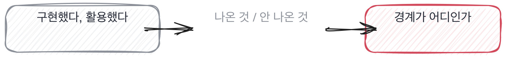

# 2.4 섞인 답, 해 본 것과 읽은 것이 섞였을 때

*[2.3](q008.md) 에서 무게를 달았죠. 이번엔 한 답 안에서 무게가 갈릴 때입니다.*

> **이 말부터**
>
> **섞인 답** 한 답변 안에 해 본 것과 읽은 것이 같이 들어 있는 것을 말합니다.
> **경계** 그 둘이 갈리는 자리예요. 대개 문장 하나 안에 있습니다.

실제 면접에서 제일 자주 만나는 건 순수한 두 종류가 아니라 섞인 답입니다.
앞의 두 줄은 해 봤고 뒤의 두 줄은 읽은 것, 그게 보통이에요.
그리고 이게 어려운 이유는 섞인 답이 **순수한 답보다 더 잘 들리기** 때문입니다.
해 본 부분이 읽은 부분을 떠받쳐 주거든요.

그래서 여기서 하는 일은 판정이 아니라 가르는 겁니다.
통째로 좋다 나쁘다 정하지 말고 경계가 어디인지만 찾아요.
경계만 찾아 두면 판정은 그다음에 저절로 됩니다.

> **이렇게 답합니다**
>
> 네, 해당 부분은 제가 구현했습니다.
> 전체적인 설계는 팀에서 함께 논의했고, 구현은 제가 담당했습니다.
> 필요한 부분은 오픈소스 라이브러리를 활용했습니다.
> 코드 리뷰를 통해 팀원들의 피드백도 반영했습니다.

어디까지가 이 사람이 한 일일까요.

> **표시해 보면**
>
> 네, 해당 부분은 제가 구현했습니다.
> 전체적인 설계는 팀에서 함께 논의했고, 구현은 제가 담당했습니다.
>     ← 함께 논의했다와 제가 담당했다가 한 줄에 붙어 있음
> 필요한 부분은 오픈소스 라이브러리를 활용했습니다.
>     ← 활용했다면 어디까지가 라이브러리이고 어디부터가 본인인지 없음
> 코드 리뷰를 통해 팀원들의 피드백도 반영했습니다.
>     ← 반영했다면 무엇이 바뀌었는지 없음

두 번째 줄 안에 경계가 있습니다. 함께 논의했고 제가 담당했다는
한 문장에 두 사람이 들어 있거든요. 설계는 팀이 했고 구현은 본인이 했다는 뜻인데,
그 사이에 무엇이 있었는지는 안 나옵니다.

세 번째 줄에서는 라이브러리가 등장합니다.
그런데 **어디까지가 라이브러리이고 어디부터가 본인인지**가 빠져 있어요.
이 두 줄이 이 답변에서 제일 많은 것을 감추고 있는 자리입니다.

> **이렇게 파고듭니다**
>
> 물음: 그 파일에서 제일 손이 많이 간 함수가 뭐였어요?
>
> 답: 전반적으로 검색 로직 부분에 시간을 많이 썼습니다.

파일과 함수를 물으면 경계가 드러납니다. 손이 많이 간 함수는 해 본 사람만 대거든요.
그것도 대충 대는 게 아니라 이름까지 기억합니다.
사흘 붙잡고 있던 함수의 이름은 몇 년이 지나도 안 잊히더라고요.

> **해 본 사람의 답**
>
> 검색 쪽은 제가 다 썼고, 청킹은 라이브러리 기본 함수를 그대로 썼습니다.
> 그러다 표가 든 문서에서 계속 깨져서 청킹만 제가 다시 썼어요.
> 제일 손이 많이 간 건 재순위 붙이는 부분입니다.
> 라이브러리가 주는 점수랑 저희 점수 범위가 달라서 섞으면 한쪽이 항상 이겼거든요.
> 그걸 정규화하는 데 사흘 썼고, 결국 순위만 쓰고 점수는 버리는 쪽으로 갔습니다.
> 그 함수는 지금도 제 이름으로 커밋이 남아 있어요.

이 답은 묻기 전에 경계를 스스로 긋습니다. 검색은 다 썼고, 청킹은 받아 쓰다가
표가 깨져서 다시 썼고, 재순위 붙이는 데 사흘을 썼다고요.
어디까지가 자기 것인지를 말하는 데 세 문장이면 충분하다는 걸 보여줍니다.

그리고 마지막에 점수를 버리고 순위만 쓰기로 한 결정이 나옵니다.
**버린 것이 나오면 그 자리는 해 본 자리**예요.
버리는 결정은 실제로 두 방법을 다 돌려 본 사람만 할 수 있으니까요.

> **현장에서는**
>
> 섞인 답을 통째로 좋게 보는 팀이 있고 통째로 나쁘게 보는 팀이 있어요.
> 둘 다 같은 실수입니다. 경계를 안 그은 거예요.

같은 자리를 다른 각도에서 한 번 더 보겠습니다.

> **한 번 더**
>
> 라이브러리 안을 아느냐고 물으면 경계가 더 또렷해집니다.
> 내부적으로 임베딩을 생성하고 유사도를 계산하는 방식으로 동작합니다.
> 효율적인 인덱싱 알고리즘을 사용하는 것으로 알고 있습니다.
> 문서를 청크 단위로 분할하여 처리합니다.
> 전반적으로 잘 추상화되어 있어서 편리하게 사용할 수 있습니다.
> 알고 있다는 말은 읽은 것이고, 편리하다는 말은 안 열어 봤다는 쪽에 가까워요.
> 반대쪽은 왜 열었는지, 무엇을 보러 갔는지를 말합니다.

경계를 그으면 판정이 둘로 나뉩니다. 이 사람이 한 부분과 안 한 부분으로요.
그리고 안 한 부분은 탈락 사유가 아니라 온보딩 계획이 됩니다.
받아 쓴 라이브러리를 첫 달에 한 번 열어 보게 하면 그게 그대로 채워지거든요.

> **판정**
>
> 본인이 경계를 그어 주면 통과입니다.
> 여기까지는 제가 썼고 여기부터는 받아 썼다고 말하는 것, 그거면 됩니다.
>
> 파고들어도 경계가 안 그어지고 계속 우리가 했다로 답하면 안 보냅니다.
> 숨기려는 게 아니라 경계를 안 세어 본 경우가 많은데, 결과는 같습니다.
>
> 디브리프에는 이렇게 적습니다. 경계가 안 그어졌고, 손이 간 함수를 물었더니
> 영역으로 답했고, 라이브러리와 본인 코드의 경계가 끝까지 불명확했다.

> **물을 문장 둘**
>
> 직접 구현했냐고 물으면 네 아니오만 돌아옵니다.
> 그래서 함수 하나를 묻습니다. 함수 이름은 손댄 사람만 기억하거든요.
>
> **그대로 읽으세요.** *그 파일에서 손이 제일 많이 간 함수가 뭐였어요?*
>
> **답을 받으면 이어서.** *그 라이브러리를 열어 보신 적 있어요? 무엇을 보러 들어가셨어요?*

경계는 지원자를 의심해서 긋는 게 아닙니다. 안 그으면 들어온 뒤에 서로 놀라게 되거든요.
맡긴 쪽은 왜 이걸 못 하냐고 놀라고, 받은 쪽은 이걸 나한테 맡길 줄 몰랐다고 놀랍니다.
그 놀람은 양쪽에 다 나쁘고, 대부분 면접에서 경계를 안 그어서 생깁니다.

> **이걸 놓치면**
>
> 경계를 못 그으면 §G04§ 에서 질문을 고쳐 써도 같은 섞인 답이 또 옵니다.

