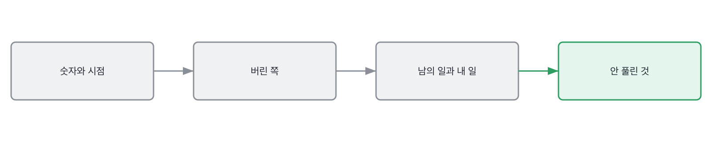
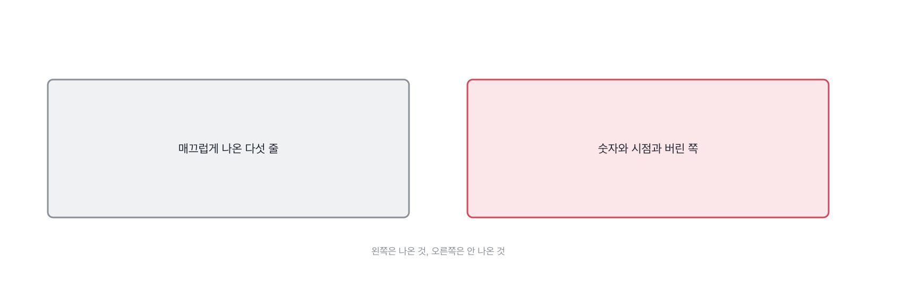

# 3장을 닫으며

## 한 관문을 닫으며

훑는 순서를 한 줄로 접으면 이렇게 됩니다. 위에서 아래로 30초입니다.

그리고 훑고 나서 손에 남는 것은 이런 모양입니다. 왼쪽이 들린 것이고 오른쪽이 안 들린 것이에요.

이 장에서 한 일은 속도를 붙인 겁니다. 잣대는 앞에서 다 만들었고,
여기서는 그 잣대를 답이 끝나기 전에 대 보는 연습만 했어요.

세 칸에서 나온 것을 한 줄로 줄이면 이렇게 됩니다.
훑는 순서를 정해 두면 판단이 빨라지고, 유창함과 앎을 갈라 두면 사람을 덜 놓치고,
준비를 벌하지 않기로 정해 두면 질문이 좋아집니다.
셋 다 지원자를 잡는 기술이 아니라 제가 덜 틀리려고 쓰는 기술입니다.

> **채용 말 배우기**
>
> **스크리닝** 서류나 짧은 통화로 다음 라운드에 부를지 정하는 첫 관문을 말합니다.
>
> **디브리프** 면접이 끝나고 면접관들이 모여 판정을 맞추는 자리예요. 먼저 말한 사람 쪽으로 쏠립니다.
>
> **캘리브레이션** 면접관들끼리 같은 답변에 같은 판정을 내리는지 맞춰 보는 것을 말해요.

디브리프에서 먼저 말한 사람 쪽으로 쏠리는 건 사람이 약해서가 아니라 자리가 그렇게 생겨서예요.
그래서 저희 팀은 각자 판정을 적어서 들고 들어옵니다. 적고 나서 말하면 덜 쏠리더라고요.
이건 18장에서 다시 다룹니다.

> **옛 규칙은 아직 유효한가**
>
> **화이트보드 코딩.** 판정은 조정해서 유효입니다.
> 근거는 제 경험이에요. 코드를 짜는 걸 보는 값은 줄었는데, 짜면서 말하는 걸 듣는 값은 그대로였습니다.
> 그래서 지금은 문제를 풀리는 대신 이미 있는 코드를 읽히고 무엇을 고칠지 말하게 합니다.

다음 장부터는 다시 새것이 나옵니다. 지금까지는 답을 들었다면,
다음 장에서는 질문을 봅니다. 좋은 답이 안 나오는 이유의 절반은 질문에 있거든요.

> **현장에서는**
>
> 저는 답변 넷을 훑을 때 항상 같은 순서로 봅니다. 숫자, 시점, 버린 쪽, 남의 이름, 못 한 것.
> 순서를 정해 두니까 세 번째 답변쯤부터 손이 저절로 갑니다. 그전에는 매번 다르게 봤어요.

이 관문에서 속기 쉬운 자리를 하나 짚습니다. 말을 잘하는 사람이라는 자리요.
이건 오래 공정한 유리함이었습니다. 설명을 잘하는 것도 일하는 능력의 일부니까요.
그 전제가 지금 흔들립니다. 설명은 빌려 올 수 있는데 판단은 못 빌려 오거든요.

> **여기서 다들 속는다**
>
> 말을 잘하는 사람은 면접에서 유리합니다. 그리고 그건 대체로 공정한 유리함이었어요.
> 설명을 잘하는 것도 일하는 능력의 일부니까요. 그 전제가 지금 흔들립니다.
> 설명은 빌려 올 수 있는데 판단은 못 빌려 오거든요. 그래서 둘을 갈라 봐야 합니다.
> 확인은 되물어 보면 됩니다. 방금 그 설명에서 어느 부분이 직접 정하신 거냐고요.

말투와 근거를 가르는 일이 이 장의 전부인데, 저도 여기서 크게 틀린 적이 있습니다.
엉키는 말투를 준비 부족으로 읽었어요. 말투는 그 사람 것이고 근거는 그 사람이 지나온 것인데,
저는 둘을 한 덩어리로 보고 있었습니다.

> **저자의 삽질**
>
> 말이 엉키는 지원자를 준비 부족으로 적기 쉽습니다. 저도 그 자리에서 여러 번 미끄러졌어요.
> 그런데 엉킨 건 말이지 손이 아닐 때가 있습니다. 그 사람이 만든 것을 열어 보면
> 물었어야 할 게 거기 있는 경우요. 말투를 보고 있으면 그게 안 보입니다.

이 관문의 것을 쓰실 때는 아래 다섯 줄이면 됩니다.
앞의 셋은 순서에 관한 것이고 뒤의 둘은 태도에 관한 거예요.
순서는 정하면 그날부터 되고, 태도는 좀 걸립니다. 저는 뒤의 둘에 반년이 걸렸습니다.

> **30초 점검**
>
> 훑는 순서를 정해 두었는가.
> 그 순서대로 넷을 다 봤는가.
> 말투와 근거를 갈라서 봤는가.
> 준비해 온 것을 벌하고 있지 않은가.
> 안 나온 것을 세었는가.

이 장의 세 칸은 새 동작을 안 넣고 훈련만 합니다. 그런데 마지막 칸에서 반문 하나를 정면으로 받아요.
그 반문에 어떻게 답하느냐로 이 책의 성격이 정해졌습니다.

> **쉬어 가기**
>
> **쉬어 가기: 준비해 온 사람을 어떻게 대할 것인가**
>
> 이 책에서 제일 오래 고민한 자리가 3장의 마지막 칸이었습니다.
> 준비를 잘해 온 게 죄냐는 반문이요. 이 질문에 어떻게 답하느냐로 책의 성격이 갈립니다.
>
> 한쪽으로 가면 부정행위를 잡는 책이 됩니다. 읽기에 재미있고 공유도 잘 될 거예요.
> 그런데 그 책으로는 면접을 못 합니다. 다 의심하는 면접관은 아무도 통과시키지 못하고,
> 아무도 통과시키지 못하는 면접관은 다음 채용에서 빠지니까요.
>
> 다른 쪽으로 가면 준비를 신호로 읽는 책이 됩니다. 이건 편한데 틀렸습니다.
> 준비의 값이 싸져서 신호가 안 되거든요. 그래서 이쪽도 못 갑니다.
>
> 남는 길이 하나였습니다. 준비로 채울 수 있는 자리와 없는 자리를 갈라 놓고,
> 채울 수 있는 자리는 그냥 인정하고 넘어가는 겁니다. 그 자리는 원래 확인용이 아니었어요.
> 그리고 못 채우는 자리에 시간을 쓰는 거죠.
>
> 이 판단에는 부작용이 하나 있습니다. 준비를 안 해 온 사람도 잘 통과합니다.
> 못 채우는 자리는 준비와 무관하니까요. 저는 이게 오히려 낫다고 봅니다.
> 준비의 성실함을 재는 건 면접의 일이 아니라 서류의 일이었고, 그마저도 이제 안 됩니다.
>
> 그래서 이 책의 태도가 정해졌어요. 준비해 온 사람을 얄미워하지 않습니다.
> 얄미워할 시간에 물을 자리를 하나 더 찾는 게 빠릅니다.

이 관문에서 들고 갈 것을 다섯 줄로 접으면 이렇게 됩니다.
이 관문은 새 동작을 안 넣고 훈련만 한 자리라, 줄 대부분이 앞 관문 것을 다시 써요.
다시 쓰는 게 이 관문의 일이었습니다. 손에 붙는 데는 반복밖에 없어서요.

> **한 관문 요약**
>
> 훑는 순서는 넷입니다. 숫자와 시점, 그 숫자가 누구 것인지, 버린 쪽, 지금 안 풀린 것.
>
> 유창함은 표시가 아닙니다. 말이 엉키는 답에 표시가 다섯 다 들어 있기도 해요.
>
> 준비는 벌하지 않습니다. 준비로 채울 수 없는 자리를 묻는 것으로 대신합니다.
>
> 다음 관문에서 뒤집히는 것. 답을 보던 눈을 질문 쪽으로 돌립니다.

> **이 판정이 헐거운 지점**
>
> 훑는 순서를 넷으로 줄인 건 제 습관이고, 자리마다 순서가 달라야 할 수도 있습니다.
>
> 말이 엉키는 사람을 45분 안에 알아보는 건 여전히 어렵습니다. 이 장으로 다 되지는 않아요.
>
> 준비를 벌하지 않는다는 원칙과, 준비된 답을 걸러야 한다는 목적은 사실 조금 부딪칩니다.
