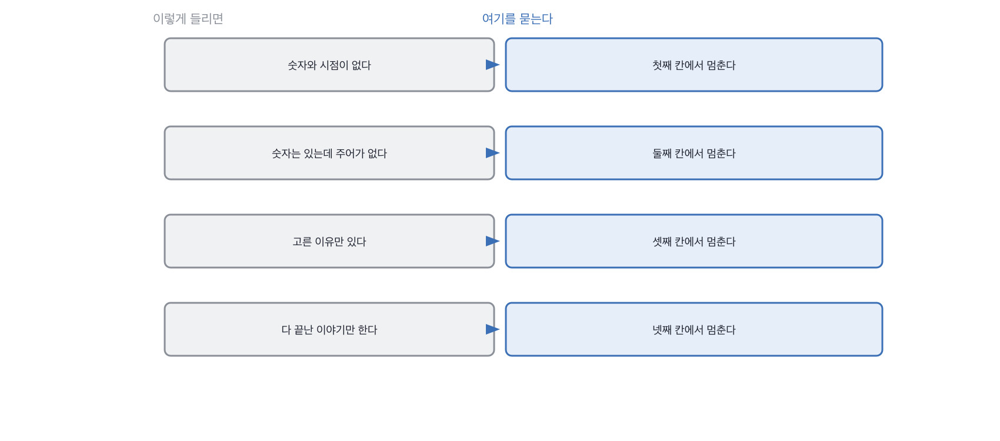

# 3.1 답변 넷을 나란히 놓고 훑는 순서

*[2.4](../02-g02/q009.md) 까지 잣대를 만들었죠. 이제 그 잣대를 답이 끝나기 전에 대 봅니다.*

> **이 말부터**
>
> **훑기** 답을 들으면서 정해진 순서로 확인하는 것을 말합니다. 다 듣고 판단하는 것과 다릅니다.
>
> **멈추는 자리** 훑다가 걸려서 파고들기로 넘어가는 지점을 말해요.

앞의 두 장에서 만든 잣대를 다 쓰려면 순서가 필요합니다. 숫자도 세고, 표시도 세고,
빈자리 무게도 달고, 경계도 그으려면 머릿속에서 네 가지가 동시에 돌아야 하거든요.
사람은 그걸 못 합니다. 저도 못 해요. 그래서 순서를 정해 두고 하나씩 봅니다.

순서는 넷입니다. 숫자와 시점이 있는가, 그 숫자가 이 사람 것인가,
버린 쪽이 나오는가, 지금 안 풀린 것을 말하는가.
이 순서인 이유는 뒤로 갈수록 준비하기 어렵기 때문이에요.
숫자는 외워 올 수 있고, 버린 쪽은 외워 오기 어렵고, 안 풀린 것은 거의 못 외워 옵니다.

> **이렇게 답합니다**
>
> 응답 품질 관리는 여러 단계로 이루어졌습니다.
> 먼저 프롬프트를 지속적으로 개선했습니다.
> 검색 결과의 관련성을 높이는 작업도 병행했습니다.
> 사용자 피드백을 수집하여 반영하는 프로세스를 만들었습니다.
> 정기적으로 품질을 점검하며 개선해 나갔습니다.

이 답변은 몇째 칸에서 멈출까요.

> **표시해 보면**
>
> 응답 품질 관리는 여러 단계로 이루어졌습니다.
> 먼저 프롬프트를 지속적으로 개선했습니다.
>     ← 개선했다면 무엇을 무엇으로 바꿨는지 없음
> 검색 결과의 관련성을 높이는 작업도 병행했습니다.
> 사용자 피드백을 수집하여 반영하는 프로세스를 만들었습니다.
>     ← 프로세스를 만들었다면 누가 언제 도는지 없음
> 정기적으로 품질을 점검하며 개선해 나갔습니다.
>     ← 정기가 얼마나인지 없음

첫째 칸에서 멈춥니다. 다섯 줄에 숫자가 하나도 없고 시점도 없어요.
그러면 둘째 셋째 넷째는 볼 필요가 없습니다. 숫자가 없으면 그 숫자가 누구 것인지도 물을 게 없으니까요.
훑기의 값이 여기 있습니다. 다 듣고 종합하는 게 아니라 **먼저 걸리는 데서 멈추는** 거예요.

> **이렇게 파고듭니다**
>
> 물음: 프롬프트를 마지막으로 바꾼 게 언제예요? 뭘 바꾸셨어요?
>
> 답: 지속적으로 개선해 왔기 때문에 특정 시점을 말씀드리기는 어렵습니다.

특정 시점을 말하기 어렵다는 답이 나오면 그건 그것대로 정보입니다.
지속적으로 개선했다는 말과 마지막으로 언제 바꿨는지 모른다는 말이 한 사람에게서 같이 나오면,
그 개선은 아마 다른 사람이 했거나 아무도 안 했을 겁니다.

> **해 본 사람의 답**
>
> 정해진 게 하나 있었어요. 매주 화요일 아침에 스무 개를 사람이 읽는 겁니다.
> 지난주에 실제로 들어온 질의에서 무작위로 뽑고, 저랑 기획하시는 분이 같이 봤어요.
> 좋다 나쁘다만 표시하고 이유는 한 줄만 적었습니다. 길게 적으면 안 하게 되더라고요.
> 그렇게 넉 달 모으니까 240개가 됐고, 그게 나중에 평가 세트가 됐습니다.
> 프롬프트는 지난달에 마지막으로 바꿨어요. 출처를 문장 끝에 붙이라고 시켰는데
> 문단 중간에 붙어서 읽기가 나빴거든요.
> 그 한 줄 바꾸고 나쁘다 표시가 주에 셋에서 하나로 줄었습니다.

이 답은 첫째 칸을 한 문장 만에 통과합니다. 매주 화요일 아침이라는 말에 시점이 들어 있고,
스무 개와 240개와 넉 달이라는 숫자가 붙거든요.
그리고 마지막 두 줄에서 넷째 칸까지 한 번에 갑니다. 프롬프트를 지난달에 바꿨고,
그 한 줄 때문에 나쁘다 표시가 주에 셋에서 하나로 줄었다고요.

> **한 번 더**
>
> 같은 질문을 다른 분께 해도 훑는 순서는 그대로입니다.
> 품질 지표를 정의하고 모니터링했습니다.
> 정확도와 응답 시간을 주요 지표로 삼았습니다.
> 대시보드를 구축하여 실시간으로 확인할 수 있게 했습니다.
> 이상 징후가 발견되면 즉시 대응하는 체계를 갖췄습니다.
> 지표를 정의했다는데 그 지표가 무엇인지 다음 줄에도 안 나와요. 여기서도 첫째 칸입니다.
> 반대쪽은 대시보드를 안 봤다고 먼저 말하고, 실제로 본 알림 하나를 댑니다.

훑는 순서를 정해 두면 좋은 게 하나 더 있어요. 어디서 멈췄는지를 적어 두면
그게 그대로 다음 면접관에게 넘길 기록이 됩니다. 좋았다 나빴다보다 훨씬 쓸모가 있어요.

> **판정**
>
> 넷째 칸까지 갔으면 통과입니다. 셋째에서 멈춰도 다음 라운드로 보냅니다.
> 버린 쪽까지 나왔으면 확인할 게 남아 있다는 뜻이니까요.
>
> 첫째 칸에서 멈추고, 파고든 뒤에도 여전히 첫째 칸이면 안 보냅니다.
> 숫자가 없다는 건 이 사람이 나쁘다는 뜻이 아니라 이 라운드에서 확인이 안 됐다는 뜻이지만,
> 확인이 안 된 사람을 통과시키면 그건 판정이 아니라 미루기예요.
>
> 디브리프에는 이렇게 적습니다. 첫째 칸에서 멈췄고, 마지막으로 바꾼 시점을 되물었지만
> 특정하기 어렵다고 답했다.

> **물을 문장 둘**
>
> 어떻게 관리했느냐고 물으면 절차가 돌아옵니다. 그래서 마지막으로 바꾼 때를 묻습니다.
> 마지막이라는 말이 시점을 강제하거든요.
>
> **그대로 읽으세요.** *그거 마지막으로 바꾼 게 언제예요? 뭘 바꾸셨어요?*
>
> **답을 받으면 이어서.** *그 뒤에 뭐가 달라졌어요? 어느 숫자로 확인하셨어요?*

> **이걸 놓치면**
>
> 순서를 안 정해 두면 [3.2](q011.md) 에서 말이 엉키는 답을 만났을 때 그냥 나쁜 답으로 넘깁니다.

