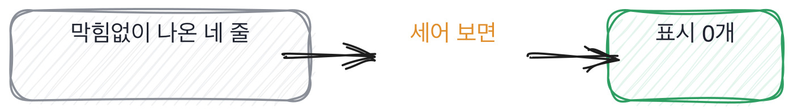

# 3.2 말을 잘하는 사람과 아는 사람을 가르는 법

*[3.1](q010.md) 에서 순서를 정했죠. 이번엔 그 순서가 말투에 안 흔들리게 만듭니다.*

> **이 말부터**
>
> **유창함** 답이 끊기지 않고 구조가 잡혀서 나오는 것을 말합니다. 말하기의 성질이에요.
>
> **자기 정정** 말하다가 방금 한 말을 스스로 고치는 것을 말합니다. 이 책에서는 좋은 신호로 봅니다.

이 칸이 이 책에서 제일 조심스러운 자리입니다. 여기서 틀리면 좋은 사람을 놓치거든요.
그리고 놓친 사람은 안 돌아옵니다. 떨어진 사람이 왜 떨어졌는지 물어보러 오는 일은 거의 없으니까요.

문제는 이겁니다. 우리는 답을 귀로 듣는데, 귀는 내용보다 리듬에 먼저 반응해요.
끊기지 않고 나오는 답은 맞는 것처럼 들리고, 더듬는 답은 모르는 것처럼 들립니다.
그런데 앞의 두 장에서 봤듯이 표시는 리듬이 아니라 낱말에 붙어 있어요.
숫자, 시점, 버린 쪽, 남의 이름, 못 한 것. 이 다섯 중 어느 것도 유창함과 상관이 없습니다.

> **이렇게 답합니다**
>
> 해당 방법이 저희 요구사항에 가장 적합하다고 판단했습니다.
> 성능과 구현 난이도, 유지보수 측면을 종합적으로 검토했습니다.
> 팀 내 기술 스택과의 호환성도 고려했습니다.
> 결과적으로 안정적인 서비스를 제공할 수 있었습니다.

이 답은 막힘없이 나옵니다. 그런데 훑는 순서를 대 보세요. 몇째 칸에서 멈추나요.

> **표시해 보면**
>
> 해당 방법이 저희 요구사항에 가장 적합하다고 판단했습니다.
>     ← 가장 적합하다는 판단의 근거가 없음
> 성능과 구현 난이도, 유지보수 측면을 종합적으로 검토했습니다.
>     ← 검토했다면 진 쪽이 왜 졌는지가 있어야 함
> 팀 내 기술 스택과의 호환성도 고려했습니다.
> 결과적으로 안정적인 서비스를 제공할 수 있었습니다.
>     ← 안정적이었다는 것을 무엇으로 알았는지 없음

셋째 칸입니다. 종합적으로 검토했다는 말에는 진 쪽이 없어요.
그리고 이 답변에서 제일 매끄러운 문장이 제일 비어 있는 문장이기도 합니다.
가장 적합하다고 판단했다는 첫 줄이요.

한 번 파고들어 보면 이 답의 바닥이 어디인지가 나옵니다.

> **이렇게 파고듭니다**
>
> 물음: 두 번째로 유력했던 방법은 뭐였어요? 그건 왜 안 됐죠?
>
> 답: 다른 방법들도 검토했지만 종합적으로 봤을 때 선택한 방법이 나았습니다.

두 번째로 유력했던 걸 물었는데 다시 종합적으로 봤다는 답이 옵니다.
같은 낱말이 두 번 나오면 그건 버릇이고, 버릇은 바닥이 거기라는 뜻이에요.
**말은 여전히 매끄러운데 새로 나온 것이 하나도 없습니다.**

이번엔 같은 질문에 더듬으면서 답한 쪽을 보겠습니다.

> **말이 엉키는 답**
>
> 음, 이게... 사실 처음엔 다른 걸 하려고 했어요.
> 그, 문서를 통째로 넣는 방식이요. 그게 구현이 제일 쉬우니까.
> 근데 문서 하나가 8천 자쯤 되는 게 있어서 그게 안 들어가더라고요.
> 아 그러니까, 들어가긴 하는데 비용이... 한 번 물어볼 때마다 열 배쯤 나왔어요.
> 그래서 잘라 넣는 쪽으로 갔는데, 이것도 처음엔 실패했습니다. 표가 깨져서요.
> 정확히는 표가 깨진 게 아니라 표 위의 제목이 잘린 거였어요. 그걸 이틀 뒤에 알았습니다.

읽기는 확실히 불편합니다. 음으로 시작하고, 그러니까가 두 번 나오고, 문장이 중간에 방향을 틉니다.
그런데 표시를 세어 보면 넷이 들어 있어요. 8천 자라는 숫자, 비용이 열 배라는 숫자,
문서를 통째로 넣으려다 버린 선택지, 그리고 이틀 뒤에 알았다는 못 한 것.

특히 마지막 두 줄을 보세요. 표가 깨졌다고 말했다가 **정확히는 표 위의 제목이 잘린 것**이라고
스스로 고칩니다. 이 자기 정정이 이 답에서 제일 값진 자리예요.
읽고 온 사람은 자기 답을 고칠 이유가 없습니다. 고칠 만큼 자세히 안 갖고 있으니까요.

> **여기서 다들 속는다**
>
> 매끄러운 답에 속는 것보다 더 흔한 실수가 있습니다.
> **더듬는 답을 모르는 답으로 넘기는 것**이에요.
> 전자는 다음 라운드에서 걸러지지만 후자는 여기서 끝납니다.
> 말이 엉키면 리듬을 듣지 말고 낱말을 세세요. 숫자와 시점은 더듬어도 나옵니다.

그렇다고 더듬는 답을 좋게 보라는 얘기는 아닙니다. 유창함을 신호에서 빼라는 것뿐이에요.
유창하면서 표시가 다섯 다 나오는 사람도 있고, 그런 분은 대개 여러 번 설명해 본 사람입니다.
설명을 많이 해 본 것도 실력이고요. 다만 그게 **해 봤음의 증거는 아니라는** 것만 기억하면 됩니다.

> **판정**
>
> 말투와 상관없이 표시가 셋 이상 나오면 통과입니다. 더듬는지 아닌지는 안 셉니다.
>
> 유창한데 표시가 하나도 안 나오고, 파고들어도 안 나오면 안 보냅니다.
> 반대로 더듬는데 표시가 나오면 그건 통과입니다. 다음 라운드에 말할 시간을 더 주면 돼요.
>
> 디브리프에는 이렇게 적습니다. 말은 정연했지만 셋째 칸에서 멈췄고,
> 두 번째 후보가 무엇이었는지 되물었지만 안 나왔다.

> **물을 문장 둘**
>
> 왜 골랐냐고 물으면 고른 이유만 돌아옵니다. 그래서 진 쪽을 묻습니다.
> 진 쪽을 말하려면 둘 다 봤어야 하거든요.
>
> **그대로 읽으세요.** *두 번째로 유력했던 방법은 뭐였어요? 그건 왜 안 됐죠?*
>
> **답을 받으면 이어서.** *그때 그걸 골랐으면 지금 뭐가 달랐을 것 같으세요?*

> **이걸 놓치면**
>
> 유창함을 신호에서 못 빼면 [3.3](q012.md) 에서 준비해 온 사람을 전부 걸러 내게 됩니다.

