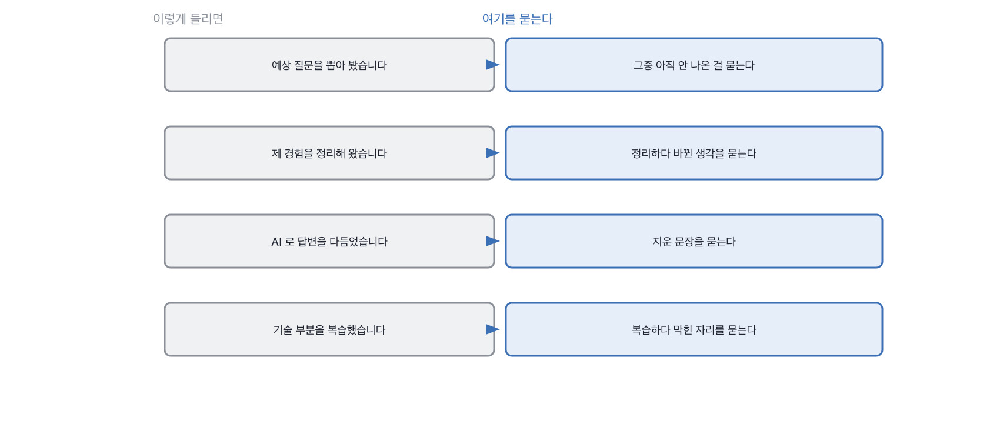

# 3.3 준비를 잘해 온 게 죄인가요

*여기서 당연한 반문 하나를 정면으로 받습니다. 1단계의 마지막 칸입니다.*

> **이 말부터**
>
> **준비** 면접 전에 답을 정리하고 연습해 오는 것을 말합니다. 이 책은 이걸 벌하지 않습니다.
>
> **못 채우는 자리** 준비로는 못 만들고 실제로 해 봐야만 생기는 답의 자리를 말해요.

여기까지 읽으신 분은 이런 생각이 드셨을 겁니다. 그래서 준비해 온 사람은 떨어뜨리자는 거냐고요.
그건 아닙니다. 그리고 그렇게 읽히면 이 책은 실패한 겁니다.

준비는 성실함의 표시예요. 회사를 알아보고 예상 질문을 뽑고 자기 경험을 정리해 오는 건
그 자리에 들이는 시간을 보여주는 일이고, 저는 그걸 좋게 봅니다.
문제는 준비가 아니라 **우리가 준비되는 것만 물어 왔다는** 데 있어요.

그래서 이 책이 하는 일은 준비를 벌하는 게 아니라 질문을 옮기는 겁니다.
버린 선택지, 되돌린 결정, 지금 안 풀린 것. 이 셋은 준비해 오기가 아주 어렵습니다.
실제로 서 봐야만 생기는 기억이라서요. 그리고 이걸 물으면 준비를 잘해 온 사람이 손해를 안 봅니다.
오히려 준비하면서 자기 프로젝트를 다시 뜯어본 사람이 여기서 제일 잘 답해요.

> **이렇게 답합니다**
>
> 회사와 팀에 대해 조사하고, 제 경험을 정리해서 왔습니다.
> 예상 질문을 뽑아 답변을 준비했습니다.
> 기술적인 부분은 다시 한번 복습했습니다.
> 좋은 결과가 있었으면 좋겠습니다.

준비를 물었는데 준비 이야기가 아닌 것으로 닫힙니다. 어디서 그렇게 되는지 보세요.

> **표시해 보면**
>
> 회사와 팀에 대해 조사하고, 제 경험을 정리해서 왔습니다.
> 예상 질문을 뽑아 답변을 준비했습니다.
>     ← 어떤 질문을 예상했는지가 없음
> 기술적인 부분은 다시 한번 복습했습니다.
>     ← 무엇을 복습했는지가 없음
> 좋은 결과가 있었으면 좋겠습니다.
>     ← 마무리가 준비 이야기가 아님

네 줄 중에 세 줄이 준비의 목록이고 마지막 한 줄은 인사예요.
예상 질문을 뽑았다고 했는데 그중 하나도 안 나옵니다.
여기서 파고들 자리는 분명합니다. **뽑은 질문을 하나만 대 달라고 하면** 됩니다.

> **이렇게 파고듭니다**
>
> 물음: 예상 질문 중에 아직 안 나온 게 있어요? 뭐였는지 말씀해 주실 수 있을까요?
>
> 답: 몇 가지 준비했는데 지금은 잘 기억이 나지 않습니다.

기억이 안 난다는 답이 나오면 그건 준비를 안 했다는 뜻이 아니라
준비를 남이 해 줬다는 뜻에 가깝습니다. 자기가 뽑은 질문은 대개 기억나거든요.
그 질문이 곧 자기가 약하다고 생각하는 자리니까요.

> **해 본 사람의 답**
>
> 세 가지를 준비했어요. 하나는 제가 만든 서비스를 5분 안에 설명하는 거고,
> 하나는 청크 크기를 왜 800자로 잡았냐는 질문이었어요. 그건 나올 것 같았거든요.
> 나머지 하나는 지금 다시 하면 뭘 바꾸겠냐는 건데, 이건 준비하다가 답이 바뀌었습니다.
> 처음엔 테스트를 더 쓰겠다고 적었는데, 적어 놓고 보니 그게 진짜 아쉬운 게 아니더라고요.
> 진짜 아쉬운 건 평가를 넉 달째에 만든 거였어요. 그건 준비하면서 알았습니다.

이 답이 좋은 이유는 준비를 많이 해서가 아닙니다. **준비하다가 답이 바뀌었다고 말해서**예요.
테스트를 더 쓰겠다고 적었다가 그게 진짜 아쉬운 게 아니라는 걸 알았고,
진짜는 평가를 넉 달째에 만든 거였다고 합니다.
준비가 자기 프로젝트를 다시 보게 만든 거고, 그건 시켜서 되는 일이 아니에요.

> **한 번 더**
>
> AI 를 어떻게 썼는지 대놓고 물어도 됩니다. 숨기라고 하면 서로 피곤해집니다.
> AI를 활용해 답변을 정리하는 데 도움을 받았습니다.
> 다만 제 경험이 아닌 내용은 사용하지 않았습니다.
> 진정성 있게 답변드리려고 노력했습니다.
> AI는 보조 수단으로만 활용했습니다.
> 경험이 아닌 내용은 안 썼다고 하는데, 그러면 무엇을 지웠는지가 나와야 하거든요.
> 반대쪽은 40퍼센트라는 숫자와 리딩이라는 표현 둘을 지웠다고 말합니다.

지운 것을 말하는 답이 왜 좋은지는 앞에서 여러 번 봤습니다.
버린 것을 말하려면 그 자리에 서 봐야 하니까요. 준비 이야기에서도 같은 일이 벌어집니다.

> **현장에서는**
>
> 어떤 팀은 준비 여부를 물어보지 않기로 정했습니다. 물어봐야 다들 성실하게 준비했다고 답하니까요.
> 대신 준비할 수 없는 질문의 개수를 셉니다. 45분에 셋이 목표라고 합니다.

이 칸이 1단계의 마지막입니다. 여기까지가 듣는 쪽 이야기였어요.
다음 장부터는 묻는 쪽으로 넘어갑니다. 준비할 수 없는 질문을 어떻게 만드는지가 거기서 나옵니다.

> **판정**
>
> 준비했다고 말하고 그 내용을 구체적으로 대면 통과입니다.
> 뽑은 질문 하나, 지운 문장 하나, 준비하다 바뀐 생각 하나. 이 중 하나면 충분해요.
>
> 준비했다고 말하는데 그 안이 하나도 안 나오면 안 보냅니다.
> 준비를 안 한 게 문제가 아니라, 자기 이야기를 자기가 안 들여다봤다는 게 걸립니다.
>
> 디브리프에는 이렇게 적습니다. 준비 목록은 말했지만 그 안이 안 나왔고,
> 예상 질문을 하나만 대 달라고 했더니 기억이 안 난다고 답했다.

> **물을 문장 둘**
>
> 어떻게 준비했냐고 물으면 목록이 돌아옵니다. 그래서 아직 안 나온 질문을 묻습니다.
> 그 질문은 자기가 약하다고 생각한 자리라 대개 기억하고 있거든요.
>
> **그대로 읽으세요.** *예상 질문 중에 아직 안 나온 게 있어요? 뭐였는지 말씀해 주실 수 있을까요?*
>
> **답을 받으면 이어서.** *준비하시다가 생각이 바뀐 게 있었어요? 뭐가 어떻게 바뀌었죠?*

> **이걸 놓치면**
>
> 준비를 벌하기 시작하면 §G04§ 에서 질문을 아무리 고쳐 써도 소용이 없습니다.

