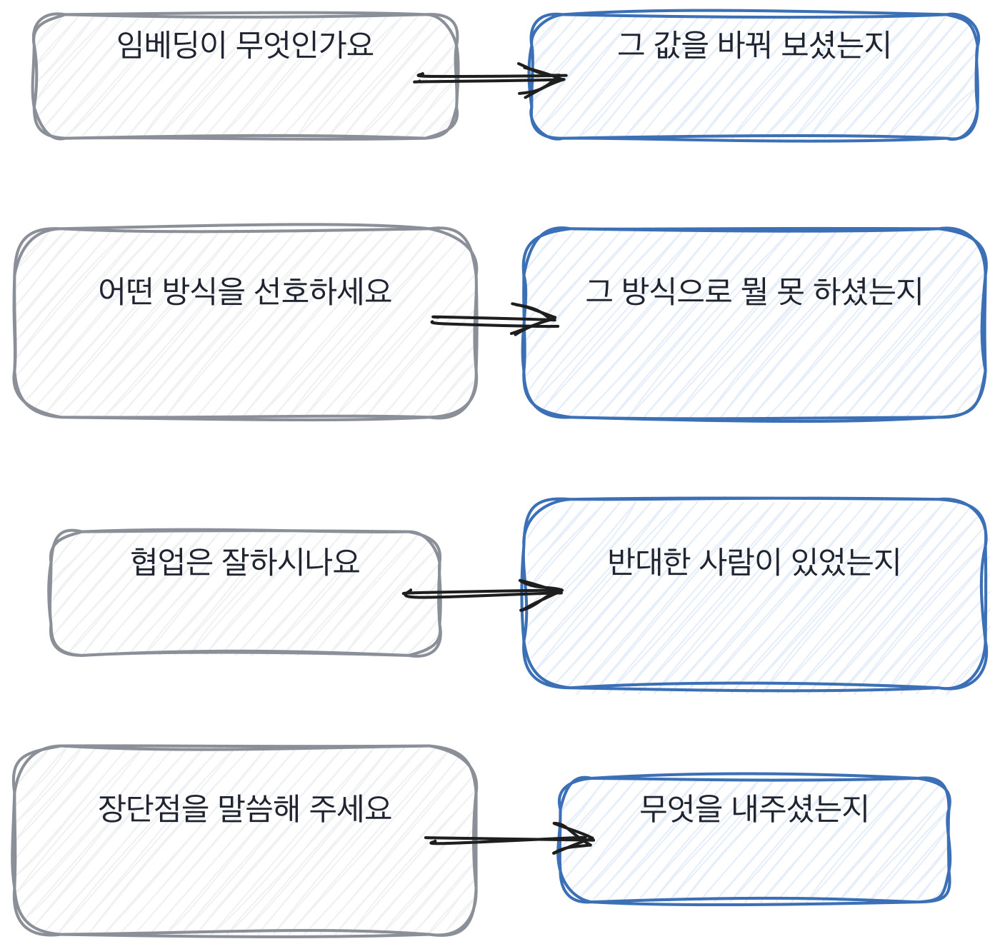

# 4장을 닫으며

## 한 관문을 닫으며

같은 주제에 두 질문을 세우면 무엇이 갈리는지가 보입니다.

이 장에서 한 일은 잣대를 지원자에게서 저에게로 돌린 겁니다.
검색되는 질문, 예 아니오로 닫히는 질문, 답이 정해진 질문, 직무와 안 이어지는 질문.
넷 다 제가 만든 것이고, 넷 다 45분에서 시간을 빼앗아 갑니다.

그리고 이 장의 결론은 질문 목록을 새로 쓰라는 게 아니에요.
지금 쓰는 질문 옆에 **그 질문이 실제로 불러온 답**을 적어 두라는 겁니다.
석 달만 모으면 어느 질문이 아무것도 안 가져오는지가 보입니다. 그때 그 질문을 뺍니다.

> **채용 말 배우기**
>
> **질문 은행** 팀이 쓰는 질문을 한자리에 모아 둔 것을 말합니다. 18장에서 서식을 다룹니다.
>
> **유도 질문** 원하는 답이 질문 안에 이미 들어 있는 질문을 말해요.
>
> **러버 스탬프** 제대로 안 보고 통과 도장을 찍는 것을 말합니다. 면접에서도 일어납니다.

옛 관행 하나를 재 봅니다. 이 관문이 다루는 것과 정면으로 걸리는 자리예요.
질문을 어렵게 만드는 쪽으로 가던 관행인데, 어려운 건 오히려 더 잘 준비됩니다.

> **옛 규칙은 아직 유효한가**
>
> **알고리즘 문제.** 판정은 이제 안 맞음입니다.
> 근거는 제 경험이에요. 준비한 사람과 안 한 사람만 갈리고, 일 잘하는 사람은 안 갈렸습니다.
> 그 자리에 지금은 남의 코드를 읽히는 과제를 둡니다. 이건 12장에서 다룹니다.

다음 장은 면접이라는 자리 자체를 다룹니다. 무엇을 보고 무엇을 안 볼지,
45분을 어떻게 나눌지요. 질문이 좋아져도 시간을 잘못 쓰면 아무것도 안 남거든요.

저도 이 자리에서 오래 틀렸습니다. 질문을 고칠 생각을 아예 안 했거든요.
답이 비슷하게 오면 지원자 쪽을 의심하지 제 질문을 의심하지는 않았습니다.
의심할 생각이 안 든 이유는 그 질문을 제가 만들었기 때문이에요. 자기가 만든 건 잘 안 보입니다.

> **저자의 삽질**
>
> 나쁜 질문은 오래 살아남습니다. 답이 다 비슷하게 오는데도 지원자 수준 탓을 하게 되거든요.
> 그 질문을 한 번 검색해 보면 대개 첫 화면에 답이 있습니다. 검색해 볼 생각을 안 하는 게 문제예요.

질문을 고치는 일이 실제로 어떻게 굴러가는지는 제 자리에서 이렇게 보입니다.
대단한 절차가 아니라 5분짜리 습관 하나예요.
5분을 안 쓰면 그 질문으로 면접 45분을 씁니다. 값이 아홉 배 차이 납니다.

> **현장에서는**
>
> 저는 질문 하나를 고칠 때 답을 먼저 세 개 적어 봅니다. 셋이 다 비슷하게 나오면 그 질문은 버려요.
> 적어 보는 데 5분 걸리는데, 안 적어 보면 면접 45분을 씁니다.

속기 쉬운 자리가 여기 하나 더 있습니다. 채점하기 쉬운 질문이요.
채점이 편하면 그 질문이 좋아 보이는데, 편한 이유가 대개 답이 하나여서입니다.
답이 하나면 그 답은 밖에 있고, 밖에 있는 답은 가져올 수 있습니다.

> **여기서 다들 속는다**
>
> 답이 정해진 질문은 채점이 쉬워서 좋은 질문처럼 느껴집니다. 맞았는지 틀렸는지 바로 아니까요.
> 그런데 채점이 쉽다는 건 정답이 밖에 있다는 뜻이고, 밖에 있으면 가져올 수 있습니다.
> 채점이 어려운 질문이 대개 확인이 되는 질문이에요. 갈리는 자리가 여럿이라 어려운 겁니다.
> 확인은 스스로 해 보면 됩니다. 이 질문의 답을 밖에서 찾을 수 있는지요.

질문 하나를 손에 들고 아래 다섯 줄로 훑어 보세요. 30초면 됩니다.
하나라도 걸리면 그 질문은 다음 면접에 안 들고 가는 게 낫습니다.
대신 그 자리를 비워 두세요. 나쁜 질문보다 빈자리가 낫거든요.

> **30초 점검**
>
> 이 질문의 답이 검색되는가.
> 예 아니오로 닫히는가.
> 내가 원하는 답이 질문에 이미 들어 있는가.
> 답이 여러 갈래로 갈릴 수 있는가.
> 우리 것을 하나라도 가리키는가.

질문을 고치고 나면 그다음 걱정이 생깁니다. 이 좋은 질문을 얼마나 오래 쓸 수 있느냐요.
만드는 데 시간이 들었으니 오래 쓰고 싶은 게 당연한데, 여기에 얄궂은 성질이 하나 있습니다.
좋은 질문일수록 빨리 닳아요. 그 이야기를 하고 이 관문을 닫겠습니다.

> **쉬어 가기**
>
> **쉬어 가기: 좋은 질문이 오래 못 사는 이유**
>
> 좋은 질문을 하나 만들면 오래 쓰고 싶습니다. 만드는 데 시간이 들었으니까요.
> 그런데 좋은 질문일수록 빨리 닳습니다. 이게 이 자리의 얄궂은 성질이에요.
>
> 이유는 간단합니다. 잘 갈리는 질문은 지원자에게도 인상적이거든요.
> 면접이 끝나고 나면 그 질문이 기억에 남습니다. 어려웠던 것보다 *처음 받아 본* 질문이요.
> 그리고 그건 다른 사람에게 이야기됩니다. 나쁜 뜻이 아니라 그냥 이야깃거리라서요.
>
> 그래서 좋은 질문의 수명은 그 질문이 얼마나 좋으냐에 반비례합니다.
> 안 갈리는 질문은 아무도 안 옮기니까 십 년을 써요. 대신 십 년 동안 아무것도 안 걸러 냅니다.
>
> 여기서 두 갈래가 나옵니다. 하나는 질문을 계속 새로 만드는 길이고,
> 다른 하나는 새어 나가도 값이 안 떨어지는 질문을 만드는 길입니다.
> 첫째 길은 지치고 둘째 길은 어렵습니다. 이 책은 둘째 길을 골랐어요.
>
> 우리 코드와 우리 숫자를 가리키는 질문이 그겁니다. 문장이 밖에 돌아도 값이 안 떨어져요.
> 답을 미리 알아도 우리 저장소를 안 열면 못 답하니까요.
> 17장에서 이 이야기를 다시 합니다. 지금은 이것만 기억해 두세요.
> **좋은 질문을 아끼지 마세요. 아껴도 닳습니다.**

이 관문에서 들고 갈 것을 다섯 줄로 접으면 이렇게 됩니다.
다섯 줄이 다 같은 방향이에요. 잣대를 지원자에게서 나에게로 돌리는 방향이요.
이 방향으로 한 번 돌리고 나면 그다음 관문들이 훨씬 쉬워집니다.

> **한 관문 요약**
>
> 빈 답변의 절반은 질문이 만듭니다. 답을 고치기 전에 질문을 봅니다.
>
> 나쁜 질문의 표시는 다섯입니다. 검색되는 것, 예 아니오, 유도, 함정, 취향.
>
> 좋아 보이는 나쁜 질문이 더 위험합니다. 컬처 핏, 스트레스, 열정 같은 것들요.
>
> 다음 관문에서 뒤집히는 것. 질문이 아니라 45분이라는 자리 자체를 봅니다.

> **이 판정이 헐거운 지점**
>
> 나쁜 질문 다섯은 제가 쓰던 질문을 되돌아보며 만든 것이라 목록이 제 편향을 탑니다.
>
> 검색되는 질문을 다 빼면 기초를 확인할 자리가 줄어듭니다. 그 균형은 아직 잘 모르겠어요.
>
> 꼬리 질문을 잘 쓰면 면접이 길어집니다. 45분 안에 넣는 문제는 다음 장으로 넘깁니다.
