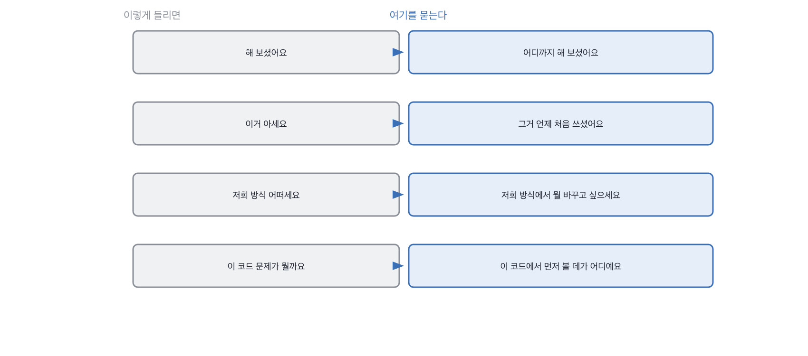

# 4.2 나쁜 질문의 공통점 다섯

*[4.1](q013.md) 에서 질문이 답을 만든다는 걸 봤죠. 이번엔 안 만드는 질문들입니다.*

> **이 말부터**
>
> **검색되는 질문** 답이 공개된 자료에 그대로 있는 질문을 말합니다.
>
> **닫힌 질문** 예 아니오나 한 낱말로 끝나는 질문이에요. 그다음이 안 이어집니다.

나쁜 질문에는 공통점이 있습니다. 답을 들어도 **판정에 못 쓴다**는 거예요.
답이 좋든 나쁘든 그다음에 할 일이 안 생기면 그 질문은 45분에서 시간만 빼앗은 겁니다.

다섯 가지를 적어 두면 자기 질문 목록을 훑을 때 편합니다.

- **.** 종류 왜 판정에 못 쓰나
- **1.** 검색되는 질문 준비한 사람과 안 한 사람만 갈립니다
- **2.** 닫힌 질문 예를 받으면 그다음 물을 게 없습니다
- **3.** 유도 질문 원하는 답이 질문 안에 이미 있습니다
- **4.** 함정 질문 못 맞히면 긴장만 남고 맞혀도 알 게 없습니다
- **5.** 취향 질문 저와 닮았는지를 재게 됩니다

> **이렇게 답합니다**
>
> 어텐션은 입력 시퀀스의 각 토큰이 다른 토큰들과 얼마나 관련 있는지를 계산합니다.
> 쿼리, 키, 밸류 세 가지 벡터를 사용합니다.
> 쿼리와 키의 내적으로 유사도를 구하고, 소프트맥스로 정규화한 뒤 밸류에 가중합을 적용합니다.
> 멀티헤드 어텐션은 이 과정을 여러 번 병렬로 수행하여 다양한 관계를 포착합니다.
> 이를 통해 장거리 의존성을 효과적으로 학습할 수 있습니다.

첫 번째 종류의 표본입니다. 답이 아주 정확한데, 그래서 더 문제예요.

> **표시해 보면**
>
> 어텐션은 입력 시퀀스의 각 토큰이 다른 토큰들과 얼마나 관련 있는지를 계산합니다.
> 쿼리, 키, 밸류 세 가지 벡터를 사용합니다.
> 쿼리와 키의 내적으로 유사도를 구하고, 소프트맥스로 정규화한 뒤 밸류에 가중합을 적용합니다.
>     ← 정확한 설명이지만 검색하면 30초에 나옴
> 멀티헤드 어텐션은 이 과정을 여러 번 병렬로 수행하여 다양한 관계를 포착합니다.
> 이를 통해 장거리 의존성을 효과적으로 학습할 수 있습니다.
>     ← 효과적으로 학습한다는 말은 이 사람이 확인한 것이 아님

이 답을 듣고 나면 무엇을 알게 될까요. 이 사람이 어텐션을 설명할 줄 안다는 것뿐입니다.
그건 30초면 검색되는 내용이라 **준비했는지만 재는** 셈이 돼요.
그리고 준비는 앞 장에서 벌하지 않기로 했죠.

> **이렇게 파고듭니다**
>
> 물음: 그 구조 때문에 실제로 곤란했던 적이 있으세요?
>
> 답: 긴 문서를 처리할 때 메모리 사용량이 많아지는 문제가 있습니다.

곤란했던 적을 물으면 방향이 바뀝니다. 메모리 이야기가 나오는데 아직 일반론이에요.
여기서 한 번 더 가면 이 사람의 자리가 나옵니다.

> **한 걸음 더 가면**
>
> 저는 그 안을 잘 모릅니다. 논문 읽고 그림 그려 본 정도예요.
> 대신 그것 때문에 겪은 건 있습니다. 문서가 길어지니까 비용이 제곱으로 뛰더라고요.
> 8천 자짜리 문서를 통째로 넣었더니 한 번 물어보는 데 열 배가 나왔습니다.
> 그래서 잘라 넣기로 한 거고, 그때 왜 제곱인지 찾아보다가 어텐션 이야기를 처음 제대로 읽었어요.
> 순서가 반대였던 거죠. 필요해서 읽은 겁니다.

이 답이 좋은 이유는 안다고 해서가 아니라 **모른다고 먼저 말해서**입니다.
논문 읽고 그림 그려 본 정도라고 선을 긋고, 그것 때문에 겪은 것만 말해요.
그리고 마지막 줄이 좋습니다. 필요해서 읽었다는 것, 순서가 반대였다는 것이요.
저는 이 순서로 배우는 사람을 좋게 봅니다. 들어와서도 그 순서로 배울 테니까요.

> **여기서 다들 속는다**
>
> 검색되는 질문을 다 빼라는 말은 아닙니다. 기초는 확인해야 하니까요.
> 다만 그 질문은 **확인용으로만 쓰고 판정에는 안 씁니다.**
> 확인용 질문에 시간을 5분 넘게 쓰고 있으면 그건 변별을 하고 있다고 착각하는 중입니다.

닫힌 질문은 특히 자주 만듭니다. 해 보셨어요, 아세요, 쓰신 적 있어요 같은 것들요.
예라는 답이 오면 그다음이 안 이어져서 결국 제가 또 질문을 만들어야 합니다.
같은 것을 열어서 물으면 한 번에 갑니다. 그거 어디까지 해 보셨어요, 처럼요.

> **판정**
>
> 이 칸의 판정 대상은 지원자가 아니라 질문입니다.
> 질문을 던지고 답을 받은 뒤에 다음 질문이 자동으로 생기면 그 질문은 통과예요.
>
> 답을 듣고 나서 그다음에 뭘 물을지 생각해야 한다면 그 질문은 뺍니다.
> 좋은 질문은 답 안에 다음 질문을 남깁니다.
>
> 질문 목록에는 이렇게 적어 둡니다. 이 질문은 확인용이고 판정에는 안 쓴다,
> 또는 이 질문은 답이 열려 있어 꼬리 질문이 붙는다.

> **물을 문장 둘**
>
> 구조를 설명해 달라고 물으면 검색되는 답이 옵니다. 그래서 그것 때문에 곤란했던 일을 묻습니다.
> 곤란은 겪어야 생기고, 겪은 일에는 숫자가 붙거든요.
>
> **그대로 읽으세요.** *그 구조 때문에 실제로 곤란했던 적이 있으세요?*
>
> **답을 받으면 이어서.** *그때 어떻게 넘기셨어요? 지금도 같은 방법을 쓰시나요?*

> **이걸 놓치면**
>
> 다섯을 못 알아보면 [4.3](q015.md) 의 좋아 보이는 질문들이 그냥 좋아 보입니다.

