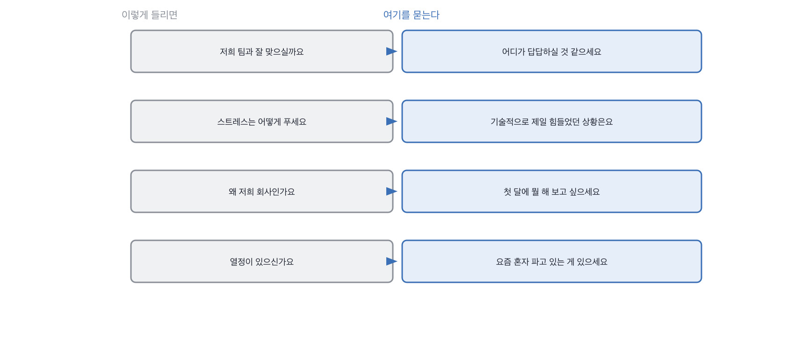

# 4.3 좋아 보이는데 나쁜 질문 셋

*[4.2](q014.md) 의 다섯은 알아보기 쉬웠죠. 이번엔 알아보기 어려운 쪽입니다.*

> **이 말부터**
>
> **확인 가능한 질문** 답을 듣고 나서 사실인지 이어서 물어볼 수 있는 질문을 말합니다.
>
> **못 쓰는 답** 좋게 들리는데 다음 라운드에 넘길 것이 하나도 안 남는 답이에요.

앞의 다섯은 목록으로 만들면 다들 안 씁니다. 문제는 좋아 보이는 쪽이에요.
면접에서 오래 쓰여 왔고, 물으면 뭔가 알게 되는 것 같고, 실제로는 아무것도 안 남는 질문들이요.
셋을 고르면 이렇습니다. 팀 문화와 맞느냐, 스트레스를 어떻게 푸느냐, 왜 우리 회사냐.

> **이렇게 답합니다**
>
> 네, 회사 소개와 기술 블로그를 보면서 팀 문화에 대해 알아봤습니다.
> 자율적으로 일하면서도 협업을 중시하는 분위기라고 이해했습니다.
> 저도 그런 환경에서 잘 일해 왔기 때문에 잘 맞을 것 같습니다.
> 빠르게 적응해서 기여하겠습니다.

이 답이 나쁜가요. 아닙니다. 성실하고 예의 바른 답이에요.
문제는 이 답을 듣고 나서 제가 할 수 있는 게 없다는 겁니다.

> **표시해 보면**
>
> 네, 회사 소개와 기술 블로그를 보면서 팀 문화에 대해 알아봤습니다.
>     ← 질문이 예 아니오로 답하게 되어 있어 답이 정해져 있음
> 자율적으로 일하면서도 협업을 중시하는 분위기라고 이해했습니다.
> 저도 그런 환경에서 잘 일해 왔기 때문에 잘 맞을 것 같습니다.
>     ← 잘 맞는다는 판단을 지원자가 하게 시킨 질문임
> 빠르게 적응해서 기여하겠습니다.
>     ← 기여하겠다는 다짐으로 닫힘. 확인할 것이 없음

질문 자체가 예 아니오를 부르고, 그 예 뒤에 붙는 말은 어느 지원자나 비슷합니다.
그리고 이 질문에는 더 나쁜 게 하나 있어요. 맞을 것 같으냐는 판단을
**지원자에게 시키고 있다는** 겁니다. 그건 저희가 할 일인데요.

> **이렇게 파고듭니다**
>
> 물음: 반대로 저희 팀에서 답답하실 것 같은 게 있을까요?
>
> 답: 특별히 걱정되는 부분은 없습니다.

반대로 물으면 방향이 바뀝니다. 답답할 것 같은 게 있냐고요.
이 물음은 준비해 오기 어렵고, 답이 오면 확인할 것이 생깁니다.

> **질문을 뒤집으면**
>
> 하나 있어요. 블로그 보니까 배포를 하루에 여러 번 하시던데,
> 저는 지금 팀에서 2주에 한 번 배포하거든요. 그 리듬이 제일 다를 것 같습니다.
> 자주 배포하는 게 좋다는 건 아는데, 제가 그렇게 일해 본 적이 없어서
> 처음 한 달은 아마 느릴 거예요. 되돌리는 게 쉬운 구조인지를 먼저 물어보고 싶습니다.

배포 주기가 다르다는 답이 나왔어요. 2주에 한 번과 하루에 여러 번이라는 숫자가 붙고,
처음 한 달은 느릴 거라는 예측이 붙고, 되돌리기가 쉬운 구조인지 되묻습니다.
**같은 자리에서 확인할 것이 셋이나 생겼어요.** 앞의 답에서는 하나도 안 생겼고요.

> **한 번 더**
>
> 스트레스 질문도 같은 방식으로 고칩니다.
> 운동을 하거나 산책을 하면서 기분을 전환하는 편입니다.
> 주말에는 충분히 휴식을 취하려고 노력합니다.
> 일과 삶의 균형을 유지하는 것이 중요하다고 생각합니다.
> 운동과 산책과 균형이라는 답은 직무와 안 이어져서 판정에 못 씁니다.
> 기술적인 상황으로 좁혀 물으면 원인을 못 찾은 채 하루가 가는 게 제일 힘들다는 답이 나오고,
> 그 뒤에 두 시간 규칙과 되돌리기 이야기가 따라옵니다.

세 번째는 왜 우리 회사냐는 질문입니다. 이건 좀 다른 이유로 나쁩니다.
답을 들어도 판정에 못 쓰는 건 같은데, 여기에 더해 **지원자에게 아부를 시킵니다.**
그 자리에서 회사를 칭찬하게 만들고, 그 칭찬을 듣고 우리가 기분이 좋아지는 구조예요.
저는 이걸 물어서 좋은 판정을 내린 기억이 없습니다.

> **현장에서는**
>
> 어떤 팀은 왜 우리 회사냐를 빼고 대신 이렇게 묻습니다.
> 저희 팀에 오시면 첫 달에 뭘 해 보고 싶으세요. 답에 우리 팀 이야기가 들어 있어야 답할 수 있어요.

셋을 다시 보면 공통점이 하나입니다. 셋 다 답이 정해져 있어서 지원자가 고를 자리가 없어요.
고를 자리가 없으면 그 사람이 안 보입니다. 그게 이 칸의 판정 기준이 됩니다.

> **판정**
>
> 답을 듣고 나서 이어서 확인할 것이 하나라도 생기면 그 질문은 통과입니다.
>
> 답이 좋게 들리는데 다음에 물을 게 안 생기면 그 질문을 뺍니다.
> 지원자가 잘못 답한 게 아니라 제가 못 쓰는 답을 요청한 거예요.
>
> 질문 목록에는 이렇게 적어 둡니다. 컬처 핏은 답답할 것 같은 것으로 바꾼다,
> 스트레스는 기술적인 상황으로 좁힌다, 왜 우리 회사는 첫 달 계획으로 바꾼다.

> **물을 문장 둘**
>
> 잘 맞을 것 같냐고 물으면 예가 옵니다. 그래서 반대로 물어요.
> 안 맞을 것 같은 데를 말하려면 우리 팀을 실제로 들여다봤어야 하거든요.
>
> **그대로 읽으세요.** *반대로 저희 팀에서 답답하실 것 같은 게 있을까요?*
>
> **답을 받으면 이어서.** *그게 실제로 그렇다면 어떻게 하실 것 같으세요?*

> **이걸 놓치면**
>
> 좋아 보이는 질문을 못 걸러 내면 [4.4](q016.md) 의 꼬리 질문이 붙을 자리가 없습니다.

