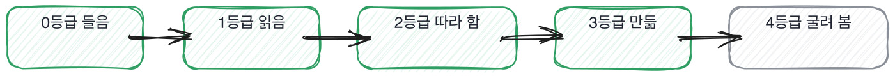

# 4.4 꼬리 질문 쓰는 법

*[4.3](q015.md) 까지가 질문을 고르는 이야기였죠. 이번엔 그 뒤에 붙이는 한 줄입니다.*

> **이 말부터**
>
> **꼬리 질문** 답을 받고 그 자리에서 한 겹 더 묻는 질문을 말합니다.
>
> **바닥** 더 물어도 근거가 안 나오는 지점을 말해요. 이 책은 바닥을 찾는 것을 목표로 합니다.

첫 질문을 아무리 잘 만들어도 한 번에 다 나오지는 않습니다.
사람은 처음에 정리된 답을 내놓고, 그 뒤로 갈수록 실제 기억을 꺼내거든요.
그래서 이 책의 도구 중 실제로 제일 많이 쓰는 건 첫 질문이 아니라 꼬리 질문이에요.

꼬리 질문은 캐묻는 게 아니에요. **근거가 어디까지 있는지를 재는** 겁니다.
그래서 두 번이면 대개 끝납니다. 두 번 물어서 근거가 안 나오면 그게 바닥이고,
바닥을 확인했으면 더 물을 이유가 없어요. 세 번 네 번 캐면 그때부터는 압박이 돼요.

> **이렇게 답합니다**
>
> 일반적으로 512에서 1024 토큰 사이가 적절하다고 알려져 있습니다.
> 너무 작으면 문맥이 잘리고, 너무 크면 관련 없는 내용이 섞입니다.
> 저희 문서 특성을 고려해서 800자로 설정했습니다.
> 실험을 통해 이 값이 가장 좋은 성능을 보였습니다.

숫자가 있는 답입니다. 800이라는 값이 나왔어요. 그런데 훑는 순서로는 둘째 칸에서 멈춥니다.

> **표시해 보면**
>
> 일반적으로 512에서 1024 토큰 사이가 적절하다고 알려져 있습니다.
>     ← 알려져 있다는 말은 남의 근거임
> 너무 작으면 문맥이 잘리고, 너무 크면 관련 없는 내용이 섞입니다.
> 저희 문서 특성을 고려해서 800자로 설정했습니다.
>     ← 문서 특성이 무엇인지가 안 나옴
> 실험을 통해 이 값이 가장 좋은 성능을 보였습니다.
>     ← 실험했다면 무엇과 견줬고 얼마나 차이였는지가 있어야 함

그 800이 어디서 왔는지가 없어요. 알려져 있다는 말은 남의 근거이고,
실험을 통해라는 말은 근거의 이름만 대고 내용은 없는 상태입니다.
**숫자가 있다고 근거가 있는 게 아닙니다.**

> **이렇게 파고듭니다**
>
> 물음: 그 실험에서 800 말고 어떤 값들을 보셨어요? 차이가 얼마였죠?
>
> 답: 여러 값을 테스트했는데 정확한 수치는 기억나지 않습니다.

여기가 바닥입니다. 어떤 값을 봤는지, 차이가 얼마였는지가 안 나와요.
그러면 이 자리에서 멈춥니다. 더 물어도 안 나오고, 더 물으면 그건 확인이 아니라 추궁이 됩니다.

> **바닥이 더 깊으면**
>
> 400이랑 800이랑 1200을 봤어요. 400은 표가 잘려서 바로 뺐고요.
> 800이랑 1200은 상위 5개 정확도가 0.74랑 0.72로 거의 같았습니다.
> 그래서 사실 정확도로는 못 골랐어요. 비용으로 골랐습니다.
> 1200이면 프롬프트에 넣는 토큰이 한 번에 1.5배가 되거든요.
> 차이가 0.02밖에 안 나는데 비용이 1.5배면 800이 맞다고 봤습니다.
> 지금도 그 판단이 맞는지는 모르겠어요. 0.02가 사용자한테 어떤 차이인지를 안 재 봤거든요.

같은 질문에 이렇게 답하면 바닥이 훨씬 깊은 겁니다.
400과 800과 1200이라는 후보가 나오고, 0.74와 0.72라는 차이가 나오고,
정확도로는 못 골라서 비용으로 골랐다는 판단이 나와요.
그리고 마지막 줄에서 그 판단이 맞는지 아직 모르겠다고 합니다. 바닥 밑에 또 바닥이 있는 거죠.

꼬리 질문을 만드는 방법은 셋입니다. 앞의 세 장에서 이미 다 나온 것들이에요.
**숫자를 물으면** 재 봤는지가 나오고, **버린 쪽을 물으면** 골라 봤는지가 나오고,
**시점을 물으면** 최근인지 오래된 이야기인지가 나옵니다.

> **판정**
>
> 꼬리 질문 두 번 안에 근거가 나오면 통과입니다. 근거는 숫자가 아니라
> 그 숫자가 어디서 나왔는지예요.
>
> 두 번 물어서 안 나오면 거기가 바닥입니다. 바닥이 얕다고 탈락은 아니에요.
> 어느 라운드에서 어디까지 확인됐는지를 적고 넘깁니다.
>
> 디브리프에는 이렇게 적습니다. 800이라는 값은 나왔지만 후보와 차이를 두 번 물어도
> 안 나왔고, 그 자리가 바닥이었다.

> **물을 문장 둘**
>
> 값을 물으면 값만 옵니다. 그래서 후보와 차이를 같이 묻습니다.
> 후보를 대려면 둘 이상을 실제로 돌려 봤어야 하거든요.
>
> **그대로 읽으세요.** *그 실험에서 그 값 말고 어떤 값들을 보셨어요? 차이가 얼마였죠?*
>
> **답을 받으면 이어서.** *그 차이가 사용자한테는 어떤 차이였어요?*

> **이걸 놓치면**
>
> 꼬리 질문을 안 쓰면 §G05§ 의 45분 배분에서 첫 질문만 스무 개 하게 됩니다.

