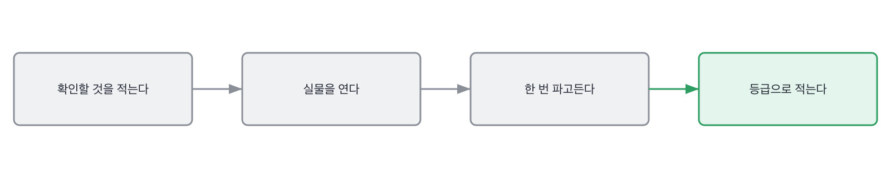
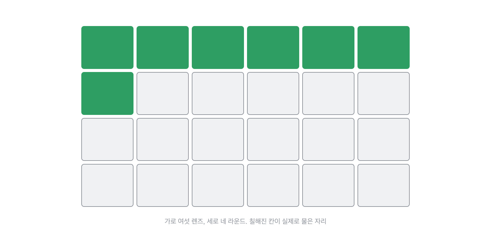

# 5장을 닫으며

## 한 관문을 닫으며

45분을 어떻게 쓰는지를 한 줄로 접으면 이렇게 됩니다.

렌즈 여섯과 라운드 넷을 격자로 놓으면 어디를 물었고 어디가 비었는지가 한눈에 보입니다.
칠해진 칸이 실제로 물은 자리예요. 한 라운드에서 여섯을 다 채우려 하지 마세요.

이 장의 한 문장은 이겁니다. **안 본 것을 안 봤다고 적어 두면 그게 절차가 됩니다.**

다 보려고 하면 45분이 다 잡담으로 갑니다. 넷을 고르고 나머지는 다음 라운드로 넘기면,
넘긴 기록이 다음 면접관에게 지도가 돼요. 그러면 지원자는 같은 이야기를 두 번 안 하게 되고,
저희는 라운드마다 다른 것을 확인하게 됩니다. 그게 라운드를 여러 번 두는 이유입니다.

이 관문에서 나온 낱말 몇 개를 짚고 갑니다. 면접이라는 자리 자체를 부르는 말들이에요.
절차가 정해진 조직에서는 매일 쓰는 말이고, 아닌 곳에서는 한 번도 안 들어 본 말입니다.

> **채용 말 배우기**
>
> **온사이트** 여러 면접관이 이어서 보는 본 면접을 말합니다. 원격으로 해도 그렇게 부릅니다.
>
> **루브릭** 무엇을 어떤 기준으로 볼지 적어 둔 평가표를 말해요.
>
> **하이어링 커미티** 면접관이 아닌 사람들이 기록만 보고 판정하는 자리를 말합니다.

옛 관행 하나를 재 봅니다. 면접 시간을 늘리던 관행이에요.

> **옛 규칙은 아직 유효한가**
>
> **구조화 면접.** 판정은 그대로 유효이고, 오히려 더 중요해졌습니다.
> 근거는 이렇습니다. 매끄러운 답이 흔해질수록 같은 질문으로 견주는 것 말고는 기댈 데가 없어요.
> 다만 구조를 거는 자리가 바뀌었습니다. 질문을 통일하는 것보다 **확인할 것을 통일하는** 쪽이 낫습니다.

다음 장은 물어보는 법입니다. 확인할 것을 정했으면 그걸 문장으로 만드는 일이 남거든요.
그 장의 산출물은 복사해 쓰는 문장들이고, 부록의 질문지가 거기서 나옵니다.

이 장에서 정한 것들이 실제로 어떻게 굴러가는지는 제 자리에서 이렇게 보입니다.
둘 다 자잘한 습관인데, 이런 게 45분의 모양을 실제로 정합니다.
절차를 아무리 잘 짜도 손에 안 붙으면 그날 회의실에서는 안 나와요.

> **현장에서는**
>
> 저는 45분을 5분, 10분, 25분, 5분으로 나눠 씁니다. 마지막 5분은 지원자가 묻는 시간이에요.
> 그 5분에 나오는 질문이 앞의 40분만큼 많은 것을 알려 줄 때가 있습니다.

적는 자리도 정해 두는 게 좋습니다. 어디에 적느냐가 지원자에게 보이거든요.

> **현장에서는**
>
> 평가표를 종이로 들고 들어갑니다. 화면을 보면 지원자가 제가 뭘 적는지 신경 쓰거든요.
> 종이는 소리가 나긴 하는데, 적는 걸 숨기는 것보다 낫습니다.

한 자리 더 짚고 갈게요. 면접을 잘 봤다는 느낌이 드는 날이 있습니다.
그 느낌 자체가 신호인데, 우리가 읽는 방향과 반대로 읽힐 때가 있어요.
즐거웠다는 게 확인했다는 뜻이 아니거든요.

> **여기서 다들 속는다**
>
> 대화가 즐거웠던 면접은 잘 본 면접처럼 느껴집니다. 서로 말이 잘 통했으니까요.
> 그런데 말이 잘 통했다는 건 대개 배경이 비슷하다는 뜻입니다. 같은 것을 겪어 봤으니 통한 거죠.
> 그러면 닮은 사람만 남습니다. 즐거움은 확인이 아니라 닮음의 신호일 때가 많아요.
> 확인은 평가표를 보면 됩니다. 즐거웠는데 채운 칸이 둘뿐이면 그건 대화였지 면접이 아니었습니다.

이 느낌에 저도 여러 번 속았습니다.

> **저자의 삽질**
>
> 면접이 끝나고 좋았다는 느낌만 남는 날이 있습니다. 그런데 평가표를 보면 칸이 거의 비어 있어요.
> 45분 동안 이야기는 많이 했는데 확인한 게 없는 겁니다. 즐거움과 확인은 같이 안 옵니다.

면접 들어가기 전에 아래 다섯 줄로 준비를 훑어 보세요.
다섯이 다 예가 아니면 그날 면접은 절반쯤 즉흥이 됩니다. 즉흥도 되긴 되는데 기록이 안 남아요.

> **30초 점검**
>
> 오늘 볼 렌즈를 하나로 정했는가.
> 45분을 어떻게 나눌지 정했는가.
> 평가표에 채울 칸이 몇 개인지 아는가.
> 기계가 볼 것과 사람이 볼 것을 갈랐는가.
> 끝나고 5분을 지원자에게 줬는가.

왜 하필 45분이고, 그 길이가 면접의 성질을 어떻게 정하는지 풀어 놓고 닫겠습니다.
대단한 이유가 있는 숫자가 아닌데, 이유 없이 정해진 것이 지금 많은 것을 정하고 있습니다.

> **쉬어 가기**
>
> **쉬어 가기: 45분은 왜 45분인가**
>
> 면접이 45분이나 한 시간인 데는 대단한 이유가 없습니다. 회의실 예약 단위여서요.
> 그런데 그 우연한 길이가 지금은 면접의 성질을 정하고 있습니다.
>
> 45분은 애매한 길이입니다. 한 가지를 깊게 보기에는 길고, 여러 가지를 보기에는 짧아요.
> 그래서 대부분의 면접이 어중간해집니다. 다섯 가지를 얕게 훑고 끝나는 거죠.
> 얕게 훑으면 준비된 답이 다 통과합니다. 준비는 얕은 데를 채우는 일이거든요.
>
> 여기서 두 갈래가 생깁니다. 라운드를 늘리거나, 한 라운드에서 볼 것을 줄이거나요.
> 라운드를 늘리는 쪽이 흔한데 값이 비쌉니다. 면접관 시간이 그만큼 더 들고,
> 지원자도 지칩니다. 넷째 라운드쯤 되면 서로 형식만 남아요.
>
> 이 책은 줄이는 쪽을 골랐습니다. 한 라운드에 렌즈 하나요.
> 렌즈 하나면 45분이 넉넉합니다. 깊게 파고들 시간이 생기고, 깊게 파야 준비가 안 통합니다.
> 대신 라운드마다 무엇을 볼지 미리 나눠야 하는데, 그게 5장에서 한 일입니다.
>
> 이 방식의 약점은 하나입니다. 라운드가 셋이면 렌즈 셋만 봅니다.
> 여섯을 다 못 봐요. 그래서 안 본 렌즈가 반드시 남고, 그 자리가 등급에 그대로 적힙니다.
> 18장에서 그 이야기를 합니다. **안 본 것을 안 봤다고 적는 게 이 방식의 값입니다.**

긴 이야기는 여기까지입니다. 이 관문에서 들고 갈 것을 다섯 줄로 접으면 이렇게 됩니다.
45분이라는 길이는 못 바꾸지만 그 안에서 볼 것은 우리가 정합니다.

> **한 관문 요약**
>
> 라운드마다 확인할 것을 하나로 정합니다. 다 보는 라운드는 아무것도 안 봅니다.
>
> 45분은 넷입니다. 질문 넷에 꼬리 질문 여덟, 그리고 마지막 5분은 지원자 몫이에요.
>
> 여섯 렌즈는 점검표가 아니라 순서입니다. 기초가 먼저고 사람이 마지막입니다.
>
> 다음 관문에서 뒤집히는 것. 무엇을 볼지 정했으니 이제 그걸 문장으로 만듭니다.

> **이 판정이 헐거운 지점**
>
> 45분에 넷이라는 배분은 제 습관입니다. 자리와 라운드에 따라 셋이 맞을 때도 있어요.
>
> 여섯 렌즈 중 사람 렌즈는 45분으로는 거의 못 봅니다. 그건 18장에서 다시 다룹니다.
>
> 기록을 남기라고 했지만, 기록이 다음 면접관에게 편견을 넘기기도 합니다. 그 균형은 어렵습니다.
