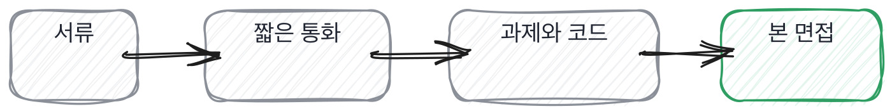

# 5.1 면접은 무엇을 하는 자리인가

*[4.4](../04-g04/q016.md) 까지 질문을 다듬었죠. 이제 그 질문을 놓을 자리를 봅니다.*

> **이 말부터**
>
> **라운드** 면접 한 번을 말합니다. 서류, 통화, 과제, 본 면접이 각각 한 라운드예요.
>
> **합격 기준** 이 라운드를 통과시키는 조건을 말합니다. 최종 합격 조건과 다릅니다.

면접이 잘 안 풀리는 가장 흔한 이유는 질문이 나빠서가 아니라 **그 라운드가 뭘 하는 자리인지
안 정해져 있어서**입니다. 정해져 있지 않으면 면접관 넷이 같은 것을 묻게 되고,
지원자는 같은 이야기를 네 번 하게 되고, 우리는 네 번 다 같은 것만 알게 됩니다.

그래서 라운드마다 확인할 것을 하나로 정합니다. 하나예요.
이 라운드는 만든 것을 보는 자리, 다음 라운드는 판단을 보는 자리, 이런 식으로요.
정하고 나면 그 라운드에서 안 볼 것도 같이 정해집니다. 그게 더 중요합니다.

정하는 방법은 간단해요. 이 사람을 뽑았을 때 6개월 뒤에 걱정될 것 셋을 적고,
그중 이 라운드에서 확인할 수 있는 것 하나를 고릅니다. 나머지 둘은 다른 라운드로 보냅니다.

> **이렇게 답합니다**
>
> 제 기술적인 역량과 문제 해결 능력을 봐 주시면 좋겠습니다.
> 그동안의 프로젝트 경험을 통해 쌓은 노하우를 말씀드릴 수 있습니다.
> 협업 경험도 많기 때문에 팀에 잘 녹아들 수 있을 것 같습니다.
> 궁금하신 부분은 무엇이든 편하게 물어봐 주세요.

이건 지원자에게 대놓고 물어본 답입니다. 저희가 뭘 확인하면 좋겠냐고요.
좋은 질문인데, 이렇게 답이 오면 아직 아무것도 안 정해진 상태예요.

> **표시해 보면**
>
> 제 기술적인 역량과 문제 해결 능력을 봐 주시면 좋겠습니다.
>     ← 역량과 능력은 어느 지원자나 대는 말임
> 그동안의 프로젝트 경험을 통해 쌓은 노하우를 말씀드릴 수 있습니다.
>     ← 노하우가 무엇인지 안 나옴
> 협업 경험도 많기 때문에 팀에 잘 녹아들 수 있을 것 같습니다.
> 궁금하신 부분은 무엇이든 편하게 물어봐 주세요.
>     ← 무엇이든 물어보라는 것은 확인할 자리를 안 정해 준 것임

무엇이든 물어보라는 마지막 줄이 이 답의 정체입니다.
확인할 자리를 정해 주는 게 아니라 저에게 되돌려준 거예요.
**자기가 어디까지 아는지 아는 사람은 범위를 그어 줍니다.**

> **이렇게 파고듭니다**
>
> 물음: 반대로, 저희가 잘못 볼 것 같은 게 있으세요?
>
> 답: 특별히 그런 부분은 없다고 생각합니다.

잘못 볼 것 같은 게 있냐는 물음은 앞 장에서 배운 뒤집기입니다.
여기서 없다고 답하면 그건 겸손이 아니라 자기 이력서를 남의 눈으로 안 읽어 본 거예요.
자기 이력서에서 오해를 부를 줄이 어디인지는, 그 줄을 쓸 때 이미 알게 되거든요.

> **범위를 그어 주면**
>
> 검색 쪽은 물어보시면 어디까지든 답할 수 있을 것 같아요. 2년 동안 그것만 했으니까요.
> 반대로 학습 쪽은 얕습니다. 파인튜닝은 한 번 따라 해 본 게 전부예요.
> 그래서 이력서에 적힌 파인튜닝 경험 한 줄을 보시고 기대하시면 그건 어긋날 것 같습니다.
> 그리고 제가 잘 못 보여드리는 게 하나 있는데, 저는 처음 두 주가 느립니다.
> 코드를 다 읽기 전에는 손을 잘 못 대거든요. 그게 지금 팀에서도 처음엔 문제였어요.

검색은 어디까지든, 학습 쪽은 얕다고 선을 긋습니다.
그리고 이력서의 파인튜닝 한 줄을 보고 기대하면 어긋날 거라고 먼저 말해요.
마지막 두 줄은 더 좋습니다. 처음 두 주가 느리다고 말하고, 그게 지금 팀에서도 문제였다고 덧붙이거든요.
**자기 약점을 시점과 함께 말하는 사람은 그 약점을 이미 다뤄 본 사람입니다.**

> **한 번 더**
>
> 라운드가 안 정해져 있으면 이런 답이 옵니다.
> 가장 어려웠던 것은 대규모 트래픽을 처리하는 시스템을 구축한 경험입니다.
> 성능 최적화와 안정성 확보가 큰 도전이었습니다.
> 여러 차례 시행착오를 거쳐 목표 성능을 달성할 수 있었습니다.
> 이 과정에서 많은 것을 배웠고 크게 성장할 수 있었습니다.
> 대규모와 최적화와 성장이 한 답에 다 있는데 숫자는 하나도 없어요.
> 반대쪽은 어려웠던 게 트래픽이 아니라 사람이었다고 말하고, 3주와 20분이라는 숫자를 댑니다.

여기까지 보고 나면 이 칸에서 무엇을 통과로 볼지가 정해집니다.
합격 기준을 문장으로 갖고 있느냐, 그리고 그 문장이 이 자리에만 맞는 문장이냐요.

> **판정**
>
> 이 칸의 판정 대상은 라운드입니다. 라운드를 마치고 확인한 것 하나를 문장으로 적을 수 있으면 통과예요.
>
> 면접이 끝났는데 좋았다 나빴다 말고 적을 게 없으면 그 라운드는 실패입니다.
> 지원자가 아니라 제가 실패한 겁니다.
>
> 기록에는 이렇게 적습니다. 이 라운드에서는 만든 것을 봤고, 판단과 운영은 안 봤다.
> 안 본 것을 적어 두는 게 절반입니다.

> **물을 문장 둘**
>
> 무엇이든 물어보라는 답이 오면 범위를 되돌려 줍니다.
> 어긋날 것 같은 자리를 물으면 자기 이력서를 남의 눈으로 읽어 본 사람만 답할 수 있거든요.
>
> **그대로 읽으세요.** *반대로, 저희가 잘못 볼 것 같은 게 있으세요?*
>
> **답을 받으면 이어서.** *그 자리를 제가 어떻게 확인하면 좋을까요?*

> **이걸 놓치면**
>
> 라운드를 안 정하면 [5.2](q018.md) 의 45분 배분이 매번 즉흥이 됩니다.

