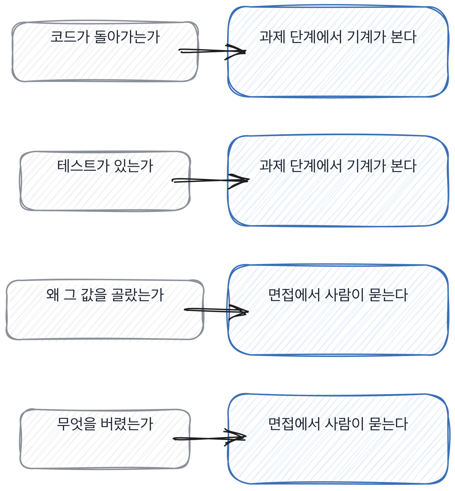

# 5.2 45분 절차

*[5.1](q017.md) 에서 확인할 것을 정했죠. 이번엔 그걸 45분에 넣습니다.*

> **이 말부터**
>
> **배분** 45분을 어디에 얼마씩 쓸지 미리 정해 두는 것을 말합니다.
>
> **기계가 볼 것** 사람이 안 봐도 되는 것을 말해요. 형식, 중복, 돌아가는지 여부 같은 것들입니다.

45분은 생각보다 짧습니다. 인사와 소개에 5분, 마지막 질문 시간에 5분을 주면 35분이 남아요.
좋은 질문 하나에 꼬리 질문 둘을 붙이면 8분에서 10분이 걸리니까 결국 넷입니다.
넷이라는 숫자를 먼저 받아들이는 게 이 칸의 시작이에요.

넷을 정할 때는 앞 장의 여섯 렌즈에서 고릅니다. 그리고 고를 때 기준이 하나 있어요.
**기계가 볼 수 있는 것은 사람이 안 봅니다.** 코드가 돌아가는지, 테스트가 있는지,
형식이 맞는지는 과제 단계에서 자동으로 봅니다. 그걸 면접에서 보면 10분이 그냥 갑니다.

- **시간.** 무엇을 왜 여기인가
- **0~5분.** 자리 만들기 긴장한 답은 실력이 아니라 긴장을 보여줍니다
- **5~15분.** 만든 것 하나 제일 잘 아는 것부터 열어야 뒤가 열립니다
- **15~25분.** 그 안의 결정 앞에서 연 것 안으로 들어갑니다
- **25~35분.** 실패와 되돌리기 신뢰가 쌓인 뒤에야 실패 이야기가 나옵니다
- **35~40분.** 안 본 렌즈 하나 다음 라운드에 넘길 자리를 여기서 찍습니다
- **40~45분.** 지원자 질문 무엇을 묻는지가 마지막 정보입니다

순서에 이유가 있습니다. 실패 이야기를 앞에 두면 안 나와요.
처음 만난 사람에게 자기가 망친 이야기를 하는 사람은 없습니다.
만든 것을 먼저 열고, 그 안의 결정을 같이 들여다보고 나서야 실패가 나옵니다.

> **이렇게 답합니다**
>
> 제가 진행한 프로젝트의 전체 아키텍처를 설명드리고 싶습니다.
> 설계 의도와 기술 선택의 이유를 말씀드릴 수 있습니다.
> 전체 흐름을 이해하시면 제 역량을 잘 파악하실 수 있을 것 같습니다.

45분에 하나만 보여준다면 뭘 보여주겠냐고 물었습니다. 이 질문 자체가 배분 연습이에요.

> **표시해 보면**
>
> 제가 진행한 프로젝트의 전체 아키텍처를 설명드리고 싶습니다.
>     ← 전체를 보여주겠다는 것은 하나를 고른 게 아님
> 설계 의도와 기술 선택의 이유를 말씀드릴 수 있습니다.
> 전체 흐름을 이해하시면 제 역량을 잘 파악하실 수 있을 것 같습니다.
>     ← 역량을 파악하시라는 것은 판단을 넘긴 것임

전체 아키텍처를 보여주겠다는 건 하나를 고른 게 아닙니다.
그리고 전체를 45분에 설명하면 어디에도 못 들어가요. 넓게 훑고 끝납니다.
**고르지 못하는 것도 정보입니다.** 자기가 어디에 깊이 들어가 봤는지를 모르는 거니까요.

> **이렇게 파고듭니다**
>
> 물음: 그 전체 중에 딱 한 부분만 고른다면요?
>
> 답: 굳이 하나를 꼽자면 검색 파이프라인 설계 부분입니다.

한 부분만 고르라고 하면 대개 골라 줍니다. 그때 고른 자리가 그 사람이 제일 오래 있었던 자리예요.
그래서 이 질문은 배분을 지원자에게 맡기는 셈이 됩니다. 저보다 그쪽이 더 잘 알거든요.

> **하나를 고르면**
>
> 청크를 어떻게 자를지 정한 과정이요. 그거 하나면 될 것 같습니다.
> 거기에 제가 한 판단이 다 들어 있거든요. 400과 800과 1200을 봤고,
> 정확도로는 안 갈려서 비용으로 골랐고, 그 뒤에 표가 깨져서 두 번 고쳤습니다.
> 그리고 지금도 문단 경계로 자르는 게 맞았다고 생각하는데 못 바꾸고 있어요.
> 그 이유까지 말씀드리면 제가 어떻게 일하는지는 다 보실 것 같습니다.

청크를 자르는 결정 하나를 고르고, 거기에 판단이 다 들어 있다고 말합니다.
숫자 셋, 버린 선택지, 두 번 고친 이력, 그리고 지금도 못 바꾸는 이유까지요.
이 답 하나로 10분을 쓰면 그 10분이 45분 중 제일 값진 시간이 됩니다.

> **여기서 다들 속는다**
>
> 시간이 남으면 질문을 더 하고 싶어집니다. 그게 제일 흔한 실수예요.
> 남은 5분에 새 질문을 던지면 답을 반쯤 듣고 끊게 되고, 반쯤 들은 답은 기록에 못 씁니다.
> **남으면 안 본 렌즈를 적고 끝내는 게 낫습니다.** 다음 라운드가 그걸 봅니다.

45분을 어떻게 나눴는지까지 들었으면 판정할 자리가 다 모였습니다.
나눠 봤느냐가 아니라 나눈 이유를 대느냐로 봅니다.

> **판정**
>
> 45분이 끝났을 때 확인한 것 하나와 못 본 것 둘을 적을 수 있으면 그 면접은 통과입니다.
>
> 질문을 여덟 개 던졌는데 꼬리 질문이 둘 이하면 그 면접은 다시 설계합니다.
> 첫 질문만 많은 면접은 넓고 얕게 훑은 거예요.
>
> 기록에는 이렇게 적습니다. 만든 것과 그 안의 결정까지 봤고, 실패와 운영은 시간이 없어 못 봤다.

> **물을 문장 둘**
>
> 전체를 설명하겠다는 답이 오면 하나로 좁힙니다.
> 하나를 고르려면 자기가 어디에 오래 있었는지를 알아야 하거든요.
>
> **그대로 읽으세요.** *그 전체 중에 딱 한 부분만 고른다면요?*
>
> **답을 받으면 이어서.** *그 부분에 며칠쯤 쓰셨어요?*

> **이걸 놓치면**
>
> 배분을 안 정하면 [5.3](q019.md) 의 평가표에 적을 것이 라운드마다 달라집니다.

