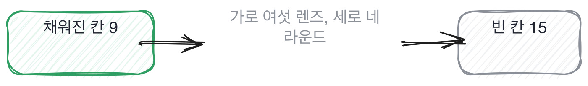

# 5.3 평가표 한 장과 여섯 렌즈

*[5.2](q018.md) 에서 45분을 나눴죠. 마지막으로 그 결과를 적는 자리를 만듭니다.*

> **이 말부터**
>
> **렌즈** 지원자를 볼 때 무엇을 보는지 정해 둔 각도를 말합니다. 이 책은 여섯을 씁니다.
>
> **평가표** 무엇을 봤고 무엇을 못 봤는지 적는 한 장을 말해요. 점수표가 아닙니다.

이 책은 지원자를 여섯 각도에서 봅니다. 기초, 만들기, 평가, 판단, 운영, 사람이에요.
여섯을 한 라운드에 다 보려고 하면 하나도 못 봅니다. 그래서 한 번에 하나씩 씁니다.

렌즈는 점검표가 아니라 순서입니다. 기초가 먼저고 사람이 마지막이에요.
만들어 본 적 없는 사람에게 트레이드오프를 물으면 답은 나오지만 확인할 게 없거든요.
그리고 사람 렌즈를 45분으로 보려는 건 대부분 실패합니다. 18장에서 다시 다룹니다.

- **렌즈.** 묻는 것 이 책의 어디
- **기초.** 쓰는 것의 동작을 아는가 9~11장
- **만들기.** 돌아가는 것을 만들어 봤는가 12장
- **평가.** 좋아졌다는 걸 무엇으로 쟀는가 13장
- **판단.** 갈림길에서 무엇을 버렸는가 7~8장, 14장
- **운영.** 터졌을 때 무엇을 봤는가 15장
- **사람.** 6개월 같이 일할 수 있는가 16장, 18장

> **이렇게 답합니다**
>
> 마이크로서비스 아키텍처를 도입한 것이 가장 좋은 결정이었습니다.
> 확장성과 유지보수성이 크게 향상되었습니다.
> 각 팀이 독립적으로 배포할 수 있게 되어 개발 속도도 빨라졌습니다.
> 전반적으로 조직 전체의 생산성이 향상되었다고 생각합니다.

이 답에 렌즈를 대 보세요. 어느 렌즈에 걸리나요.

> **표시해 보면**
>
> 마이크로서비스 아키텍처를 도입한 것이 가장 좋은 결정이었습니다.
> 확장성과 유지보수성이 크게 향상되었습니다.
>     ← 크게 향상이 무엇으로 잰 것인지 없음
> 각 팀이 독립적으로 배포할 수 있게 되어 개발 속도도 빨라졌습니다.
>     ← 빨라졌다면 얼마나인지 없음
> 전반적으로 조직 전체의 생산성이 향상되었다고 생각합니다.
>     ← 조직 전체는 이 사람이 확인할 수 있는 범위가 아님

판단 렌즈로 물었는데 답은 판단이 아니라 결과로 돌아왔습니다.
향상되었다는 말이 세 번 나오는데 무엇으로 쟀는지는 없어요.
그리고 마지막 줄은 이 사람이 확인할 수 있는 범위를 넘습니다.
**조직 전체의 생산성은 이 자리에서 확인할 수 없는 주장**이에요.

> **이렇게 파고듭니다**
>
> 물음: 그 결정으로 나빠진 건 없었어요?
>
> 답: 초기에 복잡도가 증가하는 부분이 있었지만 곧 안정화되었습니다.

나빠진 것을 물으면 판단 렌즈가 열립니다. 좋아진 것만 말하는 건 고른 게 아니라 받은 거니까요.
안정화되었다는 답으로 끝나면 그건 아직 렌즈가 안 열린 겁니다.

> **렌즈가 열리면**
>
> 평가 세트를 손으로 만든 거요. 120개를 이틀 동안 붙였습니다.
> 자랑스럽다기보다는, 그거 안 만들었으면 지금까지 한 게 다 감이었을 거예요.
> 나빠진 것도 있습니다. 그 세트가 제 손으로 만든 거라 제 편향이 들어갔어요.
> 제가 중요하다고 생각한 질문만 모였거든요. 그래서 지난달에 실제 로그에서 다시 뽑았는데,
> 새로 뽑은 걸로 재니까 점수가 0.78에서 0.69로 떨어졌습니다. 그게 진짜 점수였던 거죠.

이 답은 렌즈 둘을 한 번에 엽니다. 평가 세트를 만든 이야기는 평가 렌즈이고,
그 세트에 자기 편향이 들어갔다고 말하는 건 판단 렌즈예요.
0.78이 0.69로 떨어졌고 그게 진짜 점수였다는 마지막 줄이 이 답의 값입니다.
**자기 점수를 스스로 깎는 사람은 그 점수를 만들어 본 사람**입니다.

평가표에는 점수를 안 적습니다. 3점 4점은 적기 편하고 나중에 아무 뜻도 없어요.
대신 세 줄을 적습니다. 어느 렌즈를 봤는지, 무엇이 나왔는지, 무엇을 못 봤는지.
못 본 것을 적는 줄이 제일 중요합니다. 그게 다음 라운드의 시작점이 되거든요.

> **판정**
>
> 평가표 세 줄이 채워지면 통과입니다. 본 렌즈, 나온 것, 못 본 것.
>
> 세 줄 중 하나라도 못 채우면 그 면접은 다시 설계합니다.
> 특히 못 본 것을 못 적으면 45분 동안 아무 데도 안 들어간 겁니다.
>
> 기록에는 이렇게 적습니다. 판단 렌즈로 물었고, 나빠진 것을 되물으니 평가 편향까지 나왔고,
> 운영과 사람은 못 봤다.

> **물을 문장 둘**
>
> 자랑스러운 결정을 물으면 좋아진 것만 옵니다. 그래서 나빠진 것을 같이 묻습니다.
> 둘 다 말할 수 있으면 그건 고른 사람이에요.
>
> **그대로 읽으세요.** *그 결정으로 나빠진 건 없었어요?*
>
> **답을 받으면 이어서.** *그걸 알고도 그대로 두신 이유가 있나요?*

> **이걸 놓치면**
>
> 평가표가 없으면 §G06§ 에서 질문을 만들어도 무엇을 확인할지가 매번 달라집니다.

