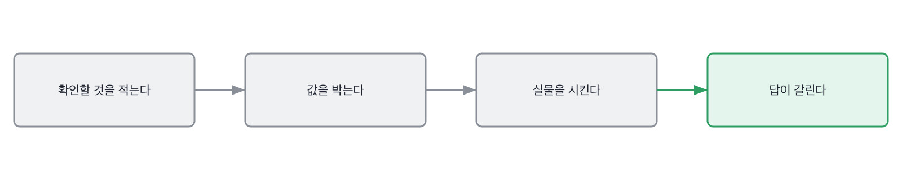
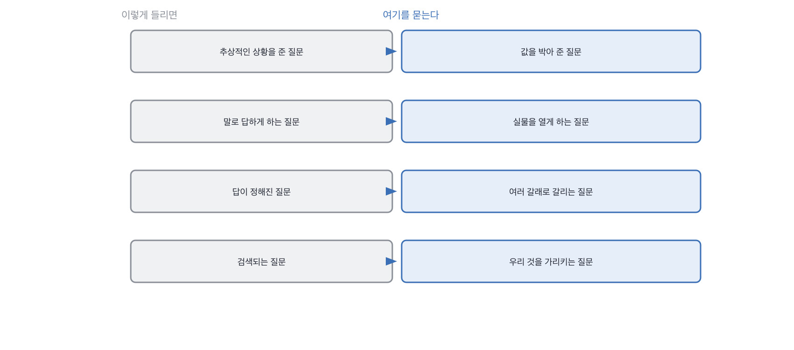

# 6장을 닫으며

## 한 관문을 닫으며

이 관문에서 만든 것을 짝으로 세우면 이렇게 됩니다.

이 관문에서 만든 것을 짝으로 세우면 이렇게 됩니다.

2단계가 여기서 끝납니다. 1단계에서 답을 듣는 귀를 만들었고, 2단계에서 질문을 손봤어요.
두 단계를 지나고 나면 면접이 좀 조용해집니다. 질문 수가 줄고 한 질문에 머무는 시간이 늘거든요.

돌아보면 2단계에서 한 일은 전부 같은 방향입니다.
답이 정해진 자리를 없애는 것. 예 아니오로 닫히는 질문을 열고,
검색되는 질문을 사례로 바꾸고, 추상적인 상황에 값을 박고, 말을 실물로 바꿨습니다.
답이 여러 갈래로 갈릴 수 있어야 그 갈림에서 사람이 보이거든요.

이 관문에서 나온 낱말 몇 개를 짚고 갑니다. 질문과 과제를 만드는 자리에서 쓰는 말들이에요.

> **채용 말 배우기**
>
> **과제 전형** 집에서 풀어 오는 문제를 말합니다. 이 책은 결과물보다 결정 과정을 봅니다.
>
> **페어 프로그래밍 면접** 같이 앉아 코드를 짜는 면접을 말해요. 12장에서 다룹니다.
>
> **테이크홈** 과제 전형을 부르는 다른 말입니다. 팀마다 쓰는 말이 다릅니다.

옛 관행 하나를 재 봅니다. 상황을 주고 설계해 보라던 관행이에요.

> **옛 규칙은 아직 유효한가**
>
> **과제 전형.** 판정은 조정해서 유효입니다.
> 근거는 제 경험이에요. 결과물만 보면 이제 아무것도 안 갈립니다. 다들 잘 만들어 오거든요.
> 그래서 저희는 과제를 채점하지 않고 **과제로 대화를 엽니다.**
> 바꿀 부분을 묻고, 근거 없이 정한 값을 묻습니다. 거기서 갈립니다.

다음 장부터 3단계입니다. 이 책의 척추가 나옵니다.
결정을 세고 버린 쪽을 묻는 자리요. 지금까지의 다섯 장이 그 준비였습니다.

질문을 만드는 일에서 제가 실제로 하는 것과 안 하는 것을 적어 둡니다.

> **현장에서는**
>
> 저는 질문을 만들 때 확인할 것을 먼저 한 줄로 적습니다. 그 한 줄을 못 쓰면 질문도 안 만들어요.
> 적어 보면 절반쯤은 확인할 게 없다는 걸 알게 됩니다. 그냥 궁금했던 거였어요.

이 규칙이 없으면 이렇게 미끄러집니다.

> **저자의 삽질**
>
> 상황을 주고 설계해 보라는 질문이 흔합니다. 사용자가 늘어난다고 가정해 보라는 식으로요.
> 가정이 흐릿하면 답도 흐릿하게 옵니다. 그런데 그걸 지원자가 흐릿하다고 읽기 쉬워요.
> 값을 박아 보면 알게 됩니다. 흐릿했던 건 질문 쪽이었다는 걸요.

속기 쉬운 자리가 여기도 있습니다. 열린 질문이 좋은 질문이라는 통념이요.
오래된 조언이고 대체로 맞는데, 지금은 여는 만큼 준비된 답이 들어옵니다.
그래서 여는 것과 좁히는 것을 같이 해야 합니다.

> **여기서 다들 속는다**
>
> 열린 질문이 좋다는 말은 오래된 조언이고 대체로 맞습니다. 답할 여지를 주니까요.
> 그런데 너무 열어 두면 지원자가 자기가 준비한 데로 갑니다. 열린 만큼 준비된 답이 들어와요.
> 그래서 저는 넓게 열고 값으로 좁힙니다. 상황은 열되 제약은 박아 두는 거죠.
> 확인은 답을 들어 보면 됩니다. 준비해 온 이야기가 그대로 나오면 너무 열어 둔 겁니다.

속기 쉬운 자리가 하나 더 있습니다. 과제를 크게 내면 많이 볼 것 같은 자리요.
저도 한동안 과제를 키우는 쪽으로 갔습니다. 볼 게 많아 보였거든요.
키우고 나서 제출물이 줄었고, 남은 제출물은 오히려 덜 갈렸습니다.

> **여기서 다들 속는다**
>
> 큰 과제를 내면 여러 가지를 한꺼번에 볼 수 있을 것 같습니다. 설계도 보고 코드도 보고요.
> 그런데 크면 제출률이 떨어지고, 떨어지면 남는 표본이 시간 많은 사람 쪽으로 쏠립니다.
> 그리고 큰 과제일수록 도구가 대신 채우기 좋습니다. 볼 것이 많아지는 게 아니라 흐려져요.
> 확인은 시간을 재 보면 됩니다. 그 과제를 직접 두 시간 안에 해 보세요.

질문 하나를 만들고 나서 아래 다섯 줄로 훑어 보세요.
첫 줄이 제일 중요합니다. 첫 줄을 못 쓰면 나머지 넷은 볼 필요도 없어요.

> **30초 점검**
>
> 확인할 것을 한 줄로 적었는가.
> 그 한 줄이 실제로 확인되는 것인가.
> 상황에 값을 박았는가.
> 못 쓰게 할 것을 정해 줬는가.
> 말 대신 실물을 시킬 수 있는가.

과제 이야기를 하나 더 하고 닫겠습니다. 좋은 과제를 만들기가 왜 그렇게 어려운지요.
난이도 문제라고 생각하기 쉬운데, 실제로 어려운 건 다른 데 있습니다.

> **쉬어 가기**
>
> **쉬어 가기: 좋은 과제는 왜 만들기 어려운가**
>
> 과제를 만들어 보면 금방 알게 되는 게 있습니다. 쉬우면 다 통과하고 어려우면 다 떨어져요.
> 가운데를 맞추기가 어렵습니다. 그런데 진짜 어려운 건 난이도가 아니에요.
>
> 좋은 과제의 조건은 난이도가 아니라 **갈림길의 개수**입니다.
> 답이 하나로 정해지는 과제는 아무리 어려워도 안 갈립니다. 맞았거나 틀렸거나뿐이죠.
> 갈림길이 여럿인 과제라야 무엇을 골랐는지, 무엇을 버렸는지가 나옵니다.
>
> 그래서 저는 과제를 만들 때 정답을 안 정합니다. 대신 갈림길을 셉니다.
> 셋이 안 나오면 그 과제는 안 씁니다. 두 시간을 들여도 볼 게 없거든요.
>
> 그리고 하나 더 있습니다. 과제에는 반드시 *정할 수 없는 값*을 하나 넣습니다.
> 우리 데이터를 모르면 정할 수 없는 값이요. 그러면 지원자가 그 자리에서 멈춥니다.
> 멈추고 나서 뭘 하는지가 이 과제의 진짜 문제입니다.
>
> 짐작으로 정하고 넘어가는 사람과, 못 정하겠다고 적어 오는 사람이 갈립니다.
> 둘 다 나쁘지 않아요. 다만 다른 사람이고, 맡길 자리가 다릅니다.
> 그래서 저는 과제 안내문에 한 줄을 넣습니다. **정하지 못한 값은 정하지 말고 적어 오세요.**

긴 이야기는 여기까지입니다. 이 관문에서 만든 것을 다섯 줄로 접으면 이렇게 됩니다.
여기서 나온 문장들이 그대로 부록의 질문지가 돼요.
복사해서 다음 면접에 들고 가시면 됩니다.

> **한 관문 요약**
>
> 확인할 것을 먼저 문장으로 적습니다. 적히지 않으면 그 질문은 안 씁니다.
>
> 상황에 값을 박으면 답이 한 갈래로 안 나옵니다. 400만 건, 예산 두 배처럼요.
>
> 말 대신 실물을 시킵니다. 그리고 실물은 채점하지 말고 대화의 입구로 씁니다.
>
> 다음 관문에서 뒤집히는 것. 준비를 다 했으니 이제 결정을 셉니다.

> **이 판정이 헐거운 지점**
>
> 확인할 것을 먼저 적으라는 규칙은 면접관이 여럿일 때 잘 안 지켜집니다. 강제할 방법을 아직 못 찾았어요.
>
> 값을 박은 질문은 우리 서비스를 아는 사람에게 유리합니다. 그 편향을 완전히 못 없앴습니다.
>
> 과제는 시간을 많이 뺏습니다. 두 시간이 넘어가면 지원자가 줄어드는 것도 사실입니다.
