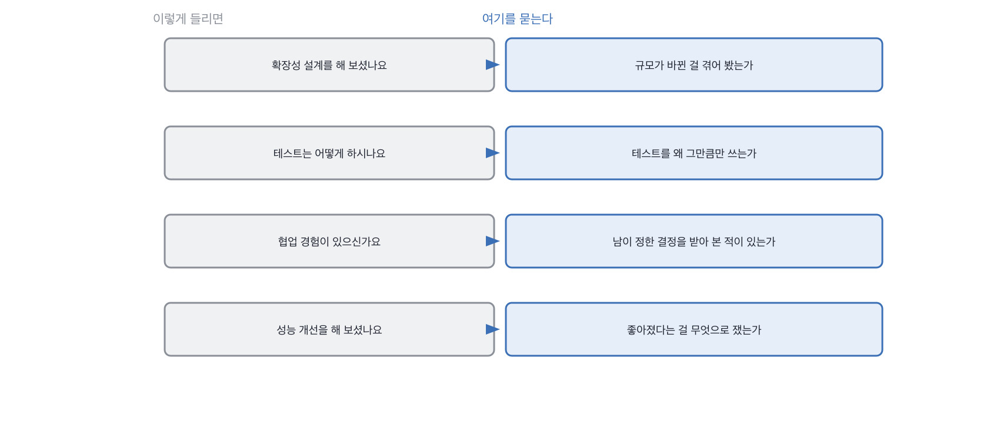

# 6.1 무엇을 확인할 것인지 먼저 문장으로 쓴다

*[5.3](../05-g05/q019.md) 에서 평가표를 만들었죠. 이번엔 그 표를 채울 질문을 만듭니다.*

> **이 말부터**
>
> **확인 문장** 이 질문으로 무엇을 알고 싶은지를 한 줄로 적은 것을 말합니다.
>
> **닫힌 질문** 예 아니오나 한 낱말로 끝나는 질문이에요. 확인 문장이 없으면 대개 이렇게 나옵니다.

질문을 먼저 만들면 대개 나쁜 질문이 나옵니다. 손에 익은 문장이 먼저 떠오르거든요.
그래서 순서를 바꿉니다. **확인할 것을 먼저 한 줄로 적고, 그다음에 질문을 만듭니다.**

확인 문장은 이렇게 생겼습니다. 이 사람이 값을 스스로 정해 본 적이 있는가.
이 사람이 자기 결정을 되돌려 본 적이 있는가. 이 사람이 안 해 본 것을 안 해 봤다고 말하는가.
전부 예 아니오로 답할 수 있는 문장인데, 그건 **제가 답할 문장**이지 지원자가 답할 문장이 아닙니다.

이 순서를 지키면 좋은 게 하나 더 있어요. 확인 문장이 안 적히는 질문은 그냥 안 씁니다.
그 질문으로 무엇을 알고 싶은지 제가 못 적으면, 답을 들어도 못 쓰거든요.

> **이렇게 답합니다**
>
> 네, 확장성을 고려한 설계 경험이 있습니다.
> 트래픽 증가에 대비해 수평 확장이 가능한 구조로 만들었습니다.
> 캐싱과 로드 밸런싱을 적용했고, 데이터베이스도 분리했습니다.
> 결과적으로 안정적으로 서비스를 운영할 수 있었습니다.

확장성 있는 설계를 해 봤냐고 물었습니다. 확인 문장 없이 손에서 나온 질문이에요.

> **표시해 보면**
>
> 네, 확장성을 고려한 설계 경험이 있습니다.
>     ← 예 아니오로 닫히는 질문이라 예가 왔음
> 트래픽 증가에 대비해 수평 확장이 가능한 구조로 만들었습니다.
>     ← 대비했다는 것은 겪었다는 뜻이 아님
> 캐싱과 로드 밸런싱을 적용했고, 데이터베이스도 분리했습니다.
> 결과적으로 안정적으로 서비스를 운영할 수 있었습니다.
>     ← 안정적이었다는 것을 무엇으로 알았는지 없음

예로 시작하는 답이 왔습니다. 그럴 수밖에 없어요. 질문이 예 아니오를 묻고 있으니까요.
그다음 세 줄은 확장성이라는 낱말에 붙는 표준 목록입니다.
캐싱, 로드 밸런싱, 데이터베이스 분리. 안 해 본 사람도 댈 수 있는 목록이에요.

> **이렇게 파고듭니다**
>
> 물음: 실제로 트래픽이 늘어난 적이 있어요?
>
> 답: 크게 늘어난 적은 없었지만 대비는 해 두었습니다.

여기서 진짜 정보가 나옵니다. 늘어난 적이 없다는 거예요.
그러면 이 사람의 확장성 경험은 **대비한 경험**이지 겪은 경험이 아닙니다.
그 둘은 아주 다른데, 처음 질문으로는 구분이 안 됐어요.

> **확인 문장을 정하고 물으면**
>
> 늘어난 적은 없어요. 그래서 확장성은 확인해 본 적이 없습니다.
> 대신 줄어든 적은 있습니다. 사내 서비스라 연말에 접속이 반으로 줍니다.
> 그때 알았는데, 저희가 항상 켜 두던 서버 두 대 중 한 대가 그냥 놀고 있었어요.
> 그걸 끄니까 월 비용이 18만원에서 11만원이 됐습니다.
> 확장을 대비한 구조가 실제로는 낭비를 대비하고 있었던 거죠.

이 답이 좋은 건 정직해서만이 아닙니다. **늘어난 적은 없지만 줄어든 적은 있다**고
방향을 바꿔서 자기 경험을 가져오거든요. 그리고 18만원이 11만원이 됐다는 숫자가 붙어요.
확장을 대비한 구조가 실제로는 낭비를 대비하고 있었다는 마지막 줄은 판단 렌즈입니다.

왼쪽이 손에서 나온 질문이고 오른쪽이 확인 문장입니다.
오른쪽을 먼저 적으면 질문은 거기서 자동으로 나와요.
규모가 바뀐 걸 겪어 봤는지 알고 싶으면, 규모가 바뀐 적이 있냐고 물으면 됩니다.

> **판정**
>
> 질문마다 확인 문장이 적혀 있으면 통과입니다. 질문 넷이면 확인 문장도 넷이에요.
>
> 확인 문장을 못 적는 질문은 씁니다가 아니라 뺍니다.
> 그 질문이 나쁜 게 아니라, 그 질문으로 무엇을 알고 싶은지를 제가 아직 모르는 겁니다.
>
> 기록에는 이렇게 적습니다. 규모 변화를 겪었는지 확인하려 했고,
> 늘어난 적은 없고 줄어든 경험에서 비용 판단이 나왔다.

> **물을 문장 둘**
>
> 해 보셨냐고 물으면 예가 옵니다. 그래서 실제로 그 일이 있었는지를 묻습니다.
> 겪은 일에는 시점이 붙고, 안 겪은 일에는 대비라는 말이 붙거든요.
>
> **그대로 읽으세요.** *실제로 그런 일이 있었어요? 언제였죠?*
>
> **답을 받으면 이어서.** *그때 뭐가 제일 먼저 티가 났어요?*

> **이걸 놓치면**
>
> 확인 문장을 안 적으면 [6.2](q021.md) 에서 값을 박아도 무엇을 보려는지가 흐려집니다.

