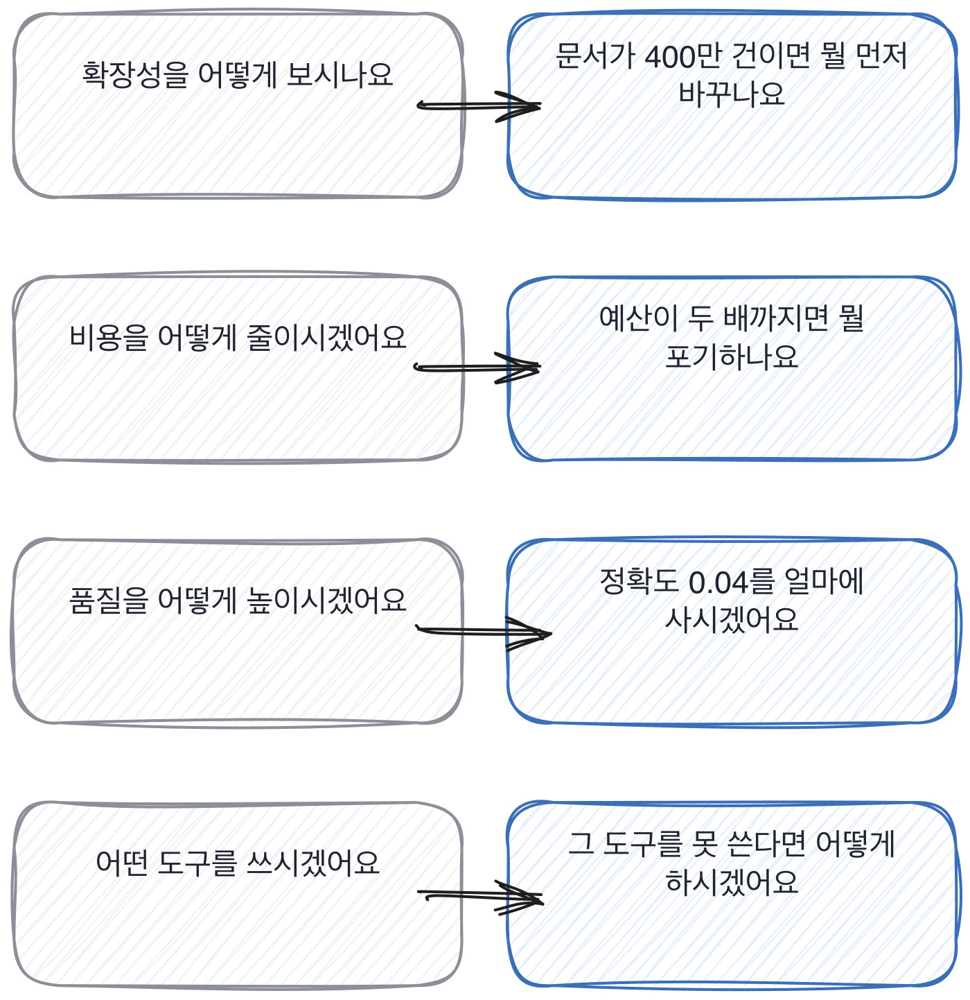

# 6.2 상황을 값으로 주고 못 쓰는 것을 정해 준다

*[6.1](q020.md) 에서 확인 문장을 적었죠. 이번엔 그 질문에 값을 박습니다.*

> **이 말부터**
>
> **값을 박는다** 질문 안에 숫자와 조건을 넣어 두는 것을 말합니다.
>
> **제약** 쓸 수 없는 것을 미리 정해 주는 것을 말해요. 예산, 시간, 못 쓰는 도구 같은 것들입니다.

설계를 물으면 대개 교과서가 옵니다. 캐싱하고, 분리하고, 모니터링하겠다는 답이요.
그게 나쁜 답이라서가 아니라 **질문에 값이 없어서** 그렇습니다.
값이 없으면 모든 답이 맞거든요. 모든 답이 맞으면 아무것도 안 갈립니다.

그래서 값을 박습니다. 문서가 400만 건이면, 예산이 지금의 두 배까지면, 두 주 안에 해야 하면.
숫자가 들어가는 순간 답이 갈리기 시작해요. 무엇을 포기할지 정해야 하니까요.

제약은 값보다 더 셉니다. 못 쓰는 것을 정해 주면 익숙한 답이 막히거든요.
GPU를 못 쓴다면, 외부 API를 못 쓴다면, 팀이 혼자라면.
이건 함정이 아닙니다. 실제로 그런 제약 아래에서 일하게 되니까요.

> **이렇게 답합니다**
>
> 먼저 인프라 비용을 분석하여 병목 지점을 파악하겠습니다.
> 임베딩 비용이 큰 비중을 차지할 것으로 예상되므로 배치 처리를 고려하겠습니다.
> 벡터 데이터베이스의 인덱스 타입도 재검토가 필요합니다.
> 캐싱 전략을 강화하여 중복 호출을 줄이겠습니다.
> 전반적으로 비용 효율성을 높이는 방향으로 접근하겠습니다.

값을 박아 물었는데도 이런 답이 올 수 있습니다. 어디서 미끄러지는지 보세요.

> **표시해 보면**
>
> 먼저 인프라 비용을 분석하여 병목 지점을 파악하겠습니다.
>     ← 파악하겠다는 것은 지금 답을 안 낸 것임
> 임베딩 비용이 큰 비중을 차지할 것으로 예상되므로 배치 처리를 고려하겠습니다.
>     ← 예상되므로라고 했는데 어느 쪽이 큰지 지금 계산할 수 있음
> 벡터 데이터베이스의 인덱스 타입도 재검토가 필요합니다.
> 캐싱 전략을 강화하여 중복 호출을 줄이겠습니다.
> 전반적으로 비용 효율성을 높이는 방향으로 접근하겠습니다.
>     ← 방향으로 접근하겠다는 마무리는 아무것도 안 고른 것임

파악하겠다, 고려하겠다, 재검토가 필요하다. 전부 **지금 답을 안 내겠다는** 문장입니다.
값을 줬는데도 계산을 안 한 거예요. 400만 건이라는 숫자가 답에 한 번도 안 나옵니다.

> **이렇게 파고듭니다**
>
> 물음: 지금 계산해 보면 임베딩과 검색 중에 어느 쪽이 클 것 같으세요?
>
> 답: 상황에 따라 다를 수 있어서 실제로 측정해 봐야 알 수 있을 것 같습니다.

지금 계산해 보라고 하면 갈립니다. 상황에 따라 다르다는 답이 오면 거기가 바닥이에요.
계산을 해 본 사람은 대충이라도 방향을 댑니다. 안 해 본 사람은 측정해 봐야 안다고 말해요.

> **계산이 되는 사람은**
>
> 임베딩은 한 번만 하니까 400만 건이면 초기 비용이 크고 그 뒤로는 거의 0이에요.
> 그래서 그건 한 번 내고 끝나는 돈이고, 매달 나가는 건 검색 쪽입니다.
> 지금 저희가 질의당 상위 20개를 가져와서 재순위를 도는데, 그게 매 질의마다 나가요.
> 400만 건이 되면 후보를 20개로 유지하는 게 오히려 더 어려워지고요.
> 그래서 저는 재순위를 먼저 끄겠습니다. 정확도가 0.78에서 0.74로 떨어질 텐데,
> 그 0.04가 예산 두 배보다 싼지는 사용자한테 물어봐야 알 것 같습니다.
> 그 질문을 먼저 하고 싶어요.

임베딩은 한 번 내고 끝나는 돈이고 검색은 매달 나가는 돈이라고 가릅니다.
그리고 재순위를 먼저 끄겠다고 고르고, 그 대가가 0.04라고 숫자를 댑니다.
마지막 줄이 제일 좋아요. 그 0.04가 예산보다 싼지는 사용자한테 물어봐야 한다고요.
**모르는 것을 모른다고 말하면서 그걸 아는 방법까지 대는** 답입니다.

> **한 번 더**
>
> 같은 상황에서 제약만 바꿔도 답이 갈립니다.
> 정확도를 유지하면서 비용을 관리하려면 최적화가 필요합니다.
> 불필요한 호출을 줄이고 캐싱을 적극 활용하겠습니다.
> 모델 경량화나 양자화도 검토해 볼 수 있습니다.
> 지속적인 모니터링으로 균형점을 찾아가겠습니다.
> 최적화가 필요하다는 첫 줄은 문제를 다시 말한 것이고, 균형점을 찾겠다는 마지막 줄은 안 고른 겁니다.
> 반대쪽은 상위 200개가 전체의 절반이라는 숫자를 대고 캐시 하나를 고릅니다.

값을 박을 때 주의할 게 하나 있습니다. **우리 서비스의 값을 그대로 쓰면 우리를 아는 사람이 유리해집니다.**
그래서 저는 값만 주고 도메인은 지원자가 아는 쪽으로 옮겨 줍니다.
문서가 400만 건이라고만 하고, 그 문서가 무엇인지는 그쪽 경험에서 가져오게 하는 식이에요.

> **판정**
>
> 값을 준 질문에 숫자로 답하면 통과입니다. 정확한 계산이 아니어도 돼요.
> 어느 쪽이 크고 어느 쪽이 작은지를 방향으로 대면 됩니다.
>
> 값을 줬는데도 파악하겠다, 검토하겠다로 답하고, 지금 계산해 보라고 해도 안 하면 안 보냅니다.
> 모르는 것과 안 세어 보는 것은 다르고, 이 자리는 후자를 봅니다.
>
> 기록에는 이렇게 적습니다. 값을 박은 질문에 초기 비용과 매달 비용을 갈라 답했고,
> 포기할 것을 골랐고, 그 대가를 숫자로 댔다.

> **물을 문장 둘**
>
> 설계를 물으면 목록이 옵니다. 그래서 지금 이 자리에서 계산해 보게 합니다.
> 방향만 대도 되니까 부담을 덜어 주면서 물어요.
>
> **그대로 읽으세요.** *지금 계산해 보면 둘 중에 어느 쪽이 클 것 같으세요?*
>
> **답을 받으면 이어서.** *그중에 하나만 오늘 하신다면 뭘 하시겠어요?*

> **이걸 놓치면**
>
> 값을 안 박으면 [6.3](q022.md) 의 과제도 교과서 답을 받게 됩니다.

