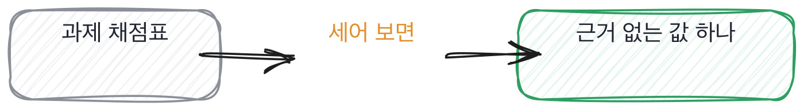

# 6.3 실물을 먼저 시킨다

*[6.2](q021.md) 에서 값을 박았죠. 마지막으로 말 대신 실물을 시킵니다.*

> **이 말부터**
>
> **과제** 집에서 만들어 오는 결과물을 말합니다. 이 책은 이걸 채점하지 않습니다.
>
> **근거 없는 값** 코드에 박혀 있는데 왜 그 값인지 설명이 없는 숫자를 말해요.

말로 하는 질문에는 한계가 있습니다. 아무리 값을 박아도 말은 말이거든요.
그래서 실물을 시킵니다. 코드든, 설계 그림이든, 짧은 문서든요.

그런데 여기서 대부분의 팀이 실수를 합니다. **과제를 채점하는** 거예요.
지금은 과제를 채점하면 아무것도 안 갈립니다. 다들 잘 만들어 오거든요.
돌아가고, 테스트가 있고, 구조가 깔끔합니다. 그건 만드는 값이 싸졌으니 당연한 일이에요.

그래서 과제의 쓰임을 바꿉니다. 채점표가 아니라 **대화의 입구**로 씁니다.
과제 안에는 근거 없이 정한 값이 반드시 있어요. 청크 크기, 겹치는 길이, 타임아웃, 재시도 횟수.
그 값을 하나 짚어서 왜 그렇게 정했냐고 물으면, 거기서 이 책의 모든 질문이 다시 시작됩니다.

```python
def split(doc_id: str, text: str, size: int = 120, overlap: int = 20) -> list[Chunk]:
    """글자 수로 자른다. 겹치는 길이만큼 뒤로 물러나며 자른다."""
    if size <= 0:
        raise ValueError("size must be positive")
    if not 0 <= overlap < size:
        raise ValueError("overlap must be in [0, size)")
```

위는 이 책이 과제로 쓰는 코드의 한 조각입니다. `size` 가 120 이고 `overlap` 이 20 이에요.
왜 120 인지, 왜 20 인지는 코드 어디에도 안 적혀 있습니다.
지원자가 이 값을 그대로 두고 왔다면 그것도 정보고, 바꿔 왔다면 왜 바꿨는지가 정보입니다.

> **이렇게 답합니다**
>
> 시간이 더 있었다면 테스트 코드를 더 작성했을 것 같습니다.
> 에러 처리도 더 꼼꼼하게 다듬고 싶습니다.
> 전반적인 구조는 만족스럽지만 세부적인 완성도를 높이고 싶습니다.
> 실무에서는 더 신중하게 작업합니다.

과제에서 바꿀 부분을 물었습니다. 제일 흔하게 오는 답이 이겁니다.

> **표시해 보면**
>
> 시간이 더 있었다면 테스트 코드를 더 작성했을 것 같습니다.
>     ← 시간이 더 있었다면은 과제 답변에서 가장 흔한 문장임
> 에러 처리도 더 꼼꼼하게 다듬고 싶습니다.
> 전반적인 구조는 만족스럽지만 세부적인 완성도를 높이고 싶습니다.
>     ← 만족스럽다면 바꿀 부분을 물은 답이 아님
> 실무에서는 더 신중하게 작업합니다.
>     ← 실무에서는 다르다는 말은 이 과제를 근거에서 빼 달라는 요청임

시간이 더 있었다면으로 시작하는 답은 과제 전형에서 가장 자주 나옵니다.
그리고 마지막 줄이 이 답의 문제예요. 실무에서는 다르다는 말은
**이 과제를 판정 근거에서 빼 달라는 요청**입니다. 그러면 과제를 낸 의미가 없어져요.

> **이렇게 파고듭니다**
>
> 물음: 테스트를 쓴다면 어느 함수부터 쓰시겠어요?
>
> 답: 핵심 로직 위주로 작성할 것 같습니다.

핵심 로직 위주라는 답은 아직 자리를 안 짚은 겁니다.
어느 함수냐고 한 번 더 물으면 대개 짚어 줍니다. 짚은 자리가 그 사람이 불안했던 자리예요.

> **자리를 짚으면**
>
> 자르는 함수부터요. 거기서 제일 많이 틀릴 것 같아서요.
> 사실 과제 하면서 그 함수를 세 번 고쳤는데, 고칠 때마다 앞에서 되던 게 깨졌어요.
> 그때 테스트가 있었으면 세 번째는 안 고쳤을 겁니다.
> 그리고 하나 더 있어요. 제가 겹치는 부분을 20자로 뒀는데 근거가 없습니다.
> 그냥 예제에서 본 값이에요.
> 그걸 정하려면 실제 문서를 봐야 하는데, 과제에는 문서가 없어서 못 정했습니다.

자르는 함수를 짚고, 과제 중에 세 번 고쳤다고 말하고, 고칠 때마다 앞이 깨졌다고 합니다.
그리고 겹치는 20자에 근거가 없다고 스스로 말해요. 예제에서 본 값이라고요.
**자기 코드에서 근거 없는 값을 먼저 대는 사람은 나머지 값에는 근거가 있는 사람**입니다.



> **현장에서는**
>
> 어떤 팀은 과제를 아예 안 채점한다고 공지합니다. 제출물은 대화 재료로만 쓴다고요.
> 그랬더니 제출률이 올라가고 완성도는 조금 떨어졌는데, 면접에서 나오는 이야기는 늘었다고 합니다.

과제에는 규칙 셋을 답니다. 두 시간을 넘기지 말 것, AI 를 써도 된다고 명시할 것,
그리고 **정하지 못한 값은 정하지 말고 적어 오라고** 할 것.
셋째가 제일 중요합니다. 정하지 못한 것을 적어 오면 그게 면접 첫 질문이 되거든요.

> **판정**
>
> 과제에서 근거 없는 값을 스스로 짚고 왜 못 정했는지 말하면 통과입니다.
> 값을 다 정해 왔다면 그중 하나의 근거를 물어서 확인합니다.
>
> 바꿀 부분을 물었는데 시간과 완성도 이야기만 하고, 자리를 짚어 달라고 해도
> 영역으로만 답하면 안 보냅니다. 자기 결과물을 다시 안 읽어 본 거예요.
>
> 기록에는 이렇게 적습니다. 자르는 함수를 짚었고, 과제 중 세 번 고쳤고,
> 겹치는 값에 근거가 없다고 스스로 말했다.

> **물을 문장 둘**
>
> 바꿀 부분을 물으면 완성도 이야기가 옵니다. 그래서 함수 하나로 좁힙니다.
> 어느 함수부터냐고 물으면 불안했던 자리가 나오거든요.
>
> **그대로 읽으세요.** *테스트를 쓴다면 어느 함수부터 쓰시겠어요?*
>
> **답을 받으면 이어서.** *그 함수에서 뭐가 제일 깨지기 쉬울 것 같으세요?*

> **이걸 놓치면**
>
> 실물을 안 시키면 §G07§ 에서 결정을 세려고 해도 셀 결정이 말밖에 없습니다.

