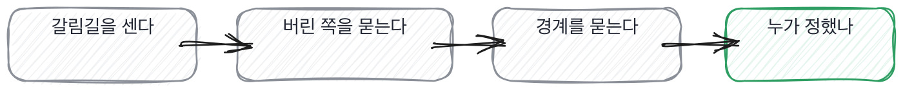

# 7장을 닫으며

## 한 관문을 닫으며

결정을 세는 일이 어디로 이어지는지를 한 줄로 접으면 이렇게 됩니다.

이 장의 네 칸은 사실 한 동작을 네 각도에서 본 겁니다.
갈림길을 세고, 안 고른 쪽을 묻고, 안 해 본 자리를 확인하고, 누가 정했는지를 가른다.
넷을 이어 붙이면 이렇게 됩니다. **이 사람이 실제로 서 본 갈림길이 몇 개인가.**

그리고 이 동작이 준비를 이깁니다. 준비는 고른 것에 대해서만 할 수 있거든요.
안 고른 쪽, 안 해 본 자리, 남이 정한 것. 이 셋은 실제로 그 자리에 있었던 사람만 압니다.
1단계에서 만든 잣대들이 여기서 다 회수됩니다.

> **저자의 삽질**
>
> 결정을 세는 잣대가 없으면 프로젝트 규모로 사람을 보게 됩니다.
> 큰 데 있었던 사람이 더 많이 해 봤을 거라고요. 대개 반대입니다. 큰 데일수록 갈림길이 남에게 있어요.

옛 관행 하나를 재 봅니다. 프로젝트 경험을 순서대로 물어보던 관행이에요.

> **옛 규칙은 아직 유효한가**
>
> **이력서 기반 질문.** 판정은 약해졌음입니다.
> 근거는 제 경험이에요. 이력서에 적힌 항목을 순서대로 물으면 준비한 순서대로 답이 나옵니다.
> 그래서 저는 이력서에서 항목이 아니라 **결정이 있었을 자리**를 찾아 묻습니다.
> 17장에서 그 읽는 법을 다룹니다.

다음 장은 이 장의 뒷면입니다. 결정을 세면 그중 틀린 결정이 나오는데,
틀린 결정을 어떻게 다뤘는지가 그 사람에 대해 제일 많은 것을 알려주거든요.

결정을 세는 일이 실제로 어떻게 굴러가는지는 제 자리에서 이렇게 보입니다.
대단한 기법이 아니라 손을 쓰는 자잘한 것들인데, 이런 게 실제로는 잘 듣습니다.
말로만 물으면 상대도 말로만 답하거든요.

> **현장에서는**
>
> 저는 갈림길을 세라고 할 때 손가락을 폅니다. 몇 개냐고 물으면서요.
> 그러면 상대도 세기 시작합니다. 그냥 물으면 대충 여러 개라고 답하는데, 손가락을 보면 셉니다.

세라고 했을 때 막히는 사람이 있는데, 그걸 어떻게 볼지도 정해 두는 게 좋습니다.

> **현장에서는**
>
> 세다가 막히는 사람이 있습니다. 셋에서 멈추고 더 안 나오는 경우요.
> 저는 그때 안 좋게 안 봅니다. 셋을 실제로 센 사람이 열 개를 말하는 사람보다 낫습니다.

속기 쉬운 자리를 둘 짚고 갑니다. 둘 다 결정 이야기에서 흔하게 나오는 것들이에요.
하나는 개수를 부풀리는 자리이고 다른 하나는 자기 자리를 지우는 자리입니다.
둘 다 나쁜 뜻으로 하는 말이 아니라서 더 잘 통과합니다.

> **여기서 다들 속는다**
>
> 결정을 많이 했다는 답은 일을 많이 한 것처럼 들립니다. 갈림길이 열 개였다는 식으로요.
> 그런데 개수는 부풀리기 쉽습니다. 세어 본 사람만 정확한 수를 대고, 대개 그 수는 작아요.
> 열 개라고 하면 저는 오히려 그중 셋을 짚어 달라고 합니다. 짚으면서 수가 줄어듭니다.
> 확인은 하나만 자세히 물으면 됩니다. 그 하나에서 버린 쪽이 나오는지요.

둘째는 반대쪽에서 옵니다. 개수를 부풀리는 게 아니라 자기 자리를 지우는 자리요.

> **여기서 다들 속는다**
>
> 팀에서 정했다는 답은 겸손하게 들립니다. 공을 나누는 문장이니까요.
> 그런데 이 문장은 자기 자리를 지우기도 합니다. 반대한 사람이 있었는지를 물으면 갈려요.
> 반대가 있었다면 그 자리에 누가 있었는지가 나오고, 없었다면 그건 결정이 아니라 통과입니다.
> 확인은 한마디면 됩니다. 그때 누가 반대했냐고 물어보세요.

면접장에서 이 관문의 것을 쓰실 때는 아래 다섯 줄이면 됩니다. 위에서 아래로 30초예요.
다섯을 다 채우는 사람은 드뭅니다. 셋이 나오면 이 렌즈는 충분히 본 겁니다.

> **30초 점검**
>
> 갈림길이 몇 개인지 세는가.
> 그중 몇 개에서 이유를 대는가.
> 버린 쪽을 말하는가.
> 안 해 본 것을 안 해 봤다고 하는가.
> 누가 정했는지가 나오는가.

이 관문에서 나온 낱말 몇 개를 짚고 갑니다. 결정 이야기에 붙는 말들이에요.
앞의 둘은 결정 자체를 가리키고 마지막 하나는 그 결정을 누가 지느냐를 가리킵니다.

> **채용 말 배우기**
>
> **디시전 레코드** 왜 그렇게 정했는지를 그때 적어 두는 문서를 말합니다.
>
> **트레이드오프** 하나를 얻으려고 다른 하나를 내주는 자리를 말해요.
>
> **오너십** 그 일을 자기 것으로 여기고 끝까지 맡는 것을 말합니다.

이 관문이 이 책의 척추라고 앞에서 여러 번 말했는데, 왜 하필 결정이냐는 이야기는 안 했어요.
그 이야기를 하고 닫겠습니다.
왜인지를 알면 뒤의 관문들이 왜 같은 질문을 자리만 바꿔 반복하는지도 같이 보입니다.

> **쉬어 가기**
>
> **쉬어 가기: 왜 하필 결정을 세는가**
>
> 이 책의 척추가 왜 결정 세기인지를 한 번 풀어 놓고 가겠습니다.
>
> 면접에서 확인하려는 것은 결국 하나입니다. 이 사람이 실제로 그 일을 했는가.
> 그런데 한 일을 물으면 답이 다 비슷하게 나옵니다. 한 일의 이름은 다들 아니까요.
> 설계했다, 구현했다, 배포했다. 이 낱말들은 겪은 사람과 읽은 사람이 똑같이 씁니다.
>
> 갈림길은 다릅니다. 갈림길은 그 프로젝트에만 있거든요.
> 남의 프로젝트에서 무슨 갈림길이 있었는지는 밖에서 못 만듭니다. 만들려면 그 사정을 알아야 하고,
> 사정을 알려면 그 안에 있었어야 합니다.
>
> 그리고 갈림길에는 성질이 하나 더 있습니다. **선 사람만 버린 쪽을 기억합니다.**
> 고른 쪽은 결과로 남아서 나중에 봐도 알 수 있는데, 버린 쪽은 아무 데도 안 남아요.
> 그 사람 머릿속에만 남습니다. 그래서 버린 쪽을 물으면 그 자리에 있었는지가 나옵니다.
>
> 이게 이 책이 예순한 번 반복하는 동작입니다. 자리를 바꿔 가며 같은 것을 물어요.
> 데이터에서 버린 것, 모델에서 포기한 것, 검색에서 뺀 것, 설계에서 안 그은 선.
> 전부 같은 질문의 다른 얼굴입니다. **안 고른 쪽을 물어라.**

긴 이야기는 여기까지예요. 이 책의 척추를 다섯 줄로 접으면 이렇게 됩니다.
뒤의 관문들은 이 다섯 줄을 자리만 바꿔 가며 다시 쓰거든요.

> **한 관문 요약**
>
> 프로젝트 하나에 갈림길은 아홉이나 열쯤입니다. 세어 보면 대개 그렇습니다.
>
> 고른 이유는 준비할 수 있고, 안 고른 쪽은 준비하기 어렵습니다.
>
> 어디까지 해 봤냐고 범위를 물으면 함정을 안 파고도 경계가 나옵니다.
>
> 다음 관문에서 뒤집히는 것. 센 결정 중에서 틀린 것을 봅니다.

> **이 판정이 헐거운 지점**
>
> 아홉이나 열이라는 숫자는 제가 본 프로젝트에서 나온 것이라 자리마다 다를 겁니다.
>
> 혼자 만든 사람은 남이 정한 것이 없어서 이 장의 넷째 칸에서 불리합니다.
>
> 결정을 세는 질문은 시간이 오래 걸립니다. 45분에 이것만 하면 다른 렌즈를 못 봅니다.
