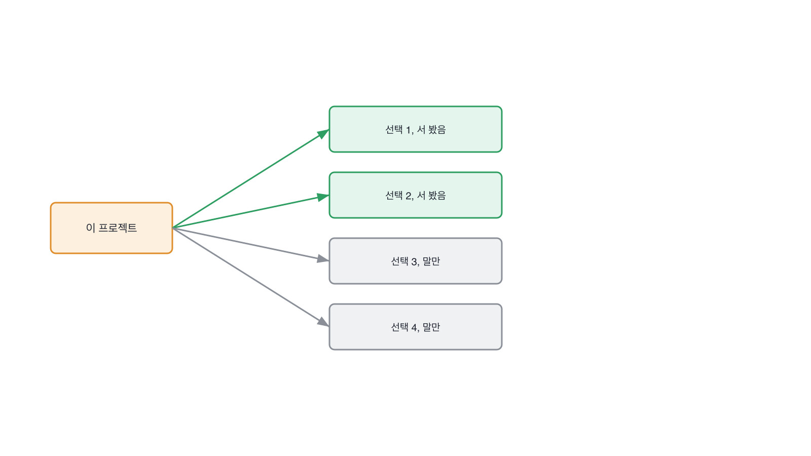

# 7.1 결정 세기, 이 프로젝트에 갈림길이 몇 개였나

*[6.3](../06-g06/q022.md) 에서 실물을 받았죠. 이제 그 실물 안의 갈림길을 셉니다.*

> **이 말부터**
>
> **갈림길** 둘 중 하나를 골라야 했던 자리를 말합니다. 단계와 다릅니다.
>
> **단계** 순서대로 거치는 과정을 말해요. 수집, 설계, 배포 같은 것들입니다.

프로젝트를 설명해 달라고 하면 대부분 단계로 답합니다.
요구사항을 정의하고, 설계하고, 만들고, 배포했다는 식이에요.
그런데 단계는 어느 프로젝트에나 똑같이 있습니다. 그래서 아무것도 안 갈라요.

갈림길은 다릅니다. 둘 중 하나를 골라야 했던 자리는 프로젝트마다 다르고,
무엇보다 **그 자리에 서 본 사람만 셀 수 있습니다.**
그래서 이 칸의 동작은 단계로 온 답을 갈림길로 옮기는 겁니다.

> **이렇게 답합니다**
>
> 먼저 요구사항을 정의하고 기술 스택을 선정했습니다.
> 그다음 아키텍처를 설계하고 데이터 파이프라인을 구성했습니다.
> 모델을 선택하고 프롬프트를 작성했습니다.
> 마지막으로 배포 환경을 구축하고 모니터링을 붙였습니다.

정해야 했던 것을 물었는데 단계가 돌아왔습니다. 어디서 그렇게 되는지 보세요.

> **표시해 보면**
>
> 먼저 요구사항을 정의하고 기술 스택을 선정했습니다.
>     ← 정의했다와 선정했다는 결정이 아니라 단계 이름임
> 그다음 아키텍처를 설계하고 데이터 파이프라인을 구성했습니다.
> 모델을 선택하고 프롬프트를 작성했습니다.
>     ← 선택했다면 후보가 있어야 하는데 없음
> 마지막으로 배포 환경을 구축하고 모니터링을 붙였습니다.
>     ← 넷은 단계이지 갈림길이 아님

정의하고, 선정하고, 설계하고, 구성했다. 전부 **한 일의 이름**이지 고른 자리가 아닙니다.
모델을 선택했다는 줄에는 그나마 고르는 동작이 있는데, 후보가 안 나와요.
후보가 없으면 그건 고른 게 아니라 받은 겁니다.

> **이렇게 파고듭니다**
>
> 물음: 그중에 실제로 둘 중 하나를 골라야 했던 건 몇 개예요?
>
> 답: 대부분의 단계에서 여러 선택지를 검토했습니다.

둘 중 하나를 골라야 했던 게 몇 개냐고 숫자로 물으면 답이 갈립니다.
서 본 사람은 세기 시작하고, 안 서 본 사람은 대부분의 단계에서라는 말로 뭉갭니다.

> **세기 시작하면**
>
> 세어 본 적은 없는데, 지금 세어 보면 아홉쯤 되는 것 같아요.
> 문서를 어디까지 색인할지, 그게 첫 번째였습니다. 전사 공개만 할지 팀 문서까지 할지요.
> 그다음이 자르는 단위였고, 겹치는 길이였고, 임베딩을 안에 둘지 밖에 둘지였어요.
> 검색을 벡터만 할지 키워드를 섞을지, 재순위를 넣을지, 답을 생성할지 원문만 보여줄지.
> 출처를 어떻게 표시할지, 실패한 질의를 어디에 남길지. 이렇게 아홉이네요.
> 이 중에 제가 정한 건 넷이고, 셋은 팀에서 정해진 걸 받았어요.
> 나머지 둘은 아직 안 정하고 기본값으로 두고 있습니다.

아홉을 셉니다. 그리고 마지막 두 줄이 이 답의 값이에요.
넷은 자기가 정했고, 셋은 받았고, 둘은 아직 기본값으로 두고 있다고 갈라 줍니다.
**센 사람만 이렇게 나눌 수 있습니다.**

위 그림에서 초록은 실제로 서 본 갈림길이고 회색은 남이 정한 자리입니다.
면접이 끝났을 때 이 그림이 그려지면 그 면접은 성공한 거예요.
그리고 회색이 많다고 나쁜 게 아닙니다. 다만 회색인 줄 알고 뽑는 것과 모르고 뽑는 건 다르죠.

> **한 번 더**
>
> 센 다음에는 그중 하나로 들어갑니다.
> 아키텍처 설계 부분에서 가장 많은 고민을 했습니다.
> 확장성과 유지보수성을 모두 고려해야 했기 때문입니다.
> 여러 패턴을 검토한 끝에 최적의 구조를 선택했습니다.
> 아키텍처라고 답하면 그건 아홉 중 하나가 아니라 전부를 가리키는 말이에요.
> 반대쪽은 답을 생성할지 원문만 보여줄지에 2주가 걸렸다고 말하고, 그 2주의 결과까지 갑니다.

세는 질문에는 한 가지 요령이 있습니다. **숫자로 물으면 세기 시작한다는** 겁니다.
무엇을 정하셨냐고 물으면 목록이 오고, 몇 개나 정해야 했냐고 물으면 세기 시작해요.
사람은 숫자를 물으면 세게 되어 있고, 세다 보면 자기도 잊고 있던 자리가 나옵니다.

> **판정**
>
> 갈림길을 다섯 이상 세고, 그중 자기가 정한 것과 받은 것을 가르면 통과입니다.
> 숫자가 정확할 필요는 없어요. 세는 동작이 되는지를 봅니다.
>
> 단계로만 답하고, 몇 개냐고 물어도 세지 못하면 안 보냅니다.
> 그건 그 프로젝트를 밖에서 본 사람이라는 뜻이에요.
>
> 기록에는 이렇게 적습니다. 갈림길 아홉을 셌고, 넷은 본인이 정했고 셋은 받았고
> 둘은 기본값으로 남아 있다고 갈랐다.

> **물을 문장 둘**
>
> 정해야 했던 걸 물으면 단계가 옵니다. 그래서 숫자로 묻습니다.
> 숫자를 물으면 사람은 세기 시작하고, 세다 보면 잊고 있던 자리가 나오거든요.
>
> **그대로 읽으세요.** *그중에 실제로 둘 중 하나를 골라야 했던 건 몇 개예요?*
>
> **답을 받으면 이어서.** *그 아홉 중에 본인이 정한 건 몇 개예요?*

> **이걸 놓치면**
>
> 갈림길을 못 세면 [7.2](q024.md) 에서 안 고른 쪽을 물을 자리가 없습니다.

