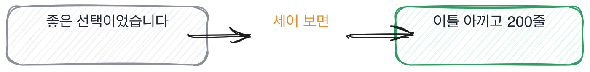

# 7.2 하나의 선택이 만든 두 세계

*[7.1](q023.md) 에서 아홉을 셌죠. 이제 그중 하나로 들어갑니다.*

> **이 말부터**
>
> **버린 쪽** 고를 수도 있었는데 안 고른 선택지를 말합니다.
>
> **대가** 그걸 안 고른 대신 나중에 치른 것을 말해요. 대가가 나오면 실제로 겪은 자리입니다.

이 칸이 이 책 전체에서 제일 중요한 자리입니다. 척추 문장이 여기서 나와요.
**답을 듣지 말고 안 고른 쪽을 물어라.**

이유는 간단합니다. 고른 이유는 결과에서 거꾸로 만들 수 있거든요.
잘 돌아가는 걸 보고 나면 왜 그게 좋은지는 누구나 설명할 수 있습니다.
그런데 안 고른 쪽은 결과에 안 남아 있어요. 그 자리에 서서 저울질해 본 사람의 머릿속에만 있습니다.

그리고 하나 더 있습니다. 안 고른 쪽을 말하는 사람은 대개 **대가**까지 같이 말해요.
그때 그걸 안 골라서 나중에 무엇을 치렀는지요. 그건 겪어야만 아는 겁니다.

> **이렇게 답합니다**
>
> 문단 단위로 자르는 방식도 고려했습니다.
> 하지만 문서 구조가 일정하지 않아 문자 수 기준이 더 안정적이라고 판단했습니다.
> 결과적으로 좋은 선택이었다고 생각합니다.

안 고른 쪽을 물었더니 답이 왔습니다. 그런데 뭔가 부족해요. 어디일까요.

> **표시해 보면**
>
> 문단 단위로 자르는 방식도 고려했습니다.
> 하지만 문서 구조가 일정하지 않아 문자 수 기준이 더 안정적이라고 판단했습니다.
>     ← 일정하지 않다는 것을 무엇으로 확인했는지 없음
> 결과적으로 좋은 선택이었다고 생각합니다.
>     ← 좋은 선택이었다는 판단의 근거가 없음

문단 단위를 고려했다고 답은 했는데, 그걸 안 고른 이유가 **일반론**입니다.
문서 구조가 일정하지 않다는 건 그럴듯한데, 그걸 무엇으로 확인했는지가 없어요.
그리고 좋은 선택이었다고 스스로 닫아 버립니다. 대가가 안 나옵니다.

> **이렇게 파고듭니다**
>
> 물음: 문단으로 잘랐으면 지금 뭐가 달랐을 것 같으세요?
>
> 답: 아마 문맥이 더 잘 유지되었을 것 같습니다.

문단으로 잘랐으면 지금 뭐가 달랐겠냐고 물으면 반대편 세계를 그려 보게 됩니다.
문맥이 더 유지됐을 것 같다는 답은 아직 상상이에요. 겪은 사람은 여기서 숫자나 사건을 댑니다.

> **대가까지 나오면**
>
> 문단으로 자르는 거였어요. 사실 그게 맞았다고 지금도 생각합니다.
> 안 고른 이유는 순전히 구현이었어요. 문서가 마크다운이랑 워드랑 위키가 섞여 있어서
> 문단 경계를 다 다르게 찾아야 했거든요. 그게 이틀 일이었고, 저는 그때 하루밖에 없었습니다.
> 문자 수로 자르면 30분이면 됐어요.
> 그 30분짜리 결정 때문에 나중에 예외 처리를 200줄 붙였습니다.
> 그러니까 이틀을 아끼려다 200줄을 쓴 거죠.

이 답은 세 가지를 합니다. 안 고른 쪽이 사실 맞았다고 인정하고,
안 고른 이유가 이틀과 하루라는 시간이었다고 밝히고,
그 30분짜리 결정 때문에 200줄을 붙였다고 대가를 댑니다.
**이틀을 아끼려다 200줄을 썼다**는 마지막 줄이 이 답의 값이에요.

여기서 조심할 게 하나 있습니다. 안 고른 쪽을 물으면 지원자가 방어하게 되는 경우가 있어요.
자기 선택을 변호해야 한다고 느끼는 겁니다. 그러면 답이 정당화로 나오고 대가는 안 나옵니다.
그래서 저는 물을 때 한 마디를 붙입니다. 지금 보면 어느 쪽이 나았을 것 같으냐고요.
판정이 아니라 회고를 부르는 물음이라 방어가 덜 나옵니다.

> **판정**
>
> 안 고른 쪽을 대고, 그걸 안 고른 이유가 그 자리의 사정이면 통과입니다.
> 시간이 없었다, 사람이 없었다, 그때는 몰랐다 같은 것들이요.
>
> 안 고른 쪽을 못 대거나, 대더라도 일반론으로만 이유를 대면 안 보냅니다.
> 문서 구조가 일정하지 않다는 말은 어느 프로젝트에나 붙습니다.
>
> 기록에는 이렇게 적습니다. 문단 단위를 버린 이유가 구현 시간이었다고 밝혔고,
> 그 대가로 예외 처리 200줄을 붙였다고 스스로 말했다.

> **물을 문장 둘**
>
> 안 고른 쪽을 물으면 방어가 나올 때가 있습니다. 그래서 지금 보면 어떻겠냐고 시점을 옮깁니다.
> 회고를 부르면 방어가 줄고 대가가 나옵니다.
>
> **그대로 읽으세요.** *그걸 골랐으면 지금 뭐가 달랐을 것 같으세요?*
>
> **답을 받으면 이어서.** *그 선택 때문에 나중에 치른 게 있나요?*

> **이걸 놓치면**
>
> 버린 쪽을 못 물으면 [7.3](q025.md) 에서 안 해 본 자리를 확인할 방법이 없습니다.

