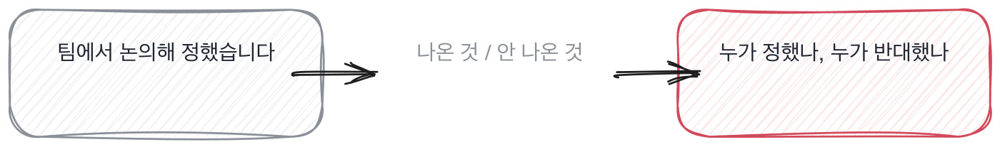

# 7.4 남의 일과 내 일을 가르는 질문

*[7.3](q025.md) 에서 경계를 그었죠. 3단계의 마지막으로 결정의 주인을 찾습니다.*

> **이 말부터**
>
> **주인** 그 결정을 최종적으로 정한 사람을 말합니다. 제안한 사람과 다를 수 있어요.
>
> **받은 결정** 남이 정한 것을 그대로 쓴 결정을 말합니다. 나쁜 게 아니라 흔한 일입니다.

결정을 세고 나면 마지막 질문이 남습니다. 그 결정을 누가 했느냐예요.

이걸 묻는 이유는 공을 가리려는 게 아닙니다. **다음에 무엇을 맡길 수 있는지**를 알려고예요.
받은 결정만 있는 사람에게 정하는 일을 맡기면 그건 그 사람에게도 나쁩니다.
반대로 정해 본 사람에게 시키는 일만 주면 그것도 오래 못 갑니다.

그런데 이 질문은 답이 잘 안 나옵니다. 팀에서 정했다는 말이 거의 자동으로 나오거든요.
겸손해서 그런 것도 있고, 실제로 회의에서 흐지부지 정해진 것도 많습니다.
그래서 한 겹 더 들어가는 물음이 필요해요. **반대한 사람이 있었는지**를 묻는 겁니다.

> **이렇게 답합니다**
>
> 팀 논의를 통해 결정했습니다.
> 제가 제안한 방향으로 진행되었고, 팀원들의 의견도 반영했습니다.
> 최종적으로는 함께 합의한 결과입니다.

누가 했냐고 물었는데 사람이 안 나옵니다. 세 줄에 주어가 없어요.

> **표시해 보면**
>
> 팀 논의를 통해 결정했습니다.
>     ← 논의를 통해라는 말에는 결정한 사람이 없음
> 제가 제안한 방향으로 진행되었고, 팀원들의 의견도 반영했습니다.
>     ← 제안과 진행이 한 문장에 붙어 경계가 사라짐
> 최종적으로는 함께 합의한 결과입니다.
>     ← 합의라는 말로 닫히면 책임 자리가 안 보임

논의를 통해, 반영했고, 합의한 결과. 전부 사람이 지워진 표현입니다.
그리고 둘째 줄이 특히 그래요. 제가 제안한 방향으로 진행되었다는 문장은
**제안과 결정 사이를 흐려 놓습니다.** 제안은 이 사람이 했는데 결정도 이 사람이 했는지는 안 나와요.

> **이렇게 파고듭니다**
>
> 물음: 그때 반대하신 분이 있었어요? 누가 어떤 이유로요?
>
> 답: 큰 이견은 없었던 것으로 기억합니다.

반대한 사람을 물으면 회의실이 살아납니다.
큰 이견이 없었다는 답이 오면 둘 중 하나예요. 정말 없었거나, 이 사람이 그 자리에 없었거나.
그리고 이견이 정말 없는 결정은 대개 중요하지 않은 결정입니다.

> **사람이 나오면**
>
> 제가 제안했고 팀 리드가 정했습니다.
> 저는 재순위를 넣자고 했고, 리드는 지연 때문에 반대했어요.
> 결국 상위 5개만 재순위하는 걸로 리드가 정했습니다. 제 안은 진 거예요.
> 그때는 좀 답답했는데, 지금 보면 리드가 맞았습니다.
> 그 화면이 검색창 아래 자동완성이라 200밀리초만 넘어도 사람들이 안 기다리거든요.
> 그건 제가 화면을 안 보고 숫자만 봐서 놓친 부분입니다.

제가 제안했고 팀 리드가 정했다고 두 사람을 갈라 줍니다.
자기 안이 졌다고 말하고, 지금 보면 리드가 맞았다고 하고,
자기가 화면을 안 보고 숫자만 봐서 놓쳤다고 이유까지 댑니다.

**자기 안이 진 이야기를 하는 사람은 그 회의실에 실제로 있었던 사람입니다.**
이긴 이야기는 나중에 들어도 할 수 있는데, 진 이야기는 그 자리에 있어야 남거든요.

> **현장에서는**
>
> 어떤 팀은 이 질문을 마지막에 한 번만 씁니다. 여러 번 물으면 추궁처럼 들려서요.
> 대신 앞에서 나온 결정 중 제일 큰 것 하나에만 물어봅니다.

여기서 3단계가 끝납니다. 갈림길을 세고, 안 고른 쪽을 묻고, 경계를 긋고, 주인을 찾았어요.
넷을 다 하면 45분 중 30분이 갑니다. 그래서 이 넷이 한 라운드의 전부가 되기도 합니다.
그래도 됩니다. 이 넷으로 안 나오는 건 대개 다른 라운드에서도 안 나와요.

> **판정**
>
> 결정마다 주인이 나오고, 자기가 진 이야기가 하나라도 있으면 통과입니다.
> 받은 결정이 많은 것 자체는 감점이 아니에요. 받았다고 말하는 게 중요합니다.
>
> 계속 팀에서 정했다로 답하고, 반대한 사람을 물어도 없었다고 하면 안 보냅니다.
> 그건 결정이 오간 자리에 이 사람이 없었다는 뜻일 가능성이 큽니다.
>
> 기록에는 이렇게 적습니다. 제안은 본인이 했고 결정은 리드가 했다고 갈랐고,
> 자기 안이 진 이유를 화면을 안 봤기 때문이라고 스스로 댔다.

> **물을 문장 둘**
>
> 누가 했냐고 물으면 팀이 나옵니다. 그래서 반대한 사람을 묻습니다.
> 반대를 기억하려면 그 자리에 있어야 하거든요.
>
> **그대로 읽으세요.** *그때 반대하신 분이 있었어요? 누가 어떤 이유로요?*
>
> **답을 받으면 이어서.** *지금 보면 그분 말이 맞았던 것 같으세요?*

> **이걸 놓치면**
>
> 주인을 못 가르면 §G08§ 에서 실패 이야기를 들어도 누구의 실패인지 모릅니다.

