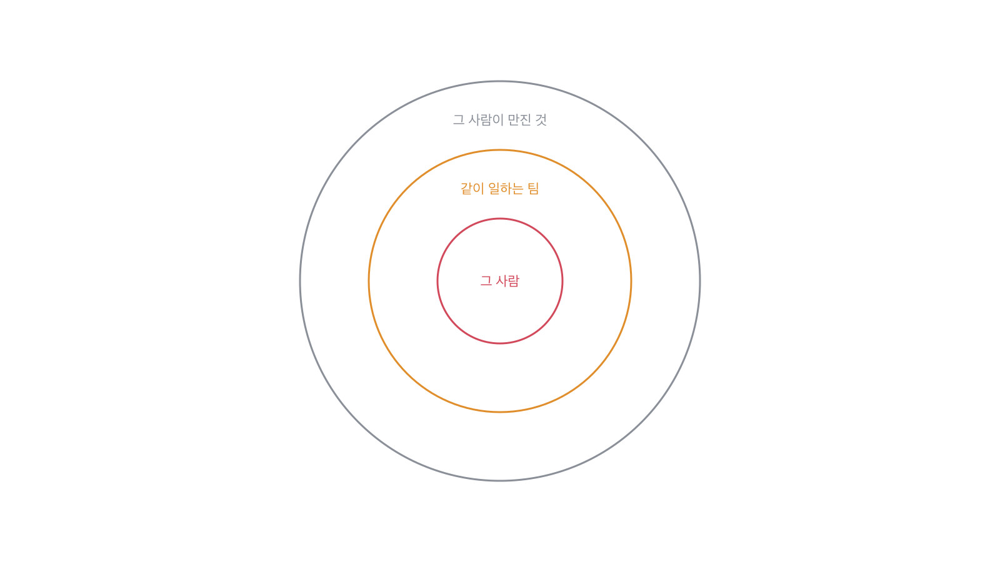

# 8장을 닫으며

## 터지는 채용 지도

3단계를 닫으면서 표 한 장을 놓습니다. 6개월 뒤에 후회하는 채용에는 표시가 있어요.
그 표시는 면접 자리에서 보입니다. 다만 그때는 그게 표시인 줄 모를 뿐이에요.

- **패턴.** 면접에서 이렇게 들립니다 30초 확인 칸
- **남의 일을 내 일로.** 전 과정을 담당했습니다 코드를 쓴 데가 어디인지 [7.4](../07-g07/q026.md)
- **되돌린 적 없음.** 다 계획대로 진행했습니다 버린 것이 얼마인지 [8.2](q028.md)
- **숫자 없음.** 크게 개선했습니다 몇에서 몇으로인지 [1.1](../01-g01/q001.md)
- **혼자만의 성공.** 제가 주도했습니다 반대한 사람이 있었는지 [7.4](../07-g07/q026.md)
- **못 한 것을 못 말함.** 특별한 문제는 없었습니다 지금 안 풀린 것이 있는지 [1.4](../01-g01/q004.md)
- **배운 자리가 없음.** 많은 것을 배웠습니다 무엇이 지금도 돌고 있는지 [8.3](q029.md)

이 여섯을 왜 세느냐면, 잘못 뽑았을 때 값을 치르는 자리가 그 사람 하나가 아니어서입니다.
표를 붙여 놓고 보면 여섯이 다 다른 이야기 같은데, 값이 어디로 번지는지를 그려 보면 하나로 모여요.
잘못 뽑은 사람은 결국 나갑니다. 그 사람이 만든 것은 안 나가고요.

가운데는 6개월이면 정리됩니다. 사람 하나 나가고 들어오는 일이니까요.
바깥이 오래 남아요. 그 사람이 세운 구조와 그 사람이 정한 이름은 그 사람이 나간 뒤에도 계속 돌거든요.
그래서 저는 이 표를 볼 때 그 사람이 무엇을 만질 자리인지를 같이 봅니다.

여섯 중 셋 이상이 보이면 저는 그 사람을 다음 라운드로 안 보냅니다.
하나나 둘은 흔해요. 저도 제 이야기를 하면 둘쯤은 나올 겁니다.
셋이 넘어가면 그건 버릇이고, 버릇은 6개월 뒤에도 그대로입니다.

## 한 관문을 닫으며

3단계가 여기서 끝납니다. 이 책의 척추가 지나갔어요.

돌아보면 3단계의 일곱 칸이 전부 한 가지를 물었습니다.
**이 사람이 실제로 서 본 자리가 어디까지인가.**
갈림길을 세고, 안 고른 쪽을 묻고, 경계를 긋고, 주인을 찾고,
터진 이야기를 꺼내고, 버린 것을 세고, 남은 것을 확인했습니다.

이 일곱으로 안 나오는 건 대개 다른 방법으로도 안 나옵니다.
그래서 시간이 없으면 이 일곱만 하셔도 돼요. 45분에 다 못 넣으면 앞의 넷을 먼저 넣으시고요.
뒤의 셋은 앞의 넷이 끝나야 나오는 이야기라, 순서를 바꾸면 둘 다 안 나옵니다.

> **저자의 삽질**
>
> 사고 이야기를 안 묻고 넘어가기 쉽습니다. 첫 만남에 굳이 아픈 데를 건드리나 싶어서요.
> 그런데 안 물으면 배포 뒤에 무엇을 보는 사람인지도 같이 안 물은 게 됩니다. 그건 들어와서 드러나요.

3단계를 닫으면서 말 몇 개를 짚고 갑니다. 사고 이야기를 팀에서 나눌 때 쓰는 말들이에요.
이 말들을 알아야 디브리프에서 같은 것을 가리키며 이야기할 수 있습니다.
면접 동작은 아닌데, 면접에서 본 것을 팀으로 옮길 때 필요합니다.

이 관문에서 나온 낱말 몇 개를 짚고 갑니다. 사고 이야기에 붙는 말들이에요.
셋 다 겪은 팀에서만 쓰는 말이라, 이 말이 나오면 그것 자체가 신호가 됩니다.

> **채용 말 배우기**
>
> **포스트모템** 사고 뒤에 원인과 대응을 정리하는 문서를 말합니다. 회고라고도 해요.
>
> **비난 없는 회고** 사람을 탓하지 않기로 정하고 여는 회고를 말합니다. 그래야 사실이 나옵니다.
>
> **롤백** 배포한 것을 이전 상태로 되돌리는 것을 말해요. 이 장의 되돌리기와는 크기가 다릅니다.

옛 관행 하나를 재 봅니다. 실패 경험을 물어보던 관행이에요.

> **옛 규칙은 아직 유효한가**
>
> **실패 경험을 묻는 관행.** 판정은 조정해서 유효입니다.
> 근거는 제 경험이에요. 실패를 물으면 준비된 실패담이 나옵니다. 성장으로 끝나는 이야기요.
> 그래서 저는 실패 대신 **되돌린 것**을 묻습니다. 되돌리기에는 버린 양이 붙거든요.
> 버린 양은 지어내기 어렵습니다.

다음 장부터 4단계입니다. 지금까지는 직군과 상관없이 쓰는 질문이었어요.
4단계부터는 AI 엔지니어 자리에서만 묻는 것들이 나옵니다.
데이터, 모델, 검색, 코드. 네 자리에서 각각 다른 것을 봅니다.

사고 이야기를 들을 때 제가 실제로 하는 것과 조심하는 것을 적어 둡니다.
이 자리는 지원자가 제일 조심스러워하는 자리라 묻는 쪽도 조심해야 해요.
덜 위험하게 물으면 더 많이 나옵니다. 이건 요령이 아니라 예의에 가깝습니다.

> **현장에서는**
>
> 저는 사고 이야기를 물을 때 먼저 제 것을 하나 꺼냅니다. 제가 망친 이야기요.
> 그러고 나서 물으면 나오는 이야기의 크기가 달라집니다. 안 꺼내면 대개 작은 것만 나와요.

속기 쉬운 자리가 여기 하나 더 있습니다. 대책이 촘촘하면 잘 배운 것처럼 들리는 자리요.
대책의 개수는 그날 회의에서 정해지고, 실제로 도는 개수는 석 달 뒤에 정해집니다.
그사이가 이 자리에서 갈리는 데예요.

> **여기서 다들 속는다**
>
> 사고 뒤에 대책을 여럿 세웠다는 답은 성실해 보입니다. 리뷰 강화, 테스트 추가, 모니터링 보강.
> 그런데 대책의 개수는 그날 회의에서 정해지고, 도는 개수는 석 달 뒤에 정해집니다.
> 셋을 세우면 대개 하나가 돕니다. 나머지 둘은 문서에만 남아요.
> 확인은 시제를 바꾸면 됩니다. 세운 것 말고 *지금 도는* 것을 물어보세요.

사고 이야기를 들으면서 아래 다섯 줄로 훑어 보세요.
마지막 줄이 제일 중요합니다. 사람 탓으로 끝나는 이야기에서는 배운 게 안 나오거든요.

> **30초 점검**
>
> 터진 이야기가 하나 나오는가.
> 몇 분 동안 안 됐는지 시간이 나오는가.
> 되돌린 것이 있는가. 얼마나 되돌렸는가.
> 그 뒤에 지금도 도는 것이 하나 있는가.
> 사람 탓으로 끝나지 않는가.

사고 이야기를 팀에서 나눌 때 쓰는 낱말도 몇 개 짚고 갑니다.

> **채용 말 배우기**
>
> **롤백** 배포한 것을 이전 상태로 되돌리는 것을 말합니다.
>
> **인시던트** 서비스가 정상이 아니었던 사건 하나를 말해요.
>
> **액션 아이템** 사고 뒤에 하기로 정한 일을 말합니다. 정한 것과 도는 것은 다릅니다.

실패를 묻는 질문이 왜 그대로 물으면 잘 안 듣는지 풀어 놓고 닫겠습니다.
오래된 조언이고 지금도 맞는 조언인데, 물는 방식을 안 바꾸면 준비된 이야기만 나옵니다.

> **쉬어 가기**
>
> **쉬어 가기: 실패를 묻는 질문이 잘 안 듣는 이유**
>
> 실패 경험을 물으라는 조언은 오래됐고 지금도 맞습니다. 다만 그대로 물으면 잘 안 들어요.
> 이유가 둘 있습니다.
>
> 첫째, 이 질문은 준비 목록의 맨 앞에 있습니다. 누구나 예상하고 옵니다.
> 그래서 준비된 실패담이 나옵니다. 적당히 아프고 적당히 배운, 잘 다듬어진 이야기요.
> 그 이야기가 거짓이라는 게 아니라 **고르고 다듬은 것**이라는 뜻입니다.
>
> 둘째, 실패를 말하는 게 위험합니다. 지원자 입장에서 당연해요.
> 안 좋게 보일 수 있는 이야기를 처음 본 사람 앞에서 꺼내는 거니까요.
> 그래서 안전한 이야기만 나옵니다. 안전한 이야기에는 확인할 자리가 별로 없습니다.
>
> 이 둘을 넘는 방법이 이 관문의 세 칸입니다. 실패를 묻는 대신 옆을 묻는 거예요.
> 몇 분이었는지, 얼마나 되돌렸는지, 그 뒤에 무엇이 남았는지.
> 셋 다 실패 자체가 아니라 그 주변이라 준비가 잘 안 돼 있습니다.
>
> 그리고 이 방식에는 부수 효과가 하나 있습니다. 지원자가 덜 위험하게 느낍니다.
> 얼마나 나빴는지를 묻는 게 아니라 그때 무엇을 했는지를 묻는 거라서요.
> **덜 위험하게 물으면 더 많이 나옵니다.** 이건 요령이 아니라 예의에 가깝습니다.

긴 이야기는 여기까지입니다. 이 관문에서 들고 갈 것을 다섯 줄로 접으면 이렇게 됩니다.
실패를 묻지 말고 그 옆을 물으라는 게 이 다섯 줄의 요지예요.

> **한 관문 요약**
>
> 아홉을 세면 두셋은 틀린 결정입니다. 다 맞았다는 답이 이상한 겁니다.
>
> 실패보다 되돌리기를 묻습니다. 되돌리기에는 버린 양이 붙습니다.
>
> 사고 뒤에 남은 것을 물으면, 사람이 해야 하는 절차는 대개 사라져 있습니다.
>
> 다음 관문에서 뒤집히는 것. 직군과 상관없던 질문에서 AI 엔지니어 질문으로 넘어갑니다.

> **이 판정이 헐거운 지점**
>
> 터지는 채용 지도의 여섯은 제가 후회한 채용에서 뽑은 것이라 표본이 제 것뿐입니다.
>
> 셋이라는 기준선도 감입니다. 자리에 따라 둘이 맞을 수도 있어요.
>
> 되돌린 적이 없는 사람이 반드시 나쁜 건 아닙니다. 되돌릴 만큼 큰 결정을 안 맡아 본 것일 수도 있어요.
