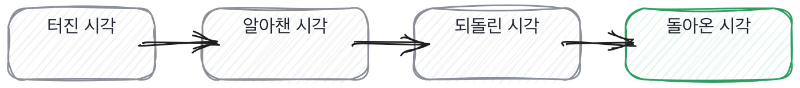

# 8.1 터졌던 이야기를 꺼내는 질문

*[7.4](../07-g07/q026.md) 에서 결정의 주인을 찾았죠. 이제 그 결정이 틀렸을 때로 갑니다.*

> **이 말부터**
>
> **사고** 서비스가 의도대로 안 돈 사건을 말합니다. 크기는 상관없어요.
>
> **인지 시간** 터진 시각과 알아챈 시각 사이의 간격을 말합니다. 이 칸이 보는 숫자입니다.

사고를 물으면 준비된 답이 옵니다. 배포하다 오류가 났고, 빠르게 롤백했고, 프로세스를 개선했다는 이야기요.
구조가 항상 같아요. 사건, 대응, 개선, 교훈. 네 박자로 끝납니다.

이 네 박자에서 빠진 게 하나 있습니다. **언제 알았는지**예요.
터진 시각과 알아챈 시각 사이가 이 사람과 그 팀에 대해 제일 많은 것을 알려줍니다.
5분이면 보고 있었던 거고, 여섯 시간이면 아무도 안 보고 있었던 거니까요.

그래서 이 칸의 동작은 하나입니다. 사고를 물은 다음에 **시간을 묻습니다.**
몇 분 동안 안 됐는지, 누가 먼저 알았는지요.

네 시각 사이의 간격이 이 칸이 보는 전부입니다. 첫째와 둘째 사이가 인지 시간이고,
셋째와 넷째 사이가 복구 시간이에요. 대개 인지 시간이 훨씬 깁니다.

> **이렇게 답합니다**
>
> 배포 과정에서 예상치 못한 오류가 발생한 적이 있습니다.
> 빠르게 원인을 파악하고 롤백하여 서비스 영향을 최소화했습니다.
> 이후 재발 방지를 위해 프로세스를 개선했습니다.
> 이 경험을 통해 신중함의 중요성을 배웠습니다.

네 박자가 그대로 나왔습니다. 그리고 마지막 줄이 사건을 덮습니다.

> **표시해 보면**
>
> 배포 과정에서 예상치 못한 오류가 발생한 적이 있습니다.
>     ← 예상치 못한 오류는 사건 이름이 아님
> 빠르게 원인을 파악하고 롤백하여 서비스 영향을 최소화했습니다.
>     ← 빠르게가 몇 분인지 없음
> 이후 재발 방지를 위해 프로세스를 개선했습니다.
> 이 경험을 통해 신중함의 중요성을 배웠습니다.
>     ← 배웠다는 마무리가 사건을 덮음

예상치 못한 오류라는 건 사건의 이름이 아닙니다. 무엇이 터졌는지가 안 나와요.
빠르게 파악했다는 말에도 숫자가 없고요.
그리고 신중함의 중요성을 배웠다는 마지막 줄은 이야기를 닫아 버립니다.
**교훈으로 닫힌 이야기에는 더 물을 자리가 없습니다.**

> **이렇게 파고듭니다**
>
> 물음: 그때 몇 분 동안 안 됐어요? 누가 먼저 알았죠?
>
> 답: 길지 않은 시간이었고, 모니터링을 통해 인지했습니다.

길지 않은 시간이었다는 답은 시간이 아니에요.
그리고 모니터링을 통해 인지했다는 건 사람이 지워진 표현입니다.
누가 먼저 알았냐는 물음이 좋은 이유가 여기 있어요. 답에 사람이 들어가야 하거든요.

> **시간이 나오면**
>
> 색인을 지웠어요. 전체를요.
> 재색인 스크립트에 지우고 다시 만드는 부분이 있었는데, 지우는 데까지만 돌고 죽었습니다.
> 디스크가 꽉 차서요. 그게 새벽 3시였고, 아침 9시에 사람들이 검색이 안 된다고 올렸습니다.
> 그러니까 여섯 시간 동안 아무도 몰랐어요. 저도 슬랙 보고 알았습니다.
> 다시 만드는 데 네 시간 걸려서 오후 1시에 돌아왔어요.
> 제일 뼈아팠던 건 그 여섯 시간이었습니다. 터진 것보다 모른 게 더 문제였어요.

색인을 전부 지웠다고 사건의 이름이 나옵니다.
새벽 3시, 아침 9시, 여섯 시간, 네 시간, 오후 1시. 숫자가 다섯 개예요.
그리고 마지막 줄이 이 답의 값입니다. **터진 것보다 모른 게 더 문제였다**고요.

이 문장을 말할 수 있으면 그 사람은 그 사고를 자기 것으로 소화한 겁니다.
사고의 크기가 아니라 사고를 어디서 봤는지를 아는 거니까요.

> **한 번 더**
>
> 한 걸음 더 가면 사고 이전이 나옵니다.
> 사전에 특별한 징후를 발견하지는 못했습니다.
> 모니터링 지표상으로는 정상이었습니다.
> 예측하기 어려운 상황이었다고 생각합니다.
> 징후를 발견하지 못했다는 답은 무엇을 보고 있었는지를 안 밝힙니다.
> 반대쪽은 2주 전에 재색인이 한 시간 반 느려진 걸 기억하고, 그게 신호였다고 말합니다.

시간을 묻는 것 말고 이 자리에서 자주 속는 데가 하나 더 있습니다.

> **여기서 다들 속는다**
>
> 사고 이야기가 자세하면 겪은 것 같습니다. 그런데 자세함은 옆에서 봐도 생겨요.
> 회고 문서를 읽은 사람이 제일 자세하게 말합니다. 문서에는 원인과 대응이 정리되어 있으니까요.
> 문서에 안 적히는 것이 하나 있어요. **그날 자기가 무엇을 하고 있었는지**입니다.
> 그래서 자세한 답이 오면 그때 본인은 어디 있었냐고 묻습니다.

사고를 물을 때 조심할 게 있습니다. **크기로 판정하지 않는 겁니다.**
큰 사고를 낸 사람이 나쁜 게 아니에요. 큰 시스템을 만졌다는 뜻일 때가 많습니다.
반대로 사고가 하나도 없는 사람은 안 만져 본 것일 수도 있고요.
보는 것은 크기가 아니라 인지 시간과 그 뒤의 문장입니다.

> **판정**
>
> 사건의 이름과 시간이 나오면 통과입니다. 무엇이 터졌고 몇 시간 동안 몰랐는지요.
> 그리고 터진 것보다 모른 게 문제였다는 쪽으로 말이 가면 좋은 신호입니다.
>
> 네 박자로만 답하고, 시간을 물어도 길지 않았다로 답하면 안 보냅니다.
> 그건 그 사고를 옆에서 본 사람이라는 뜻일 가능성이 큽니다.
>
> 기록에는 이렇게 적습니다. 색인 전체 삭제, 인지까지 여섯 시간,
> 복구까지 네 시간, 본인이 모른 시간을 문제로 짚었다.

> **물을 문장 둘**
>
> 사고를 물으면 대응 이야기가 옵니다. 그래서 시간과 사람을 묻습니다.
> 겪은 사람은 시각을 기억해요. 그날 잠을 못 잤으니까요.
>
> **그대로 읽으세요.** *그때 몇 분 동안 안 됐어요? 누가 먼저 알았죠?*
>
> **답을 받으면 이어서.** *그 일이 터지기 전에 이상하다고 느낀 순간이 있었어요?*

> **이걸 놓치면**
>
> 사고에서 시간을 못 물으면 [8.2](q028.md) 의 되돌리기도 교훈으로 닫힙니다.

