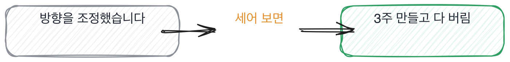
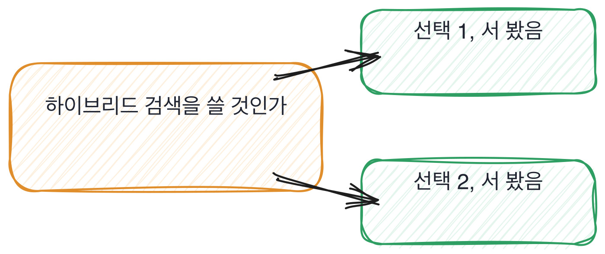

# 8.2 되돌린 적이 있는가

*[8.1](q027.md) 에서 터진 이야기를 꺼냈죠. 이번엔 스스로 되돌린 이야기입니다.*

> **이 말부터**
>
> **되돌리기** 만든 것을 쓰지 않기로 정하고 버리는 것을 말합니다. 고치는 것과 다릅니다.
>
> **버린 양** 되돌리면서 없앤 시간과 코드의 양을 말해요. 이 칸이 보는 숫자입니다.

실패를 물으면 준비된 실패담이 옵니다. 앞 칸에서 봤죠.
그래서 저는 실패 대신 되돌리기를 묻습니다. 이유가 둘 있어요.

첫째, 되돌리기에는 **양이 붙습니다.** 3주를 버렸다, 코드 400줄을 지웠다처럼요.
양은 지어내기 어렵습니다. 그리고 양을 말하는 순간 아까움도 같이 나와요.

둘째, 되돌리기는 **자기가 한 결정을 자기가 무르는** 일입니다.
남이 시켜서 되돌린 건 되돌리기가 아니에요. 그건 지시를 따른 겁니다.
그래서 이 질문은 결정의 주인을 한 번 더 확인하는 질문이기도 합니다.

> **이렇게 답합니다**
>
> 프로젝트를 진행하면서 방향을 조정한 경험이 있습니다.
> 초기 설계가 요구사항 변화에 맞지 않아 일부를 수정했습니다.
> 유연하게 대응하는 것이 중요하다고 생각합니다.
> 결과적으로 더 나은 방향으로 진행할 수 있었습니다.

되돌린 적을 물었는데 조정한 이야기가 왔습니다. 그 둘이 어떻게 다른지 보세요.

> **표시해 보면**
>
> 프로젝트를 진행하면서 방향을 조정한 경험이 있습니다.
>     ← 조정과 되돌리기는 다름. 무엇을 버렸는지가 없음
> 초기 설계가 요구사항 변화에 맞지 않아 일부를 수정했습니다.
> 유연하게 대응하는 것이 중요하다고 생각합니다.
>     ← 유연함은 태도 표명임
> 결과적으로 더 나은 방향으로 진행할 수 있었습니다.
>     ← 더 나은 방향이 무엇이었는지 없음

방향을 조정했다는 말에는 버린 것이 없습니다. 수정했다는 말도 그래요.
고치는 건 남기는 일이고 되돌리는 건 버리는 일인데, 이 답은 계속 고치는 쪽에 있습니다.
그리고 유연하게 대응하는 게 중요하다는 줄은 태도 표명이에요.

> **이렇게 파고듭니다**
>
> 물음: 그때 버린 코드가 얼마나 됐어요?
>
> 답: 일부 모듈을 수정하는 수준이었습니다.

버린 코드가 얼마나 되냐고 양을 물으면 갈립니다.
일부 모듈을 수정하는 수준이었다는 답은 아직 버린 게 없다는 뜻이에요.

> **양이 나오면**
>
> 하이브리드 검색을 3주 만들고 다 버렸습니다.
> 키워드랑 벡터를 섞는 건데, 점수 범위가 달라서 정규화하는 데만 일주일을 썼어요.
> 결국 붙이긴 했는데 평가해 보니 상위 5개 정확도가 0.74에서 0.75가 됐습니다.
> 0.01이요. 3주 써서 0.01이면 그건 안 한 거랑 같다고 봤어요.
> 지우는 게 제일 어려웠습니다. 3주가 아까워서 일주일을 더 붙들고 있었거든요.
> 지금은 그 판단을 2주쯤 일찍 했어야 한다고 생각합니다.

3주 만들고 다 버렸다고 양이 나옵니다. 그리고 왜 버렸는지가 숫자로 나와요.
0.74에서 0.75, 그러니까 0.01이라고요. 3주 써서 0.01이면 안 한 것과 같다고 판단합니다.

그런데 이 답에서 제일 좋은 건 그다음 줄입니다.
**지우는 게 제일 어려웠고, 3주가 아까워서 일주일을 더 붙들고 있었다**는 것요.
사람이 매몰비용에 붙들리는 걸 자기 안에서 관찰한 겁니다.
그리고 2주쯤 일찍 판단했어야 한다고 지금 시점에서 다시 재요.

[7.2](../07-g07/q024.md) 에서 안 고른 쪽을 물었죠. 되돌리기는 그 질문의 특별한 경우입니다.
갈림길 하나에서 이쪽을 골랐다가 저쪽으로 돌아온 사람은,
**한 갈림길의 양쪽을 다 서 본 유일한 사람**이거든요.

그래서 되돌린 이야기가 하나 있으면 그 갈림길에 대해서는 더 물을 게 없습니다.
양쪽을 다 걸어 봤으니 어느 쪽이 어디서 아픈지 둘 다 말할 수 있어요.
안 고른 쪽을 상상으로 말하는 답과는 밀도가 다릅니다.

> **판정**
>
> 버린 양이 숫자로 나오면 통과입니다. 3주, 400줄, 두 달처럼요.
> 그리고 왜 그때 못 버렸는지까지 말하면 그건 아주 좋은 신호입니다.
>
> 조정과 수정으로만 답하고, 양을 물어도 일부라는 말로 답하면 안 보냅니다.
> 되돌려 본 적이 없다는 건 큰 결정을 안 맡아 봤다는 뜻일 수도 있으니,
> 그때는 다음 라운드에 확인할 자리로 적어 넘깁니다.
>
> 기록에는 이렇게 적습니다. 하이브리드 검색 3주를 버렸고, 근거는 0.01이었고,
> 아까워서 일주일을 더 붙들었다고 스스로 말했다.

> **물을 문장 둘**
>
> 되돌린 적을 물으면 조정 이야기가 옵니다. 그래서 버린 양을 묻습니다.
> 양을 물으면 고친 것과 버린 것이 갈립니다.
>
> **그대로 읽으세요.** *그때 버린 코드가 얼마나 됐어요?*
>
> **답을 받으면 이어서.** *그걸 더 일찍 버렸어야 했다고 생각하세요? 언제쯤이요?*

> **이걸 놓치면**
>
> 되돌린 양을 못 물으면 [8.3](q029.md) 에서 남은 것을 물어도 목록만 나옵니다.

