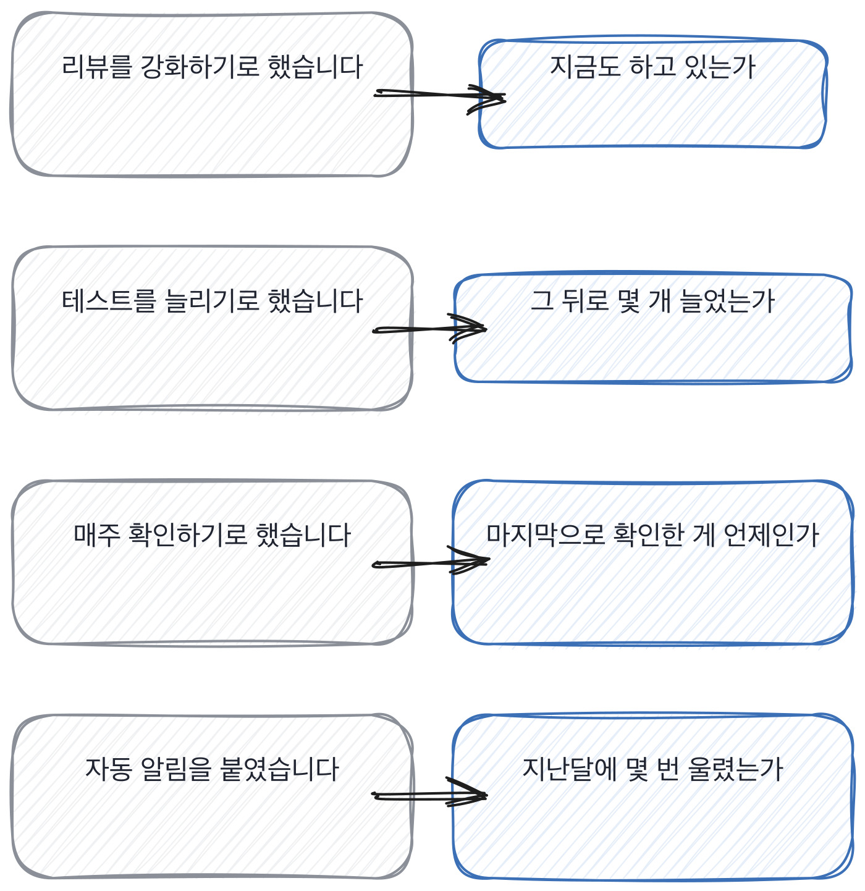

# 8.3 사고가 지나간 자리에 무엇이 남았나

*[8.2](q028.md) 에서 버린 양을 셌죠. 3단계의 마지막으로 남은 것을 봅니다.*

> **이 말부터**
>
> **남은 것** 사고 뒤에 정한 것 중 지금도 돌고 있는 것을 말합니다.
>
> **사라진 것** 정하긴 했는데 두 달 안에 안 하게 된 것을 말해요. 대개 사람이 해야 하는 절차입니다.

사고 뒤에 무엇을 했냐고 물으면 대책 목록이 옵니다. 리뷰 강화, 테스트 추가, 모니터링 보강.
이 목록은 회고 문서에 그대로 적혀 있고, 대부분 실행되지 않습니다.

그래서 이 칸은 목록을 안 묻습니다. **그중 지금도 돌고 있는 게 뭐냐**고 묻습니다.
이 질문 하나가 두 가지를 동시에 확인해요.
그 사람이 사고 이후를 지켜봤는지, 그리고 그 팀이 무엇을 지킬 수 있는 팀인지요.

> **이렇게 답합니다**
>
> 재발 방지 대책을 수립하고 프로세스를 개선했습니다.
> 코드 리뷰를 강화하고 테스트 커버리지를 높였습니다.
> 모니터링 체계도 보강했습니다.
> 전반적으로 더 안정적인 개발 문화가 자리 잡았습니다.

목록이 왔습니다. 네 줄 다 맞는 말인데, 확인할 수 있는 게 하나도 없어요.

> **표시해 보면**
>
> 재발 방지 대책을 수립하고 프로세스를 개선했습니다.
>     ← 대책을 수립했다면 그 대책이 무엇인지가 나와야 함
> 코드 리뷰를 강화하고 테스트 커버리지를 높였습니다.
>     ← 강화와 높였다는 말에 숫자가 없음
> 모니터링 체계도 보강했습니다.
> 전반적으로 더 안정적인 개발 문화가 자리 잡았습니다.
>     ← 문화가 자리 잡았다는 것은 이 사람이 확인할 수 있는 범위가 아님

수립했다, 강화했다, 높였다, 보강했다. 전부 동사만 있고 대상이 없습니다.
그리고 마지막 줄이 이 답의 문제예요.
**개발 문화가 자리 잡았다는 건 이 사람이 확인할 수 있는 범위가 아닙니다.**

> **이렇게 파고듭니다**
>
> 물음: 그중에 지금도 돌고 있는 게 뭐예요?
>
> 답: 대부분 잘 유지되고 있습니다.

지금도 돌고 있는 게 뭐냐고 물으면 목록이 줄어듭니다.
대부분 잘 유지되고 있다는 답은 안 지켜보고 있다는 뜻이에요.
지켜본 사람은 남은 것과 사라진 것을 갈라서 말합니다.

> **남은 것이 나오면**
>
> 딱 하나 남았어요. 재색인 끝나면 질의 50개를 돌려서 결과 수를 슬랙에 던지는 거요.
> 나머지는 다 없어졌습니다. 회고 때 정한 게 다섯 갠데 넷은 두 달 안에 안 하게 됐어요.
> 남은 하나가 왜 남았냐면 사람이 안 해도 되게 만들어 놨거든요.
> 사람이 매주 확인하기로 한 것들은 다 사라졌습니다.
> 그때 배운 게 그거예요. 절차를 정하지 말고 자동으로 도는 걸 하나만 만들자.

다섯 중 하나만 남았다고 말합니다. 그리고 왜 그것만 남았는지를 압니다.
**사람이 안 해도 되게 만들어 놨기 때문**이라고요.
사람이 매주 확인하기로 한 것들은 다 사라졌다는 관찰이 이 답의 값입니다.

이 관찰은 18장까지 이어집니다. 팀의 절차를 문서로 만들 때 같은 문제가 나오거든요.
사람의 성실함에 기대는 절차는 두 달을 못 갑니다.

> **한 번 더**
>
> 기록이 어디 남았는지도 물어볼 만합니다.
> 사내 문서에 회고 내용을 정리해 두었습니다.
> 관련 팀과 공유했고 필요시 참고할 수 있도록 했습니다.
> 중요한 교훈은 팀 내에서 공유되었습니다.
> 정리해 두었다는 답에는 그 뒤에 누가 읽었는지가 없어요.
> 반대쪽은 문서는 아무도 안 읽었을 거라고 인정하고, 대신 코드 주석 두 줄을 댑니다.

남은 것을 묻는 일이 제 자리에서는 이렇게 굴러갑니다.

> **현장에서는**
>
> 어떤 팀은 회고 문서에 적는 대책마다 이름과 날짜를 강제합니다.
> 두 달 뒤에 그 줄을 다시 읽는 자리를 달력에 미리 잡아 두고요.

여기서 3단계가 끝납니다. 일곱 칸을 지나왔어요.
이 일곱이 이 책에서 제일 오래 쓰이는 질문들입니다. 자리가 바뀌어도 그대로 쓰거든요.
다음 단계부터는 AI 엔지니어 자리에서만 쓰는 질문들이 나옵니다.

> **판정**
>
> 남은 것과 사라진 것을 갈라서 말하면 통과입니다.
> 그리고 왜 그것만 남았는지를 알면 그건 아주 좋은 신호예요.
>
> 대책 목록만 말하고, 지금도 도는 게 뭐냐고 물어도 대부분 유지되고 있다고 답하면 안 보냅니다.
> 그건 사고 이후를 안 지켜본 겁니다.
>
> 기록에는 이렇게 적습니다. 다섯 중 하나만 남았다고 말했고,
> 남은 이유가 사람이 안 해도 되게 만들었기 때문이라고 짚었다.

> **물을 문장 둘**
>
> 무엇을 했냐고 물으면 대책 목록이 옵니다. 그래서 지금도 도는 것을 묻습니다.
> 지금이라는 말이 시점을 강제하고, 시점이 붙으면 지켜본 사람만 답할 수 있어요.
>
> **그대로 읽으세요.** *그중에 지금도 돌고 있는 게 뭐예요?*
>
> **답을 받으면 이어서.** *나머지는 왜 없어졌을까요?*

> **이걸 놓치면**
>
> 남은 것을 못 물으면 §G09§ 에서 데이터 이야기를 들어도 절차인지 습관인지 모릅니다.

