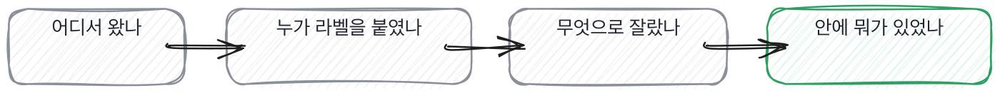
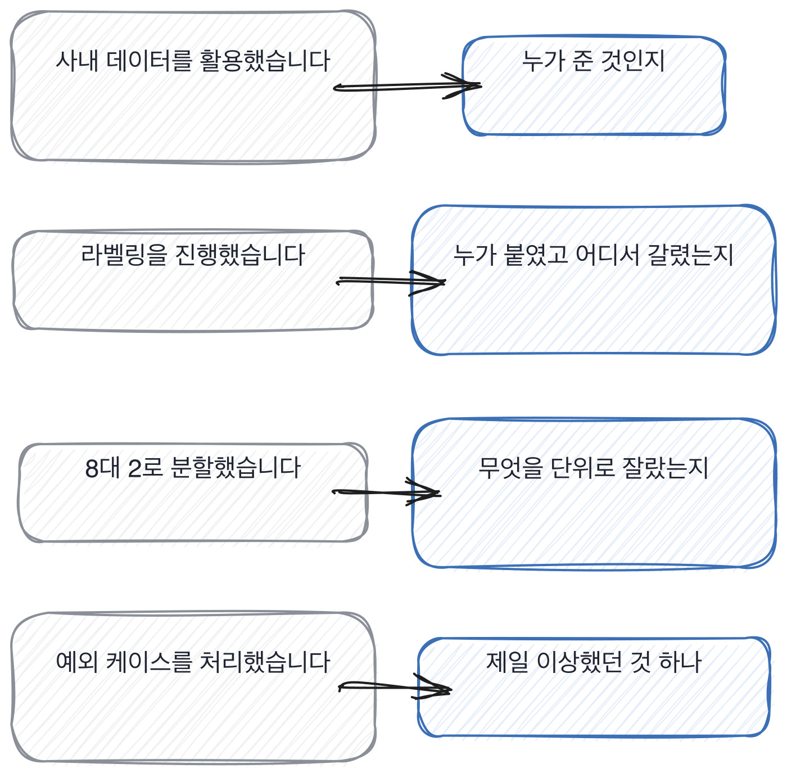

# 9장을 닫으며

## 한 관문을 닫으며

세 칸이 데이터의 세 자리를 봤습니다. 들어오는 자리와 자르는 자리, 그리고 그 안에 무엇이
들었는지를 보는 자리였어요.
이 셋을 한 줄로 이으면 이렇게 됩니다. **이 사람이 데이터를 만들었나 받았나.**
받아 쓴 것이 나쁘다는 게 아닙니다. 다만 들어와서 할 수 있는 일이 다릅니다.

네 자리를 순서대로 물으면 5분이면 끝납니다.
그리고 이 네 자리는 자리가 바뀌어도 그대로 쓸 수 있어요.
추천이든 검색이든 분류든, 데이터가 들어오는 순서는 같거든요.

네 자리 중 어디가 비었는지는 답을 듣는 동안 알 수 있습니다.
데이터 답변에서 자주 들리는 말과 그때 물을 자리를 짝으로 세우면 이렇게 됩니다.

왼쪽은 넷 다 통과되는 문장입니다. 틀린 말이 하나도 없어요.
오른쪽을 한 번씩만 물으면 넷 중 몇 개가 비어 있는지가 그 자리에서 나옵니다.

말이 나온 김에 이 장에서 쓴 낱말 몇 개를 짚고 갑니다.
데이터 이야기를 팀에서 나눌 때 자주 나오는 말들이에요.
뜻을 몰라도 면접은 되는데, 디브리프에서 같은 것을 가리키려면 필요합니다.

> **채용 말 배우기**
>
> **골드 셋** 사람이 직접 확인해 정답을 확정해 둔 작은 묶음을 말합니다. 13장에서 다시 나옵니다.
>
> **어노테이션** 라벨을 붙이는 작업 자체를 부르는 말이에요. 라벨링과 같은 뜻으로 씁니다.
>
> **데이터 시트** 이 데이터가 어디서 왔고 무엇이 빠졌는지를 적어 둔 문서를 말합니다.

데이터 자리에서 저도 크게 틀린 적이 있습니다.

> **저자의 삽질**
>
> 데이터 질문을 파이프라인 순서대로 물으면 순서대로 준비한 답이 나옵니다.
> 순서를 거꾸로 뒤집어 안에 있던 것부터 물으면 그때부터 답이 갈려요. 같은 질문인데 순서만 바꾼 겁니다.

옛 관행 하나를 재 봅니다. 다뤄 본 데이터 규모를 물어보던 관행이에요.

> **옛 규칙은 아직 유효한가**
>
> **데이터 전처리 지식을 묻는 관행.** 판정은 조정해서 유효입니다.
> 근거는 제 경험이에요. 전처리 기법을 물으면 낱말이 나오고, 낱말은 읽으면 나옵니다.
> 그래서 저는 기법 대신 **그 데이터에서 실제로 뺀 것과 그 양**을 묻습니다.
> 양에는 판단이 붙고, 판단은 그 자리에 있어야 나옵니다.

다음 장은 모델입니다. 데이터를 물었으니 이제 그걸로 무엇을 했는지를 봐요.
그런데 물어보는 자리는 바뀌어도 동작은 같습니다. 갈림길을 세고 안 고른 쪽을 묻는 것요.
3단계에서 만든 것을 자리마다 다르게 쓰는 게 4단계가 하는 일입니다.

데이터 이야기를 들을 때 제가 실제로 보는 것을 적어 둡니다.

> **현장에서는**
>
> 저는 데이터가 어디서 왔냐고 물을 때 종이에 화살표를 그립니다. 어디서 어디로 왔는지요.
> 그리면 중간에 사람이 들어간 자리가 보입니다. 말로만 들으면 그 자리가 잘 안 보여요.

속기 쉬운 자리를 하나 더 짚습니다. 데이터 규모가 크면 잘 다룬 것처럼 들리는 자리요.
크기는 받은 것이지 만든 게 아닌데, 말로 들으면 그 둘이 잘 안 갈립니다.
크게 다뤄 본 사람은 크기 말고 다른 걸 먼저 말합니다.

> **여기서 다들 속는다**
>
> 데이터가 크다는 말은 어려운 일을 한 것처럼 들립니다. 수백만 건이라는 식으로요.
> 그런데 크기는 받은 것이지 만든 게 아닙니다. 크기를 대는 것과 다뤄 본 것은 다릅니다.
> 크게 다뤄 본 사람은 크기보다 *이상한 것*을 먼저 말해요. 깨진 인코딩, 중복, 빈 값이요.
> 확인은 하나만 대라고 하면 됩니다. 그중에 제일 이상했던 입력이 뭐였냐고요.

데이터 이야기를 들으면서 아래 다섯 줄로 훑어 보세요.
둘째 줄 하나만 물어도 절반은 갈립니다. 나머지는 그다음에 이어 붙이는 것들이에요.

> **30초 점검**
>
> 데이터가 어디서 왔는지 대는가.
> 라벨을 누가 붙였는지 아는가.
> 나눈 자리를 무엇으로 갈랐는지 말하는가.
> 새어 나간 적이 있는지 말하는가.
> 제일 이상했던 입력을 하나 대는가.

이 관문에서 제일 많이 쓰는 질문 하나를 두고 왜 그게 그렇게 잘 갈리는지 풀어 놓고 닫겠습니다.
짧은 질문인데 답이 넷으로 갈리고, 갈린 뒤에 이어 붙일 자리가 각각 다릅니다.

> **쉬어 가기**
>
> **쉬어 가기: 라벨을 누가 붙였느냐가 왜 그렇게 중요한가**
>
> 이 관문에서 제일 많이 쓰는 질문이 라벨을 누가 붙였느냐입니다. 왜 이게 그렇게 잘 갈리는지
> 한 번 풀어 놓고 가겠습니다.
>
> 라벨은 데이터의 정답입니다. 그런데 그 정답은 하늘에서 오는 게 아니라 사람이 정합니다.
> 그 사람이 헷갈린 자리는 데이터에도 헷갈린 채로 들어가요.
> 그래서 라벨을 붙여 본 사람은 반드시 **헷갈렸던 자리**를 알고 있습니다.
>
> 받아 쓴 사람은 그걸 모릅니다. 모르는 게 잘못은 아니에요. 안 붙였으니까요.
> 다만 모르면 그 데이터로 잰 숫자를 어디까지 믿을지 정할 수가 없습니다.
> 0.71이라는 숫자가 나왔을 때, 그중 얼마가 헷갈린 라벨 때문인지 모르는 거죠.
>
> 그리고 이 질문에는 값이 하나 더 있습니다. 답이 짧아요.
> 제가 붙였다, 팀에서 붙였다, 외주였다, 원래 있던 겁니다. 넷 중 하나가 3초 안에 나옵니다.
> 그러고 나서 이어 붙일 자리가 각각 다릅니다.
>
> 제가 붙였다고 하면 헷갈린 자리를 묻고, 외주였다고 하면 검수를 어떻게 했는지 묻습니다.
> 원래 있던 거라고 하면 그 라벨이 언제 붙은 건지 묻고요.
> **짧은 질문 하나에서 네 갈래가 나오는 질문은 흔치 않습니다.** 그래서 이걸 씁니다.

긴 이야기는 여기까지입니다. 데이터 자리에서 들고 갈 것을 다섯 줄로 접으면 이렇게 됩니다.
다섯 줄이 다 어디서 왔느냐를 묻는 줄입니다.

> **한 관문 요약**
>
> 데이터 이야기는 대개 받은 다음부터 시작합니다. 그 앞을 물어야 갈립니다.
>
> 라벨을 누가 붙였냐고 물으면 답에 사람이 들어갑니다. 두 사람이 붙이면 반드시 갈리거든요.
>
> 나눈 비율은 기본값이라 아무것도 안 알려줍니다. 무엇을 단위로 잘랐는지가 알려줍니다.
>
> 종류를 물으면 아무나 답합니다. 실물 하나를 달라고 하면 본 사람만 답합니다.
>
> 다음 관문에서 뒤집히는 것. 데이터를 만든 사람에서 모델을 고른 사람으로 넘어갑니다.

> **이 판정이 헐거운 지점**
>
> 라벨을 남이 붙인 팀도 많습니다. 그 경우엔 이 장의 첫 칸이 불리하게 걸립니다.
>
> 점수가 두 번 나오는 답이 진짜라는 것도 제 경험이지 재 본 것이 아닙니다.
>
> 실물 하나를 못 대는 사람 중에 오래전 프로젝트라 잊은 경우가 섞여 있습니다.
