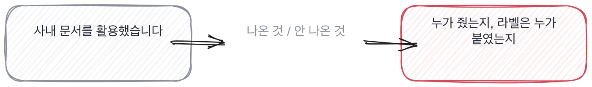

# 9.1 데이터가 어디서 왔는가, 라벨은 누가 붙였나

*[7.4](../07-g07/q026.md) 에서 결정의 주인을 갈랐죠. 이번엔 데이터의 주인을 가릅니다.*

> **이 말부터**
>
> **라벨** 각 데이터에 붙인 정답 표시를 말합니다. 이게 틀리면 뒤의 모든 숫자가 틀립니다.
>
> **일치도** 같은 것을 두 사람에게 라벨 붙이게 했을 때 얼마나 같은지를 말해요. 이 칸이 보는 숫자입니다.

4단계에 들어왔습니다. 여기부터는 AI 엔지니어 자리에서만 묻는 것들이에요.
쓰는 렌즈는 기초입니다. 이 사람이 쓰는 것의 동작을 아는가를 봅니다.
그 첫 자리가 데이터고, 데이터에서 제일 먼저 물을 것은 출처입니다.

데이터 이야기는 대개 가공에서 시작합니다. 전처리를 했고, 정제를 했고, 라벨링을 진행했다고요.
전부 데이터를 **이미 받은 다음**의 이야기예요.
받아서 돌린 사람도 여기까지는 똑같이 말합니다.

그래서 이 칸의 동작은 하나입니다. 데이터를 물은 다음에 **라벨을 누가 붙였냐**고 묻습니다.
이 물음이 좋은 이유는 답에 사람이 들어가야 해서예요.
그리고 두 사람이 붙이면 반드시 갈리는데, 갈린 걸 본 사람만 그 이야기를 합니다.

> **이렇게 답합니다**
>
> 사내에 축적된 문서 데이터를 활용했습니다.
> 데이터 품질을 확보하기 위해 전처리 과정을 거쳤고, 라벨링 작업도 진행했습니다.
> 충분한 양의 학습 데이터를 확보하는 것이 중요했습니다.
> 결과적으로 모델 성능을 개선할 수 있었습니다.

네 줄 다 맞는 말인데, 이 사람이 그 데이터를 봤는지는 안 나옵니다.

> **표시해 보면**
>
> 사내에 축적된 문서 데이터를 활용했습니다.
>     ← 어느 시스템에 있던 것인지, 누가 준 것인지 없음
> 데이터 품질을 확보하기 위해 전처리 과정을 거쳤고, 라벨링 작업도 진행했습니다.
>     ← 라벨을 누가 붙였는지 없음. 진행했다는 말에 주어가 없음
> 충분한 양의 학습 데이터를 확보하는 것이 중요했습니다.
>     ← 충분이 얼마인지 없음
> 결과적으로 모델 성능을 개선할 수 있었습니다.

축적된 문서 데이터라는 말에는 어느 시스템에 있던 것인지가 없습니다.
라벨링 작업도 진행했다는 줄에는 주어가 없고요.
진행했다는 말은 한국어에서 아주 편리한 말이에요. **한 사람과 백 사람을 같은 말로 덮거든요.**
그리고 충분한 양이 중요했다는 줄에 숫자가 없습니다.

> **이렇게 파고듭니다**
>
> 물음: 라벨은 누가 붙였어요?
>
> 답: 팀 내부에서 기준을 정해서 라벨링을 진행했습니다.

팀 내부에서 기준을 정해서 진행했다는 답도 사람이 안 들어간 답입니다.
기준을 정하는 자리에 있었으면 그 기준이 어디서 걸렸는지를 말하게 되거든요.

> **사람이 나오면**
>
> 고객센터 상담 기록이었습니다. 티켓 시스템에서 2년치를 받았어요.
> 라벨은 제가 붙였습니다. 처음엔 상담사 두 분한테 부탁드렸는데 두 분이 다르게 붙이시더라고요.
> 같은 티켓 200건을 두 분께 겹쳐 드렸더니 그중 60건 정도가 갈렸습니다.
> 갈린 걸 하나씩 봤더니 환불 문의랑 배송 문의가 섞여 있었어요. 환불 사유가 배송 지연인 것들이요.
> 그래서 라벨을 하나만 고르지 말고 두 개까지 붙일 수 있게 기준을 고쳤습니다.
> 그러고 다시 재니까 갈리는 게 60건에서 12건으로 줄었습니다.

상담사 두 분이 다르게 붙였다는 줄에서 이 답이 갈립니다.
200건을 겹쳐 주고 60건이 갈렸다는 건 일치도를 실제로 재 본 사람의 문장이에요.
그리고 갈린 이유가 구체적입니다. 환불 사유가 배송 지연인 티켓들이라고요.

여기서 제일 좋은 건 마지막 두 줄입니다. **기준을 고치고 다시 쟀다**는 것요.
60에서 12로 줄었다는 숫자가 있으면 그건 두 번 잰 겁니다.
한 번 재는 사람은 많고 고치고 다시 재는 사람은 적습니다.

> **여기서 다들 속는다**
>
> 데이터 이야기는 전문 용어가 많아서 아는 것처럼 들립니다.
> 전처리, 정제, 증강, 불균형 처리. 이 낱말들은 읽으면 바로 쓸 수 있어요.
> 낱말로는 안 갈립니다. **갈리는 건 사람 이름이 들어가는 자리**예요.
> 누가 붙였고, 누가 갈렸고, 누구한테 다시 물었는지. 그건 겪어야 나옵니다.

라벨을 누가 붙였는지 물으면 답이 넷으로 갈리는데, 그중 하나를 더 파고들어 보겠습니다.

> **한 번 더**
>
> 못 쓴 데이터를 물어도 같은 자리가 보입니다.
> 노이즈가 있는 데이터는 필터링하여 제외했습니다.
> 데이터 정제를 통해 학습에 적합한 형태로 가공했습니다.
> 노이즈를 필터링했다는 답에는 무엇을 노이즈로 봤는지가 없어요.
> 반대쪽은 8만 중 3만을 못 썼다고 하고, 그 3만이 특정 상담사에게 몰려 있어서 걱정했다고 말합니다.

라벨 이야기까지 오면 이 칸에서 볼 것은 다 본 겁니다.
어디서 왔는지와 누가 붙였는지, 둘이면 충분해요.

> **판정**
>
> 라벨을 붙인 사람이 나오고 그중 갈린 이야기가 나오면 통과입니다.
> 겹쳐 준 건수와 갈린 건수처럼 숫자가 붙으면 더 좋고요.
>
> 데이터의 출처를 물어도 가공 이야기로만 답하고, 라벨을 누가 붙였냐고 물어도
> 팀에서 진행했다고 답하면 다음 라운드로 안 보냅니다.
>
> 기록에는 이렇게 적습니다. 상담 기록 2년치, 라벨은 본인이 붙였고,
> 상담사 두 분의 일치도를 200건으로 재서 60건이 갈린 것을 확인했다.

> **물을 문장 둘**
>
> 데이터를 물으면 가공 이야기가 옵니다. 그래서 라벨을 누가 붙였는지 묻습니다.
> 사람을 물으면 갈린 이야기가 따라 나와요. 두 사람이 붙이면 반드시 갈리거든요.
>
> **그대로 읽으세요.** *라벨은 누가 붙였어요?*
>
> **답을 받으면 이어서.** *두 분이 다르게 붙인 건 없었어요? 그때 어떻게 하셨죠?*

> **이걸 놓치면**
>
> 데이터의 출처를 못 물으면 [9.2](q031.md) 에서 나눈 자리를 물어도 비율만 나옵니다.

