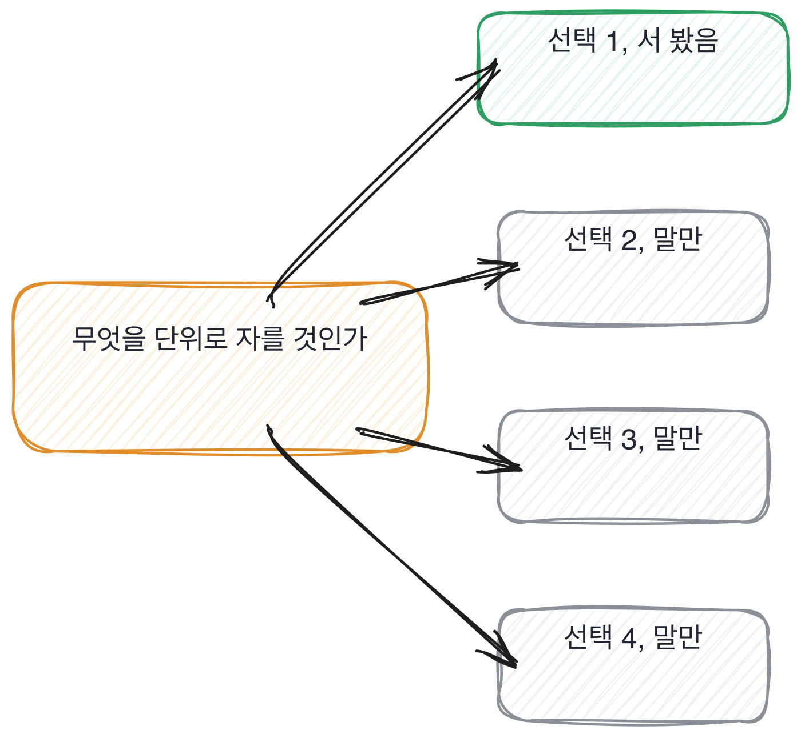

# 9.2 나눈 자리와 새어 나간 자리

*[9.1](q030.md) 에서 데이터의 주인을 물었죠. 이번엔 그 데이터를 자른 자리를 봅니다.*

> **이 말부터**
>
> **나누기** 데이터를 학습용과 평가용으로 가르는 것을 말합니다.
>
> **누수** 평가에 쓸 정보가 학습에 섞여 든 것을 말해요. 이러면 점수만 좋아집니다.

나누는 법을 물으면 비율이 옵니다. 8대 2, 7대 2대 1처럼요.
비율은 거의 아무것도 안 알려줍니다. 어느 책에나 적혀 있고 기본값이기도 하니까요.
알려주는 건 **무엇을 단위로 잘랐느냐**입니다. 건인지, 사람인지, 문서인지, 날짜인지요.

이게 왜 갈리는 자리냐면, 단위를 잘못 고르면 점수가 조용히 올라가기 때문입니다.
틀렸다고 알려주는 게 아니라 좋아졌다고 알려줘요. 그래서 안 겪은 사람은 끝까지 모릅니다.
겪은 사람은 반대로 이 이야기를 오래 합니다. 자기 점수가 가짜였던 경험이라서요.

건으로 자를지, 고객으로 자를지, 문서로 자를지, 날짜로 자를지.
갈림길이 넷인데 대개 하나만 서 봅니다. 그 하나가 기본값이고요.

> **이렇게 답합니다**
>
> 일반적인 방식으로 8대 2로 분할했습니다.
> 랜덤 샘플링을 통해 편향이 생기지 않도록 했고, 검증 세트도 따로 두었습니다.
> 데이터 누수가 발생하지 않도록 주의했습니다.
> 평가 지표는 정확도와 F1 점수를 함께 봤습니다.

누수라는 낱말까지 나왔습니다. 그런데 나왔다는 게 신호가 아니에요.

> **표시해 보면**
>
> 일반적인 방식으로 8대 2로 분할했습니다.
>     ← 무엇을 단위로 나눴는지 없음. 건인지 사람인지 문서인지
> 랜덤 샘플링을 통해 편향이 생기지 않도록 했고, 검증 세트도 따로 두었습니다.
>     ← 무작위가 왜 편향을 막는지 없음. 이 데이터에서는 반대일 수 있음
> 데이터 누수가 발생하지 않도록 주의했습니다.
>     ← 주의는 동작이 아님. 무엇을 확인했는지 없음
> 평가 지표는 정확도와 F1 점수를 함께 봤습니다.

일반적인 방식이라는 말이 첫 줄에 있습니다. 이건 기본값을 썼다는 말이에요.
그리고 무작위로 뽑아서 편향을 막았다는 줄은 이 데이터에서는 반대일 수 있습니다.
같은 사람이 남긴 것이 섞여 있으면 무작위가 오히려 섞어 놓거든요.
**누수가 나지 않게 주의했다는 줄이 이 답의 핵심 빈자리입니다.** 주의는 동작이 아닙니다.

> **이렇게 파고듭니다**
>
> 물음: 그 8대 2를 뭘 기준으로 잘랐어요? 건 단위예요, 사람 단위예요?
>
> 답: 데이터 건 단위로 랜덤하게 분할했습니다.

건 단위로 랜덤하게 나눴다는 답이 나오면 그때부터는 확인할 게 있습니다.
그 데이터에 같은 사람이 여러 번 나오는지요. 나온다면 그 나누기는 새고 있습니다.

> **숫자가 두 번 나오면**
>
> 처음엔 건 단위로 랜덤하게 잘랐습니다. 그랬더니 평가 점수가 0.91이 나왔어요.
> 너무 높아서 뜯어봤더니 같은 고객이 같은 문의를 사흘 연속 넣은 티켓들이 있었습니다.
> 그게 학습 쪽에도 있고 평가 쪽에도 있었어요. 사실상 답을 보고 푼 겁니다.
> 그래서 고객 단위로 다시 잘랐습니다. 한 고객의 티켓은 통째로 한쪽에만 가게요.
> 다시 재니까 0.91이 0.78이 됐습니다. 0.78이 진짜 점수였고요.
> 지금 생각하면 시간으로도 한 번 더 잘랐어야 했어요. 운영에서는 과거로 미래를 맞히니까요.

이 답에는 점수가 두 번 나옵니다. 0.91과 0.78이요.
**점수가 두 번 나오는 답은 대개 진짜입니다.** 한 번 재고 끝낸 사람은 낮은 쪽 숫자가 없거든요.

그리고 0.91을 보고 이상하다고 느낀 게 이 답의 값입니다.
좋은 숫자를 의심하는 건 그 숫자에 데인 적이 있어야 나오는 반응이에요.
마지막 줄도 좋습니다. 시간으로도 잘랐어야 했다고 지금 시점에서 다시 재요.

> **현장에서는**
>
> 어떤 팀은 나누기 코드를 리뷰 대상에 따로 올려 둡니다.
> 모델 코드보다 그쪽이 조용히 틀리고, 조용히 틀리면 몇 달을 갑니다.

여기서 조심할 게 있습니다. **누수를 낸 적 있다는 답을 벌하지 않는 겁니다.**
누수는 데이터를 직접 자른 사람만 낼 수 있어요. 안 잘라 본 사람은 낼 기회도 없습니다.
그래서 저는 누수를 냈다는 말을 들으면 오히려 앞으로 당겨 앉습니다.

> **판정**
>
> 자른 단위가 나오고, 그걸 왜 그렇게 골랐는지가 나오면 통과입니다.
> 점수가 두 번 나오면 아주 좋은 신호예요. 틀린 점수와 고친 점수를 둘 다 아는 겁니다.
>
> 비율로만 답하고, 무엇을 단위로 잘랐냐고 물어도 랜덤이라고만 답하면 안 보냅니다.
> 누수라는 낱말을 썼는데 그걸 겪은 자리를 못 대는 경우도 같습니다.
>
> 기록에는 이렇게 적습니다. 처음엔 건 단위로 잘라 0.91이 나왔고,
> 같은 고객이 양쪽에 있는 것을 찾아 고객 단위로 다시 잘라 0.78을 얻었다.

> **물을 문장 둘**
>
> 나누기를 물으면 비율이 옵니다. 그래서 단위를 묻습니다.
> 단위를 물으면 그 데이터에 무엇이 여러 번 들어 있는지까지 따라 나와요.
>
> **그대로 읽으세요.** *그 8대 2를 뭘 기준으로 자르셨어요?*
>
> **답을 받으면 이어서.** *같은 사람이 양쪽에 걸쳐 있진 않았어요?*

> **이걸 놓치면**
>
> 나눈 자리를 못 물으면 [13.1](../13-g13/q043.md) 에서 좋아졌다는 근거를 들어도 그 숫자를 검산할 수 없습니다.

