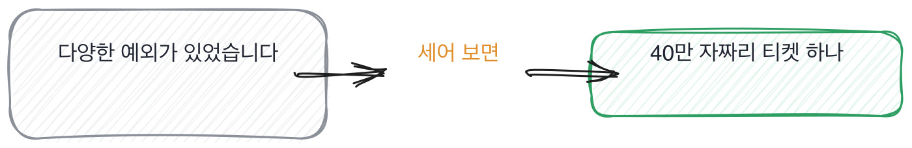

# 9.3 지저분한 입력과 큰 입력

*[9.2](q031.md) 에서 자른 자리를 봤죠. 이번엔 그 데이터 안에 실제로 뭐가 들어 있었는지를 봅니다.*

> **이 말부터**
>
> **청크** 긴 문서를 검색에 쓰려고 잘라 놓은 조각을 말합니다.
>
> **재색인** 문서 전체를 다시 넣어 검색용 자료를 새로 만드는 것을 말해요.

앞의 두 칸은 데이터를 위에서 봤습니다. 어디서 왔고 어떻게 잘랐는지요.
이 칸은 안으로 들어갑니다. 그 안에 실제로 뭐가 들어 있었는지를 봐요.
데이터를 만져 본 사람에게는 반드시 하나씩 있습니다. **잊히지 않는 입력 하나**가요.

그래서 이 칸의 동작은 종류를 안 묻는 겁니다. **실물 하나를 달라고** 합니다.
제일 이상했던 것 하나요. 종류를 물으면 아무나 답하는데 실물은 본 사람만 댑니다.
그리고 실물이 나오면 그 뒤에 그때 무엇을 했는지가 따라 나옵니다.

> **이렇게 답합니다**
>
> 다양한 형태의 예외적인 입력들이 존재했습니다.
> 특수문자나 인코딩 문제가 있는 경우가 있어서 전처리 로직을 통해 처리했습니다.
> 엣지 케이스를 고려하여 견고하게 구현하는 것이 중요하다고 생각합니다.

하나를 물었는데 종류로 답했습니다. 이 어긋남이 이 칸이 보는 전부예요.

> **표시해 보면**
>
> 다양한 형태의 예외적인 입력들이 존재했습니다.
>     ← 하나를 물었는데 종류로 답함. 실물이 없음
> 특수문자나 인코딩 문제가 있는 경우가 있어서 전처리 로직을 통해 처리했습니다.
>     ← 처리했다는 말에 무엇을 어떻게가 없음
> 엣지 케이스를 고려하여 견고하게 구현하는 것이 중요하다고 생각합니다.
>     ← 태도 표명. 여기서 이야기가 닫힘

다양한 형태의 예외적인 입력들이라는 말은 하나가 아니라 무리입니다.
특수문자나 인코딩 문제라는 것도 종류고요.
그리고 마지막 줄이 이야기를 닫습니다. **견고하게 구현하는 게 중요하다는 건 태도 표명이에요.**
[8.1](../08-g08/q027.md) 에서 본 것과 같은 닫힘입니다. 교훈이 나오면 더 물을 자리가 없어집니다.

> **이렇게 파고듭니다**
>
> 물음: 종류 말고요, 실제로 본 것 하나요. 그날 화면에 뭐가 떴어요?
>
> 답: 정확히 기억나지는 않지만 인코딩이 깨진 텍스트였던 것 같습니다.

그날 화면에 뭐가 떴냐고 물으면 장면을 요구하는 겁니다.
정확히 기억나지 않는다는 답이 나오면 그건 그 화면을 안 봤다는 뜻이에요.

> **실물이 나오면**
>
> 40만 자짜리 티켓이 하나 있었습니다.
> 상담사가 실수로 로그 전체를 본문에 붙여 넣은 거였어요.
> 그게 청크로 쪼개지니까 혼자 1400개가 나왔고, 색인의 3퍼센트를 그 한 건이 먹었습니다.
> 검색하면 그게 계속 올라왔고요. 로그라서 온갖 단어가 다 들어 있으니 뭘 물어도 걸립니다.
> 길이 상한을 걸까 하다가 안 걸었습니다. 진짜 긴 문의도 있으니까요.
> 대신 한 문서가 만드는 청크 수에 상한을 걸고 넘으면 알림이 오게 했습니다. 그 뒤로 두 번 울렸어요.

40만 자짜리 티켓 하나. 이게 실물입니다.
그리고 그 하나가 조각 1400개가 되고 색인의 3퍼센트를 먹었다는 데까지 숫자가 붙습니다.
로그라서 뭘 물어도 걸린다는 관찰은 그 검색 결과를 실제로 본 사람의 문장이에요.

이 답에서 제일 좋은 건 안 한 것을 말한 자리입니다.
**길이 상한을 걸까 하다가 안 걸었다**고요. 진짜 긴 문의도 있으니까요.
안 한 결정을 이유와 함께 말하는 건 [7.2](../07-g07/q024.md) 에서 본 그 자리입니다.

> **한 번 더**
>
> 크기를 물어도 같은 자리가 보입니다.
> 확장성을 고려한 아키텍처 설계가 필요할 것 같습니다.
> 분산 처리나 배치 처리를 도입하면 대용량 데이터도 안정적으로 처리할 수 있습니다.
> 확장성을 고려한 설계가 필요하다는 답은 지금 어디가 걸리는지를 안 짚고 해법부터 갑니다.
> 반대쪽은 재색인이 한 시간 반이라고 재 놓고, 그런데 먼저 터지는 건 시간이 아니라 비용이라고 말합니다.

크기 이야기에서 하나 더 볼 게 있습니다. 마지막 줄이에요.
임베딩 모델을 바꿀 때는 어차피 전체를 다시 해야 하는데 그건 아직 답이 없다고 합니다.
**모르는 자리를 남겨 두는 답이 다 아는 답보다 낫습니다.** 남겨 둔 자리는 실제로 거기까지 가 봤다는 표시예요.

> **판정**
>
> 실물 하나가 나오면 통과입니다. 40만 자짜리 티켓처럼 세부가 붙은 것 하나요.
> 그리고 그때 무엇을 했고 무엇을 안 했는지가 이유와 함께 나오면 좋은 신호입니다.
>
> 종류로만 답하고, 실물 하나를 달라고 해도 기억나지 않는다고 하면 안 보냅니다.
> 그건 그 데이터를 화면에서 본 적이 없다는 뜻일 가능성이 큽니다.
>
> 기록에는 이렇게 적습니다. 40만 자 티켓 한 건이 조각 1400개가 된 것을 댔고,
> 길이 상한 대신 청크 수 상한을 고른 이유를 설명했다.

> **물을 문장 둘**
>
> 지저분한 입력을 물으면 종류가 옵니다. 그래서 하나만 달라고 합니다.
> 하나라는 말이 장면을 강제하고, 장면은 본 사람만 갖고 있어요.
>
> **그대로 읽으세요.** *제일 이상했던 입력 하나만 말해 주세요.*
>
> **답을 받으면 이어서.** *그때 뭘 하셨어요? 그리고 하려다 안 한 건 없었어요?*

> **이걸 놓치면**
>
> 실물을 못 물으면 [11.2](../11-g11/q037.md) 에서 어디서 깨졌냐고 물어도 단계 이름만 나옵니다.

