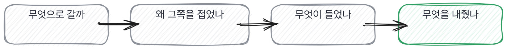
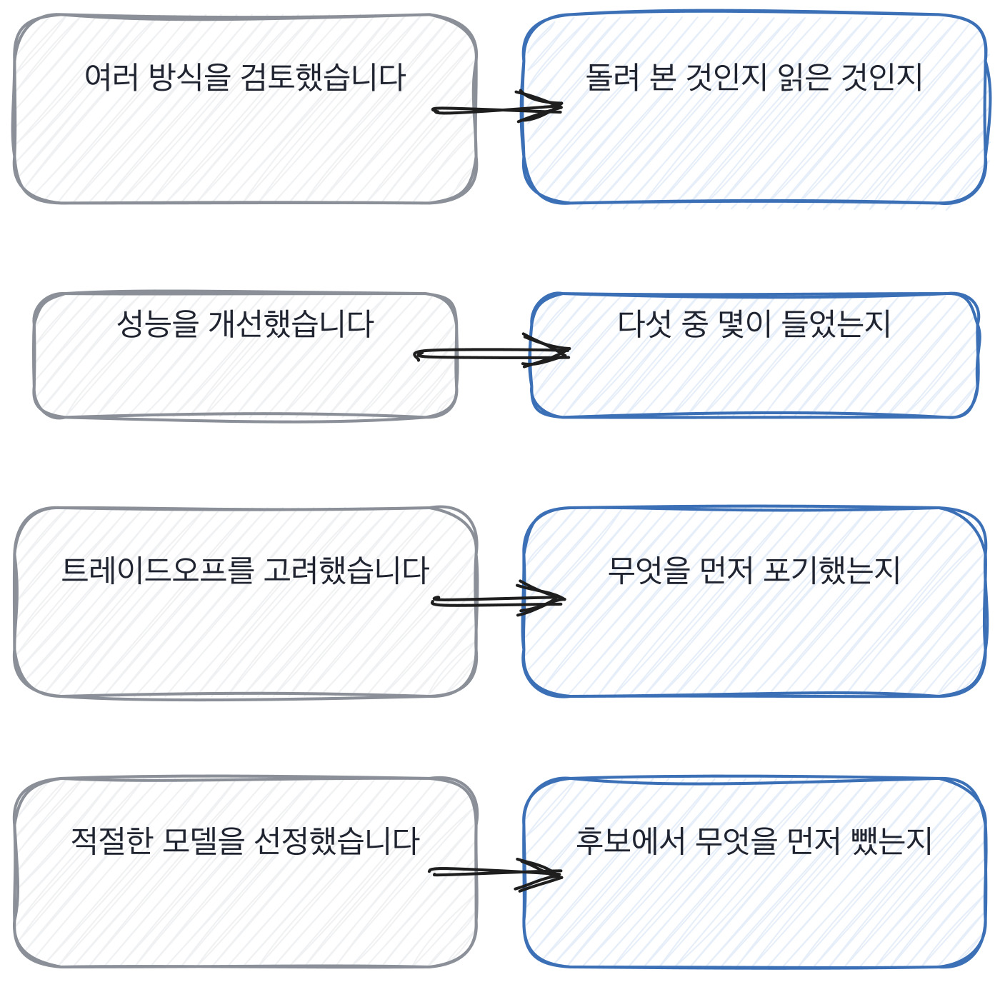

# 10장을 닫으며

## 한 관문을 닫으며

세 칸이 모델 일의 세 자리를 봤습니다. 고르는 자리, 막히는 자리, 내주는 자리.
이 셋을 한 줄로 이으면 이렇게 됩니다. **이 사람이 모델을 골랐나 받았나.**
받아서 쓴 것도 일입니다. 다만 들어와서 혼자 정할 수 있는 범위가 다릅니다.

네 자리를 순서대로 물으면 6분 안에 끝납니다. 꼬리 질문 하나씩 붙여서요.
그리고 이 순서는 자리가 바뀌어도 그대로 씁니다. 분류든 생성이든 검색이든
고르고 막히고 내주는 순서는 같거든요.

어느 자리가 비었는지는 답을 듣는 동안 알 수 있습니다.
모델 답변에서 자주 들리는 말과 그때 물을 자리를 짝으로 세우면 이렇게 됩니다.

왼쪽 넷은 전부 통과되는 문장입니다. 틀린 말이 하나도 없어요.
오른쪽을 한 번씩만 물으면 넷 중 몇 개가 비어 있는지가 그 자리에서 나옵니다.

이 장에서 나온 낱말 몇 개를 짚고 갑니다. 면접장보다는 디브리프에서 필요한 말들이에요.
같은 것을 두 사람이 다른 이름으로 부르면 판정을 맞출 수가 없거든요.

> **채용 말 배우기**
>
> **캘리브레이션** 면접관들끼리 기준을 맞추는 자리를 말합니다. 같은 답에 같은 판정이 나오게요.
>
> **레벨링** 이 사람을 몇 년 차 자리에 놓을지 정하는 것을 말해요. 합격과는 다른 결정입니다.
>
> **리드 면접관** 그 면접의 순서와 시간을 책임지는 사람이에요. 없으면 넷이 같은 걸 묻습니다.

모델 자리에서 저도 크게 틀린 적이 있습니다.

> **저자의 삽질**
>
> 모델 질문을 무엇을 썼냐로 시작하면 이름이 나옵니다. 그리고 이름은 검색돼요.
> 안 쓴 쪽을 먼저 물으면 같은 45분에서 건지는 게 달라집니다. 질문 하나의 순서를 바꾼 것뿐인데요.

옛 관행 하나를 재 봅니다. 최신 기법을 아는지 물어보던 관행이에요.

> **옛 규칙은 아직 유효한가**
>
> **모델 구조와 알고리즘을 묻는 관행.** 판정은 조정해서 유효입니다.
> 근거는 제 경험이에요. 구조를 물으면 설명이 나오는데 그 설명은 어디에나 적혀 있습니다.
> 그래서 저는 구조 대신 **그 구조를 안 고른 이유와 그때 잰 숫자**를 묻습니다.
> 숫자에는 날짜가 붙고, 날짜가 붙으면 그 자리에 있었는지가 드러납니다.

다음 장은 검색과 맥락입니다. 모델을 물었으니 이제 그 모델에 무엇을 넣었는지를 봐요.
넣을 것을 고르는 일도 결국 내주는 일입니다. 하나를 넣으면 하나가 빠지니까요.
자리는 바뀌는데 동작은 같습니다. 안 고른 쪽을 묻는 것요.

모델 이야기를 들을 때 제가 실제로 보는 자리를 적어 둡니다.

> **현장에서는**
>
> 저는 무엇을 골랐냐고 안 묻고 무엇을 안 골랐냐고 묻습니다. 같은 질문인데 답이 다르게 옵니다.
> 고른 것은 결과에 남아 있어서 나중에 봐도 알 수 있고, 안 고른 것은 그 사람에게만 있어요.

속기 쉬운 자리를 하나 더 짚고 갑니다. 최신 방법을 아는 것이 신호처럼 보이는 자리요.
예전에는 이게 맞는 신호였습니다. 읽는 데 시간이 들었으니까요.
지금은 읽는 값이 거의 0이라 이름을 아는 것과 붙여 본 것 사이가 아주 멀어졌습니다.

> **여기서 다들 속는다**
>
> 새로 나온 방법의 이름을 대면 따라가고 있는 사람처럼 보입니다. 실제로 읽고 있기도 하고요.
> 그런데 이름을 아는 것과 붙여 본 것 사이가 이제 아주 멀어졌습니다. 읽는 값이 거의 0이거든요.
> 붙여 본 사람은 이름보다 *안 붙인 이유*를 먼저 말합니다. 붙였다 걷어낸 이야기도 하고요.
> 확인은 시간을 물으면 됩니다. 그거 붙이는 데 며칠 걸렸냐고요.

모델 이야기를 들으면서 아래 다섯 줄로 훑어 보세요.
둘째 줄과 다섯째 줄이 같은 것을 다르게 묻는 겁니다. 둘 중 하나만 나와도 됩니다.

> **30초 점검**
>
> 셋 중 무엇을 왜 골랐는지 대는가.
> 안 고른 쪽의 이유가 나오는가.
> 안 되던 것을 되게 만든 과정에 숫자가 있는가.
> 셋 중 무엇을 먼저 포기했는지 말하는가.
> 붙였다 걷어낸 이야기가 있는가.

내준 것을 말하는 게 왜 그렇게 잘 갈리는지 풀어 놓고 닫겠습니다.
답 자체가 아니라 그 답을 손해로 여기느냐에서 갈리는 자리라 좀 특이합니다.

> **쉬어 가기**
>
> **쉬어 가기: 무엇을 내줬느냐가 실력의 표시인 이유**
>
> 크기와 지연과 비용은 서로 당깁니다. 하나를 좋게 하면 다른 하나가 나빠져요.
> 셋 다 만족하는 자리는 없습니다. 그래서 이 셋은 고르는 자리가 아니라 내주는 자리입니다.
>
> 그런데 면접에서 이걸 물으면 셋 다 지킨 것처럼 답이 옵니다. 트레이드오프를 고려했다는 식으로요.
> 고려했다는 말이 정확히 아무것도 안 말합니다. 무엇을 내줬는지가 빠져 있으니까요.
>
> 내준 것을 말하기가 왜 어려운지 생각해 보면, 그게 손해처럼 보이기 때문입니다.
> 지연을 포기했다고 말하면 성능을 못 낸 것처럼 들려요. 그래서 안 말합니다.
>
> 그런데 실제로 만들어 본 사람은 이걸 손해로 안 봅니다. 당연한 일로 봐요.
> 내줄 것을 정하는 게 설계니까요. 아무것도 안 내줬다는 건 아직 안 만들어 봤다는 뜻입니다.
>
> 그래서 이 질문이 잘 갈립니다. 답 자체가 아니라 **그 답을 손해로 여기느냐**에서 갈려요.
> 내준 것을 담담하게 말하는 사람은 그 자리에 서 봤고,
> 셋 다 지켰다고 말하는 사람은 아직 그 자리에 안 서 봤습니다.

긴 이야기는 여기까지입니다. 모델 자리에서 들고 갈 것을 다섯 줄로 접으면 이렇게 됩니다.
고른 것 말고 내준 것을 묻는 게 다섯 줄의 공통점이에요.
내준 것을 담담하게 말하는 사람이 그 자리에 서 봤던 사람입니다.

> **한 관문 요약**
>
> 방식은 셋이고 대개 하나만 서 봅니다. 나머지 둘을 물어야 어디까지 갔는지 나옵니다.
>
> 검토했다는 말은 읽은 것과 돌려 본 것을 같은 문장으로 덮습니다. 크기를 물어야 갈립니다.
>
> 여러 번 고쳤다는 답에서 개수를 되살립니다. 다섯 중 하나가 해 본 사람의 비율입니다.
>
> 셋을 다 지켰다는 답은 셋을 다 안 재 본 답입니다. 포기라는 낱말로 다시 묻습니다.
>
> 다음 관문에서 뒤집히는 것. 모델을 고른 사람에서 넣을 것을 고른 사람으로 넘어갑니다.

> **이 판정이 헐거운 지점**
>
> 파인튜닝을 아예 안 하는 팀도 많습니다. 그 경우엔 이 장의 첫 칸이 불리하게 걸립니다.
>
> 다섯 중 하나라는 비율은 제가 본 표본에서 나온 것이지 재 본 숫자가 아닙니다.
>
> 포기한 것을 못 대는 사람 중에 혼자 정할 자리가 아니었던 경우가 섞여 있습니다.
