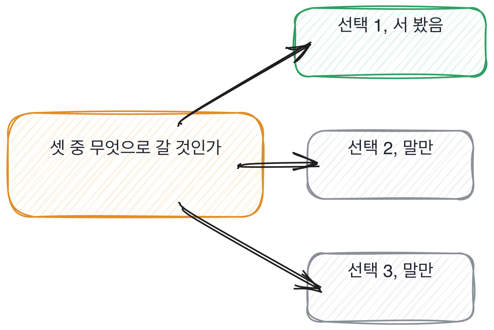

# 10.1 학습이냐 파인튜닝이냐 프롬프트냐

*[7.2](../07-g07/q024.md) 에서 버린 선택지를 물었죠. 그 물음을 이번엔 모델 자리에 그대로 놓습니다.*

> **이 말부터**
>
> **파인튜닝** 이미 만들어진 모델에 우리 데이터를 더 먹여 조금 고치는 것을 말합니다.
>
> **프롬프트** 모델은 그대로 두고 물어보는 문장만 바꿔서 원하는 답을 얻는 것을 말해요.

앞 장에서 데이터를 봤으니 이제 그 데이터로 무엇을 했는지를 봅니다.
모델 자리에서 제일 먼저 정하는 건 방식이에요. 처음부터 학습을 시킬 것인가,
있는 걸 조금 고칠 것인가, 아니면 안 건드리고 물어보는 문장만 바꿀 것인가.

이 셋의 차이는 어디에나 적혀 있습니다. 그래서 무엇을 골랐냐는 물음은 아무도 못 가려요.
셋 다 설명할 수 있고, 왜 그걸 골랐는지도 설명할 수 있습니다.
읽고 온 사람이 제일 잘 대답하는 종류의 질문이기도 하고요.

갈리는 자리는 안 고른 쪽입니다. [7.1](../07-g07/q023.md) 에서 결정을 셌던 그 방식 그대로예요.
여기 갈림길이 셋인데 이 사람이 몇 개에 실제로 서 봤는가.
답은 대개 하나입니다. 결과로 남은 길 하나요.

> **이렇게 답합니다**
>
> 프로젝트 초기에 파인튜닝과 프롬프트 방식을 모두 검토했습니다.
> 데이터 양과 비용을 고려했을 때 프롬프트 기반이 더 적합하다고 판단했습니다.
> 추후 파인튜닝으로 전환할 수 있도록 구조는 유연하게 가져갔습니다.
> 결과적으로 목표했던 수준의 성능을 확보했습니다.

네 줄이 다 맞는 말이고, 순서도 교과서와 같습니다. 그래서 더 안 보입니다.

> **표시해 보면**
>
> 프로젝트 초기에 파인튜닝과 프롬프트 방식을 모두 검토했습니다.
>     ← 검토가 무엇이었는지 없음. 읽은 것인지 돌려 본 것인지
> 데이터 양과 비용을 고려했을 때 프롬프트 기반이 더 적합하다고 판단했습니다.
>     ← 데이터가 몇 건이고 비용이 얼마였는지 없음
> 추후 파인튜닝으로 전환할 수 있도록 구조는 유연하게 가져갔습니다.
>     ← 유연한 구조가 무엇인지 없음. 전환은 실제로 안 함
> 결과적으로 목표했던 수준의 성능을 확보했습니다.
>     ← 목표가 몇이고 나온 게 몇인지 없음

첫 줄의 검토했다는 말이 이 답의 전부를 떠받치고 있습니다.
그런데 검토라는 낱말은 읽은 것과 돌려 본 것을 같은 말로 덮어요.
**한 시간 검색한 것과 사흘 붙잡고 돌린 것이 같은 문장으로 나와요.**
데이터 양과 비용을 고려했다는 둘째 줄도 마찬가지고요. 양도 없고 비용도 없습니다.

이 말은 저도 써 봤습니다. 어떤 방식을 검토했다고 적어 놓고 나중에 뭘 했나 되짚어 보니
탭 세 개를 열어 둔 게 전부였어요. 그래서 저는 이 낱말이 나오면 제 이야기부터 떠올립니다.

> **이렇게 파고듭니다**
>
> 물음: 파인튜닝 쪽은 어디까지 가 보셨어요? 한 번은 돌려 보셨나요?
>
> 답: 직접 실행하지는 않았고 팀 논의를 통해 결정했습니다.

돌려 봤냐고 물으면 검토의 크기가 그 자리에서 드러나요.
직접 실행하지 않았다는 답이 나쁜 건 아니에요. 다만 그 사람이 아는 건 셋 중 하나입니다.

> **서 본 갈림길이 나오면**
>
> 프롬프트로 시작했습니다. 제일 싸고 제일 빨리 되돌릴 수 있으니까요.
> 문의 분류가 0.71에서 넉 주 동안 안 올라가서 파인튜닝을 붙여 봤습니다.
> 라벨 붙은 티켓이 4천 건 있었고 작은 모델로 한 번 돌리니 0.83이 나왔어요.
> 그런데 두 달 뒤에 그걸 걷어냈습니다. 상품 분류가 바뀌면서 라벨이 낡았거든요.
> 다시 맞추려면 라벨을 매달 새로 붙여야 하는데 그 비용이 안 끝나는 비용이었습니다.
> 지금은 프롬프트에 예시 열둘을 넣는 쪽으로 돌아왔고 0.79에서 돌고 있습니다.

이 답에는 프롬프트와 파인튜닝이 둘 다 들어 있고, 둘 사이를 두 번 오갔습니다.
숫자도 세 번 나와요. 0.71과 0.83과 0.79요.
그런데 제일 값진 줄은 넷째 줄입니다. **붙였던 파인튜닝을 두 달 뒤에 걷어냈다고 하죠.**

걷어낸 이유가 성능이 아니라는 게 좋습니다. 라벨이 낡는다는 거였어요.
이건 두 달을 굴려 본 사람만 아는 자리입니다. 처음 재는 날에는 안 보이거든요.
[8.2](../08-g08/q028.md) 에서 되돌린 양을 셌던 이유가 이겁니다. 되돌린 사람은 양쪽에 다 서 본 사람이에요.

갈림길이 셋인데 대개 하나만 칠해집니다. 나머지 둘은 말로만 압니다.
그 둘을 물어야 이 사람이 어디까지 갔는지가 나와요.

> **여기서 다들 속는다**
>
> 방식 이야기는 셋의 장단점이 정리된 표로 도는 주제입니다.
> 그래서 답이 표처럼 나오고, 표처럼 나오면 다 맞아 보여요.
> **속는 자리는 판단이 아니라 판단의 근거입니다.**
> 표에 적힌 이유를 그대로 말한 것인지, 자기 데이터에서 나온 이유인지를 봅니다.

같은 질문을 다른 각도에서 한 번 더 던져 보겠습니다.

> **한 번 더**
>
> 베이스 모델을 왜 그걸로 골랐냐고 물어도 같은 자리가 보입니다.
> 성능과 비용을 종합적으로 고려하여 가장 적합한 모델을 선정했습니다.
> 공개된 벤치마크 점수와 커뮤니티 평가를 함께 참고했습니다.
> 벤치마크와 커뮤니티 평가를 참고했다는 답에는 우리 데이터로 재 본 자리가 없어요.
> 반대쪽은 후보 셋에 같은 티켓 200건을 물렸고, 반말로 새는 것 하나를 먼저 뺐다고 말합니다.

여기서 조심할 게 하나 있습니다. 프롬프트만 써 봤다는 답을 낮게 보지 않는 겁니다.
그게 맞는 선택이었던 팀이 훨씬 많아요. 파인튜닝을 안 한 게 게으름이 아니라 판단일 수 있습니다.
**제가 보는 건 셋 중 몇 개를 해 봤느냐가 아니라, 안 한 쪽을 이유와 함께 말하느냐입니다.**

> **판정**
>
> 안 고른 쪽이 나오고, 그걸 어디까지 가 봤는지가 나오면 통과입니다.
> 방식을 한 번 갈아탄 이야기가 나오면 아주 좋은 신호예요. 양쪽에 다 서 본 겁니다.
>
> 셋을 다 설명하는데 자기가 만진 건 하나뿐이고, 안 고른 이유가 교과서 문장이면 안 보냅니다.
> 검토했다는 말을 파고들어도 크기가 안 나오는 경우도 같습니다.
>
> 기록에는 이렇게 적습니다. 프롬프트로 시작해 0.71에서 막혔고, 티켓 4천 건으로
> 파인튜닝해 0.83을 얻었다가, 라벨이 낡는 비용 때문에 두 달 뒤 걷어냈다.

> **물을 문장 둘**
>
> 방식을 물으면 고른 쪽 이야기가 옵니다. 그래서 안 고른 쪽을 어디까지 가 봤는지 묻습니다.
> 돌려 봤냐는 한 마디가 검토의 크기를 그 자리에서 드러내요.
>
> **그대로 읽으세요.** *파인튜닝 쪽은 어디까지 가 보셨어요? 한 번은 돌려 보셨나요?*
>
> **답을 받으면 이어서.** *그때 뭐가 걸려서 접으셨죠? 지금 다시 하면 같은 선택 하시겠어요?*

> **이걸 놓치면**
>
> 방식의 갈림길을 못 물으면 [10.3](q035.md) 에서 무엇을 포기했냐고 물어도 셋을 다 지켰다는 답이 옵니다.

