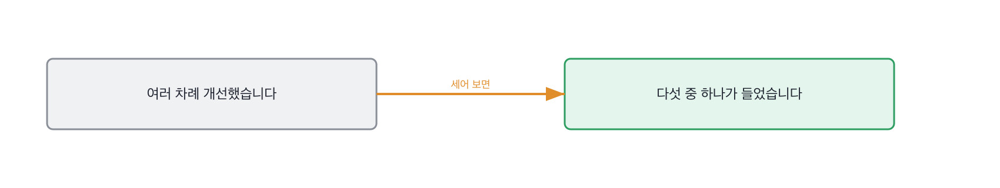

# 10.2 안 되던 것을 되게 만든 과정

*[10.1](q033.md) 에서 방식을 골라 온 길을 봤죠. 이번엔 그 길 위에서 막혔던 자리를 봅니다.*

> **이 말부터**
>
> **튜닝** 모델의 설정값을 바꿔 가며 결과가 나아지는지 보는 것을 말합니다.
>
> **청크** 긴 문서를 검색에 쓰려고 잘라 놓은 조각이에요. [9.3](../09-g09/q032.md) 에서 나왔습니다.

모델 일의 대부분은 안 되는 걸 붙잡고 있는 시간입니다. 그건 다들 압니다.
그래서 안 되던 걸 되게 만든 이야기를 해 달라고 하면 누구나 이야기를 갖고 있어요.
문제는 그 이야기가 대개 같은 모양으로 나온다는 겁니다.

같은 모양이란 이렇습니다. 처음엔 잘 안 됐고, 여러 가지를 시도했고, 결국 좋아졌다.
셋 다 사실이고 셋 다 확인할 수 없어요. **여러 가지라는 말이 개수를 지웁니다.**
개수가 지워지면 그중 무엇이 들었는지도 같이 지워집니다.

그래서 이 칸의 동작은 개수를 되살리는 겁니다. 몇 개를 바꿨고 그중 몇 개가 들었는지요.
해 본 사람의 답에는 이 비율이 늘 이상합니다. 다섯을 바꿔서 하나가 듣거든요.
읽고 온 사람의 답에서는 바꾼 것이 전부 조금씩 기여합니다. 그런 실험은 없습니다.

> **이렇게 답합니다**
>
> 초기에는 모델 성능이 기대에 미치지 못했습니다.
> 데이터 품질 개선과 하이퍼파라미터 튜닝을 반복하며 성능을 끌어올렸습니다.
> 프롬프트도 여러 차례 수정했고 최종적으로 목표 수치를 달성했습니다.
> 꾸준한 실험과 개선이 중요하다고 생각합니다.

읽으면 성실해 보이는 답입니다. 실제로 이런 답에 저는 여러 번 고개를 끄덕였고요.

> **표시해 보면**
>
> 초기에는 모델 성능이 기대에 미치지 못했습니다.
>     ← 무엇이 얼마였는지 없음
> 데이터 품질 개선과 하이퍼파라미터 튜닝을 반복하며 성능을 끌어올렸습니다.
>     ← 몇 번 돌렸는지, 어느 것이 들었는지 없음
> 프롬프트도 여러 차례 수정했고 최종적으로 목표 수치를 달성했습니다.
>     ← 어떻게 바꿨는지 없음. 목표가 몇인지도 없음
> 꾸준한 실험과 개선이 중요하다고 생각합니다.
>     ← 교훈으로 닫음. 더 물을 자리가 없어짐

기대에 미치지 못했다는 첫 줄에 숫자가 없습니다. 무엇이 얼마였는지가 없어요.
반복했다는 둘째 줄에는 횟수가 없고, 여러 차례라는 셋째 줄에는 방향이 없습니다.
그리고 마지막 줄이 문을 닫습니다. **꾸준한 실험이 중요하다는 건 교훈이에요.**
교훈이 나오면 더 물을 자리가 없어집니다. [8.1](../08-g08/q027.md) 에서 본 그 닫힘과 같은 것입니다.

> **이렇게 파고듭니다**
>
> 물음: 그 여러 번 중에 숫자를 실제로 움직인 건 뭐였어요?
>
> 답: 전반적으로 모두 조금씩 기여했다고 봅니다.

모두 조금씩 기여했다는 답은 아무것도 안 재 봤다는 뜻입니다.
하나씩 떼서 재 본 사람은 반대로 말해요. 대부분은 안 들었다고요.

> **하나가 나오면**
>
> 분류가 0.62에서 넉 주 동안 안 올라갔습니다.
> 바꿔 본 게 다섯인데 숫자를 움직인 건 하나였어요.
> 청크를 문단에서 티켓 한 건 통째로 바꾼 겁니다. 0.62가 0.74가 됐습니다.
> 나머지 넷은 헛수고였어요. 프롬프트를 세 번 고쳤는데 0.01 안쪽으로만 움직였습니다.
> 그때 배운 건 순서였습니다. 저는 만지기 쉬운 것부터 만졌는데 그게 제일 안 듣는 자리였어요.
> 지금도 0.74에서 멈춰 있고, 다음에 볼 자리는 라벨 쪽이라고 보고 있습니다.

다섯 중 하나. 이 비율이 이 답의 심장입니다.
그리고 그 하나가 무엇이었는지가 구체적이에요. 청크를 문단에서 티켓 한 건으로 바꾼 것.
0.62가 0.74가 됐다는 숫자가 양쪽에 다 있습니다.

넷째 줄이 더 좋습니다. 프롬프트를 세 번 고쳤는데 0.01 안쪽이었다고요.
**안 들은 것을 숫자로 말하는 사람은 그걸 실제로 재 본 사람입니다.**
지어내는 쪽은 안 들은 것을 아예 안 말합니다. 말할 이유가 없거든요.

그리고 마지막 두 줄에 남은 것이 있습니다. 지금도 0.74에서 멈춰 있다는 것요.
[8.3](../08-g08/q029.md) 에서 사고가 지나간 자리에 무엇이 남았냐고 물었던 그 자리입니다.
끝난 이야기로 닫지 않고 다음에 볼 자리를 대는 답이 훨씬 믿음직합니다.

> **현장에서는**
>
> 어떤 팀은 안 들은 실험을 따로 적어 둡니다. 다음 사람이 같은 걸 다시 하지 말라고요.
> 그 목록의 길이가 그 팀이 실제로 굴린 양입니다.

여기서 순서 이야기를 하나 더 짚고 갑니다. 좋은 답의 다섯째 줄이에요.
만지기 쉬운 것부터 만졌는데 그게 제일 안 듣는 자리였다는 말요.
**이건 실패의 내용이 아니라 실패의 순서를 배운 사람의 문장입니다.**
그리고 이 문장은 이력서에 안 적힙니다. 물어야만 나옵니다.

> **판정**
>
> 바꾼 개수와 그중 들었던 개수가 나오면 통과입니다. 다섯 중 하나 같은 비율이요.
> 안 들은 것을 숫자로 말하면 아주 좋은 신호고요. 그건 하나씩 떼서 재 봤다는 뜻입니다.
>
> 여러 가지를 시도했다고만 답하고, 무엇이 들었냐고 물어도 다 조금씩 기여했다고 하면
> 다음 라운드로 안 보냅니다. 좋아졌다는 숫자가 한쪽에만 있는 경우도 같습니다.
>
> 기록에는 이렇게 적습니다. 넉 주 동안 0.62에서 막혔고, 다섯을 바꿔 하나가 들었으며,
> 청크 단위를 티켓 한 건으로 바꿔 0.74를 얻었고 지금도 거기서 멈춰 있다고 말했다.

> **물을 문장 둘**
>
> 개선 이야기를 물으면 과정이 옵니다. 그래서 그중 무엇이 들었는지를 묻습니다.
> 하나를 물으면 나머지가 안 들었다는 이야기가 따라 나와요. 그 나머지가 증거입니다.
>
> **그대로 읽으세요.** *바꿔 본 게 몇 개고, 그중에 숫자를 움직인 건 뭐였어요?*
>
> **답을 받으면 이어서.** *안 들었던 건 어떻게 아셨어요? 지금은 어디서 멈춰 있죠?*

> **이걸 놓치면**
>
> 숫자를 움직인 하나를 못 물으면 [15.1](../15-g15/q049.md) 에서 배포한 뒤에 뭘 봤냐고 물어도 지표 이름만 나옵니다.

