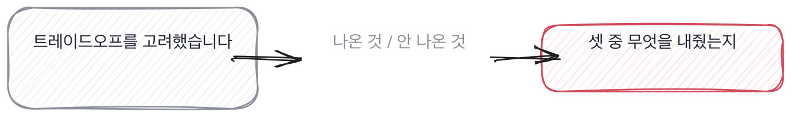

# 10.3 크기와 지연과 비용의 삼각형

*[10.2](q034.md) 에서 무엇이 들었는지를 물었죠. 이번엔 무엇을 내줬는지를 묻습니다.*

> **이 말부터**
>
> **지연** 물어보고 답이 돌아올 때까지 걸리는 시간을 말합니다. 초로 잽니다.
>
> **캐시** 같은 물음이 또 오면 전에 만든 답을 그대로 내주는 것을 말해요.

모델 자리에는 서로 잡아당기는 것이 셋 있습니다. 크기와 지연과 비용이에요.
큰 걸 쓰면 답이 좋아지고 느려지고 비싸집니다. 작은 걸 쓰면 반대고요.
셋 다 만족하는 자리는 없습니다. 그래서 이 셋은 고르는 자리가 아니라 **내주는 자리**입니다.

그런데 이 질문에 오는 답은 늘 셋 다 지킨 것처럼 나와요.
트레이드오프를 고려했다는 문장이 그 일을 해요. 고려했다는 말은 무엇을 내줬는지를 안 밝히거든요.
[7.3](../07-g07/q025.md) 에서 경계를 물었던 것과 같은 자리예요. 안 그은 선은 말로만 있습니다.

그래서 이 칸의 동작은 하나입니다. 셋 중에 **무엇을 제일 먼저 포기했냐**고 묻습니다.
포기라는 낱말을 일부러 씁니다. 조율이나 균형이라는 말로는 대답이 안 갈리거든요.
포기한 것을 대면 그 뒤에 누가 그 결정을 받아들였는지까지 따라 나옵니다.

> **이렇게 답합니다**
>
> 성능과 비용, 지연 시간 사이의 트레이드오프를 고려했습니다.
> 서비스 요구사항에 맞춰 적절한 모델 크기를 선택했습니다.
> 캐싱과 배치 처리를 도입해 운영 비용을 줄였습니다.

세 줄 다 맞는 말인데 셋 중 무엇도 숫자로 안 나옵니다.

> **표시해 보면**
>
> 성능과 비용, 지연 시간 사이의 트레이드오프를 고려했습니다.
>     ← 무엇을 얼마나 내줬는지 없음
> 서비스 요구사항에 맞춰 적절한 모델 크기를 선택했습니다.
>     ← 요구사항이 몇 초였는지, 누가 정했는지 없음
> 캐싱과 배치 처리를 도입해 운영 비용을 줄였습니다.
>     ← 얼마가 얼마로 줄었는지 없음

트레이드오프를 고려했다는 첫 줄에는 내준 것이 없습니다.
적절한 모델 크기라는 둘째 줄에는 요구사항이 몇 초였는지가 없고요.
셋째 줄이 제일 아깝습니다. **캐싱과 배치는 실제로 해 본 사람만 쓰는 낱말인데 숫자가 안 붙었어요.**
해 본 것을 안 해 본 것처럼 말하는 답도 있습니다. 그래서 낱말만으로는 못 가릅니다.

> **이렇게 파고듭니다**
>
> 물음: 셋 중에 뭘 제일 먼저 포기하셨어요?
>
> 답: 균형을 맞추는 방향으로 조율했습니다.

균형을 맞췄다는 답은 셋을 다 안 재 봤다는 뜻입니다.
잰 사람은 셋 중 하나를 반드시 내주게 되어 있고, 내준 자리를 기억합니다.

> **포기한 것이 나오면**
>
> 셋 다 못 지켜서 지연을 포기했습니다. 1.2초에서 2.8초가 됐어요.
> 대신 근거 문서를 세 개까지 붙였습니다. 상담사한테 제일 필요한 게 그거라서요.
> 2.8초가 괜찮은지는 상담사 네 분한테 물어봤습니다. 통화 중에 쓰는 게 아니라 괜찮다고요.
> 비용은 하루 4만 건으로 잡았고 캐시가 같은 문의를 3할쯤 먹어 줬습니다.
> 그런데 셋 중에 되돌리기 제일 어려운 게 지연이라는 건 나중에 알았어요.
> 느려진 걸 한 번 받아들이면 다시 빠르게 만들 이유를 아무도 안 대거든요.

첫 줄에서 바로 답이 나옵니다. 지연을 포기했다고요. 1.2초가 2.8초가 됐습니다.
숫자가 양쪽에 다 있는 건 [1.1](../01-g01/q001.md) 에서부터 세어 온 그 표시예요.
그리고 무엇과 바꿨는지가 붙습니다. 근거 문서 세 개요.

셋째 줄이 이 답을 다른 답과 갈라 놓습니다. **2.8초가 괜찮은지 상담사 네 분한테 물어봤다고 하거든요.**
쓰는 사람에게 확인하고 정한 것과 혼자 정한 것은 다른 결정입니다.
그런 답은 그 자리에 실제로 있어야 나와요. 네 분이라는 수가 지어낸 티가 안 나는 이유이기도 하고요.

마지막 두 줄에 저는 오래 머물렀습니다. 셋 중 되돌리기 제일 어려운 게 지연이라는 말요.
느려진 걸 사람들이 한 번 받아들이면 다시 빠르게 만들 이유를 아무도 안 댄다는 겁니다.
이건 성능 이야기가 아니라 조직 이야기예요. 굴려 본 사람만 여기까지 옵니다.

> **한 번 더**
>
> 비용만 따로 물어도 같은 자리가 보입니다.
> 캐싱과 모델 경량화를 적용해 비용을 최적화했습니다.
> 불필요한 호출을 줄여 운영 비용을 크게 절감했습니다.
> 크게 절감했다는 답에는 예상과 실제가 없고 무엇이 불필요했는지도 없어요.
> 반대쪽은 첫 달 청구서가 예상의 세 배였다고 하고, 원인이 긴 문서에서만 나던 재시도였다고 말합니다.

비용 답에서 하나 더 볼 게 있습니다. 원인이 두 가지가 겹쳐서 났다는 겁니다.
재시도 세 번과 긴 문서가 따로 있을 때는 아무 문제가 없었어요. 겹쳐서 터진 거죠.
**겹쳐서 터진 이야기는 지어내기 어렵습니다.** 지어내면 원인이 하나로 깔끔하게 나옵니다.

> **판정**
>
> 셋 중 포기한 것이 나오고 그 값이 숫자로 나오면 통과입니다. 1.2초가 2.8초처럼요.
> 그 포기를 누가 받아들였는지까지 나오면 아주 좋은 신호고요.
>
> 트레이드오프를 고려했다고만 답하고, 뭘 포기했냐고 물어도 균형을 맞췄다고 하면 안 보냅니다.
> 캐싱이나 배치 같은 낱말은 나오는데 얼마가 얼마로 줄었는지가 안 나오는 경우도 같습니다.
>
> 기록에는 이렇게 적습니다. 지연을 1.2초에서 2.8초로 내주고 근거 문서 세 개를 얻었으며,
> 2.8초가 괜찮은지 상담사 네 분에게 확인하고 정했다고 말했다.

> **물을 문장 둘**
>
> 셋을 물으면 고려했다는 답이 옵니다. 그래서 포기라는 낱말로 다시 묻습니다.
> 조율이나 균형으로는 안 갈리는데 포기는 하나를 대게 만들어요.
>
> **그대로 읽으세요.** *셋 중에 뭘 제일 먼저 포기하셨어요?*
>
> **답을 받으면 이어서.** *그 값이 얼마에서 얼마가 됐죠? 그 결정은 누가 받아들였어요?*

> **이걸 놓치면**
>
> 포기한 것을 못 물으면 [14.2](../14-g14/q047.md) 에서 열 배가 되면 어디가 먼저 터지냐고 물어도 짐작만 나옵니다.

