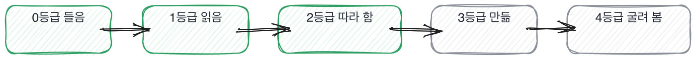
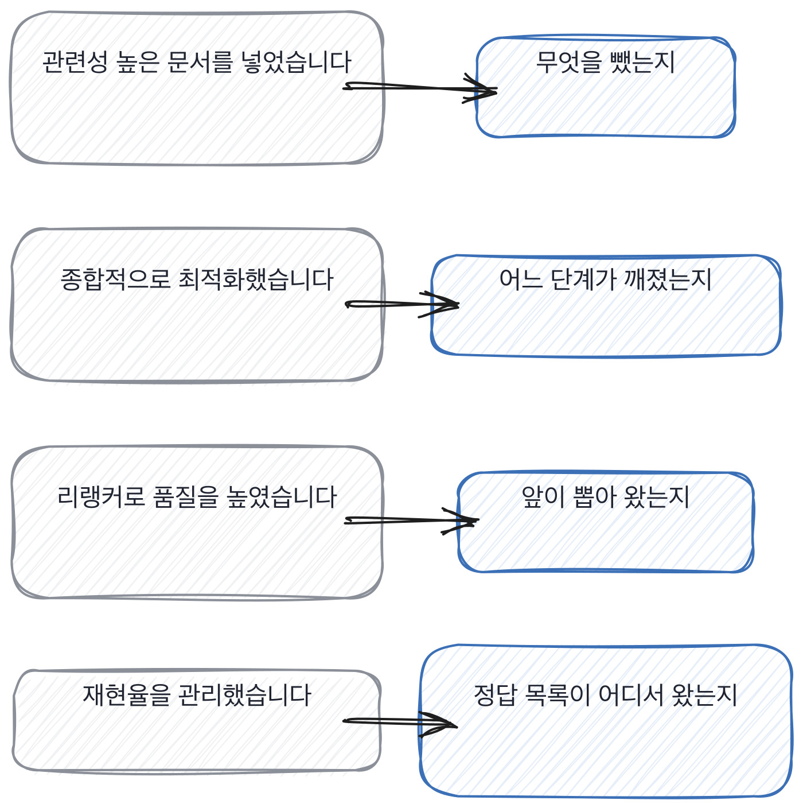

# 11장을 닫으며

## 경험 등급표

4단계의 절반이 지났으니 표 한 장을 놓습니다. 지금까지 열한 칸에서 물어 온 것을
한 줄로 줄이면 이렇게 돼요. **이 사람이 이걸 어디까지 해 봤는가.**
그 어디까지를 다섯으로 나눈 것이 아래 표입니다.

- **등급.** 어디까지 답변에서 이렇게 들립니다 가르는 질문
- **0.** 들은 것 다들 그렇게 한다고 알고 있습니다 어디서 보셨어요
- **1.** 읽은 것 일반적으로 그 방식이 권장됩니다 그 값을 재 보셨어요
- **2.** 따라 해 봄 예제를 참고해서 구성했습니다 안 되던 데가 있었나요
- **3.** 혼자 만듦 제가 청크를 셋 바꿔 봤습니다 뭘 빼고 뭘 되돌렸죠
- **4.** 굴려 봄 넉 주 뒤에 다시 깨졌어요 그때 뭘 보고 아셨어요

이 표에서 진짜 선은 하나입니다. 2등급과 3등급 사이예요.
따라 해 본 사람과 혼자 만든 사람은 낱말이 똑같이 나옵니다. 청크도 말하고 재순위도 말해요.
갈리는 건 낱말이 아니라 **뺀 것과 되돌린 것**입니다. 따라 한 사람에게는 그게 없습니다.
따라 할 때는 뺄 일이 없거든요. 예제에 있는 걸 그대로 넣으면 되니까요.

이 책의 절반이 저 칸 하나를 가르는 데 쓰입니다. 결정을 세는 것도, 버린 쪽을 묻는 것도,
못 뺀 것을 묻는 것도 전부 2와 3 사이에 선을 긋는 동작이에요.
3에서 4로 가는 선은 좀 다릅니다. 그건 시간이 재는 거라 질문으로는 잘 안 갈립니다.
넉 주 뒤에 다시 깨졌다는 문장은 넉 주를 기다려 본 사람만 갖고 있어요.

등급을 매길 때 조심할 게 하나 있습니다. **등급은 사람의 값이 아니라 그 자리의 값입니다.**
같은 사람이 데이터에서는 3등급이고 검색에서는 1등급일 수 있어요. 그게 정상입니다.
그래서 평가표에는 사람 옆에 등급 하나를 적는 게 아니라 렌즈마다 하나씩 적습니다.
사람 옆에 하나만 적으면 그 숫자가 어디서 왔는지 다음 주에 아무도 모릅니다.

## 한 관문을 닫으며

세 칸이 검색의 세 자리를 봤습니다. 고르는 자리, 깨지는 자리, 안 보이는 자리.
셋을 한 줄로 이으면 이렇게 됩니다. **이 사람이 안 나온 것을 세어 봤는가.**
뽑아 온 것만 보고 있으면 검색은 늘 잘 돌고 있는 것처럼 보입니다.

검색 답변에서 자주 들리는 말과 그때 물을 자리를 짝으로 세우면 이렇게 돼요.
왼쪽 넷은 다 통과되는 문장이고, 오른쪽을 한 번씩만 물으면 그 자리에서 갈립니다.

이 장에서 나온 낱말 몇 개를 짚고 갑니다. 검색 이야기를 팀에서 나눌 때 쓰는 말들이에요.

> **채용 말 배우기**
>
> **워크 샘플** 실제로 하는 일과 같은 모양의 과제를 내는 것을 말합니다. 12장에서 다시 나와요.
>
> **스크리닝** 서류나 짧은 통화로 앞에서 거르는 단계를 말합니다. 45분 면접 앞에 붙습니다.
>
> **루프** 한 지원자가 도는 면접 전체를 말해요. 라운드 넷이면 루프 하나입니다.

옛 관행 하나를 재 봅니다. 쓰는 기술의 이름을 확인하던 관행이에요.
이건 지금 제일 빠르게 낡고 있는 것 중 하나입니다.
이름을 대는 값이 거의 0이 됐거든요. 그래서 이름 대신 손을 묻는 쪽으로 옮겼습니다.

> **옛 규칙은 아직 유효한가**
>
> **쓰는 기술의 이름을 확인하는 관행.** 판정은 이제 안 맞음입니다.
> 근거는 제 경험이에요. 검색 파이프라인의 단계 이름은 이제 아무나 다 댑니다.
> 그래서 저는 이름 대신 **그 단계를 잘라 본 방법**을 묻습니다.
> 자르기는 손이 가는 일이라 해 본 사람만 순서를 말할 수 있습니다.

다음 장은 코드입니다. 지금까지는 만든 것을 말로 들었어요.
이제 그 자리에서 손을 쓰게 합니다. 말과 손이 갈리는 자리가 거기예요.
그리고 그 자리에서는 완성이 아니라 첫 3분을 봅니다.

검색 이야기를 들을 때 제가 실제로 하는 것을 적어 둡니다.

> **여기서 다들 속는다**
>
> 단계 이름을 순서대로 대면 파이프라인을 아는 사람처럼 보입니다. 순서가 맞으니까요.
> 그런데 순서는 그림 한 장이면 외워집니다. 자른 사람과 그린 것을 본 사람이 같은 순서를 댑니다.
> 자른 사람은 순서 대신 *어디까지 멀쩡했는지*를 말해요. 그게 자른 흔적입니다.
> 확인은 하나만 고르라고 하면 됩니다. 셋 중 어디서 깨져 있었냐고요.

둘째는 반대쪽에서 옵니다. 순서를 대는 자리가 아니라 결과를 보고하는 자리요.
검색이 잘 돌고 있다는 말은 화면에 결과가 나온다는 뜻이지 다 찾았다는 뜻이 아닙니다.

> **여기서 다들 속는다**
>
> 못 찾은 게 없다는 답은 검색이 잘 돌고 있다는 말처럼 들립니다. 실제로 화면에는 결과가 나오니까요.
> 그런데 못 찾은 것은 화면에 안 나옵니다. 안 나온 것을 세는 장치가 따로 있어야 보여요.
> 장치가 없으면 못 찾은 게 없는 게 아니라 못 찾은 걸 모르는 겁니다.
> 확인은 장치를 물으면 됩니다. 못 찾은 걸 어떻게 세시냐고요.

이 둘 중 앞엣것에서 특히 자주 미끄러집니다. 순서를 아는 것과 자를 줄 아는 것을
같은 것으로 보는 자리요. 낱말은 같은데 손이 다릅니다.

> **저자의 삽질**
>
> 단계 이름을 술술 대면 그 파이프라인을 아는 사람으로 읽힙니다. 저도 그렇게 읽었고요.
> 그런데 순서를 아는 것과 자를 줄 아는 것은 다릅니다. 안 가르면 사고가 났을 때 드러나요.
> 세 단계를 한꺼번에 만지고 어디가 문제였는지 끝내 못 찾는 자리에서요.

면접장에서 이 관문의 것을 쓰실 때는 아래 다섯 줄이면 됩니다.
셋이 나오면 검색 쪽은 충분히 본 거예요. 다섯을 다 채우는 사람은 저도 거의 못 봤고요.

> **30초 점검**
>
> 무엇을 뺐는지 대는가. 그 기준이 나오는가.
> 셋 중 깨진 단계를 하나로 짚는가.
> 나머지를 어떻게 지웠는지 말하는가.
> 못 찾은 것을 세는 장치가 있는가.
> 그 장치에 사람이 들어가는가.

이 관문의 세 칸이 왜 전부 안 보이는 쪽을 보는지, 그 이야기를 하고 닫겠습니다.
이건 검색만의 성질이 아니라 결과가 나오는 모든 일의 성질이라 한 번 짚어 둘 만합니다.

> **쉬어 가기**
>
> **쉬어 가기: 안 나온 것을 세는 일이 어려운 이유**
>
> 이 관문의 세 칸이 전부 안 보이는 쪽을 봅니다. 뺀 것, 깨진 단계, 못 찾은 것.
> 왜 하필 안 보이는 쪽이냐면, 검색이라는 일 자체가 그렇게 생겼기 때문입니다.
>
> 검색은 결과를 내놓습니다. 항상 뭔가는 나와요. 아무것도 못 찾아도 빈 목록이 나오는데,
> 빈 목록은 화면에서 조용합니다. 오류도 아니고 경고도 아니에요.
> 그래서 못 찾는 질의가 넷 중 하나여도 아무도 모릅니다.
>
> 이건 검색만의 문제가 아니라 **결과가 나오는 모든 일**의 문제입니다.
> 결과가 나오면 그 결과를 보게 되고, 결과를 보면 안 나온 것은 안 보입니다.
> 사람 눈이 그렇게 생겼어요.
>
> 그래서 안 나온 것을 세려면 장치가 필요합니다. 저절로는 안 세어집니다.
> 정답 목록을 만들고, 매주 스무 개를 열어 보고, 결과가 0건인 질의를 따로 모으는 것.
> 전부 손이 가는 일이고, 손이 가서 대부분 안 합니다.
>
> 면접에서 이걸 묻는 이유가 그겁니다. 손이 가는 일은 안 해 본 사람이 흉내를 못 내요.
> **안 나온 것을 세어 본 사람은 그 지루함을 기억하고 있습니다.** 그 지루함이 증거입니다.

긴 이야기는 여기까지입니다. 검색 자리에서 들고 갈 것을 다섯 줄로 접으면 이렇게 됩니다.
다섯 줄이 다 안 보이는 쪽을 가리킵니다.

> **한 관문 요약**
>
> 넣은 것은 누구나 말합니다. 뺀 것을 물어야 기준이 있는지 나옵니다.
>
> 종합적으로 개선했다는 답은 한 번도 안 잘라 본 답입니다. 깨진 단계를 하나만 대라고 합니다.
>
> 못 찾은 것은 화면에 없어서 저절로 안 세어집니다. 세는 장치를 물어야 갈립니다.
>
> 2등급과 3등급을 가르는 건 낱말이 아니라 뺀 것과 되돌린 것입니다.
>
> 다음 관문에서 뒤집히는 것. 말로 듣던 자리에서 그 자리에서 손을 쓰게 하는 자리로 넘어갑니다.

> **이 판정이 헐거운 지점**
>
> 검색을 안 붙인 팀에서 온 사람에게는 이 장의 세 칸이 통째로 안 걸립니다.
>
> 경험 등급표의 다섯 칸은 제가 나눈 것이고 재 본 기준이 아닙니다. 2와 3 사이만 확신합니다.
>
> 포기한 순간을 기록하는 팀이 드뭅니다. 없다고 해서 안 본 것으로 세면 억울한 사람이 생깁니다.
