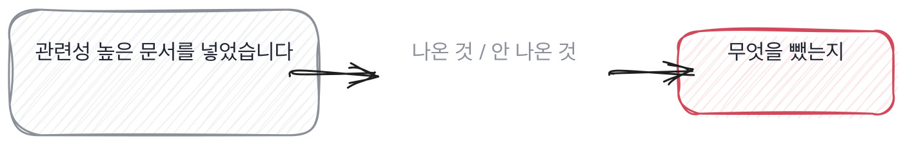

# 11.1 무엇을 넣고 무엇을 뺐나

*[10.3](../10-g10/q035.md) 에서 무엇을 내줬는지를 물었죠. 이번엔 맥락에서 무엇을 뺐는지를 봅니다.*

> **이 말부터**
>
> **맥락** 모델에게 답을 만들라고 같이 넣어 주는 문서 조각들을 말합니다.
>
> **검색 상위** 질문과 가까운 순서로 뽑은 목록에서 위쪽 몇 개를 말해요.

검색을 붙인 서비스에서 손이 제일 많이 가는 자리가 여기입니다. 모델도 그대로고
데이터도 그대로인데 넣는 문서만 바꿔도 답이 뒤집히거든요. 그래서 이 자리는
직접 굴려 본 사람과 그림으로만 본 사람이 제일 크게 갈립니다.

그런데 답변은 안 갈립니다. 관련성 높은 문서를 넣었다는 문장이 양쪽에서 똑같이 나와요.
틀린 말이 아니라서 더 그렇습니다. 관련성 높은 걸 넣는 게 맞으니까요.
문제는 그 문장이 **기준을 하나도 안 밝힌다**는 겁니다.

그래서 이 칸의 동작은 반대쪽을 묻는 겁니다. 넣은 것 말고 뺀 것을요.
넣는 건 기준이 없어도 됩니다. 위에서부터 자르면 되니까요. 빼는 건 기준이 있어야 해요.
무엇을 왜 빼는지 정해야 손이 움직이거든요. [7.2](../07-g07/q024.md) 에서 쓴 수를 자리만 옮긴 겁니다.

> **이렇게 답합니다**
>
> 사용자 질문과 관련성이 높은 문서를 선별해 컨텍스트를 구성했습니다.
> 관련성은 임베딩 유사도를 기준으로 판단했고 상위 문서를 사용했습니다.
> 컨텍스트 윈도우 한계를 고려해 적절한 개수로 조정했습니다.
> 불필요한 정보는 최대한 배제하려고 노력했습니다.

네 줄이 다 맞는 말이고 네 줄이 다 확인이 안 됩니다.

> **표시해 보면**
>
> 사용자 질문과 관련성이 높은 문서를 선별해 컨텍스트를 구성했습니다.
>     ← 관련성이 높다는 기준이 없음
> 관련성은 임베딩 유사도를 기준으로 판단했고 상위 문서를 사용했습니다.
>     ← 상위 몇 개인지, 그 수를 누가 정했는지 없음
> 컨텍스트 윈도우 한계를 고려해 적절한 개수로 조정했습니다.
>     ← 적절이 몇인지 없음. 조정 전과 후가 없음
> 불필요한 정보는 최대한 배제하려고 노력했습니다.
>     ← 무엇을 뺐는지가 없음. 노력으로 닫음

관련성이 높다는 첫 줄에 그 높낮이를 가른 선이 없습니다. 상위 문서라는 둘째 줄에는
몇 개인지가 없고요. 셋째 줄의 적절한 개수도 마찬가지입니다.
그리고 넷째 줄이 문을 닫습니다. **배제하려고 노력했다는 말에는 뺀 것이 하나도 없어요.**
노력은 결과가 아니라 태도라, 태도로 닫힌 답에는 더 물을 자리가 없습니다.

> **이렇게 파고듭니다**
>
> 물음: 넣을 것 말고, 뺀 건 뭐였어요?
>
> 답: 불필요하거나 중복되는 내용은 제외했습니다.

불필요하거나 중복되는 걸 뺐다는 답은 아무것도 안 뺐다는 뜻입니다.
실제로 빼 본 사람은 뺀 것의 이름을 댑니다. 이름을 대는 순간 그게 왜 들어와 있었는지도 나오고요.

> **뺀 것이 나오면**
>
> 처음엔 위에서 열 개를 넣었는데 답이 더 나빠졌습니다.
> 뒤쪽 넷이 같은 공지의 개정 전 판본이었어요.
> 제목이 겹치면 최신 하나만 남기고 다섯으로 줄였습니다.
> 정답률이 0.58에서 0.71이 됐습니다.
> 결재 이력이랑 첨부 목록은 아예 안 넣기로 했어요.
> 지금도 못 뺀 게 표입니다. 자르면 뜻이 깨져서 통째로 넣습니다.

첫 줄부터 다릅니다. 많이 넣었더니 나빠졌다는 말요. 이건 겪어야 아는 순서입니다.
둘째 줄에 원인이 붙어요. 뒤쪽 넷이 같은 공지의 개정 전 판본이었다고요.
**같은 문서의 옛 판본이 상위에 겹쳐 들어오는 건 사내 문서에서 늘 나는 일입니다.**
그리고 이 문장은 검색을 붙여 놓고 답을 열어 본 사람만 씁니다.

셋째 줄과 넷째 줄이 짝입니다. 제목이 겹치면 최신 하나만 남기고 다섯으로 줄였고,
정답률이 0.58에서 0.71이 됐다고요. 규칙 하나와 그 규칙이 움직인 숫자가 같이 나왔어요.
[10.2](../10-g10/q034.md) 에서 숫자를 움직인 하나를 물었던 자리가 여기서 그대로 회수됩니다.

> **현장에서는**
>
> 어떤 팀은 맥락에서 뺀 것의 목록을 따로 적어 둡니다. 그 목록이 그 팀의 기준이에요.
> 목록이 비어 있으면 아직 아무 기준도 없는 겁니다.

마지막 줄에 제가 오래 머문 게 있습니다. 지금도 못 뺀 게 표라는 말요.
자르면 뜻이 깨져서 통째로 넣고 있다는 겁니다. **못 뺀 것을 말하는 답은 지어내기 어렵습니다.**
지어내는 쪽은 기준이 깔끔하게 완성됩니다. 남은 문제를 굳이 붙일 이유가 없거든요.

> **판정**
>
> 뺀 것의 이름이 나오고 왜 뺐는지가 붙으면 통과입니다. 개정 전 판본, 결재 이력처럼요.
> 빼고 나서 숫자가 얼마에서 얼마가 됐는지까지 나오면 아주 좋은 신호입니다.
>
> 관련성 높은 것을 넣었다고만 답하고, 뭘 뺐냐고 물어도 불필요한 것을 뺐다고 하면
> 다음 라운드로 안 보냅니다. 상위 몇 개인지 그 수를 누가 정했는지 못 대는 경우도 같습니다.
>
> 기록에는 이렇게 적습니다. 열 개에서 다섯으로 줄인 기준이 제목 겹침이라고 말했고,
> 정답률 0.58에서 0.71을 댔으며, 표가 든 문서는 지금도 못 뺐다고 스스로 밝혔다.

> **물을 문장 둘**
>
> 넣는 기준을 물으면 관련성이라는 답이 옵니다. 그래서 뺀 것을 묻습니다.
> 빼는 데는 기준이 있어야 해서, 뺀 것의 이름이 나오면 그 기준이 같이 나옵니다.
>
> **그대로 읽으세요.** *맥락에 넣은 것 말고, 뺀 건 뭐였어요?*
>
> **답을 받으면 이어서.** *그거 빼고 나서 어느 숫자가 얼마나 움직였죠? 지금도 못 뺀 건 뭔가요?*

> **이걸 놓치면**
>
> 뺀 것을 못 물으면 [13.2](../13-g13/q044.md) 에서 지표가 무엇을 가리는지 물어도 이름만 나옵니다.

