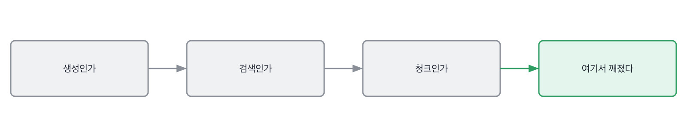

# 11.2 어디서 깨졌나

*[11.1](q036.md) 에서 무엇을 뺐는지를 물었죠. 이번엔 그 앞 단계가 어디서 깨졌는지를 봅니다.*

> **이 말부터**
>
> **임베딩** 문장을 숫자 묶음으로 바꿔 가까운 것끼리 찾게 만드는 것을 말합니다.
>
> **재순위** 먼저 뽑은 목록을 다시 줄 세워 위쪽을 바꾸는 단계를 말해요.

검색은 한 덩어리가 아니라 단계가 이어 붙은 것입니다. 문서를 자르고, 숫자로 바꾸고,
가까운 걸 뽑고, 다시 줄 세우고, 그걸 모델에 넣죠. 어느 한 자리가 깨져도 결과는 똑같이
나쁘게 나옵니다. **나쁜 결과 하나로는 어디가 깨졌는지 알 수 없어요.**

그래서 이 일의 절반은 자르는 일입니다. 한 단계씩 떼어 내고 거기까지는 멀쩡한지 보는 거죠.
해 본 사람은 이 자르기를 반드시 해 봤습니다. 안 하면 고칠 데를 못 찾으니까요.
안 해 본 사람은 셋을 한꺼번에 만집니다. 그리고 좋아지면 셋 다 덕분이라고 말하고요.

이 칸의 동작은 그래서 하나입니다. **셋 중 어디서 깨져 있었냐**고 묻습니다.
하나를 대라고 하면 자른 사람만 답할 수 있습니다. [10.2](../10-g10/q034.md) 에서 다섯 중 하나를
물었던 것과 같은 모양이에요. 개수를 좁히면 실제로 잰 사람만 남습니다.

> **이렇게 답합니다**
>
> 청킹 전략과 임베딩 모델, 리랭커를 종합적으로 최적화했습니다.
> 청크 사이즈와 오버랩을 조정하며 최적의 조합을 찾았습니다.
> 리랭커를 도입해 검색 품질을 크게 향상시켰습니다.
> 파이프라인 전반을 개선한 결과 만족스러운 성능을 얻었습니다.

낱말은 다 맞습니다. 청킹, 임베딩, 리랭커. 셋 다 실제로 쓰는 말이에요.

> **표시해 보면**
>
> 청킹 전략과 임베딩 모델, 리랭커를 종합적으로 최적화했습니다.
>     ← 셋을 한꺼번에 만짐. 무엇이 들었는지 못 가림
> 청크 사이즈와 오버랩을 조정하며 최적의 조합을 찾았습니다.
>     ← 처음 값과 나중 값이 없음
> 리랭커를 도입해 검색 품질을 크게 향상시켰습니다.
>     ← 크게가 몇인지 없음. 넣기 전 숫자가 없음
> 파이프라인 전반을 개선한 결과 만족스러운 성능을 얻었습니다.
>     ← 만족으로 닫음. 지금 안 되는 자리가 없음

첫 줄의 종합적으로가 이 답의 전부입니다. 셋을 한꺼번에 만졌다는 말이거든요.
둘째 줄에는 청크 크기의 처음 값과 나중 값이 없고, 셋째 줄의 크게 향상에는 숫자가 없습니다.
**넷째 줄은 만족스러운 성능으로 닫습니다.** 지금 안 되는 자리가 하나도 없다는 뜻인데,
검색을 붙여 놓고 안 되는 자리가 없는 팀은 저는 아직 못 봤습니다.

> **이렇게 파고듭니다**
>
> 물음: 셋 중에 어디서 깨져 있었어요?
>
> 답: 세 단계 모두 개선 여지가 있어 함께 조정했습니다.

세 단계 모두 개선 여지가 있었다는 답은 어느 단계도 안 재 봤다는 뜻입니다.
잰 사람은 반대로 말해요. 두 단계는 멀쩡했고 한 단계가 깨져 있었다고요.

> **자른 자리가 나오면**
>
> 못 찾는 질문 스무 개를 뽑아 한 단계씩 잘라 봤습니다.
> 정답 문서를 손으로 넣고 물으니 답이 맞았어요. 생성은 멀쩡한 겁니다.
> 그다음 정답 문서가 상위 스물에 있는지 봤는데 열넷이 없었습니다.
> 검색에서 깨진 거였어요. 리랭커는 볼 필요가 없었습니다.
> 원인은 청크였습니다. 표 안의 값을 묻는 질문이었거든요.

첫 줄에 표본이 나옵니다. 못 찾는 질문 스무 개를 뽑았다고 하죠. 이게 이 답의 시작점이에요.
둘째 줄이 첫 번째 자르기입니다. 정답 문서를 손으로 넣고 물었더니 답이 맞았다고 하죠.
**이 한 번으로 생성 쪽이 통째로 용의선상에서 빠집니다.**
셋째 줄이 두 번째 자르기고요. 상위 스물 안에 정답이 있는지를 셌더니 열넷이 없었습니다.

넷째 줄에 제가 좋아하는 문장이 있습니다. 리랭커는 볼 필요가 없었다는 말요.
앞이 못 뽑아 온 걸 뒤에서 줄 세워 봐야 소용이 없거든요. **안 봐도 되는 걸
안 봤다고 말하는 사람은 순서를 아는 사람입니다.** 이건 읽어서 아는 순서가 아닙니다.

> **한 번 더**
>
> 임베딩 모델을 어떻게 골랐냐고 물으면 같은 자리가 한 번 더 보입니다.
> 더 좋은 임베딩 모델로 교체해 검색 성능을 개선했습니다.
> 벤치마크 상위 모델을 선정해 적용했습니다.
> 남의 순위표가 근거인 답입니다. 우리 질문으로 잰 숫자가 한쪽에도 없어요.
> 반대쪽은 1등을 넣었더니 0.71이 0.66이 됐다고 말합니다. 그리고 되돌렸다고요.

되돌린 이야기가 여기서 또 나오는 게 우연이 아닙니다. [8.2](../08-g08/q028.md) 에서 되돌린 양을
물었던 그 자리가 검색에서 다시 나오는 거예요. 순위표 1등을 넣고 나빠졌다는 건
흔한 일인데, 흔한 일을 말하는 사람이 드뭅니다. 나빠진 걸 말하면 안 좋아 보이니까요.

> **판정**
>
> 셋 중 깨진 단계를 하나로 짚고 어떻게 잘랐는지가 나오면 통과입니다.
> 정답 문서를 손으로 넣어 봤다거나, 상위 스물 안에 있는지 세어 봤다는 식으로요.
>
> 종합적으로 최적화했다고 답하고, 어디서 깨졌냐고 물어도 셋 다 여지가 있었다고 하면
> 다음 라운드로 안 보냅니다. 리랭커부터 손댔다고 하면 순서를 한 번 더 물어봅니다.
>
> 기록에는 이렇게 적습니다. 못 찾는 질문 스무 개로 단계를 잘랐고, 정답 문서가 상위 스물에
> 열넷이 없어 검색에서 깨진 것을 확인했으며, 원인을 표가 든 청크로 좁혔다고 말했다.

> **물을 문장 둘**
>
> 검색 이야기를 물으면 단계 이름이 줄줄이 옵니다. 그래서 깨진 자리를 하나만 대라고 합니다.
> 하나로 좁히면 나머지를 어떻게 지웠는지가 따라 나와요. 그 지운 과정이 증거입니다.
>
> **그대로 읽으세요.** *그 셋 중에 어디서 깨져 있던 거였어요?*
>
> **답을 받으면 이어서.** *나머지 둘이 멀쩡한 건 어떻게 확인하셨죠?*

> **이걸 놓치면**
>
> 깨진 단계를 못 물으면 [15.1](../15-g15/q049.md) 에서 배포한 뒤에 뭘 봤냐고 물어도 대시보드 이름만 나옵니다.

