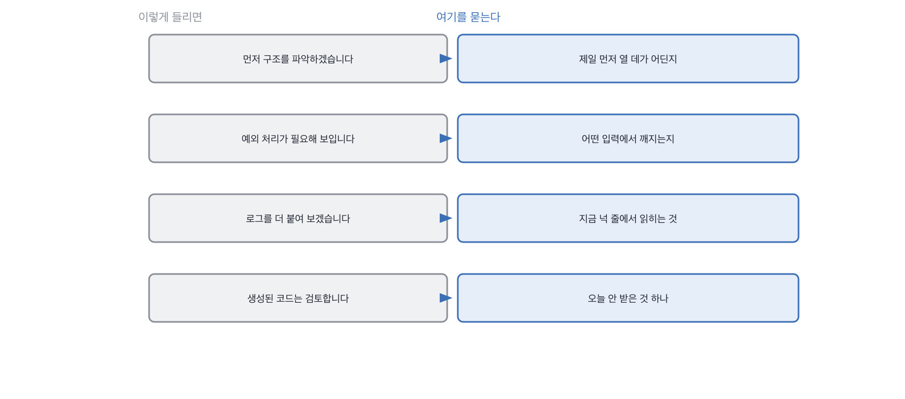

# 12장을 닫으며

## 한 관문을 닫으며

네 칸이 같은 자리를 네 번 팠습니다. **말고 손이 갈리는 자리**요.
지금까지 열한 장은 해 본 것을 말로 들었습니다. 이 장은 그 자리에서 하게 했어요.
그런데 하게 해 놓고도 결과물은 안 봤습니다. 결과물은 이제 다들 비슷하게 나오거든요.

봤던 건 넷 다 결과물 앞이나 뒤입니다. 시작하기 전에 어디를 여는지, 읽고 나서 어느 값을 대는지,
터진 뒤에 자국에서 무엇을 집어 오는지, 받고 나서 무엇을 버리는지.
**가운데는 준비할 수 있고 앞뒤는 준비가 안 됩니다.** 그게 이 장의 한 문장이에요.

코드 자리에서 자주 들리는 말과 그때 물을 자리를 짝으로 세우면 이렇게 돼요.
왼쪽 넷은 다 통과되는 문장이고, 오른쪽을 한 번씩만 물으면 그 자리에서 갈립니다.

> **저자의 삽질**
>
> 과제를 끝까지 해 오고 테스트까지 붙여 오면 통과를 주기 쉽습니다. 저도 그랬고요.
> 그런데 초록불은 다 똑같이 생겼습니다. 함수를 부르기만 하고 비교를 안 하는 테스트도
> 돌리면 초록불이 켜져요. 그 자리에서 안 하는 일이 하나 있습니다. 하나 깨 보라고 안 하는 것.

과제를 짤 때 제가 지키는 게 하나 있습니다. **같은 코드를 계속 써요.**
이 책이 아홉째 장부터 쓰고 있는 그 검색기예요. 새 과제를 매번 만들면 저부터 그 코드를 모릅니다.
같은 코드를 스무 번 쓰면 어디서 다들 걸리는지가 손에 익어요. 그러면 30초에 판정이 섭니다.

과제 코드를 미리 주는 게 낫냐는 말이 자주 나옵니다. 저는 줍니다.
못 읽고 온 사람이 걸러지는 게 아니라 **읽고 와서도 값을 못 대는 사람**이 걸러지거든요.
미리 준 코드에서 값을 못 대면 그건 시간이 모자라서가 아닙니다.

> **30초 점검**
>
> 시작 전에 제일 먼저 열 데를 대는가. 자리 하나면 됩니다.
> 깨지는 입력을 값으로 대는가. 소감이 아니라 값입니다.
> 로그에서 숫자를 둘 이상 집어 와서 잇는가.
> 받은 것 중에 안 받은 자리를 하나 대는가.
> 받은 테스트를 깨 본 적이 있는가.

이 장에서 나온 낱말 몇 개를 짚고 갑니다. 과제 이야기를 팀에서 나눌 때 쓰는 말들이에요.
셋 다 과제의 형태를 가리키는 말입니다. 어느 형태를 고르느냐가 무엇을 볼지를 절반쯤 정합니다.

> **채용 말 배우기**
>
> **페어 프로그래밍 면접** 면접관이 옆에서 같이 짜는 형태를 말합니다. 막히면 거들어 줍니다.
>
> **테이크홈** 집에 가져가서 며칠 안에 내는 과제를 말해요. 이제 결과물로는 잘 안 갈립니다.
>
> **코드 워크스루** 자기가 전에 짠 코드를 들고 와서 설명하는 자리를 말합니다.

옛 관행 하나를 재 봅니다. 화이트보드에 손으로 코드를 쓰게 하던 관행이에요.

> **옛 규칙은 아직 유효한가**
>
> **화이트보드 코딩.** 판정은 이제 안 맞음입니다.
> 근거는 제 경험이에요. 손으로 쓴 코드에서 볼 수 있는 게 문법과 침착함뿐인데, 둘 다 준비됩니다.
> 그래서 저는 판서 대신 **돌아가는 코드를 주고 깨지는 값을 대라**고 합니다.
> 값은 그 코드를 읽어야만 나오고, 읽는 건 그 자리에서 처음 하는 일입니다.

다음 장은 평가입니다. 이 장에서 손을 봤으니 이제 그 손이 만든 것을 무엇으로 쟀는지를 봐요.
좋아졌다는 말이 나오는 자리인데, 좋아졌다는 말은 무엇과 견줬는지가 없으면 아무 말도 아닙니다.

이 장을 열면서 라이브 코딩 이야기를 꺼냈는데, 그 이야기를 제대로 하고 닫겠습니다.
요즘 이 자리를 없애자는 말이 자주 나오거든요. 저는 반대하는 쪽인데,
반대하는 이유가 라이브 코딩이 좋아서는 아닙니다.

> **쉬어 가기**
>
> **쉬어 가기: 라이브 코딩을 없애자는 말에 대하여**
>
> 라이브 코딩을 없애자는 말이 요즘 자주 나옵니다. 저는 반대하는 쪽인데, 그 이유가
> 라이브 코딩이 좋아서는 아닙니다. 없애면 그 자리에 아무것도 안 들어와서예요.
>
> 없애자는 쪽의 근거는 셋쯤 됩니다. 실제 업무와 다르다, 긴장하면 못 한다,
> 그리고 이제 도구가 대신 짜 준다. 셋 다 맞는 말입니다.
>
> 그런데 셋을 다 받아들여도 남는 질문이 있습니다. 그럼 손을 쓰는 건 어디서 보느냐요.
> 과제로 옮기자는 말이 나오는데, 과제는 집에서 하니까 더 안 보입니다.
> 포트폴리오를 보자는 말도 나오고요. 그것도 밖에서 만든 겁니다.
>
> **그 방에서 손이 움직이는 걸 보는 자리는 라이브 코딩뿐입니다.** 대체재가 없어요.
> 그래서 저는 없애는 대신 보는 것을 바꿨습니다. 완성 대신 첫 3분이요.
>
> 이렇게 바꾸고 나니 없애자는 쪽의 근거 셋이 대부분 해결됐습니다.
> 첫 3분은 업무와 다르지 않고, 긴장해도 어디를 열지는 말할 수 있고,
> 도구가 있어도 어디를 먼저 볼지는 그 사람이 정합니다.
>
> 그러니까 문제는 라이브 코딩이 아니라 *완성을 보던 습관*이었던 거죠.
> 습관을 고치면 자리는 살릴 수 있습니다. 자리를 없애면 다시 만들기가 어렵고요.

마지막으로 이 장에서 속기 쉬운 자리를 하나 더 짚습니다. 완성도라는 자리요.
다 끝내 온 과제를 보면 실력이 좋아 보이는데, 완성도가 이제 무엇을 재는지가 달라졌습니다.
들인 시간이 아니라 쓴 도구가 정하거든요.

> **여기서 다들 속는다**
>
> 과제를 다 끝내 오면 실력이 좋아 보입니다. 실제로 다 끝내는 사람이 많지도 않고요.
> 그런데 완성도는 이제 들인 시간이 아니라 쓴 도구가 정합니다. 두 시간짜리가 이십 분에 끝나요.
> 그래서 저는 완성도를 안 보고 *안 받은 것*을 봅니다. 받은 것은 다들 비슷하거든요.
> 확인은 한마디면 됩니다. 오늘 받은 것 중에 안 쓰신 게 뭐냐고요.

이 관문에서 들고 갈 것을 네 줄로 접으면 이렇게 됩니다.

> **한 관문 요약**
>
> 45분에 완성은 안 나옵니다. 첫 3분에 어디를 여는지가 나옵니다.
>
> 잘 짜였다는 소감은 아무 코드에나 붙습니다. 깨지는 입력을 값으로 하나 받으세요.
>
> 로그를 더 붙이겠다는 답은 지금 로그를 안 읽은 답입니다. 있는 넉 줄에서 읽게 합니다.
>
> 받은 것은 다들 비슷합니다. 안 받은 것 하나가 그 사람의 기준입니다.
>
> 다음 관문에서 뒤집히는 것. 손으로 만든 것을 보던 자리에서 그것을 무엇으로 쟀는지로 넘어갑니다.

> **이 판정이 헐거운 지점**
>
> 첫 3분에 자리를 못 대는 사람 중에 긴장한 사람이 섞여 있습니다. 저는 그걸 못 가릅니다.
>
> 미리 준 코드를 안 읽고 온 사람과 읽고도 값을 못 대는 사람은 답이 비슷하게 들립니다.
>
> 도구를 안 쓰는 팀에서 온 사람에게 마지막 칸이 불리합니다. 안 받은 것이 없을 수밖에 없어요.
