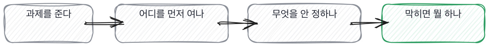

# 12.1 라이브 코딩에서 볼 것과 안 볼 것

*[11.3](../11-g11/q038.md) 까지는 말로 들었죠. 이번엔 그 자리에서 손을 쓰게 합니다.*

> **이 말부터**
>
> **라이브 코딩** 면접관이 보는 앞에서 코드를 짜게 하는 것을 말합니다.
>
> **첫 손** 과제를 받고 맨 처음 여는 자리를 말해요. 이 책에서만 쓰는 말입니다.

이 장부터 렌즈가 바뀝니다. 지금까지는 기초와 판단이었고 여기서는 만들기예요.
돌아가는 것을 실제로 만들어 봤는지를 봅니다. 말로 듣던 것을 손으로 확인하는 자리죠.
그런데 이 자리가 요즘 제일 시끄럽습니다. 라이브 코딩을 없애야 한다는 말이 많거든요.

절반은 맞는 말입니다. 45분에 완성을 보려고 했다면요. 완성은 이제 신호가 아닙니다.
그런데 완성을 보는 게 애초에 이 자리의 목적이 아니었어요.
**저는 라이브 코딩에서 완성을 본 적이 한 번도 없습니다.** 볼 시간이 없거든요.

그럼 무엇을 보느냐. 첫 3분입니다. 과제를 주면 사람마다 여는 데가 다릅니다.
테스트를 먼저 여는 사람, 함수 본문부터 읽는 사람, 아무것도 안 열고 질문부터 하는 사람.
[6.3](../06-g06/q022.md) 에서 실물을 먼저 시키라고 했던 그 자리가 여기서 열립니다.

과제로 쓰는 코드는 이런 것입니다. 이 책이 아홉째 장부터 쓰고 있는 검색 서비스의
자르는 함수예요. 문서를 받아서 글자 수로 잘라 조각을 만드는 자리입니다.
새 과제를 만들지 않고 같은 코드를 계속 씁니다. 그래야 어디서 다들 걸리는지가 손에 익거든요.

```python
def split(doc_id: str, text: str, size: int = 120, overlap: int = 20) -> list[Chunk]:
    """글자 수로 자른다. 겹치는 길이만큼 뒤로 물러나며 자른다."""
    if size <= 0:
        raise ValueError("size must be positive")
    if not 0 <= overlap < size:
        raise ValueError("overlap must be in [0, size)")

    body = text.strip()
    if not body:
        return []

    step = size - overlap
    chunks: list[Chunk] = []
    start = 0
    while start < len(body):
        piece = body[start : start + size]
        chunks.append(Chunk(doc_id=doc_id, index=len(chunks), text=piece))
        start += step
    return chunks
```

짧고, 다 읽히고, 결함이 하나 숨어 있습니다. 첫 3분에 그 결함을 찾으라는 게 아니에요.
**어디를 먼저 여는지만 봅니다.** 그래서 시작 전에 무엇을 할 건지 물어봅니다.

> **이렇게 답합니다**
>
> 먼저 전체 구조를 파악하고 요구사항을 정리하겠습니다.
> 클린 코드 원칙에 맞게 함수를 분리하고 타입 힌트를 추가하겠습니다.
> 테스트 코드도 함께 작성해 품질을 확보하겠습니다.
> 전반적으로 확장 가능한 구조로 설계하려고 합니다.

네 줄이 다 좋은 말입니다. 그리고 네 줄이 다 이 코드를 안 열어도 나오는 말이에요.
구조 파악, 클린 코드, 테스트, 확장성. 어느 과제에 갖다 붙여도 맞는 말이죠.

> **표시해 보면**
>
> 먼저 전체 구조를 파악하고 요구사항을 정리하겠습니다.
>     ← 무엇을 볼지가 없음. 보는 순서가 없음
> 클린 코드 원칙에 맞게 함수를 분리하고 타입 힌트를 추가하겠습니다.
>     ← 이미 붙어 있는 것. 코드를 안 열어 본 말
> 테스트 코드도 함께 작성해 품질을 확보하겠습니다.
>     ← 무엇을 먼저 테스트할지가 없음
> 전반적으로 확장 가능한 구조로 설계하려고 합니다.
>     ← 무엇이 바뀔 것 같은지가 없음

둘째 줄이 이 답을 가장 크게 무너뜨립니다. 타입 힌트를 추가하겠다는 말인데,
**이 코드에는 이미 타입 힌트가 다 붙어 있어요.** 열어 봤으면 안 나올 문장입니다.
첫 줄과 넷째 줄은 어느 과제에 갖다 붙여도 맞는 말이고요.

> **이렇게 파고듭니다**
>
> 물음: 그중에 제일 먼저 손대실 게 뭐예요?
>
> 답: 상황에 맞게 우선순위를 정해 진행하겠습니다.

우선순위를 정해 진행하겠다는 답에는 첫 손이 없습니다. 정하겠다는 말은 아직 안 정한 겁니다.

> **첫 손이 나오면**
>
> 겹침이 크기보다 크면 어떻게 되는지부터 볼게요.
> 지금 막고 있는데, 막는 게 맞는지는 아직 모르겠어요.
> 테스트를 보니 마지막 조각이 짧게 남네요. 일부러 둔 것 같고요.
> 빈 문자열이랑 겹침이 0인 경우 두 개만 짚고 시작하겠습니다.
> 나머지는 돌려 보고 정할게요. 지금 짐작으로 정하면 틀립니다.

첫 줄에 자리 하나가 딱 나옵니다. 겹침이 크기보다 크면 어떻게 되는지요.
둘째 줄이 더 좋습니다. 막고 있는데 막는 게 맞는지는 아직 모르겠다고 말하거든요.
**읽은 것과 판단한 것을 갈라 놓은 문장이에요.** 이건 태도가 아니라 습관입니다.



넷째 줄과 다섯째 줄이 짝입니다. 둘만 짚고 시작하겠다고 하고, 나머지는 돌려 보고 정하겠다고 하죠.
짐작으로 정하면 틀린다는 말은 틀려 본 사람의 말이에요.
그리고 이 다섯 줄은 코드를 한 줄도 안 쓴 상태에서 나온 겁니다.

> **현장에서는**
>
> 저는 라이브 코딩 시간을 반으로 줄이고 앞의 5분을 읽는 시간으로 떼어 놓습니다.
> 그 5분에 나오는 말이 나머지 25분보다 많습니다.

안 볼 것도 정해 둡니다. 문법을 외웠는지, 표준 라이브러리 함수 이름을 아는지,
들여쓰기를 어떻게 하는지. **검색되는 것은 안 봅니다.**
그리고 안 볼 것을 지원자에게 먼저 말해 줍니다. 그래야 엉뚱한 데 시간을 안 씁니다.

> **판정**
>
> 첫 3분에 코드의 특정 자리를 짚고 왜 거기부터 보는지 말하면 통과입니다.
> 지금 아는 것과 아직 모르는 것을 갈라서 말하면 아주 좋은 신호고요.
>
> 구조를 파악하겠다거나 클린 코드로 정리하겠다고만 하고, 먼저 손댈 데를 물어도
> 자리를 못 대면 다음 라운드로 안 보냅니다. 코드에 이미 있는 것을 하겠다고 하면 같습니다.
>
> 기록에는 이렇게 적습니다. 겹침이 크기보다 큰 경우를 첫 3분에 짚었고, 막는 것이 맞는지는
> 아직 모르겠다고 스스로 갈랐으며, 나머지는 돌려 보고 정하겠다고 말했다.

> **물을 문장 둘**
>
> 과제를 주면 계획이 옵니다. 계획은 어느 과제에나 붙어요. 그래서 첫 손을 묻습니다.
> 한 자리를 대면 왜 거기인지가 따라 나오고, 그 이유가 코드를 열었는지를 말해 줍니다.
>
> **그대로 읽으세요.** *시작하기 전에, 제일 먼저 열어 보실 데가 어디예요?*
>
> **답을 받으면 이어서.** *거기부터 보는 이유가 뭐죠? 지금 아직 모르겠는 건 뭔가요?*

> **이걸 놓치면**
>
> 첫 손을 못 보면 [12.3](q041.md) 에서 로그를 줘도 어디를 열지 정하는 걸 못 봅니다.

