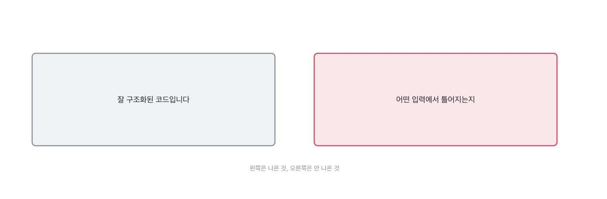

# 12.2 남의 코드를 읽히는 과제

*[12.1](q039.md) 에서 첫 손을 봤죠. 이번엔 그 손이 코드를 실제로 읽었는지를 봅니다.*

> **이 말부터**
>
> **읽기 과제** 짜게 하지 않고 남이 짜 둔 코드를 읽게 하는 과제를 말합니다.
>
> **깨지는 입력** 넣으면 결과가 틀어지는 값 하나를 말해요. 소감이 아니라 값입니다.

짜게 하는 과제는 45분을 다 먹습니다. 읽게 하는 과제는 10분이면 되고요.
그런데 읽기 과제가 더 잘 갈립니다. 짜는 건 준비할 수 있는데 남의 코드를 읽는 건
그 자리에서 처음 보는 것이거든요. [6.3](../06-g06/q022.md) 의 실물이 여기서는 이미 있는 코드입니다.

과제로 주는 건 이 책이 계속 쓰는 검색기의 점수 매기는 자리입니다.
열다섯 줄이고, 바깥 것을 안 쓰고, 결함이 둘 들어 있어요.
둘 다 찾으라는 게 아니라 **하나만 대 보라**고 합니다.
[11.2](../11-g11/q037.md) 에서 깨진 단계를 하나만 물었던 것과 같은 수예요. 개수를 좁히면 잰 사람만 남습니다.

```python
    def score(self, query: str, chunk: Chunk) -> float:
        q_terms = tokenize(query)
        if not q_terms:
            return 0.0
        counts = Counter(tokenize(chunk.text))
        length = sum(counts.values()) or 1
        return sum((counts[t] / length) * self.idf(t) for t in q_terms)

    def search(self, query: str, top_k: int = 3) -> list[tuple[Chunk, float]]:
        if top_k <= 0:
            return []
        scored = [(c, self.score(query, c)) for c in self.chunks]
        hits = [(c, s) for c, s in scored if s > 0.0]
        hits.sort(key=lambda pair: (-pair[1], pair[0].chunk_id))
        return hits[:top_k]
```

묻는 문장은 짧습니다. 이 코드에서 깨지는 입력을 하나만 찾아 달라고 합니다.
잘못된 점이나 개선점을 물으면 소감이 옵니다. 입력을 물어야 값이 옵니다.

> **이렇게 답합니다**
>
> 전반적으로 잘 구조화된 코드입니다.
> 타입 힌트와 데이터클래스를 활용해 가독성이 좋습니다.
> 다만 예외 처리와 엣지 케이스 보완이 필요해 보입니다.
> 성능 최적화 여지도 있을 것 같습니다.

네 줄에 입력이 하나도 없습니다. 넷 다 이 코드를 안 보고도 쓸 수 있는 문장이에요.

> **표시해 보면**
>
> 전반적으로 잘 구조화된 코드입니다.
>     ← 읽은 소감. 깨지는 입력이 아님
> 타입 힌트와 데이터클래스를 활용해 가독성이 좋습니다.
>     ← 겉모양 이야기. 동작 이야기가 아님
> 다만 예외 처리와 엣지 케이스 보완이 필요해 보입니다.
>     ← 어느 입력인지 없음
> 성능 최적화 여지도 있을 것 같습니다.
>     ← 무엇이 느린지 없음. 재 본 적 없음

첫 두 줄은 겉모양 이야기입니다. 구조가 좋다, 타입 힌트가 붙어 있다.
맞는 말인데 동작 이야기가 아니에요. 셋째 줄의 엣지 케이스가 이 답의 중심인데
**어느 입력인지가 없습니다.** 넷째 줄은 성능 이야기를 꺼내 놓고 무엇이 느린지를 안 댑니다.



> **이렇게 파고듭니다**
>
> 물음: 그 엣지 케이스, 입력을 하나만 대 주세요.
>
> 답: 예를 들어 비정상적인 입력이 들어오는 경우가 있겠습니다.

비정상적인 입력이라는 답이 나오면 거기서 멈춰도 됩니다. 값을 못 대는 겁니다.
읽은 사람은 값부터 말해요. 낱말 하나, 숫자 하나, 빈 문자열 하나.

> **읽은 사람이면**
>
> 질의에 같은 낱말을 두 번 넣으면 점수가 두 배가 됩니다.
> 질의 낱말을 세지 않고 그냥 더하거든요. 환불 환불 이라고 치면요.
> 그리고 점수 0인 게 많으면 결과가 top_k 보다 짧게 나옵니다.
> 이건 버그가 아닐 수도 있는데, 부르는 쪽이 길이를 믿으면 터집니다.

첫 줄에 값이 나옵니다. 같은 낱말을 두 번 넣으면 점수가 두 배가 된다고요.
둘째 줄이 이유고요. 질의 낱말을 안 세고 그냥 더하거든요. 코드 여든한째 줄 이야기입니다.
**환불 환불 이라고 치면 이라는 한마디가 이 답을 다른 답으로 만듭니다.**

셋째 줄과 넷째 줄이 제가 더 좋아하는 자리예요. 점수 0인 게 많으면 결과가 짧게 나온다고 짚습니다.
그러고는 이건 버그가 아닐 수도 있다고 스스로 물러섭니다.
[2.4](../02-g02/q009.md) 에서 갈랐던 그 경계가 여기서도 보입니다. 확인한 것과 짐작한 것을 갈라 놓았어요.

> **현장에서는**
>
> 읽기 과제에 저는 결함을 둘 심어 둡니다. 하나는 5분이면 나오고 하나는 잘 안 나옵니다.
> 둘 다 못 찾은 사람보다, 하나 찾고 나머지는 모르겠다고 말한 사람이 낫습니다.

읽기 과제에서 볼 것은 여기까지입니다. 값 하나와 그 값이 나온 줄 하나요.
둘이 나오면 그 사람은 코드를 연 사람입니다.

> **판정**
>
> 입력을 하나라도 값으로 대고 코드의 어느 줄 때문인지를 짚으면 통과입니다.
> 버그인지 아닌지 모르겠다고 스스로 갈라 말하면 아주 좋은 신호예요.
>
> 구조가 좋다거나 예외 처리가 필요하다고만 하고, 입력을 하나 대 달라고 다시 물어도
> 비정상적인 입력이라는 식으로만 답하면 다음 라운드로 안 보냅니다.
>
> 기록에는 이렇게 적습니다. 같은 낱말을 두 번 넣으면 점수가 두 배가 된다는 것을 값으로 짚었고,
> 질의 낱말을 안 센다는 줄까지 댔으며, 결과 길이 문제는 버그가 아닐 수도 있다고 스스로 갈랐다.

> **물을 문장 둘**
>
> 코드를 보여주면 소감이 옵니다. 소감은 어느 코드에나 붙어요. 그래서 값을 하나 달라고 합니다.
> 값을 대면 이유가 따라 나오고, 그 이유가 어느 줄을 읽었는지를 말해 줍니다.
>
> **그대로 읽으세요.** *이 코드에서 깨지는 입력을 하나만 찾아 주세요.*
>
> **답을 받으면 이어서.** *그게 왜 깨지죠? 어느 줄 때문인가요?*

> **이걸 놓치면**
>
> 값을 못 받고 넘어가면 [13.1](../13-g13/q043.md) 에서 좋아졌다는 근거를 물어도 소감이 그대로 다시 옵니다.

