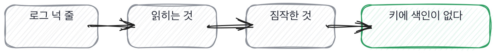

# 12.3 디버깅 과제, 로그 하나로 원인을 짚는가

*[12.2](q040.md) 에서 깨지는 입력을 물었죠. 이번엔 이미 깨진 뒤의 자국을 읽게 합니다.*

> **이 말부터**
>
> **디버깅 과제** 고장 난 코드와 그때 남은 로그를 주고 원인을 짚게 하는 과제입니다.
>
> **자국** 고장이 지나가면서 로그에 남긴 숫자와 낱말을 말해요. 이 책에서만 쓰는 말입니다.

읽기 과제가 코드를 읽게 했다면 이 과제는 로그를 읽게 합니다.
둘은 다른 일이에요. 코드는 앞에서 뒤로 읽으면 되는데 로그는 뒤에서 앞으로 읽어야 하거든요.
일이 벌어진 뒤의 자국만 보고 벌어진 일을 되짚는 겁니다.

과제로 주는 건 캐시입니다. 같은 질의가 또 오면 전에 만든 답을 그대로 내주는 자리예요.
문서를 새로 넣어도 답이 안 바뀝니다. 코드는 이렇게 생겼습니다.

```python
    def search(self, query: str, top_k: int = 3) -> list[tuple[str, float]]:
        key = query.strip().lower()
        if key in self._store:
            self.log.append(
                f"cache hit query={key!r} chunks={len(self.index.chunks)}"
            )
            return self._store[key]

        hits = [(c.chunk_id, round(s, 4)) for c, s in self.index.search(query, top_k)]
        self._store[key] = hits
        self.log.append(f"cache miss query={key!r} chunks={len(self.index.chunks)}")
        return hits
```

그리고 이걸 돌린 자국을 넉 줄로 줍니다. 지원자에게 코드는 안 보여주고 로그만 먼저 줘요.
로그만 주면 짐작으로 못 때웁니다.

돌려 보면 이렇게 나옵니다. 같은 질의를 문서 넣기 앞뒤로 한 번씩 쳤습니다

```
cache miss query='환불' chunks=15
top1 policy#14
--- 개정 공지를 넣었다 ---
cache hit query='환불' chunks=33
top1 policy#14
```

넉 줄 안에 답이 다 들어 있습니다. 조각 수가 15에서 33으로 늘었는데 맨 위가 그대로예요.
게다가 둘째 질의는 hit 입니다. 새로 뽑은 적이 없다는 뜻이죠.
**조각은 늘었고 답은 안 바뀌었고 뽑은 적은 없다.** 세 줄이 한 방향을 가리킵니다.

> **이렇게 답합니다**
>
> 캐시 관련 이슈로 보입니다. 캐시 정책을 점검해야 할 것 같습니다.
> TTL 설정과 무효화 전략을 확인해 보겠습니다.
> 로깅을 더 추가해 원인을 파악하는 것도 방법입니다.
> 모니터링을 강화하면 유사한 문제를 예방할 수 있습니다.

캐시라는 낱말은 맞았습니다. 그런데 그 낱말은 로그 첫 글자에 적혀 있어요.

> **표시해 보면**
>
> 캐시 관련 이슈로 보입니다. 캐시 정책을 점검해야 할 것 같습니다.
>     ← 로그에 적힌 낱말을 다시 말함
> TTL 설정과 무효화 전략을 확인해 보겠습니다.
>     ← 로그에 시간이 없음. 안 본 것을 짐작함
> 로깅을 더 추가해 원인을 파악하는 것도 방법입니다.
>     ← 지금 로그에서 읽을 수 있는 것을 안 읽음
> 모니터링을 강화하면 유사한 문제를 예방할 수 있습니다.
>     ← 예방으로 넘어감. 원인을 못 짚음

둘째 줄이 이 답을 무너뜨립니다. TTL 을 확인하겠다는 말인데 **로그에 시간이 한 번도
안 나옵니다.** 안 본 것을 짐작한 거죠. 셋째 줄은 로그를 더 붙이겠다는 말이고요.
지금 있는 넉 줄을 안 읽은 사람이 넉 줄을 더 받으면 여덟 줄을 안 읽습니다.



넷째 줄에서 예방으로 넘어갑니다. 원인을 못 짚었는데 재발 방지로 건너뛰는 거예요.
이 건너뜀이 흔합니다. 원인 자리는 틀릴 수 있고 예방 이야기는 틀릴 일이 없거든요.
안전한 쪽으로 말이 옮겨 간 겁니다.

> **이렇게 파고듭니다**
>
> 물음: 지금 이 네 줄에서 읽을 수 있는 건 뭐예요?
>
> 답: 캐시가 정상 동작하지 않는 상황으로 판단됩니다.

지금 이 넉 줄에서 뭘 읽을 수 있냐고 물으면 갈립니다. 읽은 사람은 숫자를 댑니다.

> **읽은 사람이면**
>
> 조각 수가 15에서 33으로 늘었는데 맨 위가 그대로예요.
> 그런데 두 번째가 hit 입니다. 새로 뽑은 적이 없다는 뜻이죠.
> 캐시 키에 색인이 안 들어가 있는 것 같습니다. 질의만 키인 거요.
> 확인은 쉬워요. 다른 질의로 한 번 치면 그건 새 문서가 나올 겁니다.

첫 줄에 숫자가 둘 나옵니다. 15와 33. 로그에서 그대로 집어 온 값이에요.
둘째 줄이 그 둘을 잇습니다. 그런데 이번엔 hit 라는 겁니다. 새로 뽑은 적이 없다는 뜻이죠.
**숫자 둘을 붙여서 뜻을 하나 만든 겁니다.** 이게 로그를 읽는다는 말의 실제 내용이에요.

셋째 줄이 원인이고 넷째 줄이 확인 방법입니다. 키에 색인이 안 들어갔다는 짐작을 세워 놓고,
다른 질의로 한 번 쳐 보면 갈린다고 말해요. [11.2](../11-g11/q037.md) 에서 단계를 잘랐던 그 손입니다.
짐작을 세우는 사람은 많고 **그 짐작을 깨는 방법까지 말하는 사람은 드뭅니다.**

> **여기서 다들 속는다**
>
> 로그에 적힌 낱말을 다시 말하면 원인을 짚은 것처럼 들립니다.
> 캐시 문제로 보인다는 문장이 그거예요. 로그 첫 글자가 이미 캐시라고 적고 있습니다.
> 낱말은 로그가 준 것이고 지원자가 보탠 것은 없습니다.
> 확인은 한마디면 됩니다. 이 넉 줄에서 읽을 수 있는 숫자를 대 보라고 하세요.

로그 이야기는 여기까지입니다. 숫자를 집어 왔는지와 그 숫자를 이었는지 둘이면 됩니다.
짐작을 깨는 방법까지 나오면 더 볼 것이 없어요.

> **판정**
>
> 로그에 있는 숫자를 둘 이상 집어 와서 잇고, 원인을 한 자리로 좁히면 통과입니다.
> 그 짐작을 어떻게 깨 볼지까지 말하면 아주 좋은 신호예요.
>
> 로그에 없는 것을 확인하겠다고 하거나 로그를 더 붙이겠다고 하고,
> 지금 넉 줄에서 뭘 읽었냐고 다시 물어도 낱말만 되풀이하면 다음 라운드로 안 보냅니다.
>
> 기록에는 이렇게 적습니다. 조각이 15에서 33으로 늘었는데 맨 위가 그대로인 것과 둘째가 hit 인 것을
> 붙여서 캐시 키에 색인이 없다는 데까지 좁혔고, 다른 질의로 쳐 보면 갈린다고 확인 방법을 댔다.

> **물을 문장 둘**
>
> 로그를 주면 대책이 옵니다. 대책은 어느 사고에나 붙어요. 그래서 지금 읽히는 것을 묻습니다.
> 숫자를 집어 오면 그 숫자를 어디에 이었는지가 따라 나오고, 그 이음이 원인을 짚는 손입니다.
>
> **그대로 읽으세요.** *지금 이 넉 줄에서 읽을 수 있는 게 뭐예요?*
>
> **답을 받으면 이어서.** *그게 맞는지는 뭘 해 보면 갈리죠?*

> **이걸 놓치면**
>
> 자국 읽는 손을 못 보면 [15.2](../15-g15/q050.md) 에서 조용히 나빠지는 것을 물어도 대시보드 이름만 나옵니다.

