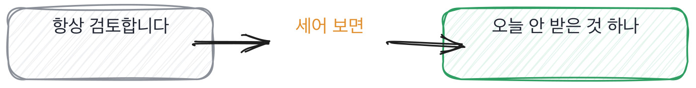

# 12.4 AI 를 쓰게 하고 무엇을 보는가

*[12.3](q041.md) 까지는 지원자 혼자 손을 썼죠. 이번엔 도구를 켜 놓고 같이 보게 합니다.*

> **이 말부터**
>
> **안 받은 것** 도구가 준 것 중에서 지원자가 버리거나 고쳐 쓴 부분을 말합니다.
>
> **받아쓰기** 준 것을 그대로 붙여 넣고 넘어가는 것을 말해요. 빠르고 아무것도 안 남습니다.

이 칸이 4단계의 한 문장입니다. 도구를 못 쓰게 막는 대신 쓰게 하고, 무엇을 안 받았는지를 봐요.
막는 쪽으로 가면 감시가 되고 감시는 서로를 지치게 합니다.
그리고 막아 봐야 회사에 들어오면 어차피 씁니다. 면접장에서만 못 쓰게 하는 셈이죠.

쓰게 하면 받은 결과물은 다들 비슷해집니다. 그래서 결과물로는 안 갈려요.
갈리는 자리는 하나입니다. **준 것 중에 무엇을 안 받았는가.**
안 받으려면 기준이 있어야 하고, 기준은 우리 데이터를 아는 사람에게만 있습니다.

과제는 이 책의 검색기에 중복 제거를 붙이는 겁니다. 도구가 흔히 내놓는 초안은 이렇게 생겼어요.
제목이 같으면 먼저 온 것을 남겨요.

```python
def dedup_by_title(chunks: list[Chunk], titles: dict[str, str]) -> list[Chunk]:
    """제목이 같으면 먼저 온 것만 남긴다. 초안 그대로다."""
    seen: set[str] = set()
    kept: list[Chunk] = []
    for chunk in chunks:
        title = titles.get(chunk.doc_id, "")
        if title in seen:
            continue
        seen.add(title)
        kept.append(chunk)
    return kept
```

틀린 코드가 아닙니다. 잘 돌고 테스트도 통과해요. 다만 우리 문서에서는 반대입니다.
개정본이 나중에 들어오거든요. **먼저 온 것을 남기면 옛 정책이 계속 나갑니다.**
이 한 자리를 잡아내는지가 이 칸의 전부입니다.

> **이렇게 답합니다**
>
> AI를 활용해 생산성을 크게 높이고 있습니다.
> 생성된 코드는 항상 검토 후 사용합니다.
> AI는 보조 도구일 뿐이고 최종 판단은 개발자의 몫이라고 생각합니다.
> 적절히 활용하면 좋은 결과를 얻을 수 있습니다.

네 줄이 다 옳은 말이고 네 줄 다 오늘 무엇을 했는지는 안 말합니다.

> **표시해 보면**
>
> AI를 활용해 생산성을 크게 높이고 있습니다.
>     ← 크게가 몇인지 없음
> 생성된 코드는 항상 검토 후 사용합니다.
>     ← 검토해서 무엇을 뺐는지가 없음
> AI는 보조 도구일 뿐이고 최종 판단은 개발자의 몫이라고 생각합니다.
>     ← 태도로 닫음. 실제로 내린 판단이 없음
> 적절히 활용하면 좋은 결과를 얻을 수 있습니다.
>     ← 아무것도 안 말함

첫 줄의 크게가 몇인지 없습니다. 둘째 줄이 이 답의 중심이에요.
항상 검토한다는 말인데 **검토해서 무엇을 뺐는지가 없습니다.**
셋째 줄은 태도로 닫고 넷째 줄은 적절히로 닫습니다. 둘 다 아무 일도 안 일어난 문장이에요.



> **이렇게 파고듭니다**
>
> 물음: 오늘 받은 것 중에 안 쓴 부분이 있어요?
>
> 답: 대부분 그대로 사용할 수 있는 수준이었습니다.

대부분 그대로 쓸 수 있었다는 답이 나오면 거기서 정해집니다. 안 받은 것이 없다는 뜻이니까요.
받아쓰기를 한 겁니다. 판단한 자리가 한 군데도 없습니다.

> **안 받은 자리가 나오면**
>
> 제목이 같으면 먼저 온 걸 남기는 코드를 줬는데 그건 안 받았습니다.
> 저희 문서는 개정본이 나중에 들어와서 반대로 남겨야 하거든요.
> 날짜를 같이 받아서 늦은 쪽을 남기는 걸로 바꿨습니다.
> 나머지는 거의 그대로 썼어요. 이름 두 개만 바꿨습니다.

첫 줄에 자리가 딱 나옵니다. 먼저 온 것을 남기는 코드를 안 받았다고 말하죠.
둘째 줄이 이유입니다. 우리 문서는 개정본이 나중에 들어오거든요.
**이 문장은 우리 데이터를 아는 사람만 씁니다.** 도구는 우리 문서를 모르거든요.

셋째 줄에서 고친 방법이 나오고, 넷째 줄에서 나머지는 거의 그대로 썼다고 말합니다.
저는 이 넷째 줄이 좋습니다. 도구를 깎아내리지도 않고 다 받았다고도 안 하거든요.
한 자리를 안 받았고 나머지는 받았다. [7.4](../07-g07/q026.md) 에서 갈랐던 그 손이 여기서도 보입니다.

> **한 번 더**
>
> 테스트도 시켰냐고 물으면 같은 자리가 한 번 더 보입니다.
> 테스트 코드도 AI가 생성해 줘서 커버리지를 빠르게 확보했습니다.
> 커버리지를 확보했다는 말인데 무엇을 덮었는지가 없습니다. 통과만 본 거예요.
> 반대쪽은 받은 테스트를 하나씩 깨 봤다고 말합니다. 하나가 안 깨져서 지웠다고요.

안 깨지는 테스트가 이 자리에서 자주 나옵니다. 함수를 부르기만 하고 비교를 안 하는 테스트요.
돌리면 초록불이 켜지니까 아무도 안 봅니다. **깨 보기 전에는 초록불이 다 똑같이 생겼어요.**
그래서 저는 테스트 개수를 안 묻고 깨 본 적을 묻습니다.

> **판정**
>
> 받은 것 중에 안 받은 자리를 하나 대고, 왜 안 받았는지가 우리 데이터 이야기로 나오면 통과입니다.
> 받은 테스트를 깨 봤다는 말이 나오면 아주 좋은 신호예요.
>
> 생산성이 올랐다거나 항상 검토한다고만 하고, 안 쓴 부분을 물어도 대부분 그대로 썼다고 하면
> 다음 라운드로 안 보냅니다. 도구를 안 썼다고 자랑하는 답도 같은 자리에 놓습니다.
>
> 기록에는 이렇게 적습니다. 먼저 온 판본을 남기는 초안을 안 받았고, 개정본이 나중에 들어온다는
> 우리 쪽 사정을 이유로 댔으며, 날짜를 받아 늦은 쪽을 남기는 것으로 고쳐 썼다고 말했다.

> **물을 문장 둘**
>
> 도구 이야기를 물으면 태도가 옵니다. 태도는 누구나 같은 말로 해요. 그래서 오늘을 묻습니다.
> 안 받은 자리를 하나 대면 왜 안 받았는지가 따라 나오고, 그 이유가 기준이 있는지를 말해 줍니다.
>
> **그대로 읽으세요.** *오늘 받은 것 중에 안 쓰신 부분이 있어요?*
>
> **답을 받으면 이어서.** *왜 그건 안 받으셨죠? 대신 뭘 하셨어요?*

> **이걸 놓치면**
>
> 안 받은 것을 못 물으면 [17.2](../17-g17/q057.md) 에서 질문을 바꾸는 이야기가 통째로 안 걸립니다.

