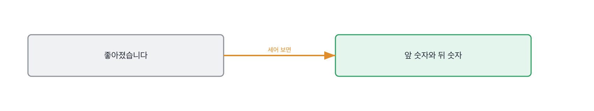
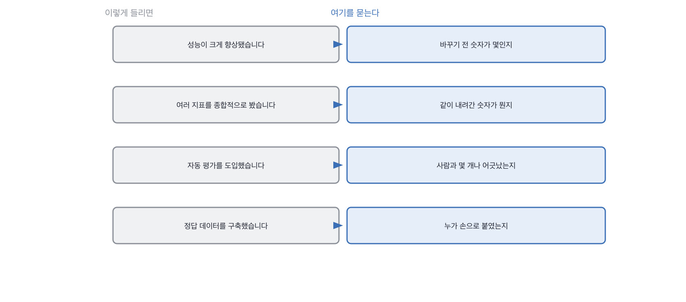

# 13장을 닫으며

## 한 관문을 닫으며

세 칸이 같은 질문을 세 번 했습니다. **무엇과 견줬느냐**고요.
바꾸기 전과 견주고, 같이 움직인 숫자와 견주고, 다른 심판과 견뎠습니다.
견주는 대상이 없는 숫자는 아무 말도 안 하는데, 숫자라서 뭔가 말하는 것처럼 들려요.

평가 이야기에서 제일 오래 속는 자리는 대시보드입니다.
숫자가 크게 찍혀 있고 선이 위로 가고 있으면 확인된 것처럼 느껴지거든요.
**그런데 화면에 있는 건 우리가 재기로 정한 것뿐입니다.** 안 재기로 한 것은 화면에 없어요.
그리고 대개 사고는 안 재기로 한 쪽에서 납니다.

평가 답변에서 자주 들리는 말과 그때 물을 자리를 짝으로 세우면 이렇게 됩니다.
왼쪽 넷은 다 통과되는 문장이고, 오른쪽을 한 번씩만 물으면 그 자리에서 갈려요.

평가 답변에서 자주 들리는 말과 그때 물을 자리를 짝으로 세우면 이렇게 됩니다.

> **저자의 삽질**
>
> 숫자를 여럿 들고 오면 잘 재 본 사람으로 읽힙니다. 저도 개수에 안심한 적이 많고요.
> 그런데 셋이 다 같은 방향을 보는 숫자면 그건 한 번 잰 겁니다.
> 견준 것으로 느껴지는데 견준 게 아니에요. 같은 걸 세 번 잰 거죠.

정답 목록을 만드는 일에 대해 한마디 더 하고 싶습니다. 이게 이 장에서 가장 안 물어지는 자리예요.
지표 이야기는 다들 하는데 그 지표가 딛고 선 목록 이야기는 아무도 안 합니다.
목록이 열 개짜리면 지표의 소수점 둘째 자리는 뜻이 없어요. **목록 크기가 지표의 해상도를 정합니다.**
그래서 저는 숫자를 듣기 전에 목록이 몇 개짜리냐고 먼저 묻습니다.

이 순서를 바꾸면 면접이 편해집니다. 목록 이야기부터 하면 지원자가 자기 숫자를 스스로 깎거든요.
목록이 다섯이라 못 믿는다는 문장이 지원자 입에서 먼저 나오면 그 뒤는 볼 것이 별로 없습니다.
그 문장 하나가 이미 재 본 사람이라는 표시니까요.

> **30초 점검**
>
> 바꾸기 전 숫자를 대는가. 값 하나면 됩니다.
> 정답 목록이 몇 개짜리인지 대는가. 그리고 누가 붙였는지 아는가.
> 한 번에 하나만 바꿨다고 말하는가.
> 오른 숫자 옆에 내려간 숫자를 같이 대는가.
> 심판을 썼다면 사람과 몇 개 어긋났는지 세어 봤는가.

이 장에서 나온 낱말 몇 개를 짚고 갑니다. 평가 이야기를 팀에서 나눌 때 쓰는 말들이에요.
셋 다 사람을 재는 자리에서 쓰는 말인데, 재는 방식이 이 장에서 다룬 것과 똑같습니다.
기준을 맞추고, 어긋난 데를 세고, 근거를 남기는 것이요.

> **채용 말 배우기**
>
> **캘리브레이션** 면접관들끼리 점수 기준을 맞추는 자리를 말합니다. 심판 맞추기와 같은 일이에요.
>
> **레벨링** 이 사람을 어느 연차 자리에 놓을지 정하는 것을 말합니다. 합격 판정과는 별개입니다.
>
> **시그널** 면접에서 얻은 판단 근거 하나를 말해요. 인상이 아니라 근거를 셀 때 씁니다.

옛 관행 하나를 재 봅니다. 과제에 채점표를 붙이던 관행인데, 이건 살릴 데가 있어요.
점수만 남기면 반년 뒤에 뜻을 모르는 게 문제이지, 채점표 자체가 나쁜 건 아닙니다.

> **옛 규칙은 아직 유효한가**
>
> **과제 채점표로 점수를 매기는 관행.** 판정은 조정해서 유효입니다.
> 근거는 제 경험이에요. 점수는 여전히 필요한데, 점수만 남기면 반년 뒤에 아무도 뜻을 모릅니다.
> 그래서 저는 점수 옆에 **어긋난 자리**를 같이 적습니다. 면접관 둘이 다르게 매긴 항목이요.
> 어긋난 자리가 다음 캘리브레이션의 안건이 되고, 그게 채점표를 실제로 고칩니다.

다음 장은 설계입니다. 지금까지는 만든 것과 잰 것을 봤어요.
이제 그림을 그리게 하고 어디에 선을 그었는지를 봅니다. 선은 안 그은 자리가 더 많이 말합니다.

평가 이야기를 들을 때 제가 실제로 하는 것을 하나 더 적어 둡니다.

> **현장에서는**
>
> 저는 숫자를 듣기 전에 정답 목록이 몇 개짜리냐고 먼저 묻습니다. 순서를 바꾼 거예요.
> 목록 이야기부터 하면 지원자가 자기 숫자를 스스로 깎습니다. 그 문장이 나오면 볼 게 별로 없어요.

이 관문에서 속기 쉬운 자리를 하나 짚습니다. 숫자가 여럿이면 잘 잰 것처럼 보이는 자리요.
개수가 아니라 방향이 중요한데, 개수가 눈에 먼저 들어옵니다.
같이 오르는 숫자 셋은 한 번 잰 겁니다. 서로 당기는 둘이라야 견준 거예요.

> **여기서 다들 속는다**
>
> 숫자가 셋 나오면 잘 재 본 것처럼 보입니다. 하나보다 셋이 든든하니까요.
> 그런데 셋이 같은 방향을 보는 숫자면 그건 한 번 잰 겁니다. 개수가 아니라 방향이 중요해요.
> 견줬다는 건 서로 당기는 둘을 봤다는 뜻입니다. 같이 오르는 셋은 견준 게 아닙니다.
> 확인은 반대쪽을 물으면 됩니다. 그때 내려간 숫자가 뭐냐고요.

심판을 맞춰 보는 일에 되돌이가 하나 있습니다. 그 이야기를 하고 닫겠습니다.
푸는 방법이 있는데, 그 방법이 18장에서 면접관들끼리 하는 일과 똑같습니다.

> **쉬어 가기**
>
> **쉬어 가기: 심판을 심판하는 일**
>
> 답변에 점수를 매기는 일을 모델에 시키는 게 이제 흔합니다. 저도 그렇게 합니다.
> 사람이 매기면 느리고 비싸고, 무엇보다 사람마다 다르거든요.
>
> 그런데 여기에 재미있는 되돌이가 하나 있습니다.
> 모델 심판을 쓰는 이유가 사람이 일관되지 않아서인데, 모델 심판이 맞는지 확인하려면
> 결국 사람이 매긴 것과 맞춰 봐야 합니다. 일관되지 않다던 그 사람 말이죠.
>
> 이 되돌이를 푸는 방법은 하나입니다. 사람을 정답으로 두지 않고 **어긋난 자리를 재료로** 쓰는 것.
> 사람과 심판이 어긋난 여덟 건을 모아 놓고 읽으면, 어느 쪽이 틀렸는지가 아니라
> *기준이 어디서 흐린지*가 보입니다.
>
> 이 책의 과제에서 어긋난 넷 중 셋이 같은 모양이었던 게 그 예입니다.
> 길고 숫자가 든 틀린 답이요. 그건 심판이 틀린 거였습니다.
> 반대로 셋이 제각각이었다면 그건 사람 기준이 흐린 거고요.
>
> 그러니까 심판을 맞춰 보는 일은 심판을 채점하는 일이 아니라 **기준을 고치는 일**입니다.
> 그래서 한 번 하고 끝나는 게 아니라 계속 합니다. 기준은 계속 흐려지거든요.
> 18장에서 면접관들끼리 이걸 하는 이야기가 나옵니다. 같은 일입니다.

긴 이야기는 여기까지입니다. 평가 자리에서 들고 갈 것을 다섯 줄로 접으면 이렇게 됩니다.
무엇과 견줬느냐를 다섯 번 다르게 묻는 것이 이 관문이었습니다.

> **한 관문 요약**
>
> 좋아졌다는 말은 앞 숫자가 없으면 아무 말도 아닙니다. 바꾸기 전 값을 받으세요.
>
> 지표를 딛고 선 정답 목록이 몇 개짜리인지를 먼저 묻습니다. 목록이 해상도를 정합니다.
>
> 하나가 오르면 대개 다른 하나가 내려갑니다. 안 내려갔다는 답은 한 번만 잰 답입니다.
>
> 심판이 사람과 얼마나 어긋났는지는 건수로만 답할 수 있습니다. 경향이라는 답은 안 세어 본 답이에요.
>
> 다음 관문에서 뒤집히는 것. 잰 것을 보던 자리에서 어디에 선을 그었는지를 보는 자리로 넘어갑니다.

> **이 판정이 헐거운 지점**
>
> 평가 조직이 따로 있는 회사에서 온 사람은 앞 숫자를 남이 만들어 줬을 수 있습니다.
>
> 심판을 사람과 맞춰 보는 일은 표본이 작을 때만 쉽습니다. 큰 데서 온 사람에게는 불리해요.
>
> 어긋남을 세는 방식은 여럿인데 저는 건수만 씁니다. 이게 맞는 방식인지는 확신 못 합니다.
